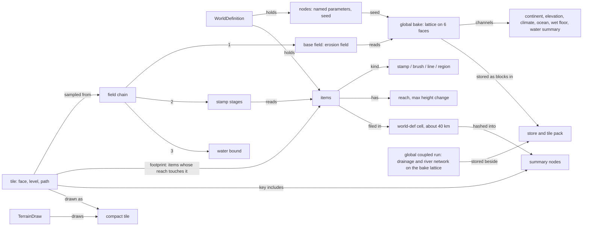
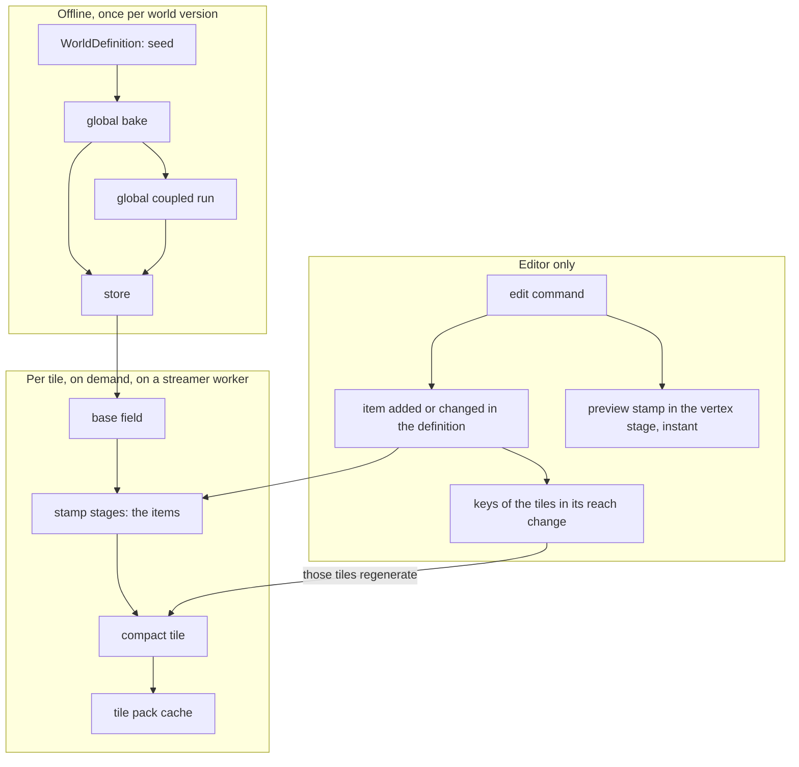
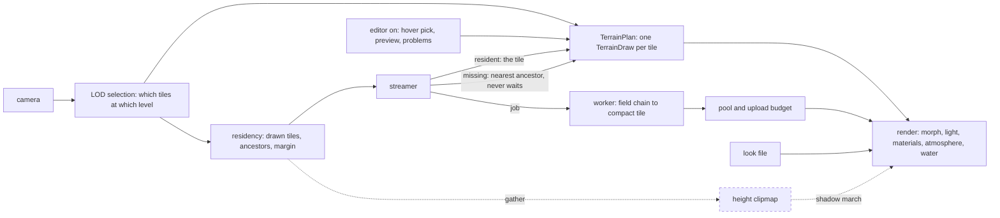

# Domain glossary

The project's shared language: what each term means, its shape, who owns it and its status. Status: evergreen; maintained by the architect (owner, 2026-10-30), other sessions propose changes in their PRs. Facts and file references of the first version: `spikes/domain-glossary/results/facts.md` (SPIKE-39). Rules for keeping it current: section 7.

Status of a term:
| Status | Meaning |
|---|---|
| accepted | decided by an accepted ADR or spec; in the code or planned for it |
| proposed | named by a proposed ADR, a spike or an open change; not yet a decision |
| retiring | decided to leave (an accepted ADR or owner decision) but still in the code; new work does not use it |
| retired | gone from the code; listed only in section 8 (non-normative) |

## 1. The pictures
Dashed boxes are accepted but not built yet.

### 1a. Semantic model: what relates to what

### 1b. Generation pipeline, with edits

### 1c. Runtime model: one frame

The editor changes items in the WorldDefinition; the keys of the tiles those items reach change, so those tiles are generated again. Until they arrive, the edit shows as a preview in the vertex stage (editor only). Shadows today come from horizon maps (retiring); ADR 0085 replaces them with the height clipmap march.

## 2. The grids (the most common confusion)
| Grid | What it is | Size | Fixed or by LOD | Status |
|---|---|---|---|---|
| Cube-sphere face | one of six faces; a point is `(face, s, t)` | face edge 10,008 km on Earth | fixed | accepted |
| Tile | a square of the quadtree on a face, addressed by `TileId` (face, level, path) | edge 10,008 km / 2^level; 32 cells, 33 x 33 samples; level 3 = 1,251 km, level 22 = 2.4 m | **by LOD**: the plan picks the level per view | accepted |
| Bake lattice cell | one interval of the global bake's grid | `res` cells per face edge: 16,384 in the store (611 m), at most 1,024 in memory | fixed per world | accepted |
| Bake storage block | a tile-shaped piece of the bake lattice, the unit the store reads and writes | up to 1,024 cells per edge | fixed | accepted |
| World-def cell | a tile at one fixed level (8 on Earth) used to index items | about 40 km | fixed | accepted |
| Height clipmap level | a camera-centred square raster of terrain heights, curvature applied on the CPU, with max mips; 10 to 12 levels, each twice the extent of the last (ADR 0085) | 1024 x 1024 texels per level | by camera position, not by LOD | accepted, not built |
| Chunk | a fixed square of whole bake cells (the area of a level-11 tile, about 5 km); the A-net erosion stage that ran on it is removed after M8 (owner, 2026-10-29); the lattice stays only as the horizon maps' key until ADR 0085's build | 5 km | fixed: never by LOD | retiring |

A tile is what the camera sees and changes with distance; a fixed grid (CON-08's "chunk of a fixed grid") is a piece of the world generated once with its surroundings. CON-08 keeps the generic notion; no regional stage uses it after the chunk stage is removed. "Parcel" is reserved for later concepts (cities).

## 3. Terms
| Term | Meaning | Owner | Status |
|---|---|---|---|
| WorldDefinition | the single source of truth (CON-05): seed, parameters as named nodes, authored items | world-def | accepted |
| node (definition) | one named parameter of the definition, e.g. `body.0.radius_m` | world-def | accepted |
| item | one authored edit: a stamp, brush, line or region, anchored at lat, lon, with a reach and a maximum height change | world-def | accepted |
| stamp | an item with a shape (hill, crater, plateau, ridge, channel, region) and up to three size parameters | world-def | accepted |
| brush | a stamp made of strokes (raise, lower, smooth, flatten) | world-def, editor | accepted |
| line | a ridge or channel stamp along 2 to 64 points | world-def | accepted |
| region | a closed polygon with a surface type; no height of its own; can mask other layers | world-def | accepted |
| reach | the distance beyond which an item changes nothing | world-def | accepted |
| footprint | the items whose reach touches a tile | world-def | accepted |
| summary node | a hash over the items in a quadtree cell; makes coarse tiles' keys change when an item inside changes | world-def | accepted |
| global bake | the planet-wide coarse lattice, a pure function of the seed (channels in section 1) | generators, cache | accepted |
| global coupled run | drainage and the river network over time on the bake lattice, stored beside the bake (ADR 0077) | generators | accepted |
| store | a directory holding a stored bake, its coupled run and pre-filled coarse tiles | cache | accepted |
| tile pack | append-only file of cached records (tiles, bake blocks) keyed by cache key | cache | accepted |
| cache key | a hash of everything a result depends on: field, version, implementation, read set, upstream keys | cache, generators | accepted |
| field | a pure function from a direction on the sphere to a value (height in metres for `HeightField`) | generators | accepted |
| HeightField | the interface every height function implements: value, key parts, bounds | generators | accepted |
| erosion field | the default base field: bake elevation plus ridged creases where the bake is steep | generators | accepted |
| stamp stage | adds one layer's items to a base field, stamps then lines | generators | accepted |
| field chain | base field, then stamp stages per layer, then the water bound; assembled in `app` today (SPIKE-37) | generators, app | accepted |
| stage | global-coarse, regional or local (CON-08); in production only the global-coarse graph is registered | generators | accepted |
| scope, halo | where a stage output lives (global or per tile) and how far beyond the tile it computes | generators | accepted |
| implementation id | the name of the one implementation of a field layer (CON-07), part of every key | generators | accepted |
| compact tile | the drawn form of a tile: quantised heights, normals, nine control points, a 9 x 9 climate block | generators, cache | accepted |
| LOD selection | picks the tiles to draw so that sample spacing stays under a pixel bound; neighbours differ by at most one level | frame | accepted |
| morph | the blend of a tile's vertices towards its parent's grid with distance, so levels change without pops | frame, render | accepted |
| TerrainPlan, TerrainDraw | the production frame plan and its per-tile record (CON-03). `FramePlan` and `TileDraw` are the M1 debug plan | frame | accepted |
| residency | the tiles that should be loaded: the drawn set, their ancestors and a margin; independent of the view direction | frame | accepted |
| streamer | fetches or generates tiles, parent first, and answers with the nearest resident ancestor until a tile arrives (CON-22) | streaming | accepted |
| pool, upload | GPU slots for compact tiles; a per-frame byte budget for uploads | streaming, frame | accepted |
| preview stamp | an edit being dragged, drawn in the vertex stage on stale tiles until they regenerate (REND-033); a stale tile takes the delta only while it still holds the state it had when the preview began (REND-045) | frame, render | accepted |
| look file | presentation parameters per body (exposure, materials' curves); outside the definition and every key | frame | accepted |
| presentation data | what the GPU derives only for display (shading, atmosphere, water surface); no CPU twin (CON-14) | render | accepted |
| material weights | per pixel shares of rock, sand, grass and soil from slope, height, climate and surface type | frame (reference), render | accepted |
| horizon map | per-chunk tables of the horizon angle used for terrain shadows, with a coarse horizon from the coupled run for far terrain (GEN-044/045, REND-038) | generators, streaming, render | retiring (ADR 0085) |
| shadow march | per-pixel ray march toward the sun over the height clipmap, at half resolution, with a penumbra from the closest approach to the sun's disc (ADR 0085 layer 1) | render, frame | accepted, not built |
| cascaded shadow maps | shadows cast by objects, near the camera (ADR 0085 layer 2) | render | accepted, not built |
| compute share, reserve | a subsystem's budget of main-thread time, GPU time, cores and memory per frame; a reserve is a share held for a subsystem not built yet (ADR 0083, BUDG-001 to BUDG-007) | perf, frame | accepted, not built |
| job system | the one worker pool with priority classes that every background job runs on (ADR 0083, BUDG-004) | streaming | accepted, not built |
| perf window | a measurement on Rasierklinge with the other lanes stopped, authorised by the architect (ADR 0020) | perf | accepted |
| loaded pass | a perf verdict taken while other work runs, valid only as a pass with margin (SPIKE-58) | perf | proposed |
| driver map | a physical field (soil depth, wetness, drainage) that materials and plants read through suitability rules (ADR 0076); the chunk stage's driver channels leave with it, M9 re-adds drivers from the stored bake | generators, render | proposed |
| coarse valley carve | a valley cut into the base field along the coupled run's network (ADR 0084) | generators | proposed |
| terrain descriptor, scorecard | measures of a terrain's form (slope, curvatures, relief, TPI, geomorphons, drainage density) compared against real elevation data (SPIKE-57) | tools | proposed |

## 4. Same word, different things
| Word | Meanings |
|---|---|
| block | the bake's storage unit; a former name of the chunk (section 8) |
| cell | a bake lattice interval; a world-def index cell (about 40 km); a tile has 32 cells per edge |
| chunk | CON-08's generic fixed-grid unit; the 5 km lattice that keys horizon maps (retiring); in old ADRs and logs, the A-net erosion unit (retired, section 8) |
| node | a definition parameter; a summary hash node; a selected LOD node (a drawn tile) |
| summary | the item hash tree; the bake's water summary channel; the editor's health summary |
| plan | `TerrainPlan` (production); `FramePlan` (M1 debug views) |
| window | the editor or viewer window; a perf window (section 3) |

## 5. What runs where
| When | What | Editor-off viewer |
|---|---|---|
| Offline, once per world | global bake and its channels, the global coupled run, store, pre-filled coarse tiles | reads the results |
| Per tile, on demand | the field chain sampled into a compact tile | yes |
| Per frame, CPU | LOD selection, plan, residency, streaming, water selection | yes |
| Per frame, GPU | morph, lighting, materials, ground detail, atmosphere, water, shadows | yes |
| Editor only | commands and undo, preview stamps, hover and drag picking, problems list, regions overlay, edit markers | no |

## 6. Edits and erosion
No erosion runs after the edits today: the chunk stage that did is removed (owner, 2026-10-29). Edits are stamped on the base field. Where an edit should sit relative to erosion (decision D3, owner 2026-10-26: edits under the erosion by default) is on M9's deferred list and is decided again with M9's erosion design.

## 7. Keeping it current
- The architect keeps this file current (owner, 2026-10-30). An ADR, spec or change that adds, renames or retires a term updates this file in the same PR; the architect checks it at each milestone (housekeeping skill).
- A new term enters as **proposed** with its source (ADR, spike, change) and becomes **accepted** with the ADR or spec that decides it.
- A term decided to leave becomes **retiring**, naming the decision. When its code is gone it moves to section 8 as **retired**, and the code, specs and active docs stop using it: identifiers, file names, flags and comments are renamed in the removal PRs (e.g. the horizon code's "chunk" names).
- One meaning per new term; a homonym goes into section 4 until it is renamed.
- A rename lists the former name in section 8; ADRs follow it under ADR 0078.
- `Owner` names crates.

## 8. Former terms (non-normative)
History for reading old ADRs, logs and spike results. Nothing here describes the current system; never use these terms in new specs or code. Rows marked *code removal pending* are still in the code until the chunk-stage removal (B6, `openspec/changes/remove-chunk-stage/`) lands; they are listed here already because no new work may use them.
| Former term | What it was | Left | Now |
|---|---|---|---|
| chunk stage, A-net erosion | fine erosion and river routing per 5 km chunk on a 4 to 10 m raster, on top of the base field (ADR 0077 points on regional stages, GEN-036 to GEN-078) | off by default 2026-10-28; removed after M8 (owner, 2026-10-29); *code removal pending* | M9's erosion design (bake-side erosion; SPIKE-57) |
| chunk erosion order (D3: `Under`, `OnTop`) | where the chunk stage ran relative to the edits | with the chunk stage; *code removal pending* | section 6 |
| chunk re-solve | re-running the chunks an edit touched (STRM-056, GEN-081, GEN-082, GEN-087) | with the chunk stage; *code removal pending* | none; M9 deferred list |
| chunk fade, stand-in share | the 1.5 s fade of a landing chunk's change and the plan's share of stand-in tiles (REND-039, STRM-052) | with the chunk stage; *code removal pending* | none |
| block (regional square) | the first name of the chunk (SPIKE-34) | renamed 2026-10-23 | chunk, then retired |
| hydrology chunks | informal name for the chunk stage's river and erosion work | with the chunk stage; *code removal pending* | the global coupled run's network; M9 channels |
