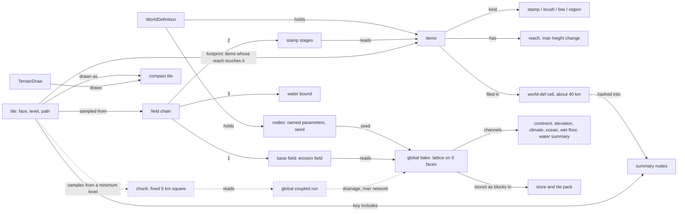
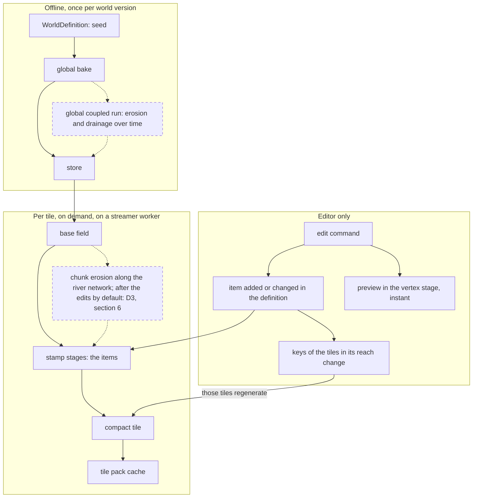
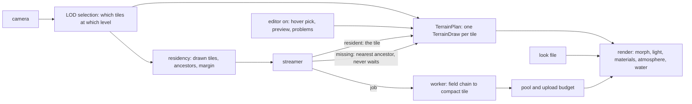

# Domain glossary

The project's shared language: what each term means, its shape, who owns it and when it exists. Status: evergreen (owner, 2026-10-23). Facts and file references: `spikes/domain-glossary/results/facts.md` (SPIKE-39). Rules for keeping it current: the last section.

## 1. The pictures
GitHub renders these diagrams in the browser; dashed boxes and dotted lines are planned for M8.

### 1a. Semantic model: what relates to what

### 1b. Generation pipeline, with edits

### 1c. Runtime model: one frame

The editor changes items in the WorldDefinition; the keys of the tiles those items reach change, so those tiles are generated again. Until they arrive, the edit shows as a preview in the vertex stage (editor only).

## 2. The grids (the most common confusion)
| Grid | What it is | Size | Fixed or by LOD | Lives |
|---|---|---|---|---|
| Cube-sphere face | one of six faces; a point is `(face, s, t)` | face edge 10,008 km on Earth | fixed | everywhere (core) |
| Tile | a square of the quadtree on a face, addressed by `TileId` (face, level, path) | edge 10,008 km / 2^level; 32 cells, 33 x 33 samples; level 3 = 1,251 km, level 22 = 2.4 m | **by LOD**: the plan picks the level per view | generated per view, cached |
| Bake lattice cell | one interval of the global bake's grid | `res` cells per face edge: 16,384 in the store (611 m), at most 1,024 in memory | fixed per world | offline, stored |
| Bake storage block | a tile-shaped piece of the bake lattice, the unit the store reads and writes | up to 1,024 cells per edge | fixed | cache records |
| World-def cell | a tile at one fixed level (8 on Earth) used to index items | about 40 km | fixed | with the definition |
| Chunk (planned, ADR 0077; former: block) | a fixed square of whole bake cells on which a regional process runs, with its own fine raster | 5 km, raster 4 to 10 m | fixed: never by LOD; tiles from a minimum level sample it | M8, generated on demand, cached |
**Chunk, not tile (owner, 2026-10-23):** a tile is what the camera sees and changes with distance; a chunk is a fixed piece of the world that is generated once, with its surroundings, and that tiles read from. "Parcel" is reserved for later concepts (cities).

## 3. Terms
| Term | Meaning | Owner | Exists |
|---|---|---|---|
| WorldDefinition | the single source of truth (CON-05): seed, parameters as named nodes, authored items | world-def | per world file |
| node (definition) | one named parameter of the definition, e.g. `body.0.radius_m` | world-def | per world file |
| item | one authored edit: a stamp, brush, line or region, anchored at lat, lon, with a reach and a maximum height change | world-def | per world file |
| stamp | an item with a shape (hill, crater, plateau, ridge, channel, region) and up to three size parameters | world-def | with the item |
| brush | a stamp made of strokes (raise, lower, smooth, flatten) | world-def, editor | with the item |
| line | a ridge or channel stamp along 2 to 64 points | world-def | with the item |
| region | a closed polygon with a surface type; no height of its own; can mask other layers | world-def | with the item |
| reach | the distance beyond which an item changes nothing | world-def | with the item |
| footprint | the items whose reach touches a tile | world-def | per tile query |
| summary node | a hash over the items in a quadtree cell; makes coarse tiles' keys change when an item inside changes | world-def | with the definition |
| global bake | the planet-wide coarse lattice, a pure function of the seed (channels in section 1) | generators, cache | offline |
| store | a directory holding a stored bake and pre-filled coarse tiles | cache | offline |
| tile pack | append-only file of cached records (tiles, bake blocks) keyed by cache key | cache | offline and per run |
| cache key | a hash of everything a result depends on: field, version, implementation, read set, upstream keys | cache, generators | per tile |
| field | a pure function from a direction on the sphere to a value (height in metres for `HeightField`) | generators | built per use |
| HeightField | the interface every height function implements: value, key parts, bounds | generators | per use |
| erosion field | the default base field: bake elevation plus ridged creases where the bake is steep | generators | per use |
| stamp stage | adds one layer's items to a base field, stamps then lines | generators | per use |
| field chain | base field, then stamp stages per layer, then the water bound; assembled in `app` today (SPIKE-37) | generators, app | per tile job |
| stage | global-coarse, regional or local (CON-08); in production only the global-coarse graph is registered | generators | static |
| scope, halo | where a stage output lives (global or per tile) and how far beyond the tile it computes | generators | static |
| implementation id | the name of the one implementation of a field layer (CON-07), part of every key | generators | static |
| compact tile | the drawn form of a tile: quantised heights, normals, nine control points, a 9 x 9 climate block | generators, cache | per tile |
| LOD selection | picks the tiles to draw so that sample spacing stays under a pixel bound; neighbours differ by at most one level | frame | per plan |
| morph | the blend of a tile's vertices towards its parent's grid with distance, so levels change without pops | frame, render | per frame |
| TerrainPlan, TerrainDraw | the production frame plan and its per-tile record (CON-03). `FramePlan` and `TileDraw` are the M1 debug plan | frame | per frame |
| residency | the tiles that should be loaded: the drawn set, their ancestors and a margin | frame | per plan |
| streamer | fetches or generates tiles, parent first, and answers with the nearest resident ancestor until a tile arrives (CON-22) | streaming | per run |
| pool, upload | GPU slots for compact tiles; a per-frame byte budget for uploads | streaming, frame | per run |
| look file | presentation parameters per body (exposure, materials' curves); outside the definition and every key | frame | per run |
| presentation data | what the GPU derives only for display (shading, atmosphere, water surface); no CPU twin (CON-14) | render | per frame |
| material weights | per pixel shares of rock, sand, grass and soil from slope, height, climate and surface type | frame (reference), render | per pixel |
| driver map (planned, ADR 0076) | a physical field (drainage, soil depth, wetness) that materials and plants read through suitability rules | — | M8 |
| global coupled run (planned, ADR 0077) | erosion and drainage over time on the bake lattice; fixes heights, drainage area and the river network | — | M8, offline |
| chunk (planned, ADR 0077; former: block) | a fixed square of ground (the area of a level-11 tile, about 5 km) on which a regional stage, such as fine erosion, runs once with a halo of its surroundings; tiles from a minimum level read their heights from it; never by LOD | generators, cache, streaming | M8, on demand, cached |

## 4. Same word, different things
| Word | Meanings |
|---|---|
| block | the bake's storage unit in the code; ADR 0077's regional square is now the chunk |
| cell | a bake lattice interval; a world-def index cell (about 40 km); a tile has 32 cells per edge |
| node | a definition parameter; a summary hash node; a selected LOD node (a drawn tile) |
| summary | the item hash tree; the bake's water summary channel; the editor's health summary |
| plan | `TerrainPlan` (production); `FramePlan` (M1 debug views) |

## 5. What runs where
| When | What | Editor-off viewer |
|---|---|---|
| Offline, once per world | global bake and its channels, store, pre-filled coarse tiles; M8: the global coupled run | reads the results |
| Per tile, on demand | the field chain sampled into a compact tile; M8: chunks (on demand, cached; D7) | yes |
| Per frame, CPU | LOD selection, plan, residency, streaming, water selection | yes |
| Per frame, GPU | morph, lighting, materials, ground detail, atmosphere, water | yes |
| Editor only | commands and undo, preview stamps, hover and drag picking, problems list, regions overlay, edit markers | no |

## 6. Where an edit sits relative to erosion (decision D3, owner 2026-10-26)
The chain is `base field (bake) -> stamp stages (edits) -> chunk stage (erosion along the river network)` by default (`Under`, GEN-039). The chunk stage's place was decision D3:
| Order | Effect |
|---|---|
| `bake -> chunk erosion -> edits` | an edit is a shape on top of eroded ground: instant, but never weathered |
| `bake -> edits -> chunk erosion` | an edit is weathered like the land around it: rivers cut through it; each edit re-runs its chunks (seconds) |
Chosen: the second row is the default (`Under`); `OnTop` stays a per-layer setting. The chunks an edit re-keys are those whose read set it touches (GEN-081, GEN-082).

## 7. Keeping it current
- An ADR, spec or change that adds, renames or retires a term updates this file in the same PR.
- `Owner` names crates; the housekeeping skill checks this file at each milestone.
- One meaning per new term; a homonym goes into section 4 until it is renamed.
- A rename lists the former name in the term's row ("former: block"); ADRs follow it under ADR 0078.
