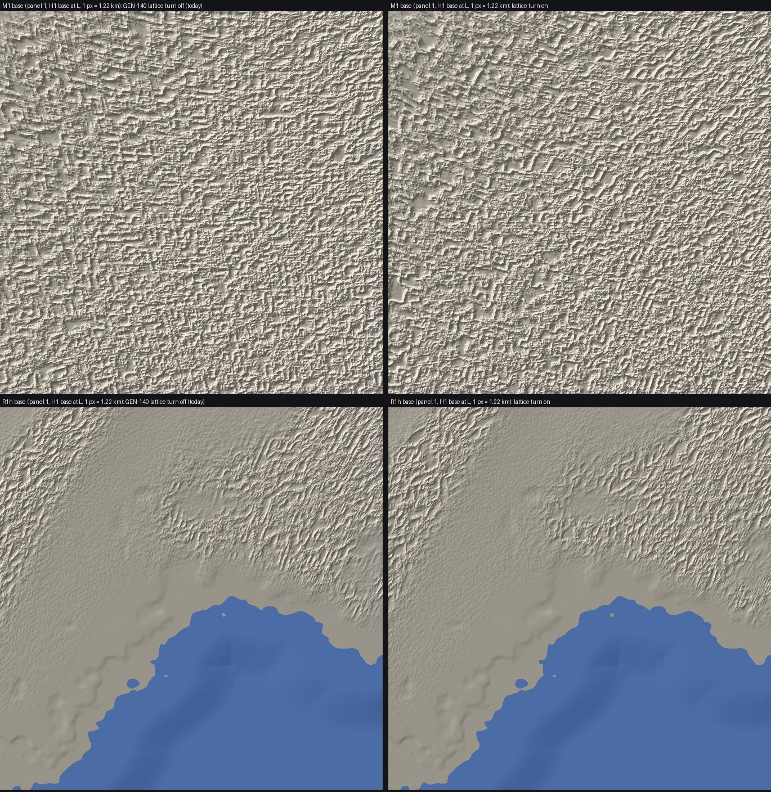

Opened: 2026-11-18
Question: Why is M1's base an even, worm-like noise with lumps along the grid axes and no ranges, main ridges or larger valleys, and which stage would give it mountain structure?
Why it matters: the owner's finding on g1f5-m1 before G2 (lead #167); the river graph is built on this base.
Time box: half a day of agent work.
Success criteria: the lattice turn and the face metric measured on the windows; M1's base against GLO-30 mountain tiles in numbers; the share of M1's closed basins the base explains; a cost estimate. No build.
Fallback if it fails: report the measures that do not separate M1 from real mountains.
Code location: `spike/rg-prototype` (`rg_chain --noise turned | axis`, explorer's 3582b14e after crusader's 0b648824); analysis scripts in `raw/`.

# SPIKE-140: the base's noise and M1's missing mountain structure

Runs:
- the chain runner's base on M1 and R1h, with GEN-140's lattice turn off (the chain run before reading 30) and on (later stages skipped);
- the measures on the base's L dump (`base.f32`, the H1 base read at L, 101.8 m cells) and on `S0`, in the counted box (L cells 1600-6560);
- GLO-30 tiles block-averaged to about 100 m, one 100 km square each.

Produced using Copernicus WorldDEM-30 © DLR e.V. 2010-2014 and © Airbus Defence and Space GmbH 2014-2018 provided under COPERNICUS by the European Union and ESA; all rights reserved. The organisations in charge of the Copernicus programme by law or by delegation do not incur any liability for any use of the Copernicus WorldDEM-30.

## 1. The lattice turn (GEN-140)
- The switch is a process flag, `planet_generators::height::set_turned_noise`, off by default. The chain runner never set it, so every chain run before reading 30 had the axis-aligned lattice.
- The measure: the base's 2-D power spectrum (plane removed, Hann taper), and the share of the power within 5 deg of the grid axes. An isotropic field has 11-15 % there.

| Base | 0.8-3.3 km | 3.3-13 km | 13-52 km | 52-208 km | Gradient anisotropy, grid / metric-corrected |
|---|---|---|---|---|---|
| M1, turn off | 22.1 % | 28.1 % | 12.3 % | 12.6 % | 0.22 / 0.10 |
| M1, turn on | 11.6 % | 12.6 % | 11.8 % | 13.1 % | 0.22 / 0.10 |
| R1h, turn off | 9.6 % | 8.6 % | 9.2 % | 27.9 % | 0.39 / 0.50 |
| R1h, turn on | 10.2 % | 10.9 % | 11.1 % | 30.5 % | 0.42 / 0.51 |

- **M1, turn off:** 2-2.5 times the isotropic share at 0.8-13 km. These are the "bricks" at the top left (Visuals).
- **M1, turn on:** the axis share falls to the isotropic one at every scale.
- **R1h:** its band noise is weak, so the lattice does not show. Its anisotropy of about 0.4 runs at 28 deg, along its belt, and its 52-208 km axis share is the coast.
- **Reading:** the axis-aligned lumps are the unturned lattice, not the face warp. Reading 30 (lead, 2026-11-18) turns the lattice on in the chain runner.

## 2. The face metric
Cell edge lengths along both axes at the corners of each window (regional cells, 200-cell margin included; great-circle distance between neighbouring centres, equiangular map):

| Window | Face | x-edge / y-edge | x-edge (m) | y-edge (m) |
|---|---|---|---|---|
| R1h | 1 | 0.77-0.89 | 628-705 | 794-811 |
| R3a | 4 | 1.21-1.38 | 809-814 | 590-666 |
| R3b | 2 | 1.04-1.17 | 778-805 | 688-749 |
| M1 | 4 | 0.81-0.89 | 662-722 | 808-814 |
| F1 | 4 | 0.93-0.99 | 754-789 | 801-813 |

- The ratio changes 6-13 % across one window.
- K5 and H1 run on the physical metric: `Grid::with_metric(Metric::cube_face)` and `CarveParams.cell_metric = true` (GEN-138; `region_bake.rs`).
- The L stages (KS, KG-trib, KV, KC) and the gate use uniform cells.
- On M1 the metric accounts for about half the gradient anisotropy (0.22 to 0.10, table of section 1). It does not account for the axis-aligned spectrum. The turn changes the spectrum, and the metric correction does not.

## 3. M1's base against mountain terrain
One 100 km square at 100 m per row. For M1, three squares (centre, upper left, lower right of the box) of the base and of `S0`.

| Terrain | Relief 1 km p50 / p95 (m) | Relief 5 km | Relief 25 km | Variation of the 5 km relief over 25 km blocks (CV) | Closed basins (> 0.5 m, >= 16 cells) | Power at 10-50 km of 1-50 km | Local ridge coherence | Direction consistency | Main-valley spacing |
|---|---|---|---|---|---|---|---|---|---|
| Alps N47E011 | 108 / 611 | 554 / 1351 | 1199 / 1884 | 0.62 | 5.7 % | 54 % | 0.45 | 0.32 | 13.7 km |
| Himalaya N27E086 | 514 / 905 | 1644 / 2621 | 3966 / 5499 | 0.17 | 0.3 % | 81 % | 0.39 | 0.43 | 15.1 km |
| Appalachian Valley and Ridge N40W078 | 110 / 280 | 351 / 488 | 544 / 603 | 0.12 | 3.4 % | 55 % | 0.80 | 0.87 | 16.3 km |
| Scottish Highlands N57W005 | 107 / 298 | 384 / 694 | 974 / 1042 | 0.18 | 1.2 % | 68 % | 0.43 | 0.30 | 16.4 km |
| Black Forest N48E008 | 80 / 275 | 235 / 644 | 764 / 1039 | 0.43 | 3.3 % | 80 % | 0.47 | 0.27 | 17.6 km |
| M1 base, turn off (3 squares) | 285-377 / 670-803 | 1318-1602 / 2242-2580 | 3147-3310 / 3422-3576 | 0.11-0.13 | 38.5-44.5 % | 86-91 % | 0.45-0.57 | 0.06-0.55 | 14.4-17.7 km |
| M1 base, turn on | 308-366 / 734-838 | 1376-1583 / 2437-2676 | 3080-3365 / 3473-3540 | 0.11-0.13 | 39.4-47.1 % | 82-91 % | 0.47-0.56 | 0.24-0.64 | 16.0-17.5 km |
| M1 `S0`, turn off | 324-404 / 867-951 | 1396-1710 / 2502-2584 | 3081-3191 / 3223-3459 | 0.12-0.17 | 11.7-18.2 % | 78-86 % | 0.47-0.56 | 0.10-0.50 | 14.9-17.6 km |

Measures:
- relief: the range in a square of the given size around sampled cells;
- CV: the standard deviation of the 25 km block means of the 5 km relief over their mean;
- local ridge coherence: the mean anisotropy of the gradient's structure tensor in 10 km blocks after a 2 km smoothing;
- direction consistency: the length of the blocks' mean doubled-angle vector;
- main-valley spacing: the median distance between minima of a 5 km smoothed profile.

What M1's base lacks:
1. **A drained valley network.** 38-47 % of M1's base land lies in closed basins, against 0.3-5.7 % on the five tiles. The base is noise that no drainage has shaped; K5 and the drains leave 12-18 % in `S0` (section 4).
2. **A relief hierarchy across 25-100 km.**
   - M1's 5 km relief is the same over the whole square, with a CV of 0.11-0.13. The Alps have 0.62 and the Black Forest 0.43: high ranges beside broad low valleys.
   - M1's 25 km relief holds at 3.1-3.4 km in every square. That is Himalaya amplitude everywhere, with no lower country between ranges.
3. **Not lacking at these measures:**
   - ridge coherence (0.45-0.57 against 0.39-0.80);
   - main-valley spacing (14-18 km against 14-18 km);
   - the share of power at range scale (high in M1 and the Himalaya).
   The base has ridges at range spacing, but no ranges that differ from their surroundings.
4. **Not measured:**
   - range length, which a 100 km tile is too small for;
   - the ridge-crest hierarchy, because a crest-line extraction does not exist.

Which stage would make it:

| Missing | Stage | What would change | Cost (agent work; not built) |
|---|---|---|---|
| Relief hierarchy across a belt | Plate mask GEN-094 and class amplitudes GEN-097 | the mountain band's amplitude modulated at 25-100 km inside a belt: ranges along the belt's strike, from the margin distance and the strike factor the mask already has, and lower country between them | 2-3 PRs (spec delta to GEN-094 or GEN-097, the field, its bounds, the class-blend tests, re-baked previews); bake keys change; 2-3 days |
| Ranges along the strike | Mountain band noise (`ClassSource::elevation_m_with`, ridged octaves) | ridged octaves stretched along the belt's strike direction instead of isotropic | 1-2 PRs within the same field; 1-2 days, after the hierarchy |
| A drained valley network | K5 (GEN-123 uplift, carve) | carve time or uplift raised in belt cores so K5 drains the base's 40 % pits | the uplift field exists (GEN-123); a parameter change plus a budget check; 1 PR, but K5 time on every window grows (not measured) |
| Crease detail | GEN-109 crease band | no change needed for this finding | none |

## 4. M1's closed basins and the base
The rule: on the L grid, outlets at the sea and the window's border, a priority fill raising a cell more than 0.5 m, connected sets of at least 16 cells.

| Window | Base: land in closed basins | Depth p50 / p95 | `S0`: land in closed basins | Depth p50 / p95 | `S0` basin area inside a base basin | Base basin area still a basin in `S0` |
|---|---|---|---|---|---|---|
| M1 | 60.6 % | 658 / 1732 m | 22.3 % | 196 / 536 m | 98.9 % | 36.4 % |
| R1h | 32.1 % | 37 / 500 m | 6.5 % | 17 / 113 m | 85.3 % | 17.0 % |

- On M1, 98.9 % of `S0`'s closed-basin area lies inside depressions of the base: `S0`'s basins are what the stages before KS leave of the base's own pits.
- K5 and the drains of reading 23 remove 64 % of the base's basin area on M1 and 83 % on R1h.
- M1's 28 % closed basins (river length, the gate) and 15 % lake share therefore come from the base noise, not from K5's own carving.
- K5 makes no new deep basins. This depression measure cannot separate K5's deep basins from the base's.

## 5. Recommendation
- **Reading 30 is done:** the lattice turn is on in the chain runner (explorer, lead #173). It removes the axis-aligned lumps and nothing else.
- **The missing mountain structure is the base's, not the river chain's.** The base has no relief hierarchy across a belt, and its noise is undrained, so the chain inherits 40-60 % closed land.
- **Order of a fix:** the relief hierarchy along the belt (GEN-094/097) first, then the strike-aligned band. The drained network then follows from K5, possibly with more carve time in belt cores.
- **Decision for the owner:** whether to give M1 a range hierarchy before G2 (2-3 days plus re-bakes), or to accept even mountain country for G2 and take it up with the base.

## Visuals

Panel 1 of the chain sheet (the H1 base read at L, 1 px = 1.22 km, sun az 315 alt 10, CPU stage sheet) for M1 (top) and R1h (bottom), GEN-140 off (left) and on (right). M1's axis-aligned bricks at the top left go with the turn; neither form has ranges or broad valleys.
