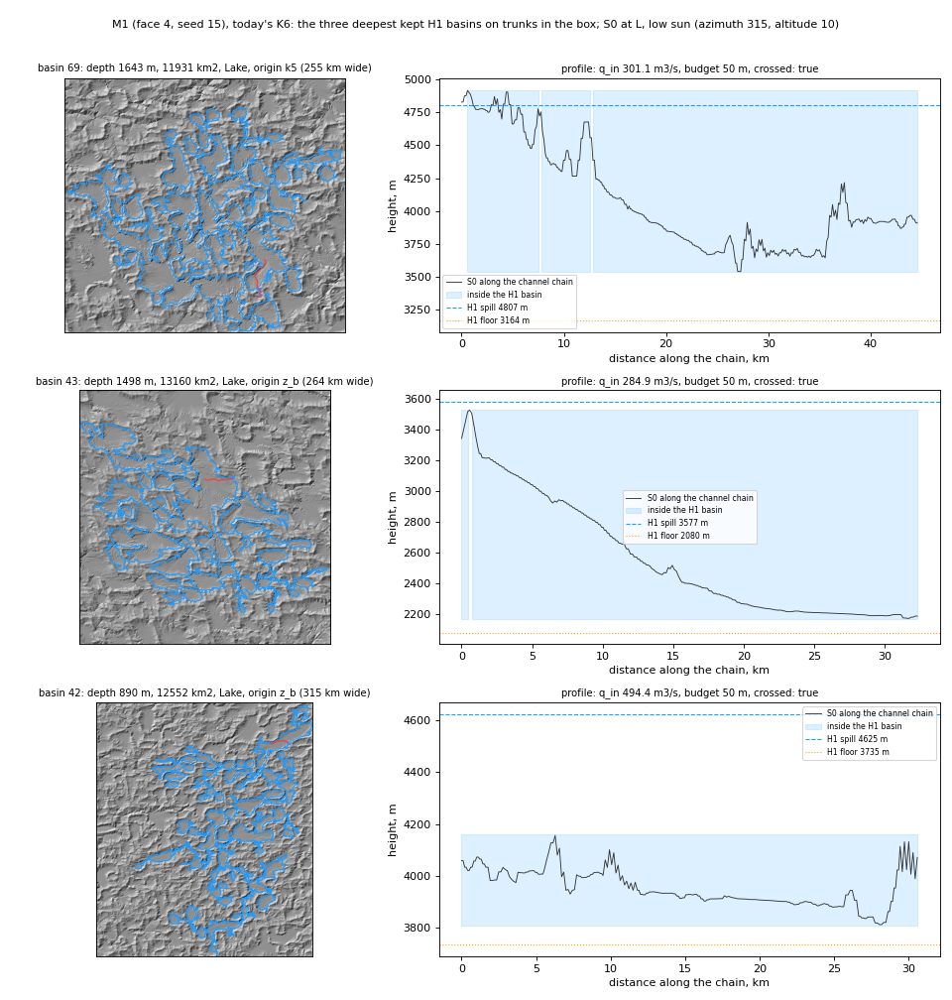
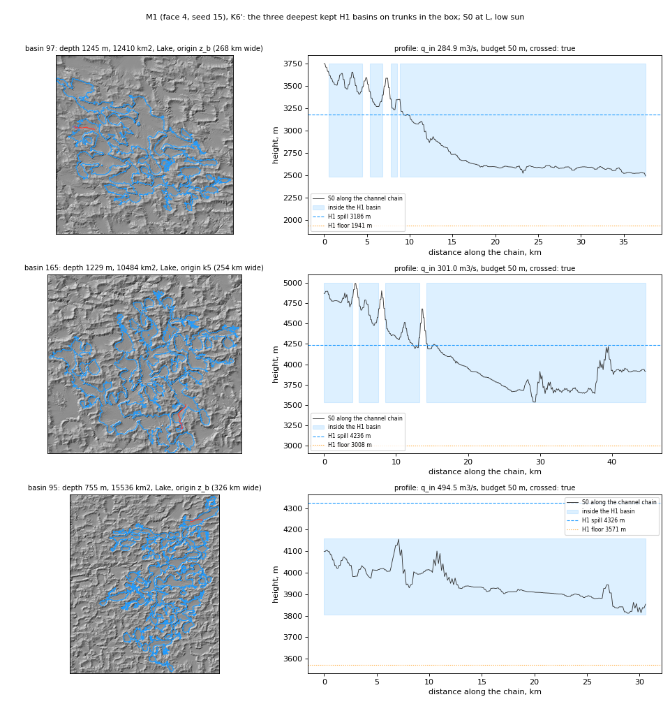
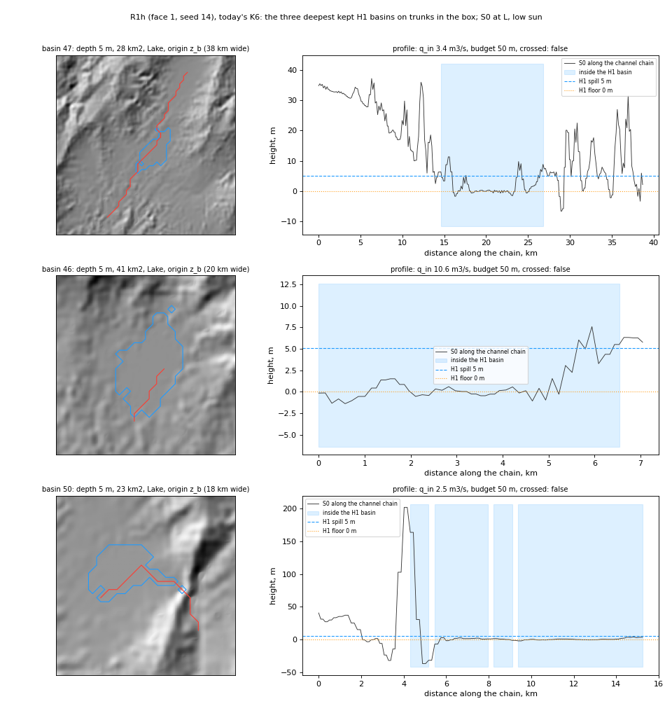
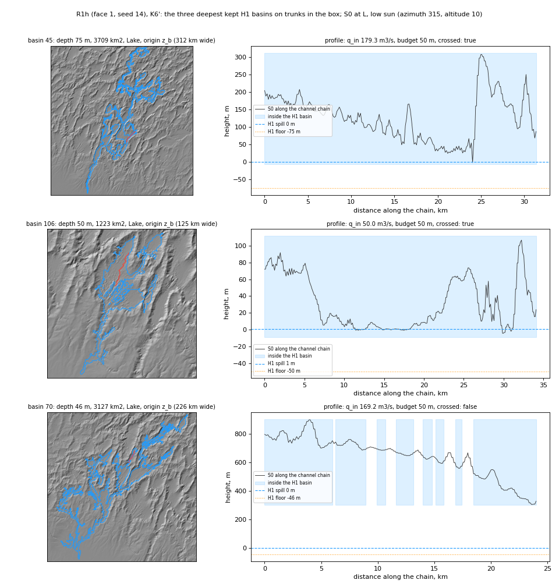

# SPIKE-134: the deep H1 basins on trunks and their origin

Opened: 2026-11-17 (lead #134, #134b)
Question: which kept H1 basins hold trunk cells, how much river length they would hold as lakes, what reading 13 makes of the deep ones, and where they come from (Earth-like at 814 m, K5 not converged, K6''s node height, or real)?
Why it matters: the owner's decision 5 (the kept-lake share); river graphs G1c/G1f (`g0-contracts.md` readings 11-13).
Time box: about 1.5 days (lead #134 one day, #134b half a day). Used: about 0.5 day.
Success criteria: per basin depth, area, class, `q_in` and floor origin; the lake length against review B's 2-10 % aim and decision 5's 10 % trigger; the exception count under reading 13; stills of the three deepest on M1 and R1h; a per-window table of basins on trunks by origin with counts and river length (lead #134, #134b).
Fallback if it fails: report what is measured. Not needed.
Code location: spike branch `spike/deep-basins` (f6395a8f): `crates/cache/examples/kg_trunk.rs` (SPIKE-129's KG-trunk with readings 12 and 13, the census and `--attrib`), `earth_h1.rs` (the Earth reference), `cell_latlon.rs`; stills `tools/deep_stills.py`.

## 1. Method
| Item | Definition |
|---|---|
| Bases | K6' on the sills of `S0` (SPIKE-127) and today's K6, five windows; readings 11-13 applied (lowest-path centreline, connected sea, cut only at basins within the budget) |
| Basins on trunks | kept H1 basins (GEN-145: pit limit 0.5 m; artefact floor fewer than 4 cells and shallower than 2 m) holding channel-segment cells (>= 75 km2) in the region's box |
| Depth, area | `spill - floor` (node heights), the basin's cells' area |
| Floor origin | the floor cell lies in a depression (filled more than 0.5 m) of `z_b` (the base at 814 m): `z_b`; else of `z_s` (K5's output): `k5`; else (K6' only) of the node heights alone: `band` (S0's band under 814 m) |
| River length | channel-segment cells in the box, step length to the receiver; lowland: `z_s` <= 300 m |
| Lake length, upper bound | the river length in every kept basin; reading 13's lakes: in the basins within the budget at their floor |
| Reading 13 | a basin deeper than the budget at its floor is crossed along H1's chain; L reaches through it counted with their `rise_over_budget` |
| Attribution (#134b), in order | **K6' node**: the basin keeps under half its cells in a basin when the node height is the median L cell of the 814 m cell instead of the lowest (K6' only; sills lifted to both nodes); **K5**: it keeps under half its cells in a basin with K5 run for twice the rounds (8; K6' rebuilt on the new `S0`); **real**: otherwise, a lake when the water balance overflows (`Basin::overflows`), endorheic otherwise |
| Earth (#134b) | `earth_h1`: the GLO-30 tiles of BUILD-059's matched relief set per window (prepared at 101.8 m), reduced over 8 x 8 cells by the mean, the minimum or the median, H1 run on them (canonical flood, clipped MFD, `hydrology` with GEN-145's defaults, no runoff weights); the share of channel cells in kept basins inside a one-cell border; tiles with fewer than 100 channel cells left out; the four 3DEP DTM tiles as a bare-earth check |
| Stills | analysis renders (CPU): `S0` at L under a low sun (azimuth 315, altitude 10), the basin's H1 cells outlined, the channel chain through it, and `S0` along the chain with H1's floor and spill. The production path (`cargo xtask capture stills`) reads a world bake; on a window's region store it stops ("the store holds no bake of 16384 cells") |

## 2. Results
### 2.1 Lake length (the upper bound) against Earth, five windows (K6' / today's K6)
| | R1h | R3a | R3b | M1 | F1 |
|---|---|---|---|---|---|
| River length in the box, km | 18,786 / 13,428 | 38,417 / 31,513 | 30,325 / 22,500 | 34,852 / 22,590 | 43,543 / 41,262 |
| In kept basins, every one kept | 61.7 / 1.5 % | 68.5 / 21.6 % | 48.7 / 1.5 % | 90.9 / 16.8 % | 86.3 / 75.0 % |
| Lowland (`z_s` <= 300 m) in kept basins | 67.9 / 2.0 % | 69.6 / 22.0 % | 60.0 / 2.1 % | no lowland | 86.3 / 75.0 % |
| In reading 13's lakes (within the budget) | 55.3 / 1.5 % | 68.4 / 21.6 % | 48.7 / 1.5 % | 3.6 / 0.0 % | 10.9 / 1.5 % |
| Earth at 814 m, channel cells in kept basins: block mean / minimum / median | 20.4-73.7 / 1.9-26.0 / 17.5-74.3 % | 5.5-51.5 / 0.6-9.4 / 5.4-43.4 % | 5.5-54.8 / 0.6-9.4 / 5.4-43.4 % | 7.4-39.2 / 0.2-3.0 / 5.9-41.2 % | 5.5-54.8 / 0.6-9.4 / 5.4-43.4 % |
| Review B's aim / decision 5's trigger | 2-10 % / 10 % | | | | |

- Earth at 814 m is not a lake share: bare-earth DTMs give the same as the GLO-30 DSM on the same tiles (11-71 % against 35-74 % with the mean; `raw/earth-h1.txt`). Valleys narrower than the cell vanish in the mean or median, and the river crosses false pits; the block minimum follows the valley floors (0.2-26 %).

### 2.2 Kept basins on trunks by origin (basins, river length km; share of the box's river length)
| Window, base | K6' node | K5 not converged | real, floor in `z_b` | real, floor in `z_s` only (K5) | real, `band` only | Total in kept basins |
|---|---|---|---|---|---|---|
| R1h K6' | 36, 2,321 (12.4 %) | 1, 18 | 6, 8,701 (46.3 %) | 0 | 5, 546 (2.9 %) | 48, 11,586 (61.7 %) |
| R1h today | - | 0 | 7, 197 (1.5 %) | 0 | - | 7, 197 (1.5 %) |
| R3a K6' | 51, 1,692 (4.4 %) | 2, 1,389 (3.6 %) | 4, 12,234 (31.8 %) | 3, 3,310 (8.6 %) | 17, 7,701 (20.0 %) | 77, 26,326 (68.5 %) |
| R3a today | - | 22, 4,579 (14.5 %) | 110, 2,236 (7.1 %) | 0 | - | 132, 6,815 (21.6 %) |
| R3b K6' | 21, 306 (1.0 %) | 2, 4 | 4, 3,168 (10.4 %) | 0 | 7, 11,277 (37.2 %) | 34, 14,755 (48.7 %) |
| R3b today | - | 0 | 11, 336 (1.5 %) | 0 | - | 11, 336 (1.5 %) |
| M1 K6' | 19, 275 (0.8 %) | 8, 2,441 (7.0 %) | 7, 9,363 (26.9 %) | 3, 19,597 (56.2 %) | 0 | 37, 31,676 (90.9 %) |
| M1 today | - | 3, 1,385 (6.1 %) | 4, 2,028 (9.0 %) | 1, 383 (1.7 %) | - | 8, 3,796 (16.8 %) |
| F1 K6' | 21, 4,473 (10.3 %) | 0 | 7, 33,002 (75.8 %) | 0 | 2, 106 (0.2 %) | 30, 37,582 (86.3 %) |
| F1 today | - | 0 | 48, 30,926 (75.0 %) | 0 | - | 48, 30,926 (75.0 %) |

- Water balance: every kept basin on trunks overflows (class Lake) on all ten runs; the climate's open-water term never closes one (SPIKE-126's caveat: about 35 mm/yr). No endorheic or seasonal class to subtract.
- K5 with twice the rounds changes the kept-basin count from 230 to 353 (M1 K6'), 195 to 346 (R3a K6'), 106 to 77 (M1 today), 227 to 263 (R3a today), within 15 elsewhere: more rounds also make basins.
- The median node height gives more kept basins than the minimum (367-611 against 115-236): the minimum is not what makes K6' rough; the K6' node basins are a minority of the river length (0.8-12.4 %).
- Rows per basin with depth, area, class, `q_in`, floor origin, attribution and overlaps: `raw/basins-<window>[-today].csv`, `raw/origin-<window>[-today].csv`.

### 2.3 Per basin (kept basins on trunks)
| K6' / today | R1h | R3a | R3b | M1 | F1 |
|---|---|---|---|---|---|
| Basins | 48 / 7 | 77 / 132 | 34 / 11 | 37 / 8 | 30 / 48 |
| Depth p50 / max, m | 2.0 / 75 ; 2.7 / 5 | 0.8 / 18 ; 0.9 / 3 | 1.0 / 5 ; 1.4 / 4 | 16.9 / 1,245 ; 733 / 1,643 | 1.4 / 27 ; 1.1 / 37 |
| Area p50 / max, km2 | 24 / 13,231 ; 23 / 50 | 32 / 13,621 ; 5 / 3,120 | 24 / 6,640 ; 12 / 71 | 49 / 26,477 ; 5,119 / 13,160 | 34 / 59,168 ; 5 / 40,462 |
| Deeper than the budget (crossed by reading 13) | 2 / 0 | 1 / 0 | 0 / 0 | 10 / 8 | 2 / 2 |

### 2.4 Reading 13 (whole window)
| K6' / today | R1h | R3a | R3b | M1 | F1 |
|---|---|---|---|---|---|
| L reaches crossing a deep kept basin | 8,402 / 6,684 | 2,945 / 4,844 | 5,371 / 10,184 | 39,509 / 20,128 | 25,933 / 22,678 |
| Of them `rise_over_budget` | 1,718 / 1,420 | 39 / 135 | 438 / 1,342 | 16,826 / 8,004 | 2,260 / 1,482 |
| All `rise_over_budget` L reaches | 2,364 / 2,713 | 347 / 642 | 1,531 / 3,116 | 17,212 / 11,341 | 2,649 / 2,445 |
| Conservation breaks (crossing reaches carry H1's `q_w`, which falls inside a basin) | 440 / 40 | 78 / 182 | 390 / 96 | 1,488 / 42 | 1,446 / 314 |

- The crossing counts are window-wide (the margins hold most of the large basins); the census in sections 2.1-2.3 is the box's.

## 3. Findings
1. **Today's K6: the basins on trunks come from the base.** On every window the real basins' floors lie in depressions of `z_b` at 814 m; K5 adds a few (R3a 22 basins, M1 3, which go with twice the rounds). F1's lowland trunks lie 75 % in one family of shallow, very large `z_b` depressions (the largest 40,462 km2, 37 m deep); M1's are 733 m deep at the median.
2. **K6' adds basins from the band and the node height**, on top of the base's: `band` basins hold 0.2-37 % of the river length (R3b 37 %, R3a 20 %), K6' node basins 0.8-12 %, and its `z_b` basins are larger than today's (R1h 46 % against 1.5 %).
3. **Earth at 814 m is no guide to the lake share:** H1's basin rule on real terrain keeps 5.5-74 % of the channel cells with the mean and 0.2-26 % with the minimum, also on bare-earth DTMs. The kept set at 814 m measures unresolved valleys, not lakes; on this measure today's K6 lies inside or under Earth's mean range except F1 (75 %), K6' above Earth's minimum range everywhere.
4. **The water balance does not separate them:** every basin on trunks overflows.
5. **Against review B's 2-10 % and decision 5's 10 % trigger:** today's K6 is under 10 % on R1h and R3b and over it on R3a (21.6 %), M1 (16.8 %) and F1 (75 %); reading 13 leaves 0-1.5 % as lakes on today's K6 (21.6 % on R3a, whose basins are within the 10 m budget); K6' is over 48 % everywhere before reading 13.
6. **Reading 13 crosses the deep ones but brings back conservation breaks** (40-1,488 per run): a crossing reach carries H1's routed discharge, which falls inside a basin (its losses and the cascade to its spill). The contract needs the crossing reach's `q_w` rule (for instance the basin's `q_out` held through the crossing).
7. **The deepest basins are not lakes one would draw:** on M1 the three deepest of each base (755-1,643 m deep, 10,500-15,600 km2) lie under ground whose `S0` along the channel runs 230-2,000 m above their H1 floor; on R1h K6''s three deepest have floors 46-75 m below the sea level (an inland L pocket under the sea level drags the node down) while today's three deepest are 5 m coastal flats (stills).

## 4. Recommendation (input to decision 5)
- Fix at the source stage: the deep and the large kept basins on trunks are closed 814 m depressions of the base `z_b`, not lakes and not a K5 or K6' artefact; the base generator (K0-K4) or K5's treatment of `z_b`'s closed depressions is the stage to change, not the kept-lake share.
- Until then: reading 13 for the trunk graph, with the crossing reach's `q_w` rule added to the contract; lakes only from basins within the budget (today's K6: 0-1.5 % of the river length on four windows, 21.6 % on R3a).
- The Earth share at 814 m is not a target for decision 5: it measures resolution.

## Visuals
Analysis renders (CPU), not the production path (section 1): per basin, left `S0` at L under a low sun with the basin's H1 cells outlined (blue) and the channel chain through it (red); right `S0` along the chain with H1's floor (orange) and spill (blue dashed), the basin's stretch shaded.

M1 (face 4, seed 15), today's K6: the three deepest kept basins on trunks (1,643, 1,498 and 890 m deep, 11,900-13,200 km2); their spill lies 750-1,400 m above the valley floor of the profile.

M1, K6': the same family (1,245, 1,229 and 755 m deep).

R1h (face 1, seed 14), today's K6: the three deepest are 5 m coastal flats at the sea level, 23-41 km2.

R1h, K6': floors 46-75 m below the sea level under land 0-300 m high; each H1 cell takes its lowest L cell, an inland pocket below the sea level.
