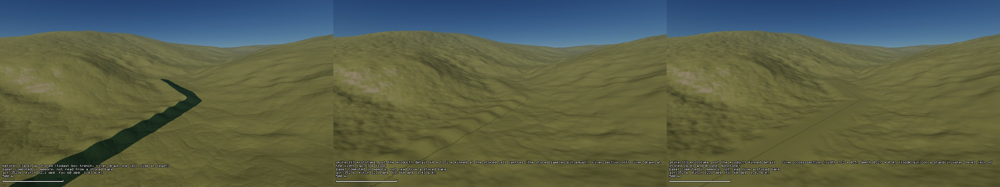
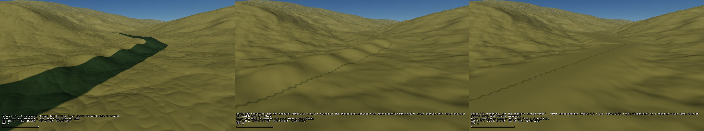
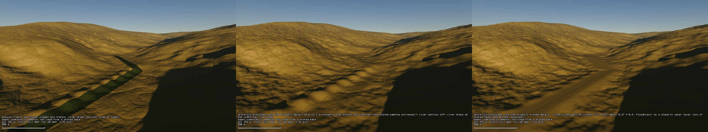
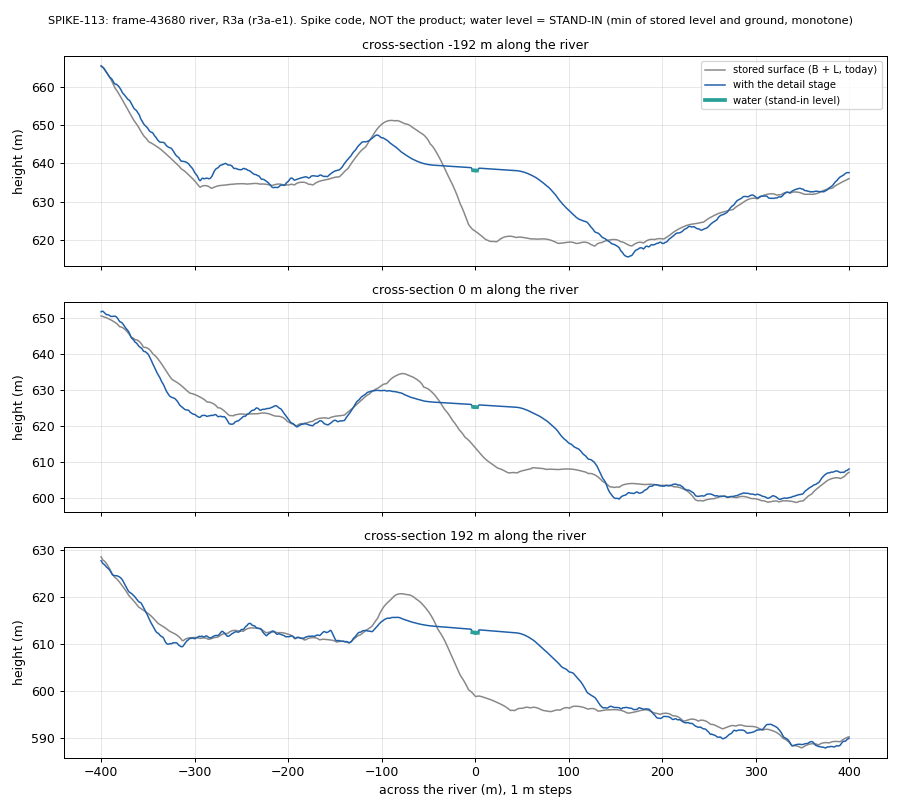

# SPIKE-113 Detail below 100 m on a stored region, with a river cross-section

Opened: 2026-11-13
Question: can detail below the 101.8 m region cells (to about 1-10 m) come from a later stage on top of the stored region, without changing the region's rivers and lakes (receivers, areas, water levels bit-equal)?
Why it matters: P2 exit item 4 (the "detail later" spike, owner 2026-11-13); findings F3, F5 and F6 of the R3a preview round (box trench, blocky carving below 1 km, rivers as wide as a cell).
Time box: 1 day of agent work.
Success criteria: the stored region (L tiles, channel graph, basin tables, lake masks) unchanged by the stage; the routing at 100 m from the detailed surface equal to the routing without it; the stage's cost per terrain node; a cross-section of a river with a width and depth from its discharge; a labelled before/after pair through the production path at the owner's frame-43680 spot.
Fallback if it fails: a finer bake near rivers (a K7 profile with a valley section instead of the box trench), with the cost of a bake per tile.
Code location: branch `spike/detail-below-100m` (throwaway; never merged into the main crates). Starts from SPIKE-100's detail plan (`spikes/ground-detail-m9/results/results.md`, D3).

## Answer (2026-11-13, measured on r3a-e1; the river part waits for E1's re-baked store)
- **Terrain detail: yes.** A later stage adds detail of 64 m to 2 m on top of the stored region and leaves the region's samples bit-equal: the detail minus its bilinear interpolant from the four surrounding L cell centres is 0 at every centre. Measured: 3,800 of 3,800 L cell centres in a 6 km box bit-equal, receivers on them 100 % equal, store files equal. Unpinned detail of the same amplitude keeps 3.9 % of the centres and 83 % of the receivers.
- **River cross-section: not on today's store.** The stored samples hold the river as a one-cell box trench, and the stored line and level are not the carved ground (below). A sub-cell channel can only replace the trench by changing samples near the river: 9.5 % of the centres in the box, by up to 41 m. A later stage can draw the cross-section without touching the samples only once the stored line lies in a valley floor of the samples and its level is that floor's water surface (E1's source fix).
- **Stand-in, named:** every river result below uses a water surface of `min(stored level, stored ground on the line)`, not rising downstream. It is a stand-in, not an answer.

## The stored level is not a water surface (r3a-e1)
Channel points inside the commit's 52 tiles (the first point of each segment at its cell centre; 21,715 on land; `levels` lines of `raw/route-all.txt`):

| Composed ground minus stored level (m) | p5 | p25 | p50 | p75 | p95 |
|---|---|---|---|---|---|
| all points | -29.8 | -8.9 | -3.8 | -1.6 | 0.3 |
| without the runtime crease detail | -27.6 | -6.2 | -1.4 | -0.1 | 0.1 |
| Q 10-100 m3/s | -48.1 | -18.7 | -7.7 | -3.2 | -0.2 |
| Q at least 100 m3/s | -41.1 | -21.9 | -12.7 | -7.4 | -2.5 |

- 83 % of the points have the ground more than 1 m below the stored level. The K7 burn only lowers ground to the H1 level; the incision and the final channel pass cut deeper; the runtime crease detail adds -1.5 m at the median.
- At the frame-43680 spot the stored line runs along a slope at 623-638 m; the carved low lies 50-150 m to one side and about 20 m lower, behind the bank crusader measured (cross-section below). The line is about one cell off the trench K7 carved.

## Method
- Stage (spike code): a hook after `B + L` in the eroded field's height (`spike_d`), installed for `--commit` runs under `PLANET_SPIKE113=on`. It reads the commit's channel graph (13,729 channels, 27,943 segments over the commit's tiles) and lake masks; it writes nothing.
- Detail: 6 octaves of value noise at 64, 32, 16, 8, 4 and 2 m; first amplitude `1 + 40 slope` m (cap 8 m), falling as `(lambda / 64)^0.9`; masked to 0 near rivers and lakes and within 1-11 m of the sea level; pinned at the cell centres (above).
- Cross-section: width `7.2 Q^0.5` m (the burn's law, floor 3 m); depth `0.27 Q^0.4` m (floor 0.3 m); a parabolic bed below the water; a bank rising 1 in 2 to a floodplain `0.5 + 0.5 D` m above the water; the floodplain out to `W/2 + 30 m + 2 W`; then a 120 m blend to the stored surface. The drawn river takes the same width (REND-059's one-cell floor off).
- Probe (`examples/spike113`): a 6 km box at 5 m around the frame-43680 river (38.902 S, 165.995 W), before and after in one process; fine routing by a priority flood to the drawn river; 100 m block means; the L cell centres in the box; one-thread timing of 200,000 samples.
- CPU checked after the EC reset: 76 % "% Prozessorleistung" (_Total) under the probe's 8-thread load (the 15 % latch is gone). Other lanes' prepush ran during some rounds; the timing table takes the rounds whose plain field is 3.2-3.4 us.

## Results (6 km box, 1,429,314 land cells at 5 m)

| Configuration | L cell centres bit-equal | Receivers on the centres equal | 100 m block receivers equal | Fine cells to the same river | Fill over 0.5 m (before 1.80 %) |
|---|---|---|---|---|---|
| detail, pinned | 3,800 of 3,800 (100 %) | 100 % | 96.1 % | 98.7 % | 2.67 % |
| detail, not pinned | 147 (3.9 %) | 83.2 % | 95.5 % | 98.6 % | 2.74 % |
| river section only (stand-in) | 3,440 (90.5 %) | 92.8 % | 95.6 % | 69.2 % | 1.80 % |
| both (pinned, stand-in) | 3,440 (90.5 %) | 92.8 % | 92.7 % | 69.2 % | 2.64 % |

- Store files (pack, index, commit) bit-equal before and after in every run (`raw/hash-all.txt`).
- The 100 m block means and the 5 m routing are not the region's samples: pinned detail moves micro-divides at 5 m (1.3 % of cells) and block means by up to 4.8 m, as any detail must; the region's routing reads the samples, which stay.
- The river section sends 31 % of the 5 m cells to another river: the stand-in floodplain cuts and fills the corridor around a line that is not in the carved low.

| Timing, one thread (us a sample) | Field without the stage | Stage alone | Field with the stage | A 33 x 33 terrain node |
|---|---|---|---|---|
| detail pinned + river | 3.34-3.37 | 2.8-3.1 | 6.31-6.32 | +3.2 ms (field 3.7 ms) |
| detail pinned only | 3.21 | 5.5 | 6.39 | +3.5 ms |
| detail not pinned | rounds loaded | 0.9-1.2 | - | about +1 ms |
| river section only | 5.2-5.5 (loaded) | 0.14-0.33 | - | +0.2-0.4 ms |

- The pin costs five noise sums a sample (the point and four centres): 5x the unpinned detail. Taking the centres' noise from a per-node table would bring it near the unpinned cost (not tried).
- Stage set-up: 2-6 s (channel index and lake distances over 6,144 x 6,144 cells); the stand-in water surface 1.1 s.

## Findings
- **Pinning is the rule that makes detail safe**: a stage that is 0 at the stored samples cannot change the region's receivers, areas or lakes, whatever its amplitude between them. The cost is a band-pass: wavelengths above about two cells are removed by the interpolant.
- **The river is in the samples today**: K7 burns a one-cell box trench (101.8 m) into L, so the channel and its banks are sample values. A narrower river is a change of samples, not detail.
- **The stored line and level do not describe the carved ground** (table above). With E1's fix (the stored line and level become the water surface of the final ground) the cross-section can be a pinned stage on a floor the samples already hold.
- **Narrow rivers need a finer coverage**: a 6 m river drawn through REND-059's coverage (codes of 1/32 cell, node samples 2.4-9.5 m apart) breaks into steps; the water is a tint on the ground, so a 0.3 m depth does not show.
- **With the drawn river narrow, the box trench shows**: at low sun the trench reads as a row of beads along the line's D8 steps (middle frame of the low-sun triptych).

## Visuals
Product path (`planet test-render --scene capture-stills --commit r3a-e1`), RTX 3080 Ti, 1920 x 1080 scaled to 960 x 540 each. Left: before (r3a-e1 as stored). Middle: **prototype, not the product**: pinned detail, river section off, river drawn at the width law. Right: **prototype, not the product**: pinned detail and the river cross-section on the **stand-in** water level. Poses in `poses-43680.toml`.

The owner's frame-43680 pose (352 m above the ground, heading 101 degrees, 12 degrees down): the one-cell river (left); the detail on the slopes and a 6 m stream drawn in steps (middle); the stand-in floodplain, a flat terrace about 90 m wide (right).

100 m above the ground, 300 m back: the box trench filled by the drawn river (left); the detail and the stepped narrow river (middle, right); the terrace on the right lies on the slope above the carved low.

The frame-43680 pose at 17.5 h: the stored trench shows as beads once the drawn river is narrow (middle).

Three sections 192 m apart, 1 m steps: the stored surface (grey), with the stage (blue), the stand-in water (green). The stored line sits on the slope; the carved low is 50-150 m to its right and about 20 m lower; the stand-in fills it with a terrace.

## Reproduce
- Branch `spike/detail-below-100m` (local; spike code).
- Probe: `PLANET_SPIKE113=on` (and optionally `PLANET_SPIKE113_RIVER=0`, `PLANET_SPIKE113_PIN=0`, `PLANET_SPIKE113_NOISE=0`), then `cargo run --release -p planet --example spike113 -- --commit <r3a-e1> --lat -38.90206 --lon -165.99522 --out <dir> --box-m 6000 --step-m 5 --threads 8`.
- Stills: the same variables with `planet test-render --scene capture-stills --adapter hardware --seed 14 --commit <r3a-e1> --poses poses-43680.toml`.
- Raw output: `raw/route-*.txt`, `raw/timing-*.txt`, `raw/hash-all.txt`.
