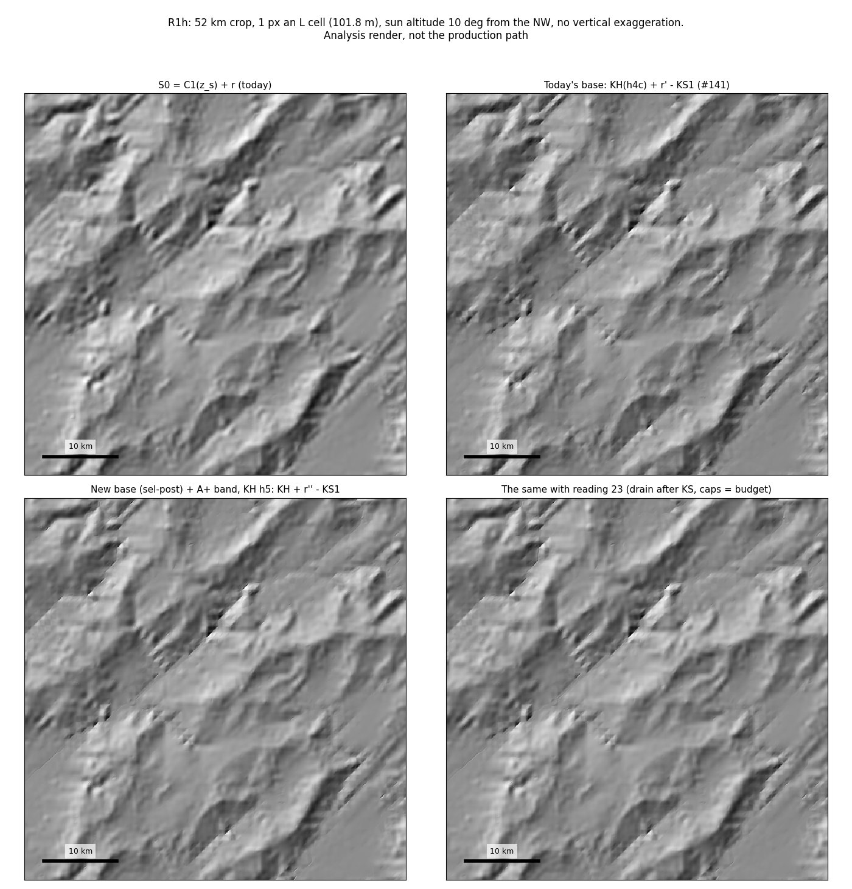
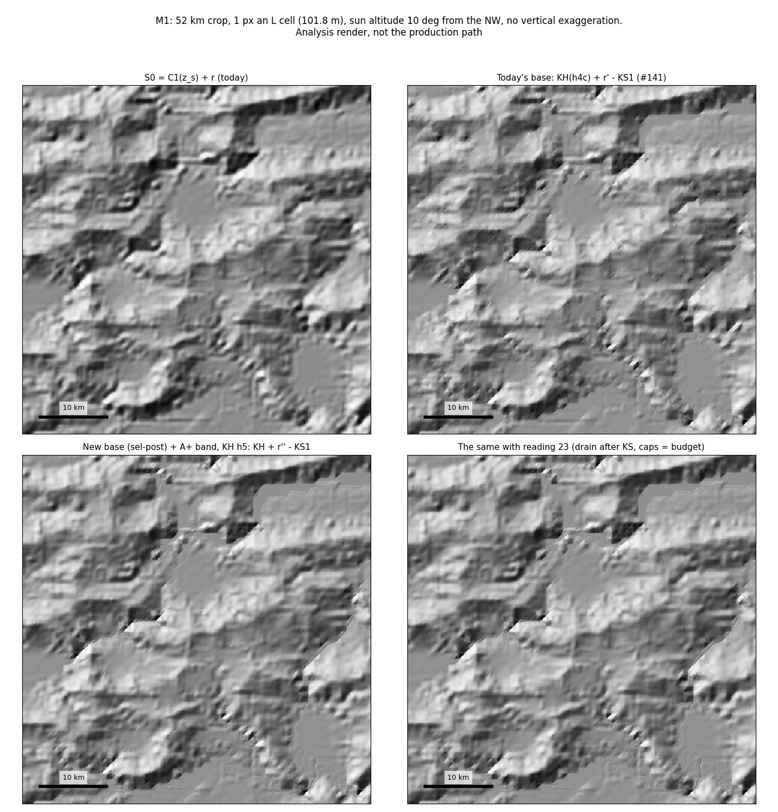
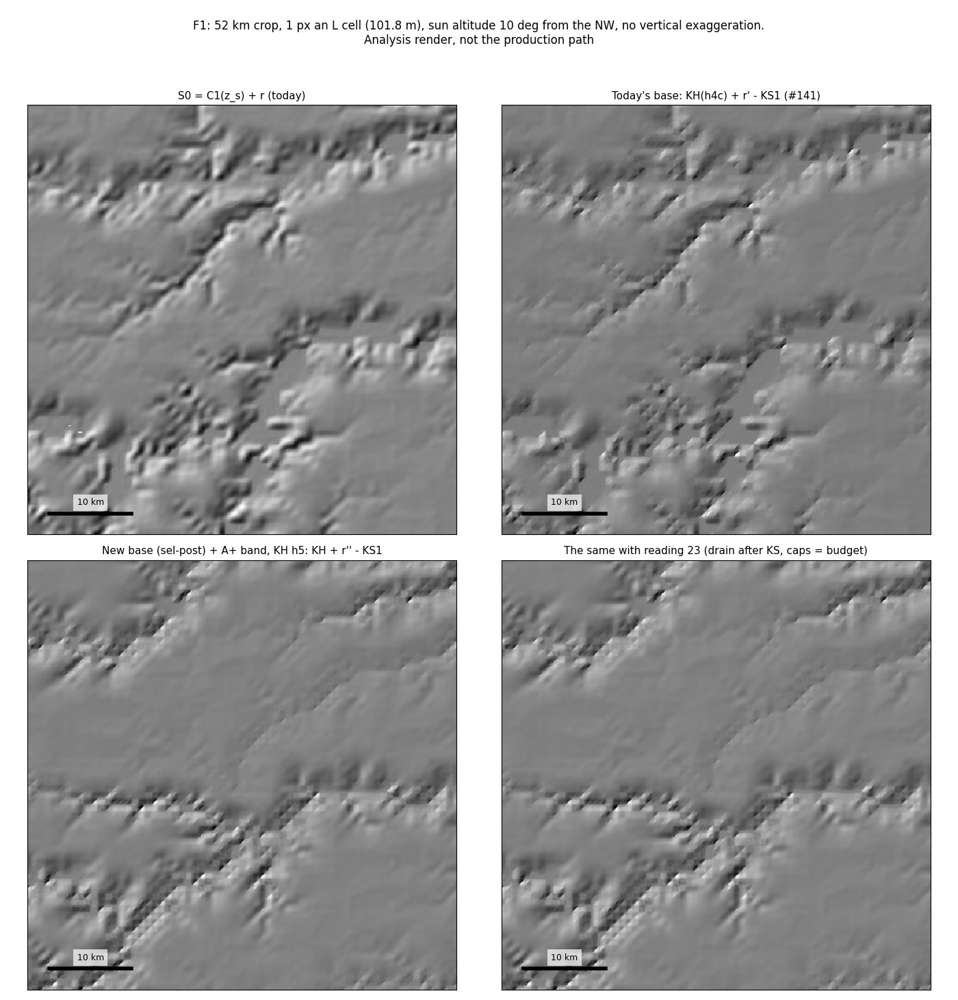
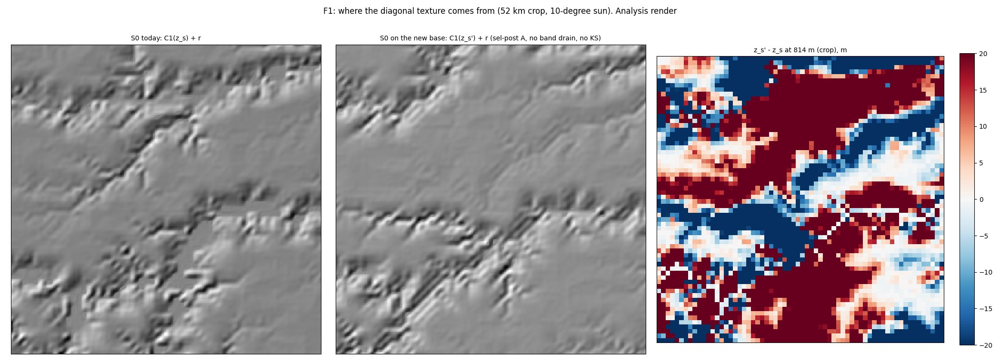

# SPIKE-138: a base that drains at both scales (A+, decision 5)

Opened: 2026-11-17 (lead #143; owner, 2026-11-17: "Please do"). Fixes: lead #145 (owner, 2026-11-17). KH h5: lead, 2026-11-18 (reading 25).
Question: does a base drained before K5 at 814 m (A) and a band drained on KH at L (A+) bring the river length in closed basins after KH and KS1 under the 10 % G-DRAIN bar, without cutting or filling the relief away?
Why it matters: decision 5 (where the drainage repair lives); the RG prototype's base stages 1, 3 and 6 (`spike/rg-prototype`, lead #146).
Time box: 1 day (used: about 13 h, most of it runs behind the shared heavy lock).
Success criteria: river length (75 km2 channels) in G-DRAIN basins under 10 % on five windows; no deep cuts through ridges; relief kept.
Fallback if it fails: KS2 or KV/KC on the band's pits (SPIKE-135 addendum 2).
Code location: branch `spike/drain-aplus` (never merged):
- @ f5b7fa47: `planet_generators::bake::drain` (least-cost breach or fill, the smaller volume), the base hook before K5 in `region_bake`, `--drain a | aplus` in `kh_smooth` and `ks_kh`.
- @ 6ef56536, d3721a3e, fe18927b: #145's forms: `drain_selective` (a breach only within 50 m of cut, a fill only within 50 m of depth), the post-K5 drain (`POST_HOOK`) and the K5 breach floor (`round::LEVEL_FLOOR`), reading 23's forms in the ladder, `--band-cap`.
- @ 91b38d6f: `--kh h5` in `ks_kh` and the ladder (`kh::channel_zone`, `kh::zone_weight`; in the runner as `spike/rg-chain` fea68a91).

## Answer
- **Yes on all five windows.** With the selective pre-K5 drain and the post-K5 drain on `z_s` (sel-post), the band drained on KH (A+) and reading 23's post form, 0.00-0.01 % of the river length lies in G-DRAIN basins (#141: 9.3-48.9 %). Reading 23's clamp form gives 0.00-0.52 %. KH h5 and h4c give the same within 0.2 points.
- **The cost is M1.** M1's deep basins (both the breach cut and the fill depth over 50 m) stay through K5. The uncapped band drain then fills them at L: 384-386 km3 raised, the band std from 26.4 to 33.1 m, flat lake floors in the valleys. Capped at 50 m, the band drain leaves 1,704 G-DRAIN pits (402 km3) and 22.8-32.4 % of the river length in them.
- **F1 changes its valley network.** The pre-K5 drain makes 18,046 breaches on the lowland; `z_s` moves by about +/-20 m over most of F1's crop, and the new channels run diagonally across the flats. KH draws them with bead and diamond chains (h5 as h4c: they lie in h5's channel zone).

## Method
The chain per window (R1h, R3a, R3b, M1, F1; margin 200, L = 8):

| Stage | Form |
|---|---|
| 1. Base, pre-K5 (`z_b` at 814 m) | `drain_selective`: each depression of the priority-flood fill (no epsilon) is breached along its least-cost path (cost `max(0, z - z_floor)`) when the deepest cut is at most 50 m, or filled when its depth is at most 50 m; both allowed: the smaller volume; neither: left for K5. Repeats until none is left or 12 rounds. Intended basins: none (the generator has no closed-basin field; the rift and basin provinces stand in for a tectonic mask, below) |
| 2. K5 | today's rounds on the drained base; the regional field stays `z_s - z_b` (the original `z_b`), so the band `r = B - C1(z_b)` is unchanged |
| 3. Base, post-K5 (sel-post) | `drain_selective` on `z_s`, the same caps. Form sel-clamp instead: K5's breach target never below the fill level inside the basins stage 1 left |
| 4. KH | h4c (reading 20) or h5 (reading 25: h4c on the 75 km2 channel zone, C1 elsewhere) |
| 5. A+ band | `drain_band`: KH + `r` drained with `drain` (uncapped) or `drain_selective` (capped at 50 m); `r'' = drained - KH`; outlets: reading 12's sea and the window's edge |
| 6. KS1 and reading 23 | KS1 on KH + `r''` (the floor at sea + 0.5 m); reading 23: clamp (no KS lowering on cells `drain_band` raised) or post (`drain_selective` on the final surface, caps the budget at the floor) |

- The ladder classifier is SPIKE-135 addendum 2's (base / K5 / interpolation / band), the base rungs on the drained `z_b` and on `z_s`.
- Measures: the SPIKE-134 census (kept H1 basins holding trunk cells after K5), `z_b`'s change, K5's work, the band's pits before and after, and the river cells (D8 area 75 km2) of the final surface in G-DRAIN basins (at least 0.5 m deep and 16 cells).
- Raw: `raw/base-sel-post-<w>.csv`, `raw/base-sel-clamp-<w>.csv` (`--base-only`), `raw/ladder-<w>.csv` (h4c), `raw/ladder-h5-<w>.csv`, `raw/bc-ladder-<w>.csv` (band capped; M1, R1h), `raw/today-ladder-<w>.csv` (today's base, #141's chain), `raw/first-ladder-<w>.csv` (#143's first form). Tables: `raw/tables.md`, built by `tools/s138_tables.py raw ../../repair-debt/results/raw r1h r3a r3b m1 f1`.

## Results
### The base after K5
Kept H1 basins holding trunk cells in the box after K5 (SPIKE-134's census): basins (trunk km), of them deeper than the budget:

| Window | Today | sel-post | sel-clamp |
|---|---|---|---|
| R1h | 7 (117 km), 0 | 0 | 71 (2,631 km), 45 |
| R3a | 132 (3,800 km), 0 | 0 | 1 (159 km), 1 |
| R3b | 11 (288 km), 0 | 1 (365 km), 1 | 12 (2,165 km), 5 |
| M1 | 8 (2,589 km), 8 | 8 (2,556 km), 8 | 391 (10,921 km), 334 |
| F1 | 48 (15,319 km), 2 | 0 | 1 (231 km), 1 |

- A tectonic mask (rift or basin province at least 0.5 at the floor) would keep none of today's kept basins on any window; under the new forms 0-6 (R1h sel-clamp 4, R3b 1-6).

Stage 1 on `z_b` (land of the box):

| Window | Depressions left (both over 50 m) | Cells lowered / raised over 1 m | km3 lowered / raised | `z_b` ridge cells lowered over 1 m / over 20 m |
|---|---|---|---|---|
| R1h | 1,352 | 3,893 / 5,801 | 22.4 / 40.9 | 1,150 / 403 of 87,700 |
| R3a | 3 | 7,737 / 831 | 19.8 / 1.5 | 1,254 / 37 of 51,264 |
| R3b | 6 | 5,496 / 203 | 16.2 / 0.5 | 890 / 37 of 54,450 |
| M1 | 3,517 | 332 / 428 | 4.4 / 4.6 | 98 / 66 of 146,888 |
| F1 | 0 | 22,705 / 6,642 | 79.9 / 14.5 | 5,553 / 146 of 127,612 |

- Over 50 m: no cell, except 15 lowered on R1h.
- #145's starting point: the uncapped drain (#143) lowered M1's `z_b` 4,869 km3, 15,524 cells over 50 m; the 50 m cap that followed filled 58.1 % of M1's land (lead #145).
- Stage 3 (post-K5): 10-164 breaches and 1-65 fills per window, at most 0.55 km3 lowered; 3-86 depressions stay (both over 50 m).
- K5's work on sel-post (km3 lowered) is within 5 % of today's on M1, R1h and R3a, and 14-32 % smaller on R3b and F1. sel-clamp carves 24 % less on M1 (83,414 against 109,802 km3) and 32 % less on R1h, and keeps those basins as basins.

### The band and the final surface
A+'s band drain on KH (land of the box; full table `raw/tables.md`):

| Window, KH, band drain | G-DRAIN pits of KH + `r` -> KH + `r''` | Band raised, km3 | Band std, m |
|---|---|---|---|
| R1h, h4c / h5, uncapped | 3,970 / 5,380 -> 0 | 11.4 / 11.7 | 6.21 -> 6.28 / 6.30 |
| R1h, h4c, capped 50 m | 3,970 -> 20 | 6.9 | 6.21 -> 6.23 |
| M1, h4c / h5, uncapped | 7,973 / 9,360 -> 0 | 384.0 / 386.0 | 26.39 -> 33.10 / 33.17 |
| M1, h4c, capped 50 m | 7,973 -> 1,704 (401.8 km3 left) | 8.0 | 26.39 -> 26.39 |
| R3a, R3b, F1, uncapped | 694-8,482 -> 0 | 1.3-4.3 | change at most 0.34 m |

River length (75 km2 channels) in G-DRAIN basins, % of the river; the new base with A+ and KS1 / with reading 23 clamp / with reading 23 post:

| Window | #141 | KH h4c | KH h5 | h4c, band capped 50 m |
|---|---|---|---|---|
| R1h | 22.82 | 7.42 / 0.18 / 0.00 | 7.24 / 0.17 / 0.00 | 7.46 / 1.80 / 0.00 |
| R3a | 33.63 | 9.05 / 0.04 / 0.00 | 9.02 / 0.05 / 0.00 | - |
| R3b | 9.31 | 4.05 / 0.00 / 0.01 | 4.04 / 0.00 / 0.00 | - |
| M1 | 44.00 | 3.77 / 0.52 / 0.00 | 3.87 / 0.50 / 0.00 | 32.24 / 32.42 / 22.79 |
| F1 | 48.87 | 17.03 / 0.04 / 0.00 | 17.06 / 0.04 / 0.00 | - |

- #143's first form (uncapped stage 1, no stage 3, A+, KS1, h4c): R1h 5.99, M1 2.10, F1 16.47 %.
- By origin class (h5 + KS1, before reading 23): base 0-10 %, K5 0 %, interpolation 8-35 %, band 58-92 % of the remainder (#141: base 10-86 %). Reading 23's post form leaves no G-DRAIN river cell on any window with KH h5 (with h4c: on four; R3b keeps 12 cells).
- Breach volume of the final surface (cells over 1 m): #141 0.25-266 km3; h5 + KS1 0.07-8.2 km3; with reading 23 post 0.00-0.05 km3.

## Findings
1. **The selective pre-K5 drain does what the cap did not.** It drains F1, R3a and R3b's `z_b` fully or nearly (0-6 depressions left), changes M1's by under 5 km3 (no fill, no cut over 50 m), and leaves the deep basins (R1h 1,352, M1 3,517) to K5.
2. **sel-post drains the trunks; sel-clamp keeps the deep basins as basins.** After K5, sel-post leaves kept basins on trunks only on M1 (8, as today) and R3b (1). sel-clamp keeps 1-391 (M1 391, 334 of them deeper than the budget) and carves 24-32 % less on M1 and R1h.
3. **The band holds what remains after KS1, and reading 23 removes it.** Before reading 23, 3.8-17.1 % of the river length lies in G-DRAIN basins, 58-92 % of it of the band class: KS1 re-creates pits the band drain had drained (lead #145). Reading 23's clamp leaves 0.00-0.52 %, the post form 0.00-0.01 %.
4. **M1: the deep basins become a fill.** With nothing capping stage 5, `drain_band` fills the basins K5 left (raised 384-386 km3 on about 543,000 cells, band std +25 %). The renders show flat lake floors in M1's valleys (Visuals). Capped at 50 m, M1 looks like today and keeps 22.8-32.4 % of its river length in 1,704 deep pits.
5. **F1: a different valley network.** Stage 1 breaches 18,046 depressions on the lowland; `z_s` after K5 differs from today's by about +/-20 m over most of the crop, and its channels run diagonally across the flats. KH (h4c or h5, both inside the channel zone there) draws them as bead and diamond chains at a 10-degree sun. The new base's own `S0` (C1 + `r`) shows the re-routed valleys without the diamonds.
6. **h5 against h4c:** the same drainage within 0.2 points on every measure; on R1h the new surface's hillslopes read closer to `S0` than today's h4c surface. h5's band has more pits before the drain (R1h 5,380 against 3,970 G-DRAIN), all drained by A+.

## Recommendation
- **Stages 1 and 3 as sel-post** (selective drain before K5, the same on `z_s` after it), **KH h5**, **A+ band drain**, **KS1**, **reading 23 post**: G-DRAIN 0.00-0.01 % on five windows. These are the prototype's base stages (lead #146: base1, base3, band6).
- **For the owner: M1's deep basins.** Either the uncapped band drain (drains, fills the valleys flat: 384 km3) or the capped one (keeps today's look, 22.8-32.4 % of M1's river length in deep basins). A third route, K5 carving deeper (sel-clamp's opposite), is not measured.
- **F1's re-routing** is the selective drain working as specified on a lowland; whether the diagonal channel look is acceptable is the owner's call.

## Visuals
Analysis renders (CPU), not the production path. #137's crops (52 km, 512 x 512 L cells), sun altitude 10 degrees from the north-west, no vertical exaggeration. Panels: `S0` today; today's base with KH(h4c) + `r'` - KS1 (#141); the new base (sel-post) with A+ and KH h5, KS1; the same with reading 23 post.

R1h: the new base looks like today's; the hillslopes read closer to `S0` with h5.

M1: the uncapped band drain fills the deep valleys flat (top right, centre).

M1 with the band drain capped at 50 m (KH h4c): today's look; the deep basins stay.

F1: a different valley network; diagonal bead and diamond chains along the new channels.

F1: `S0` today, `S0` on the new base (no band drain, no KS) and `z_s' - z_s` at 814 m: the re-routing comes from stages 1-3, not from KH.

## Reproduce
- `cargo test -p planet-generators --lib bake::drain` (on `spike/drain-aplus`).
- KS: `cargo xtask heavy target/release/examples/ks_kh.exe --window <w> --out <ks> --kh h5 --drain aplus --base-form sel-post [--band-cap 50]`.
- Ladder: `cargo xtask heavy target/release/examples/kh_smooth.exe --window <w> --out <dir> --tag <t> --kh h5 --drain aplus --base-form sel-post --ks1 <ks> --r23 clamp,post --dump-f`; base only: `--drain a --base-form sel-post|sel-clamp --base-only`.
- Tables: `python tools/s138_tables.py raw ../../repair-debt/results/raw r1h r3a r3b m1 f1`. Sheets: `python tools/s138_sheet.py <today dir> <new dir> <w> <name> <cx,cy> <out> [<tag> <label>]`; `python tools/s138_s0cmp.py` for the F1 comparison.
