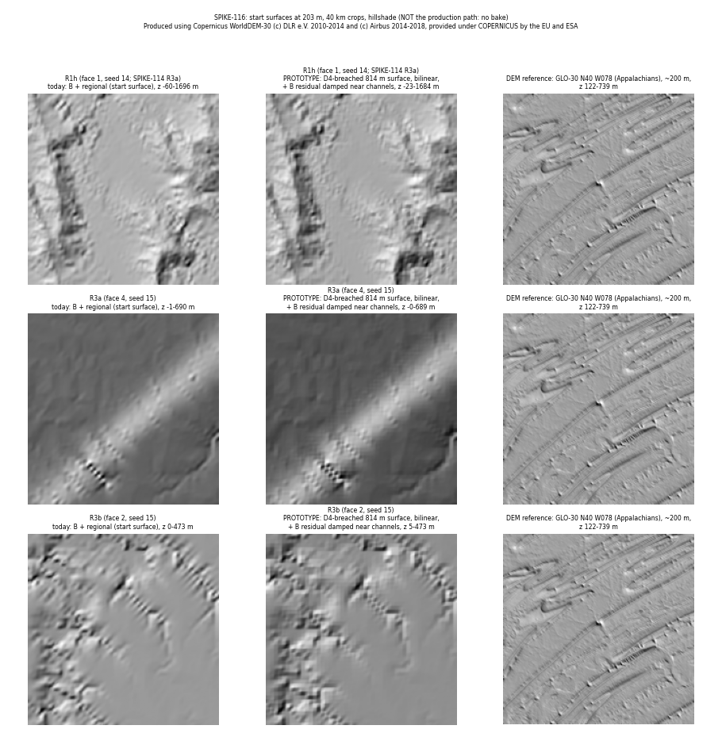
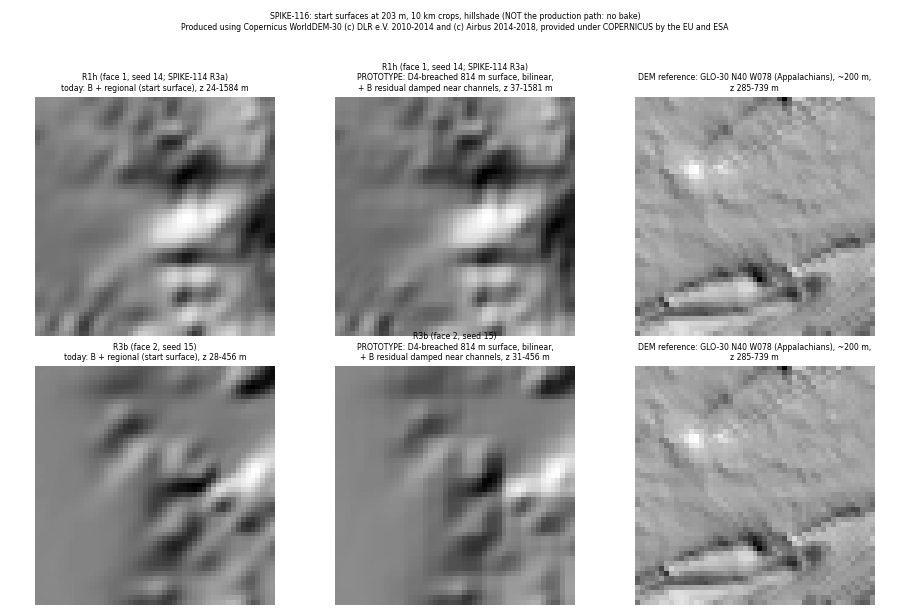

# SPIKE-116: a base whose sub-km relief drains at L

Opened: 2026-11-14
Question: can the stage that builds B (its 611 m lattice) make relief that drains at L (101.8 m) by construction, so rivers need neither canyons nor lakes?
Why it matters: P3 E1 (owner, 2026-11-14: "double down on rivers"; fix at the earlier, more global stage). SPIKE-114: closed basins lie on 73-75 % of the river length at L.
Time box: 1 day of agent work (about 4.5 h used).
Success criteria: on the windows R1h, R3a and R3b, compare against today's B:
- SPIKE-114's metrics: river length over closed basins; cut over 50 m with every pit breached; river cells in lakes when pits over 20 m stay;
- relief at 200 m-1 km kept;
- a picture sheet with a DEM reference.
Fallback if it fails: route at L with lakes kept, or the region-wide carve or erosion at L (SPIKE-115), and record the gap.
Code location: branch `spike/drain-base` (from crusader's `spike/rivers-at-l`; local, never merged). Examples `crates/cache/examples/drain_base.rs` and `crates/app/examples/dem_dump.rs`.

## Answer
- **No: B is not where the L basins come from.** Five base-stage variants change B's 611 m lattice before the regional solve: breach, fill, Génevaux 2013 rivers-first, Schott 2024 multi-scale breach, and Lindsay 2016 constrained breach. All of them leave 61-70 % of R1h's river length on closed basins, against 71 % today.
- **The cause is the hand-over from the 814 m solve to L.**
  - The solved regional surface drains at its own grid: 5.9 % of river length on closed basins, 0.1 % over 5 m deep.
  - The same surface read bilinearly at L: 74.5 % (strict count 66.9 %), 44 % over 5 m deep.
  - A D8 step to a diagonal neighbour between two higher cells becomes a saddle in any bilinear or C1 read of the grid.
  - B alone at L shows the same: 71.9 %.
- **A hand-over that drains by construction meets the cut and lake bars on all three windows.** It has three steps:
  1. The solved surface is breached over 4 neighbours, so every regional cell drains through an edge (land floored at sea level + 5 mm).
  2. The result is read bilinearly at L: a bilinear surface over such a grid has no closed basin in the continuum.
  3. B's sub-814 m residual is added back, damped to 0 toward the channels of that surface over 400 m (Génevaux's idea applied to the residual).
- Results of the hand-over:
  - cut over 50 m: 0.00 % on all three windows;
  - lakes: 0-3.1 % of river cells;
  - relief kept: 85-90 % of the 200 m-1 km band and 94-99 % of the 1 km block relief.
- **Not met:** shallow closed basins stay on 25-35 % of the river length (cut p99 at most 13 m).
  - The regional cell-centre lines fall between L samples (8 per cell), so the samples beside a breached corridor see its walls.
  - A burn of the river lines at L (K7's own pass) or one erosion round at L (SPIKE-115) would close them.

## Method
- `drain_base` reads B's lattice (16,384 nodes a face edge, 611 m) over a window and applies a variant to its nodes. It then runs the regional solve (`region_front`) on it and builds K7's start surface `B + regional` at L. It routes that surface at L as SPIKE-114 does (plain flood, D8 accumulation, channels at 75 km2).
- It reports, on the window's region core (no commit needed):
  - river length over closed basins (cells over 5 cm under a 1 mm-a-cell fill; strict: under a 1e-7 m fill);
  - cut over 50 m with every pit breached (D = infinity);
  - river cells in lakes with pits over 20 m kept (D = 20 m);
  - relief: the std of the 200 m-1 km band (box means over 3 and 11 cells) and the 1 km block range p50 / p95;
  - the lattice change.
- `PLANET_DIAG` routes B alone, the solved regional surface alone (bilinear) and the 814 m surface itself. `PLANET_TRANSFER=d4` replaces the start surface with the 4-neighbour hand-over.
- The windows are SPIKE-111's, cut to 620-cell region cores with a margin of 200, to stay within 12 GB:

| Name | Face | Region core (i0-i1, j0-j1) | Seed | Note |
|---|---|---|---|---|
| R1h | 1 | 8056-8675, 760-1379 | 14 | the r3a stores' window (SPIKE-114 and SPIKE-115 call it R3a) |
| R3a | 4 | 368-987, 4720-5339 | 15 | centred in SPIKE-111's 168-1187, 4520-5539 |
| R3b | 2 | 9968-10587, 8304-8923 | 15 | centred in SPIKE-111's 9768-10787, 8104-9123 |

- Every run went through `cargo xtask heavy`.

## Base-stage variants (R1h)
| Variant (on B's lattice, before the solve) | River on closed basins | Cut over 50 m | Lakes | Band std / 1 km p50 / p95 | Lattice change |
|---|---|---|---|---|---|
| none (today) | 71.2 % | 8.18 % | 47.7 % | 11.4 / 53.0 / 304 m | - |
| breach (complete, 8 neighbours) | 69.6 % | 13.25 % | 47.7 % | 14.7 / 59.3 / 333 m | 5.1 % of land nodes lowered, p95 512 m, max 1,350 m |
| fill | not run | | | | |
| rivers first, Génevaux-like: low-pass network, relief rising from it, then breach (candidate a) | 61.1 % | 10.00 % | 39.6 % | 13.7 / 59.8 / 334 m | lowered over 50 m on 1.5 % of nodes, max 1,383 m |
| multi-scale breach, Schott 2024 (radii 4, 2 nodes, then plain) | 67.8 % | 11.65 % | 46.8 % | 13.1 / 59.2 / 315 m | lowered over 50 m on 6.7 % of nodes |
| constrained breach 20 m then fill, Lindsay 2016 | 69.2 % | 4.75 % | 38.9 % | 9.0 / 33.6 / 216 m | raised p95 695 m (fills) |
| low-pass B, radius 2 nodes twice (diagnostic, flattens) | 60.7 % | 4.78 % | 35.9 % | 8.0 / 38.7 / 244 m | - |
- Even B without its sub-2 km relief leaves 60.7 % of the river length on closed basins. The relief of B below 814 m is a minor share of the cause.
- Génevaux's known limit, "flat rivers can cut through high mountains", shows at the lattice level: its breach lowers nodes by up to 1,383 m, and 10 % of the river cells are still cut over 50 m at L.

## Where the basins come from (R1h, `PLANET_DIAG`)
| Surface routed at L | River on closed basins (1 mm fill) | Strict | Over 5 m deep |
|---|---|---|---|
| the solved surface at its own 814 m grid | 5.92 % | - | 0.10 % |
| the solved surface, bilinear at L | 74.46 % | 66.93 % | 44.0 % |
| B alone (C1 lattice read) | 71.89 % | 65.46 % | 44.3 % |
| B + regional (today's start surface) | 71.24 % | 69.28 % | 46.1 % |
| the solved surface breached over 4 neighbours, bilinear | 30.74 % | 25.19 % | 4.9 % |
| that + B's residual damped near channels (the hand-over) | 30.52 % | 26.30 % | 4.4 % |

## The 4-neighbour hand-over on the three windows
| Window | Surface | River on closed basins | Cut over 50 m (D inf) | Cut p99 | Lakes (D 20 m) | Band std | 1 km block p50 / p95 |
|---|---|---|---|---|---|---|---|
| R1h | today | 71.24 % | 8.18 % | 127.5 m | 47.69 % | 11.43 m | 53.0 / 303.7 m |
| R1h | hand-over | 32.63 % | 0.00 % | 12.6 m | 3.09 % | 10.31 m (90 %) | 52.1 / 292.2 m (98 / 96 %) |
| R3a | today | 63.42 % | 0.01 % | 13.3 m | 1.63 % | 1.39 m | 8.4 / 54.1 m |
| R3a | hand-over | 35.21 % | 0.00 % | 3.1 m | 0.00 % | 1.22 m (88 %) | 8.3 / 53.8 m (99 / 99 %) |
| R3b | today | 64.90 % | 1.15 % | 52.1 m | 25.34 % | 3.65 m | 10.5 / 87.7 m |
| R3b | hand-over | 24.50 % | 0.00 % | 4.6 m | 0.00 % | 3.09 m (85 %) | 10.3 / 82.6 m (98 / 94 %) |

| What the 814 m breach costs | R1h | R3a | R3b |
|---|---|---|---|
| land regional cells lowered | 38,985 of 724,357 | 48,799 of 727,003 | 51,717 of 883,611 |
| lowering p50 / p95 / max | 9.8 / 149 / 744 m | 0.4 / 12 / 347 m | 3.4 / 47 / 208 m |
| lowered over 50 m (814 m-wide valleys, not one-cell canyons) | 1.03 % of land | 0.06 % | 0.27 % |
| sea share at L, today / hand-over | 31.0 / 31.4 % | 18.7 / 20.7 % | 11.3 / 11.8 % |
- Without a floor at the sea level the breach pushed coastal plains under 0 m (R3a: sea share 18.7 to 21.9 %, lakes 64.5 %). The floor (sea + 5 mm, as the regional carve's rule) brought the lakes to 0 % and the sea share to 20.7 %. The remaining 2 points: plains held at the floor take B's residual and fall just under 0 m where it is negative (a reading, not traced). The residual needs the same floor, which was not run in this time box. The table holds the floored runs.

## Findings
- **The hand-over is the earlier stage the evidence points at.** Neither B nor the regional solve is the source. The basins come from reading a D8-drained 814 m surface at 101.8 m. Any interpolant (bilinear, Catmull-Rom, GEN-188's monotone cubic) puts a saddle on a diagonal drainage step.
- **4-neighbour drainage at 814 m is the construction that survives interpolation.**
  - It could come from the regional solve itself (routing over 4 neighbours) or from a final pass after the rounds (as here).
  - Its cost is valleys cut along the grid axes at 814 m: 1 % of R1h's land is lowered over 50 m.
- **Axis-aligned grooves.** The breached corridors follow the 814 m grid's axes. On R3b's 40 km crop they show as stair-step valley segments; at 10 km in high relief the change is not visible.
- **Remaining shallow basins** (25-35 % of the river length, p99 cut 3-13 m) come from sampling. The L cell centres sit off the regional cell-centre lines (8i + 3.5), so the samples beside a corridor that drops 1 cm per 814 m step pick up the wall's slope. They are within reach of K7's burn of the routed lines, or of SPIKE-115's one round at L.
- **SPIKE-114's metric counts flats.** Its 1 mm-a-cell fill raises long flats graded at 1 mm per 814 m. The strict count is 2-8 points lower; the deep share (over 5 m) is the same in both.
- **For SPIKE-115:** its one round at L met the bars on R1h but left 29.1 % and 13.7 % of the river length in shallow basins on the flat windows. The hand-over here leaves 35.2 % and 24.5 % and adds no cuts. The two are complementary: the hand-over removes the deep basins before the round; the round at L closes the shallow ones.

## Methods from the literature review (`lanes/digest/2026-11-14-rivers-literature.md`)
- Génevaux 2013, rivers first: candidate (a) on B's lattice, and the damping of B's residual toward the channels in the hand-over.
- Schott 2024 multi-scale breaching: on B's lattice (no gain). Its multi-scale erosion is SPIKE-115's.
- Lindsay 2016 constrained breach/fill: on B's lattice (no gain on the basins; it lowers the cuts by filling and halves the relief).
- Barnes 2014 Priority-Flood: the fills and the strict count.
- Tunnels and karst: not tested (out, lead 2026-11-14).

## Visuals
Not the production path: no bake was made with the new start surface (as in SPIKE-114). These are top-down shaded crops of the start surface at 203 m (every second L cell), computed by the probe.

One row per window: today's start surface `B + regional` (left), the 4-neighbour hand-over (middle; prototype), and GLO-30 N40 W078 (Appalachian Valley and Ridge, about 200 m) as the DEM reference (right). The crop is the window's highest-relief, mostly-land 40 km square. R3b's middle panel shows the axis-aligned valley segments of the 814 m breach.

R1h and R3b at 10 km: in the highest-relief crops the hand-over is hard to tell from today's surface; both lack GLO-30's fine ridges (no relief below about 600 m exists in either).

DEM figures and images: produced using Copernicus WorldDEM-30 © DLR e.V. 2010-2014 and © Airbus 2014-2018, provided under COPERNICUS by the European Union and ESA; all rights reserved.

## Reproduce
- Probe: `cargo xtask heavy target/release/examples/drain_base.exe --face F --region i0,i1,j0,j1 --seed S --variant none|breach|fill|rivers|msbreach|hybrid|lowpass`.
- Add `PLANET_DIAG=1` for the decomposition and `PLANET_TRANSFER=d4` for the hand-over.
- Raw lines: `raw/`.
