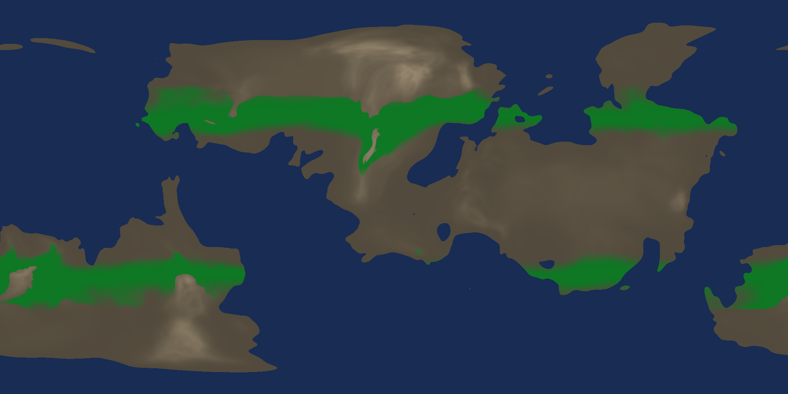
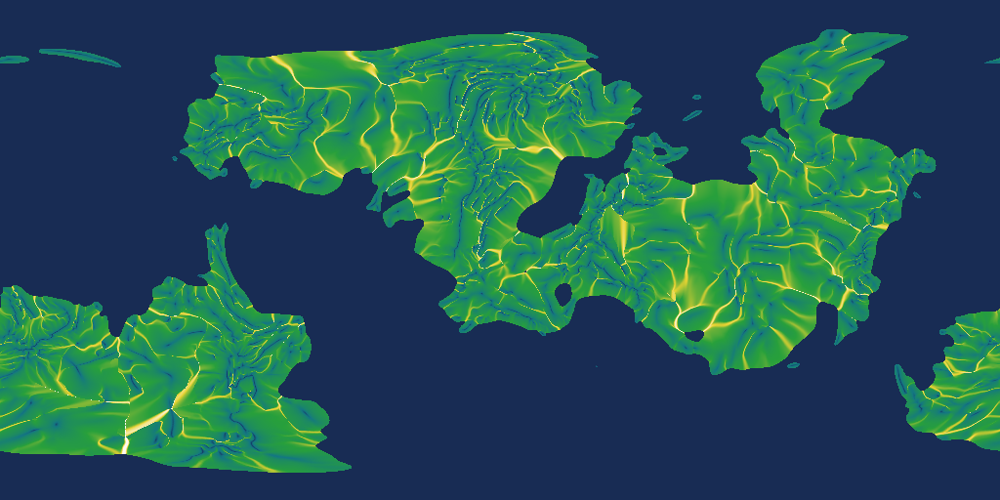
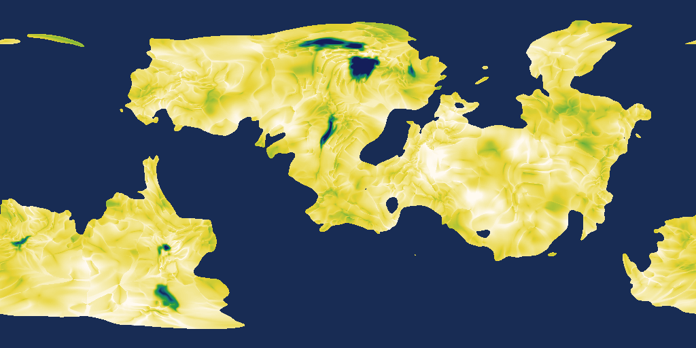
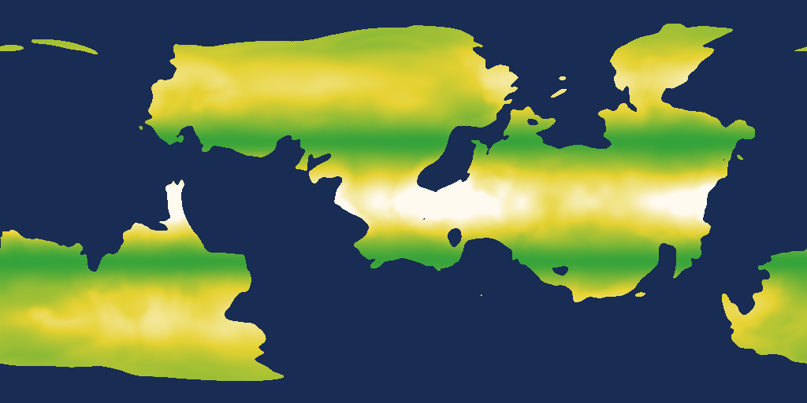
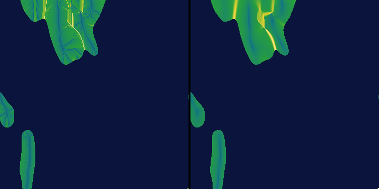

Opened: 2026-10-22
Question: What do flow accumulation and soil depth cost (bake time, memory, storage) at the store's resolution and at a coarse grid with regional refinement, does a physical suitability rule (the pine) work on the existing world, and should materials read a per-tile driver vector or evaluate drivers per pixel?
Why it matters: ADR 0076 (proposed) and the M8 driver-maps plan commit to a driver list and a storage scheme only after D1 measures the open costs.
Time box: about 4 h of agent work; indicative on the RTX 3080 Ti laptop machine, no perf window, no `cargo xtask perf`.
Success criteria: numbers for the three questions, one pine debug image of the whole planet and two close views, a recommended first driver list, the open points of ADR 0076 updated as a proposal.
Fallback if it fails: drivers computed only locally per tile (slope, curvature, insolation) and no global flow stage.
Code location: `spikes/driver-maps/proto/` (throwaway; kept as `driver-maps-prototype.patch` in this folder, not merged).

# SPIKE-30 D1: driver-maps measurements

## Summary
- **Flow accumulation and soil depth cannot be baked in memory at the store's 16384 cells per face edge** (1.61 G cells): the prototype needs 16.4 B per cell (measured at 4096), about **26 GB** at 16384 against the 8 GB budget (CON-21). The sequential work itself is cheap (priority-flood, multiple-flow-direction routing and the derived maps: 178 ns per cell at 4096, about 6 to 7 minutes single-threaded extrapolated to 16384), so the problem is memory and a global priority-flood, not time.
- **A coarse grid is cheap**: 2048 cells per face edge (25 M cells, 5 km) takes **3.5 s** and 0.43 GB for flow, slope, wetness and soil together; 4096 (100 M cells, 2.4 km) takes **18 s** and 1.65 GB. Storage is 1 byte per channel and cell: 25 MB (2048) or 101 MB (4096) per channel, against 1.61 GB per channel at 16384.
- **Regional refinement works as a job**: a 1280 x 1280 patch (1.64 M cells at the 16384 grid, 0.77 km cells, 960 km) costs **0.9 to 1.0 s** wall (4 threads: 0.6 s to sample the eroded height, 0.3 s routing and derivation), 27 MB. Routing is 200 ns per cell; the height sampling dominates (1.3 us per cell per thread, the eroded field).
- **The pine rule works** on the existing world: a belt of forest at the mid-latitudes, absent in the tropics, on high plateaus and at the poles; 21.4 % of land pixels above 0.5. One rule costs 7.2 ns per point on the CPU.
- **Per-tile storage of the driver vector beats per-pixel evaluation** from coarse textures: a per-pixel read of a 2048 grid is visibly blocky at ground scale (the close views), and per-pixel needs 100 MB of GPU texture per four channels; a 9 x 9 vector per tile costs 81 B per channel (810 B for ten channels, 7.1 MB for the 8,763-tile draw set) and 5.5 us to fill from the grid, against 40 ms to generate a tile (SPIKE-23). The shader evaluation cost is **not measured** (no GPU run in this spike).

## Method
- Prototype: `driver-maps-prototype.patch` (a standalone crate over `planet-generators`; not in the workspace). Windows, release build, one process at below-normal priority, `-j 2` builds, 1 thread for the bake stages that are sequential and 1 to 4 threads for height sampling (the per-thread rate is reported).
- **World:** the seed-42 single planet at Earth's radius (6371 km); the global field `global::sample` (continents, ranges; land 47.5 %), the eroded field `ErosionField` over a 2048 in-memory bake for the regional patches. Cell-centred cube-face grids with the tangent warp; the 16384 grid has 0.61 km cells at the equator of a face. (The store is vertex-centred with 16385 vertices per edge; the difference is immaterial here.)
- **Routing on the sphere across cube edges:** neighbours of an edge cell come from the direction (`face_to_direction` with the face coordinate extended past +-1, then `direction_to_face`), 8 neighbours, no seam logic elsewhere. Cell area from the exact solid angle of the tangent-warped cell; cell edge length as the square root of the area; diagonal neighbours at sqrt 2.
- **Depressions:** priority-flood with epsilon (Barnes 2014) from the coast (cells at or below 0 m are the sea and the sinks); the pop order is stored and walked backwards for accumulation. Land lakes are filled (no endorheic basins).
- **Multiple flow direction:** Freeman, slope to the power 1.1 over the strictly lower neighbours of the filled surface, normalised; the single-direction (D8) variant for comparison (ADR 0030 point 2).
- **Soil depth (stand-in formula, not calibrated):** 2.5 m x slope factor exp(-slope/18 degrees) x curvature factor (1 + 0.5 tanh) x flow factor (0.5 to 1 from log10 of the upstream area) x lithology (0.5 to 1.5 from value noise bands) x altitude factor (to 0 from 2500 to 4500 m), clamped to 0 to 8 m. Stored as 8 bits (square-root coded). Slope, wetness index ln(a / tan slope) and soil are one pass over the 3 x 3 neighbourhood.
- **Pine rule (the briefing's table):** trapezoid responses (smoothstep rise and fall) of soil depth (0.1 / 0.4 / 3 / open m), moisture index (0.2 / 0.35 / 0.7 / 0.85), temperature (-12 / -4 / 12 / 18 C), slope (open / 0 / 30 / 45 degrees) and altitude above the tree line (open / open / -200 / 0 m; the tree line is where the sea-level temperature minus 6.5 C/km reaches -4 C); suitability is the product. Moisture index (stand-in): half the precipitation over 2200 mm, half the wetness index scaled from 3 to 12.

## Q1: bake cost and storage
Measured on the machine while another session was building (below-normal priority); times are wall seconds of the stage, sequential unless noted. Height sampling is the existing global field: 1.3 to 1.5 us per cell per thread.

| Grid (cells per face edge) | Cells | Height sample | Priority-flood | Accumulate (MFD) | Slope, wetness, soil | Sequential total | ns per cell | Peak working set |
|---|---|---|---|---|---|---|---|---|
| 512 | 1.57 M | 2.0 s (1 thread) | 0.07 | 0.07 | 0.05 | 0.18 s | 117 | 33 MB |
| 1024 | 6.29 M | 8.1 s (1 thread) | 0.29 | 0.32 | 0.17 | 0.78 s | 124 | 114 MB |
| 2048 | 25.2 M | 9.2 s (4 threads; 37 s CPU) | 1.34 | 1.44 | 0.70 | 3.5 s | 138 | 428 MB |
| 4096 | 100.7 M | 38.7 s (4 threads; 155 s CPU) | 6.54 | 8.52 | 2.89 | 18.0 s | 178 | 1649 MB |
| 16384 (extrapolated) | 1610 M | about 38 min CPU (about 3 min on 16 threads) | about 6 min | | | about 6 to 7 min | about 220 to 250 | **about 26 GB** |

- The ns per cell rises with the grid (cache misses: 117 to 178); the extrapolation takes 220 to 250 at 16384. The priority-flood is inherently global and sequential in this form; parallel variants (a tile-wise flood with a spill-over graph) exist and are not tried here.
- Memory at 16.4 B per cell: height 4, filled height 4, pop order 4 (land only), accumulation 4, soil, slope, wetness and lithology 1 each. At 16384 this is 26 GB; with u16 height and a sparse land-only order it would still be above 8 GB. **The whole-planet 16384 grid is not feasible in core; it needs a tiled or hierarchical scheme, or the coarse grid below.**
- Land is 47.5 % of cells; the flood seeds are the coast cells (97 k at 4096, heap peak equals the seed count, so the heap stays small).
- **Storage per channel** (8 bits per cell):

| Grid | One channel | The two global channels (flow, soil) | Four channels (flow, soil, slope, wetness) |
|---|---|---|---|
| 2048 | 25 MB | 50 MB | 101 MB |
| 4096 | 101 MB | 201 MB | 403 MB |
| 16384 | 1.61 GB | 3.2 GB | 6.4 GB (x2 at 16 bits) |

- Slope, curvature, aspect and insolation need no global store: they come from the tile's own height lattice at generation time. Only flow accumulation and the soil base need the global stage.

### Coarse plus regional refinement
Patches on the 16384 grid, eroded height field, 4 threads for the sampling and 1 for the routing; a patch's border cells are outlets (no inflow from outside), so a halo (192 to 256 cells) is added around the area of interest.

| Patch (cells) | Across | Height sample (eroded) | Flood | Accumulate | Derive | Routing ns per cell | Working set |
|---|---|---|---|---|---|---|---|
| 512 x 512 | 300 km | 0.08 s | 0.02 | 0.02 | 0.01 | 182 | 4 MB |
| 1024 x 1024 | 600 km | 0.33 s | 0.07 | 0.09 | 0.05 | 200 | 17 MB |
| 1536 x 1536 | 900 km | 0.76 s | 0.16 | 0.20 | 0.11 | 202 | 39 MB |
| 2048 x 2048 | 1190 km | 1.57 s | 0.31 | 0.41 | 0.20 | 218 | 69 MB |
| 1280 x 1280 (the close views; 768 + 2 x 256 halo) | 750 km | 0.57 to 0.64 s | 0.32 to 0.34 s (routing and derive together) | | | 198 to 205 | 27 MB |

- A patch is a background job of about one second per 1.6 M cells; sampling the eroded height is 1.3 us per cell per thread and is most of it (the tile generator pays it anyway).
- Covering all land at 16384 by patches would be about 1.2 G cells with halo overhead (1.56 x), minutes of CPU and no whole-planet memory; it is not needed, patches are made where the player is.
- **Coarse-to-fine consistency is not solved.** A patch routes only what is inside it. The Pearson correlation of ln(upstream area) between a refined patch (eroded height, so with creases) and the coarse grid looked up per cell is 0.04 and -0.07 in the two close views: the eroded creases route water differently from the 5 km grid, and no inflow from outside the patch is injected. A real design needs the coarse accumulation to be injected at the patch border (and the refined routing to be consistent with it); not built, not validated here.
- Edge check of ADR 0030 point 2 (the across-edge gradient before the stage ships), 1024 grid: mean |ln A difference| of orthogonal land neighbours, across a face edge against inside a face. D8: 0.71 against 0.459 (ratio **1.55**; rivers with A of 1000 km2 or more 1.33). MFD: 0.171 against 0.114 (ratio **1.50**; rivers 1.66). The 1.6 x and 2.7 x ratios of SPIKE-03 were drainage-area ratios; here the ratio is about 1.5 for both routings and **not explained**: candidate causes are the cell-size model (the edge length is the square root of the area, ignoring the anisotropy of the warped cells) and the one-sided neighbour relation across edges. MFD removes the lattice hatching: the typical neighbour change in ln A inside a face drops 4 x (0.459 to 0.114) and the D8 crop shows axis-aligned segments that MFD does not. D8 is 1.4 x faster to accumulate (0.22 s against 0.31 s at 1024).

## Q2: the pine rule on the world
- Whole planet, 2048 x 1024 equirectangular, coarse drivers from the 2048 grid (nearest cell), height, temperature and precipitation from the global field at the pixel: 2.7 s (1.28 us per pixel including the global sample). 21.4 % of land pixels have suitability above 0.5, 27.9 % above 0.05 (the image: green is suitability, brown is the ground, shaded by height).
- The rule behaves as intended: forests form belts at the cool mid-latitudes, stop at the tree line on the high ground (the bare patches inside the green are the ranges above the tree line), stop where it is too dry or warm (none in the tropics), and thin out at the edges by themselves (the soft margins).
- Two close views, chosen automatically as the best-contrast forest edges in ranges, 768 x 768 cells (470 km) of the 16384 grid, **left: refined drivers** (a patch with halo from the eroded height, drivers at 0.61 km), **right: coarse 2048 drivers** looked up per fine cell, same height and shading:
  - View 0 (lat 17.6, lon -14.8): mean suitability 0.539 refined against 0.561 coarse, mean |difference| 0.027.
  - View 1 (lat -37.3, lon -100.5): 0.710 against 0.708, mean |difference| 0.001.
  The refined view shows creased valleys and thin soil on slopes, the coarse view shows 5 km steps. The two agree on the large-scale belt, so a coarse grid carries the placement of a whole forest and the refinement the valley detail.
- **Soil depth stand-in is too thick:** most land has more than 3 m (the image saturates), so the pine's soil criterion rarely bites. The formula needs calibration against the lithology and a rule for rock exposure before M8; the cost numbers do not depend on it.
- Plugging into the ground materials (LOOK-008): the weights function takes eight inputs, three of them the reserved driver slots (soil depth, moisture, insolation), and one `(lo, hi)` smoothstep pair per input and material. The pine's trapezoid is a rise and a fall on one input, so it needs **two pairs per input (or a quad `(lo0, hi0, hi1, lo1)`)**: with one pair a material can only be monotone in a driver (more soil, more grass), not peak at a depth. This is a spec point for M8 (LOOK-008 says a driver is "a new value in a reserved slot and new curves", which holds for monotone curves only).
- Eight reserved slots are not enough for a ten-channel list; the briefing's driver vector (at most 12 channels, ADR 0076 point 3) is a wider interface than LOOK-008's eight inputs.

## Q3: per-tile driver vector against per-pixel evaluation
| | Per tile (vector of N channels, 9 x 9, 8 bits, built by the tile job) | Per pixel (coarse driver textures sampled in the shader) |
|---|---|---|
| Storage | 81 x N B per tile: 324 B for 4 channels, 810 B for 10; 7.1 MB for the 8,763-tile draw set (ADR 0031) at 10 channels; the climate's 9 x 9 pair of f16 is 324 B | the grid on the GPU: 100 MB (2048) or 403 MB (4096) per 4 channels, resident for the whole planet |
| CPU cost | 5.5 us per tile for 4 channels read from the grid (nearest; bilinear about 3 x), against 40 ms to generate a tile (SPIKE-23): below 0.02 %; no new per-frame cost | none per frame; one upload |
| Resolution at ground level | the vector is built from the coarse grid and refined by the tile's own height lattice (slope, curvature, insolation), and a patch result can replace the grid value: smooth, 9 x 9 per tile  | the grid's own: 2.4 km (4096) or 5 km (2048) cells; visibly stepped in the close views |
| Shader cost | bilinear read of a per-tile table (a small texture array, as the climate) plus the weights function | a cube-face-array fetch (about 3 to 4 fetches for bilinear and gradients) plus the weights function; **both: not measured** (no GPU run); the weights function itself is the same code in both |
| Rule evaluation on the CPU (placement, CON-14) | the same driver values as the shader reads, from the same tile or the same grid; **7.2 ns per point** for the pine rule | a cube-face lookup of 42 ns per point by direction (nearest, 3 channels) plus the rule |
| Consistency with CPU placement | exact: the tile vector is a deterministic function of the stored grid and the tile height; the CPU reads the same values | the shader reads a GPU copy of the grid; the CPU needs the same grid and the same interpolation |

**Recommendation: per tile**, with the global grid a CPU-side stored field. It costs less than 1 % of tile generation, keeps the smooth look at ground scale, lets local terms (slope, curvature, insolation, wetness from the tile's own heights) join the coarse ones, and needs no whole-planet GPU texture. The GPU time of the two ways is the open item (an ad hoc measurement over the SPIKE-27 prototype's detail pass would answer it).

## Recommended first driver list
Ten channels (the briefing's set), with the stage and what it costs:

| Driver | Stage | Stored? | Cost (this spike) |
|---|---|---|---|
| elevation, continentalness | global (exists) | in the bake | exists |
| temperature, precipitation | global (exists) | in the bake | exists |
| slope, curvature, aspect | tile, from the tile's height lattice | per tile (in the vector) | cheap, with the tile job |
| insolation | tile, analytic from the normal and the latitude | per tile | cheap |
| **flow accumulation** | **global pre-bake, 2048 or 4096 grid, MFD**, refined per patch at ground levels | **grid, 1 channel (25 or 101 MB)** | 3.5 s or 18 s; patch 1 s per 1.6 M cells |
| **soil depth** | **global pre-bake at the same grid**, thinned by the tile's slope and curvature | **grid, 1 channel** | 0.7 s or 2.9 s on top of flow |
| wetness index, moisture | tile, from flow and slope and the precipitation | per tile | cheap |
| rock hardness (lithology) | analytic noise, no store | none | 1 to 2 noise evaluations (about 0.1 us) |

- The stored global part is **two channels: flow accumulation and soil depth** (50 MB at 2048, 201 MB at 4096), not a driver store at 16384.
- Sediment (the briefing's expensive driver) is not measured here: it needs the erosion and deposition processes (stream-power incision), not only routing; the routing and priority-flood measured here are its first half.
- Grid size choice (2048 or 4096): 4096 (2.4 km cells, about 6 km2 each) costs 18 s and 1.65 GB once; 2048 (5 km cells, about 24 km2 each) costs 3.5 s. Both are far below the 10-minute bake budget. The owner's need for visible rivers on the global scale decides it.

## Open and not done
- The coarse-to-fine consistency (inflow injection at patch borders) and the unexplained 1.5 x edge ratio.
- The soil formula and the moisture index are stand-ins; calibration and a lake/endorheic treatment (land depressions are filled here) belong to the M8 design.
- GPU cost of per-tile against per-pixel; the whole-planet 16384 grid out of core (a tiled flood) was not built.
- No sediment, no insolation image.

## Visuals
All renders are from the CPU prototype (no adapter), the seed-42 world, equirectangular views with the global field's pole axis (COORD +z).

## Raw numbers
`raw/bake-1024-seed42.txt`, `raw/images-2048.txt` (the 2048 row, the pine and close-view numbers), `raw/bake-4096.txt`, `raw/refine-bench.txt`, `raw/compare-routing-1024.txt`, `raw/evalbench.txt` (the 512 row). The 256 and 512 bakes of an earlier world seed were dropped. The working sets of the patches are computed at 16.4 B per cell, not measured; the bake working sets are the process peak.
