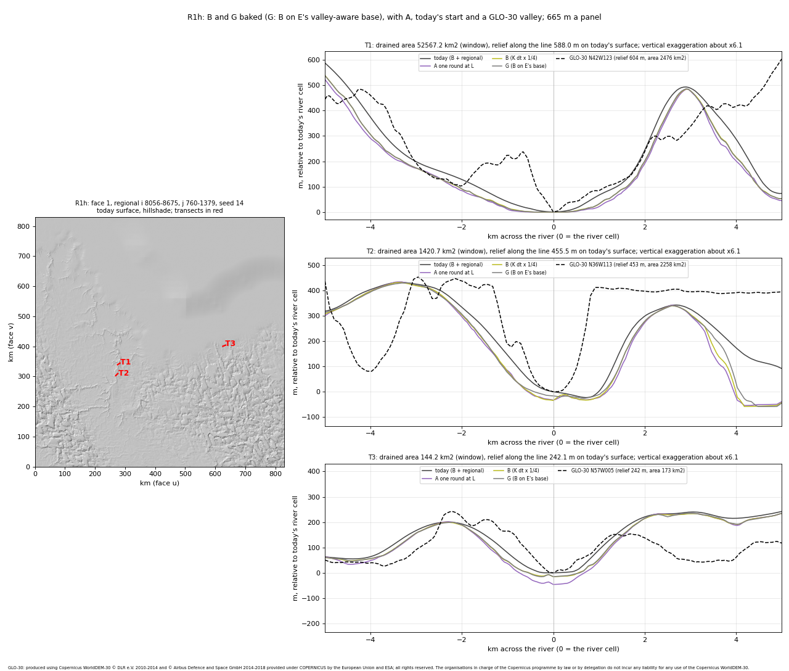
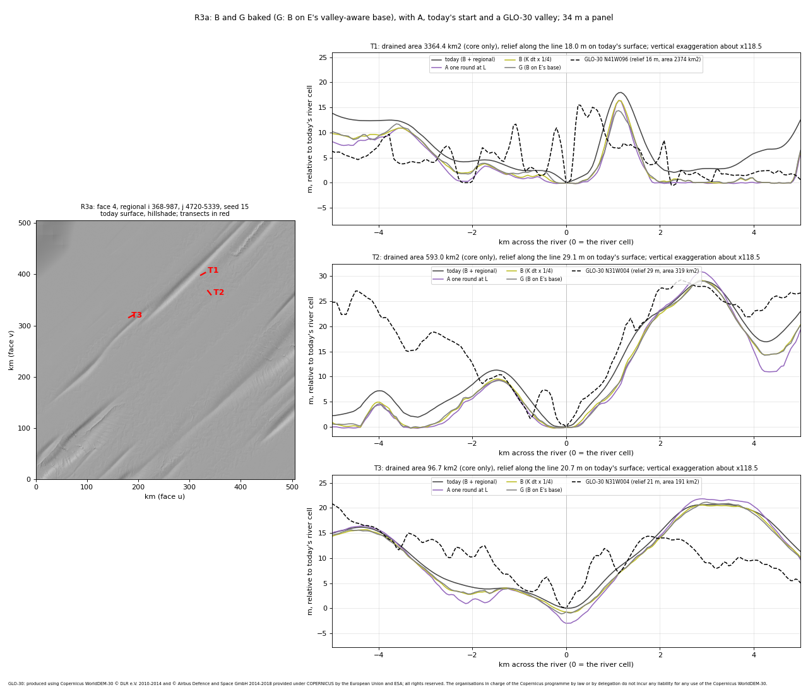
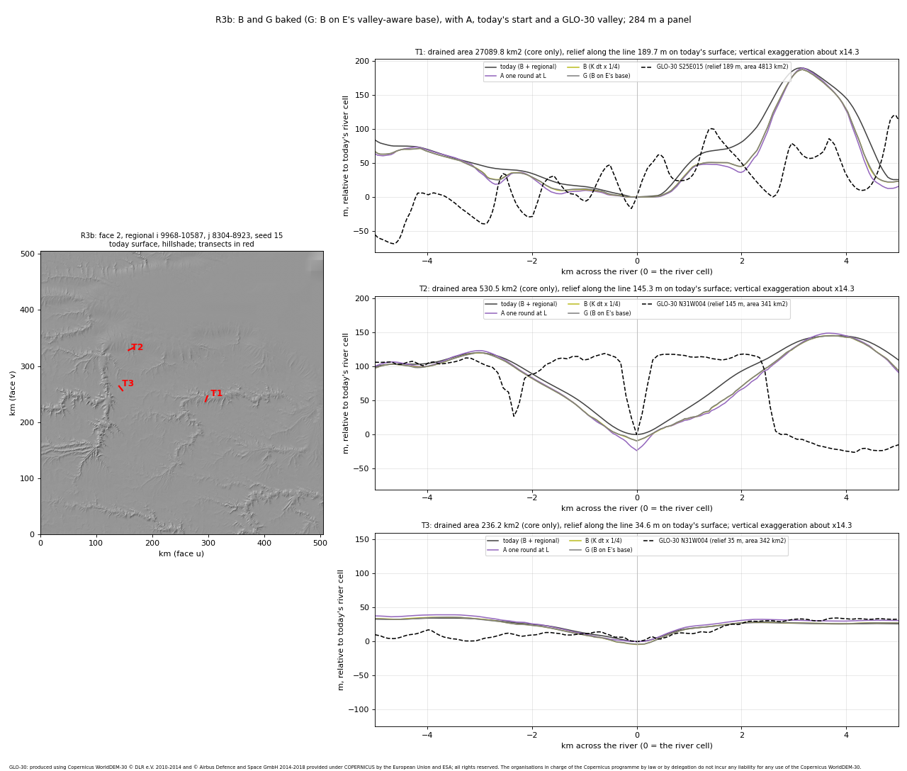
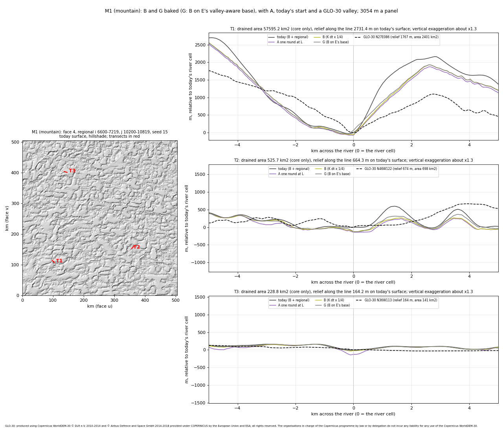
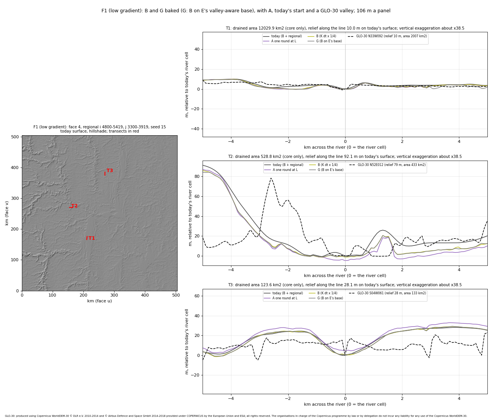

# SPIKE-125: variant G, B on E's valley-aware base

Opened: 2026-11-16
Question: does B (one round at L, K dt x 1/4), the D-1 front-runner, improve when its start surface takes E's valley-aware residual (Agt G's "fix the base first", tested so far only on top of D as variant E)?
Why it matters: P3 E3, D-1 (how drainage becomes valid at L); the owner's question of 2026-11-16 (lead #130).
Time box: 1 day (lead, 2026-11-16).
Success criteria: G baked on all five windows by the A-C binary from a start file; every column of the D-1 table (`spikes/e3-variants-bc/results/d1-table.md`) measured beside B; the T1-T3 cross-sections; no re-calibration.
Fallback if it fails: report G as it is (lead #130). Not needed.
Code location: spike branch `spike/e3-def` (`crates/cache/examples/drain_base.rs`, `PLANET_TRANSFER=g`); bakes with explorer's `bake_eroded` (spike/e3-variants-bc 811cbea4, the bits of a07b404c); tables with main's `cargo xtask river-gate --table` (main a7a4e311).

## 1. The variant (one thing changed against B)
| | Start surface (what the L round starts from) | Then |
|---|---|---|
| B (explorer's stores) | today's surface: B + regional | one round at L with K dt x 1/4 (`--k-scale 0.25`), K7 |
| G | today's surface with B's sub-814 m residual replaced by E's: attenuated toward the channels over 1,200 m and averaged along the downslope direction over +-4 L cells (channels and directions as in E: the 814 m surface breached over 8 neighbours, read at L on D8-diagonal triangles, routed at L, area at least 75 km2); no rebuild from the 814 m nodes, no capped breach | the same: `bake_eroded --window <w> --k-scale 0.25 --threads 8 --start <file>` (explorer's B invocation, confirmed 2026-11-16) |

- **Bit check:** B's own start (B + regional, the probe's dump) baked through `--start` on R1h gives a gate row identical in every column to explorer's b-r1h-s0.25 (raw `raw/gate-b-g.csv` source rows, `raw/bake-r1h-bcheck.txt`).
- **No re-calibration:** B's k-scale and E's base settings as they were.
- **Recorded this time:** bake time and the bake process's peak working set (polled every 0.5 s; `raw/bake-*.txt`).

## 2. The D-1 table, B and G
Ridge columns by SPIKE-122's rule (sections 6 and 7: today's ridge cells lowered over 20 m; saddles: cut-throughs at a 1 km2 channel, before K7 = the surface K7 starts from, explorer's `--dump-pre-k7`); gate columns by main's reader a7a4e311; B's gate row read in the same run (it equals explorer's D-1 table). Full gate rows: `raw/gate-b-g.csv`; the rows for explorer: `d1-rows.csv`.

| Window | Variant | Ridge > 20 m before / after K7 % | Saddles before / after K7 (75 km2 before) | Ground > 50 m below start % | Relief 1 km store / start m | Corridor k_c 2 raw / snapped % | Edge 2 km % | G-DRAIN basins % | G-INCISION valley > 50 m % | Bake s | Peak GB |
|---|---|---|---|---|---|---|---|---|---|---|---|
| R1h | B | 2.17 / 24.21 | 764 / 1,915 (498) | 8.48 | 69.56 / 60.66 | 96.28 / 96.93 | 86.36 | 0.47 (pass) | 1.57 (pass, bar 1.80) | explorer | explorer |
| R1h | G | 4.08 / 28.65 | 1,495 / 4,193 (1,087) | 8.38 | 68.92 / 60.66 | 96.79 / 97.32 | 90.91 | 0.40 (pass) | 1.22 (pass, bar 1.80) | 397 | 5.25 |
| R3a | B | 0.34 / 2.51 | 2 / 29 (3) | 0.08 | 12.48 / 9.97 | 99.92 / 99.83 | 26.19 | 0.00 (pass) | 0.02 (pass, bar 0.10) | explorer | explorer |
| R3a | G | 0.33 / 2.53 | 3 / 28 (2) | 0.08 | 12.51 / 9.97 | 99.96 / 99.92 | 27.38 | 0.00 (pass) | 0.02 (pass, bar 0.10) | 395 | 5.04 |
| R3b | B | 2.74 / 9.88 | 228 / 432 (163) | 0.29 | 12.34 / 10.48 | 98.78 / 99.36 | 69.89 | 0.03 (pass) | 0.01 (pass, bar 0.10) | explorer | explorer |
| R3b | G | 2.66 / 9.77 | 245 / 473 (194) | 0.28 | 12.39 / 10.48 | 98.82 / 99.40 | 70.97 | 0.06 (pass) | 0.01 (pass, bar 0.10) | 399 | 5.05 |
| M1 | B | 9.58 / 75.06 | 12,506 / 22,386 (4,440) | 56.08 | 402.67 / 371.53 | 88.92 / 94.63 | 79.27 | 3.32 (pass) | 22.23 (pass, bar 40.80) | explorer | explorer |
| M1 | G | 26.09 / 78.14 | 21,615 / 32,703 (8,632) | 55.06 | 401.24 / 371.53 | 89.95 / 95.66 | 81.71 | 2.95 (pass) | 18.24 (pass, bar 40.80) | 1923 | 5.72 |
| F1 | B | 1.14 / 2.57 | 46 / 101 (58) | 0.01 | 13.26 / 11.49 | 96.15 / 98.33 | 34.48 | 0.00 (pass) | 0.00 (pass, bar 0.10) | explorer | explorer |
| F1 | G | 1.08 / 2.48 | 90 / 159 (98) | 0.01 | 13.13 / 11.49 | 96.22 / 98.47 | 34.48 | 0.00 (pass) | 0.00 (pass, bar 0.10) | 447 | 4.59 |

## 3. Findings
- **G passes both bars on all five windows** (basins 0.00-2.95 %, valley depth within every window's bar).
- **On the gate columns G is B within about a point:** a little better on R1h and M1 (valley depth 1.22 against 1.57 % and 18.24 against 22.23 %; corridor raw +0.5 and +1.0 points; edge +2 crossings each), and on R3a, R3b and F1 equal within 0.1 point except edge (R3a and R3b +1 crossing, about +1.1 points).
- **On the owner's fault class G is worse than B where there is relief:** cut-through saddles before K7 R1h 1,495 against 764 (2.0x), M1 21,615 against 12,506 (1.7x), F1 90 against 46; equal within 17 on R3a and R3b. Ridge cells lowered over 20 m before K7: R1h 4.08 against 2.17 %, M1 26.09 against 9.58 %.
- **Where G stands among the variants (saddles before K7):** R1h above A (1,156) and below D and E (about 3,700); M1 above A (16,665) and below D and E (about 25,700). E's residual damps the relief toward the channels, crests near the channels included; on B's base that adds ridge cuts that B's own base does not have.
- **Answer to the owner's question:** "fix the base first", in E's form, does not improve B; it buys about one point on the gate columns of the steep windows with 1.7-2x B's ridge cuts. B on its own base stays ahead on the ranking measure.
- **Cost:** a G bake takes 395-447 s on R1h, R3a, R3b and F1 and 1,923 s on M1, at a peak working set of 4.59-5.72 GB (bake process only; G's start surface is a separate 10-12 min probe run).
- **Cross-sections:** B and G nearly coincide on the transects (within about 50 m on M1, where G stands slightly higher on T2's ridge); the differences are in ridge cells between the transects (section 2's counts), not on the chosen lines.

## Visuals

R1h (face 1, seed 14): baked A, B and G on the SPIKE-119 transects, today's start surface and a GLO-30 valley at matched relief, one vertical scale. CPU sampling of the stores.

R3a (face 4, seed 15): the same.

R3b (face 2, seed 15): the same.

M1 (face 4, seed 15): the same.

F1 (face 4, seed 15): the same.

Images derived from Copernicus DEM GLO-30 (the dashed valleys): produced using Copernicus WorldDEM-30 © DLR e.V. 2010-2014 and © Airbus Defence and Space GmbH 2014-2018 provided under COPERNICUS by the European Union and ESA; all rights reserved. The organisations in charge of the Copernicus programme by law or by delegation do not incur any liability for any use of the Copernicus WorldDEM-30.
