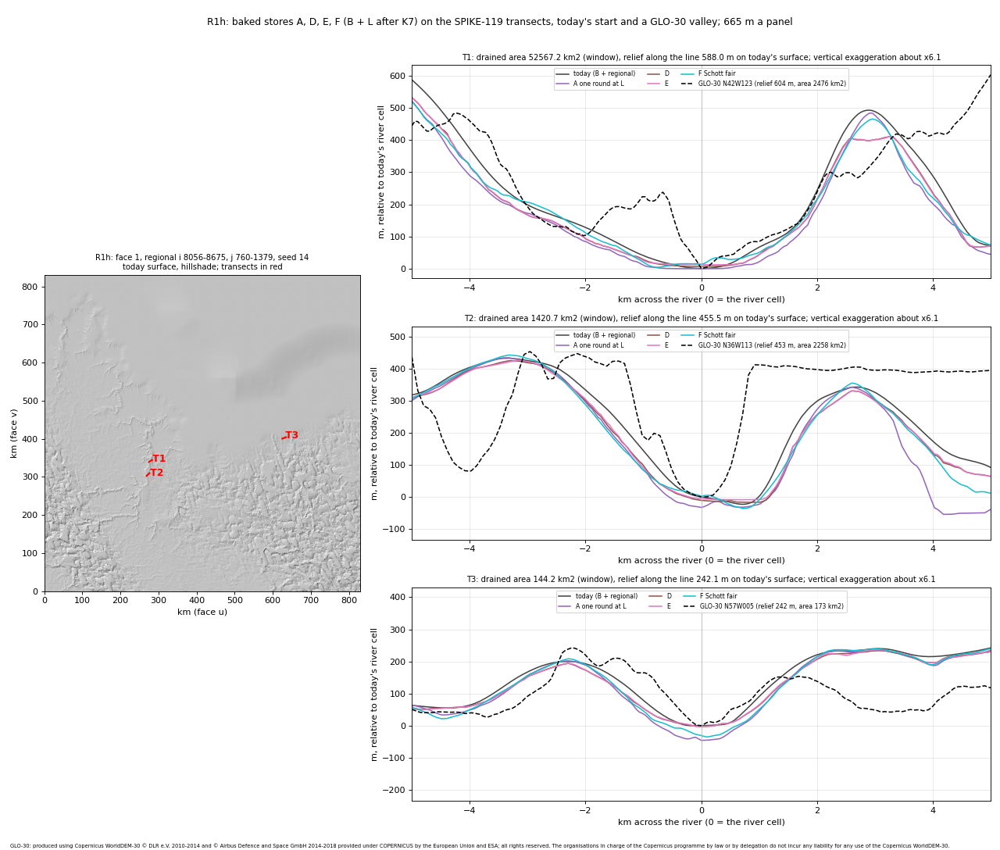
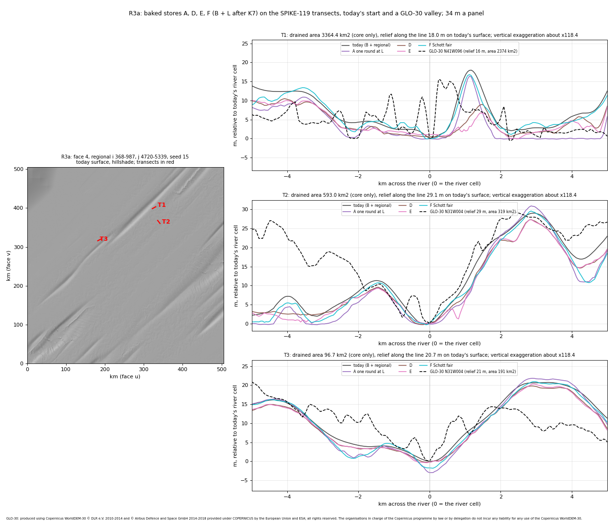
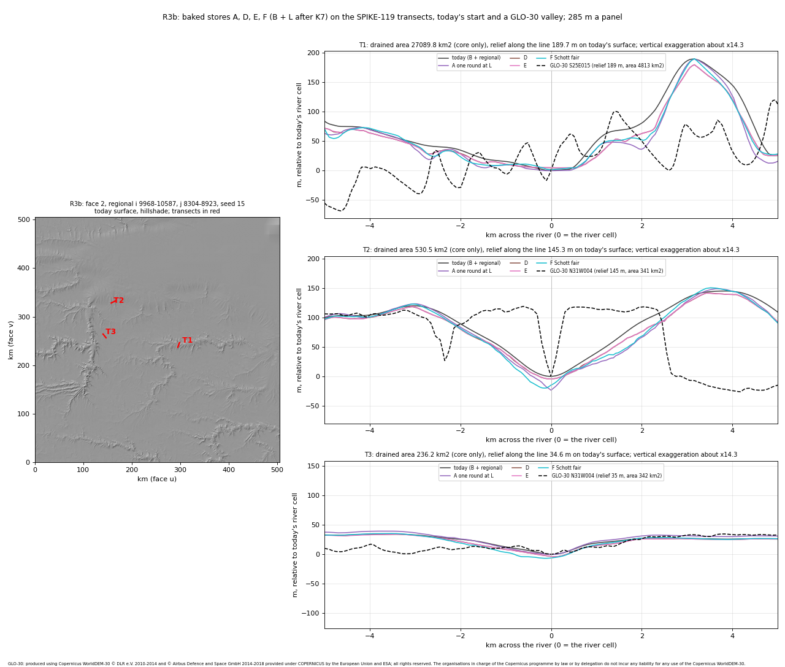
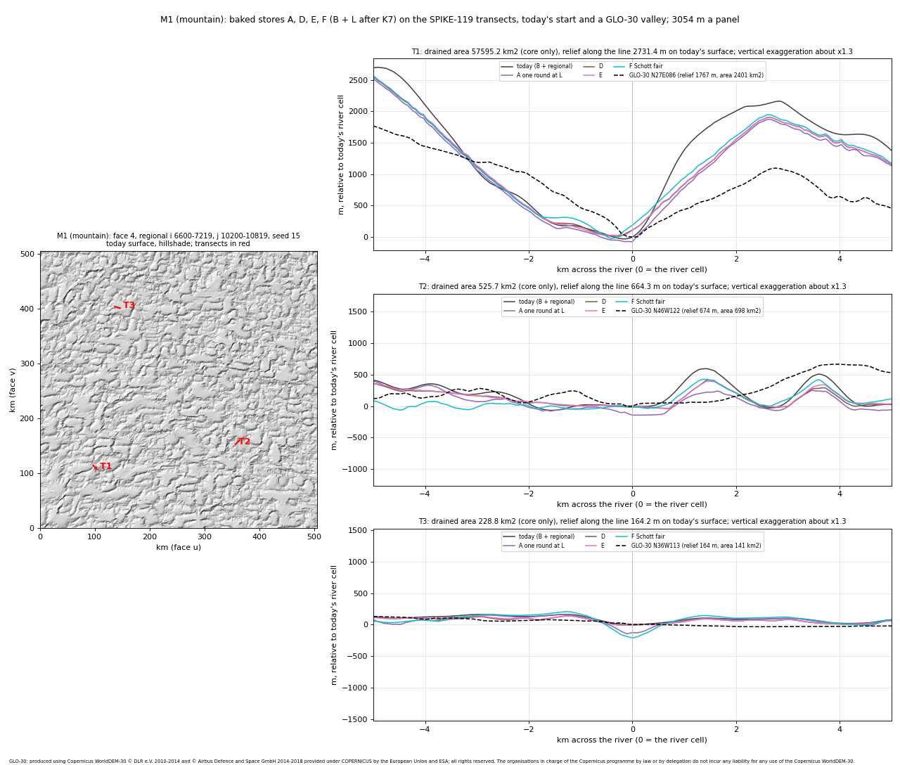
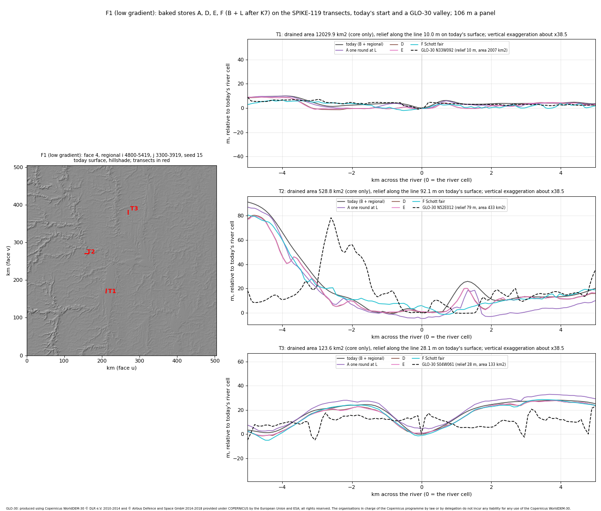

# SPIKE-122: E3 variants D, E and F (how drainage becomes valid at L)

Opened: 2026-11-15
Question: does a drainage-preserving hand-over with a bounded multi-scale breach (D), the same on a drainage-aware residual (E), or Schott 2024 done fairly (F, the benchmark) pass G-DRAIN and G-INCISION separately, with acceptable cross-sections, on all five windows, against A (one round at L) on the same base and reader build?
Why it matters: P3 exit item E3 (D-1, how drainage becomes valid at L). B and C are explorer's (SPIKE-121); A is the shared reference.
Time box: 1.5 days (lead, 2026-11-15; report by 2026-11-17 00:00).
Success criteria: one baked store per variant and window (D, E, F x R1h, R3a, R3b, M1, F1) from the A-C binary, measured with `river-gate --table` beside A; the cross-sections on the SPIKE-119 transects; D's one parameter derived and calibrated on R1h only; every variant reported against the E3 pass bars (P3.md, set before the results).
Fallback if it fails: D and F first, E as partial (lead, 2026-11-15). Not needed.
Code location: spike branch `spike/e3-def` (`crates/cache/examples/drain_base.rs`: `PLANET_TRANSFER=d8tri | d8tri-e`, `PLANET_START_OUT`; `store_xsec.rs`); bakes with explorer's `bake_eroded` (spike/e3-variants-bc a07b404c, `--start <file> --rounds 0`); tables with main's `cargo xtask river-gate --table` (main 9ad592e2), one reader build for every row.

## 1. The variants (one thing changed each)
| Variant | Start surface | Then |
|---|---|---|
| A (reference, explorer's stores) | B + regional | one round at L, K7 |
| D | the 814 m solved surface breached over 8 neighbours, read at L by triangles split along each quad's D8 diagonal; B's sub-814 m residual damped toward the channels over 400 m (SPIKE-116's damping) | a multi-scale breach (radii 8, 4, 2, 1 L cells, then plain), each cell lowered at most cap(c); no L round; K7 |
| E | D with the residual attenuated toward the channels over 1,200 m and averaged along the downslope direction (+-4 L cells): relief oriented along the valleys | as D |
| F | SPIKE-116's 4-neighbour hand-over, then SPIKE-118's per-scale pipeline (407 / 204 / 101.8 m, 2 rounds a scale, retargeting, multi-scale breach) | K7 |

Every start surface is written over the whole L window (8,160 cells a side, margin included) and baked by `bake_eroded --start <file> --rounds 0`, which replaces B + regional by it and keeps the regional solve, H1, routing and K7.

**Bit check (R3a):** the probe's own `B + regional`, baked through `--start`, gives a gate report identical in every line to the bake from the binary's own start surface (`--rounds 0`, both stores): the start surfaces stand on A's base. Raw: `raw/bitcheck-r3a-own.txt`, `raw/bitcheck-r3a-start.txt`.

## 2. D's one parameter: the breach depth cap
Derivation:
- B's sub-814 m residual r (B minus B read at the solve nodes through the same triangles) is relief the regional solve never saw; its pits at L are noise of r, not structure.
- r's local standard deviation sigma(c), over a box of radius 8 L cells (one solve cell), is the noise amplitude at c.
- A dip of a zero-mean field below its surroundings reaches about 2 sigma at the 95 % level, so a pit up to 2 sigma(c) deep is noise and is breached; a deeper one is structure and is left for the gate (a basin or a lake).
- cap(c) = m x sigma(c), m = 2; calibrated on R1h only over m = 1, 2, 3.

Calibration on R1h, baked (cap p50 / p95 over land: m = 1: 4.5 / 25.7 m; m = 2: 9.0 / 51.5 m; m = 3: 13.4 / 77.2 m):

| m | Basins % (cells) | Valley depth 1-2 over 50 m % (cells) | Ring 2-4 % | Eroded over 50 m below the start % | Lakes % | Relief 10 x 10 m (start 60.7) |
|---|---|---|---|---|---|---|
| 1 | 4.42 (8,027) | 0.42 (765) | 1.76 | 4.51 | 0.90 | 65.5 |
| **2** | **2.37 (4,290)** | **0.49 (896)** | **1.89** | **4.77** | **0.63** | **65.6** |
| 3 | 1.72 (3,101) | 0.47 (853) | 1.89 | 4.95 | 0.37 | 65.6 |

- The cap sets drainage, not incision: basins fall from 4.42 to 1.72 % while the valley depth at 1-2 cells stays at 0.42-0.49 % (lead #125: SPIKE-120 measured 8.76 % for the breach alone). The capped multi-scale breach lowers the cells it touches by p50 0.03-0.26 m, p95 0.3-11.5 m (M1 the most); the plain breach wanted more than the cap on 41,889-221,021 cells of a window's 66.6 million (R1h 76,696 at m = 2), which stay pits (raw `raw/probe-*.txt`).
- m = 2 (the derived value) is kept: under the basin bar with headroom, the same incision as m = 3.

## 3. Numbers: every variant against the E3 pass bars
Bars (P3.md "E3 pass bars", lead #126, set before the results): G-DRAIN basins at most 10 %; G-INCISION the valley-depth share over 50 m (ring 1-2) at most R1h 1.80 %, R3a 0.10 %, R3b 0.10 %, M1 40.80 %, F1 0.10 %. Baked stores, main's gate, `--no-key-check` (spike stores). All values are % of river cells with the absolute count where it decides a bar; the full suite per row is in `table.csv`.

| Window | Variant | River cells | Basins % (cells) G-DRAIN | Valley depth 1-2 % (cells) G-INCISION | Ring 2-4 % | Eroded over 50 m % | Lakes % | Relief 10 x 10 m (start) | Edge matched | Uphill steps % | Drainage density km/km2 |
|---|---|---|---|---|---|---|---|---|---|---|---|
| R1h | A | 176,287 | 0.58 (1,019) pass | 1.26 (2,225) pass | 4.82 | 37.11 | 0.11 | 76.9 (60.7) | 34 of 44 | 0.09 | 0.079 |
| R1h | D | 181,028 | 2.37 (4,290) pass | 0.49 (896) pass | 1.89 | 4.77 | 0.63 | 65.6 | 43 of 44 | 0.25 | 0.081 |
| R1h | E | 185,046 | 2.21 (4,089) pass | 0.22 (407) pass | 1.45 | 3.72 | 0.19 | 64.1 | 42 of 44 | 0.28 | 0.083 |
| R1h | F | 204,394 | 0.44 (898) pass | 0.33 (666) pass | 4.38 | 25.39 | 0.00 | 77.0 | 41 of 44 | 0.04 | 0.088 |
| R3a | A | 64,841 | 0.05 (35) pass | 0.08 (49) pass | 0.42 | 4.48 | 0.00 | 14.4 (10.0) | 21 of 84 | 0.02 | 0.032 |
| R3a | D | 93,251 | 1.80 (1,674) pass | 0.00 (0) pass | 0.02 | 0.12 | 0.00 | 11.1 | 27 of 84 | 0.17 | 0.047 |
| R3a | E | 89,506 | 7.19 (6,435) pass | 0.00 (0) pass | 0.02 | 0.12 | 0.00 | 11.2 | 28 of 84 | 0.82 | 0.045 |
| R3a | F | 103,686 | 0.97 (1,003) pass | 0.00 (0) pass | 0.15 | 3.31 | 0.00 | 12.7 | 30 of 84 | 0.11 | 0.050 |
| R3b | A | 211,075 | 0.25 (534) pass | 0.01 (25) pass | 0.12 | 6.81 | 0.00 | 13.7 (10.5) | 64 of 93 | 0.04 | 0.087 |
| R3b | D | 219,185 | 1.73 (3,789) pass | 0.01 (21) pass | 0.01 | 0.49 | 0.00 | 11.6 | 67 of 93 | 0.12 | 0.091 |
| R3b | E | 219,637 | 1.97 (4,324) pass | 0.01 (21) pass | 0.01 | 0.49 | 0.00 | 11.6 | 69 of 93 | 0.15 | 0.091 |
| R3b | F | 231,265 | 0.41 (943) pass | 0.00 (0) pass | 0.01 | 8.93 | 0.00 | 14.1 | 65 of 93 | 0.03 | 0.093 |
| M1 | A | 247,334 | 3.50 (8,665) pass | 16.49 (40,781) pass | 33.25 | 81.68 | 1.29 | 423.6 (371.5) | 67 of 82 | 0.52 | 0.089 |
| M1 | D | 241,227 | 9.09 (21,936) pass | 14.37 (34,662) pass | 27.75 | 32.73 | 4.93 | 390.1 | 70 of 82 | 1.07 | 0.087 |
| M1 | E | 236,899 | 6.54 (15,498) pass | 11.71 (27,752) pass | 22.44 | 20.06 | 2.99 | 385.6 | 69 of 82 | 0.90 | 0.086 |
| M1 | F | 248,751 | 1.72 (4,285) pass | 16.41 (40,809) pass | 36.08 | 52.20 | 0.23 | 423.7 | 65 of 82 | 0.17 | 0.088 |
| F1 | A | 179,874 | 0.18 (315) pass | 0.00 (1) pass | 0.00 | 0.53 | 0.00 | 14.4 (11.5) | 30 of 87 | 0.04 | 0.074 |
| F1 | D | 219,322 | 4.50 (9,859) pass | 0.00 (0) pass | 0.00 | 0.02 | 0.00 | 12.4 | 39 of 87 | 0.24 | 0.092 |
| F1 | E | 230,016 | 5.17 (11,893) pass | 0.00 (0) pass | 0.00 | 0.02 | 0.00 | 12.3 | 43 of 87 | 0.28 | 0.096 |
| F1 | F | 251,953 | 1.26 (3,178) pass | 0.00 (0) pass | 0.00 | 2.02 | 0.00 | 13.8 | 38 of 87 | 0.07 | 0.101 |

- Every variant passes G-DRAIN and G-INCISION on all five windows. The bars do not separate them; the closest call is D on M1 (basins 9.09 %).
- What separates them is how much they cut and lift:
  - **Erosion below the start** (river level over 50 m under today's surface): A 37 % on R1h and 82 % on M1, F 25 % and 52 %; D 5 % and 33 %, E 4 % and 20 %.
  - **Relief at 1 km:** A and F raise it 14-44 % above the start (A: R1h 127 %, R3a 144 %, R3b 131 %, M1 114 %, F1 125 %; F 114-135 %); D and E keep 104-112 %.
  - **Edge agreement with H1:** D and E match more H1 crossings than A on every window (R1h 43 / 42 against 34 of 44; F1 39 / 43 against 30 of 87).
  - **Drainage density:** A carries the least river length on the flat windows (R3a 0.032 against 0.045-0.050; F1 0.074 against 0.092-0.101).
- E against D (one thing changed: the oriented, attenuated residual): less incision (R1h valley depth 0.22 against 0.49 %, M1 11.7 against 14.4 %, eroded 20 against 33 % on M1) at about the same drainage, except R3a (basins 7.19 against 1.80 %, uphill steps 0.82 %): on the flattest window the downslope averaging leaves more closed basins.

### 3.1 The flat windows against GLO-30 (indicative only)
GLO-30 is a surface model; on flat ground SPIKE-119 measured it against bare earth (3DEP): basins x1.3-2.9, uphill steps up to x1.8, relief at 1 km up to x3. The low and mid pools, beside their bare-earth correction where measured:

| Measure | R3a / R3b / F1, baked variants | GLO-30 low pool (N52 E012, N33 W092, S04 W061, N70 W154) | DSM factor (SPIKE-119) | Reading |
|---|---|---|---|---|
| Basins % | 0.05-7.19 | 40-69 | x1.3-2.9 (floodplain x1.35) | bare-earth floodplains still hold 15-50 %: every variant drains far more than real lowlands |
| Relief 10 x 10 m | 11.1-14.4 | 9.6-19.9 | up to x3 (floodplain 15.2 against 4.7 m) | the variants are rougher than bare-earth floodplain (about 5-7 m), A and F the most |
| Drainage density km/km2 | 0.032-0.101 | 0.064-0.104 | not measured | D, E and F lie inside the pool's range, A on R3a below it |
| Valley depth 1-2 % | 0.00-0.08 | 0.00 | none (steep ground agrees) | all variants as Earth |

## 4. Cross-sections
Baked stores sampled along the SPIKE-119 transects by `store_xsec` (the gate's stored-ground reading, every 0.5 face L cells), drawn by `transects.py plot --only-today --extra` beside today's start surface and the GLO-30 valley at matched relief, one vertical scale per figure.
- R1h: D and E keep today's valley shapes; A cuts deepest (T3 about 45 m under today's river, and a second trough beside T2), F lies near D and E. **Artefact of D and E:** on T1 the ridge beside the trunk is flattened at about 400 m, about 90 m under today's crest: the smoothed multi-scale breach spreads its lowering onto the ridge where the residual sigma (the cap) is large.
- R3a, R3b: every variant keeps a broad V; the GLO-30 valleys at matched relief are narrower (R3b T2).
- M1: every baked variant lowers the trunk's far valley wall at T1 by 200-600 m against today (K7 and the shared bake, common to A-F); A and F dig 130-200 m troughs at the river on T2 and T3, D and E do not; F also lowers T2's left side about 300 m.
- F1: A, D and E level a 5 km strip beside the trunk at the river (T1, within about 1 m); on T2 A lowers the whole right side by 10-15 m and removes the bank ridge at 1.2 km, D and E keep part of it; on T3 A stands up to 5 m above today on both sides (the relief A adds, section 3).
- Against Earth: GLO-30's valleys at matched relief are narrower and steeper-sided than every variant on R3b T2 and F1 T2; on M1 T1 no tile reaches the trunk's relief.

## 5. Findings
- **D-1 is not decided by the bars:** all four variants pass G-DRAIN and G-INCISION on all five windows. The bars as set do not discriminate; the measures that do are erosion below the start, relief kept, edge agreement and drainage density.
- **D and E change the terrain least:** they drain to 1.7-9.1 % basins while eroding 0.02-33 % of river cells over 50 m (A 0.5-82 %), keep 1 km relief at 104-112 % (A 114-144 %) and match H1's edge crossings best.
- **A and F cut and lift:** they drain most (0.05-3.5 % basins), at the cost of the deepest erosion and 14-44 % more relief than the start.
- **The cap is a drainage knob, not an incision knob,** on R1h: valley depth 0.42-0.49 % for m = 1-3.
- **E's orientation helps on relief, hurts on the flattest window:** less incision than D everywhere, more basins on R3a (7.19 %).
- **One artefact to fix if D or E is chosen:** the multi-scale breach's spread lowers ridge tops beside large rivers (R1h T1, about 90 m); a cap that excludes ridges (lowering only below the channel side) is the obvious next step, not tested.
- **The flat windows drain far more than real lowlands** (indicative, DSM-corrected): Earth's floodplains keep 15-50 % of river length in pits; G-LAKE and D-4 will decide how much of that the planet should keep.

## Visuals

R1h (face 1, seed 14): baked stores A, D, E, F on the three transects, today's start surface and a GLO-30 valley at matched relief, one vertical scale per figure (in its title). CPU sampling of the stores, no renderer; D and E nearly coincide.

R3a (face 4, seed 15): the same.

R3b (face 2, seed 15): the same.

M1 (face 4, seed 15, the mountain window): the same; the trunk T1 sets the scale (3,054 m a panel), so T2 and T3 read at about x1.3.

F1 (face 4, seed 15, the low-gradient window): the same (106 m a panel).

Statistics and images derived from Copernicus DEM GLO-30: produced using Copernicus WorldDEM-30 © DLR e.V. 2010-2014 and © Airbus Defence and Space GmbH 2014-2018 provided under COPERNICUS by the European Union and ESA; all rights reserved. The organisations in charge of the Copernicus programme by law or by delegation do not incur any liability for any use of the Copernicus WorldDEM-30.
