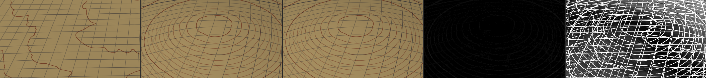
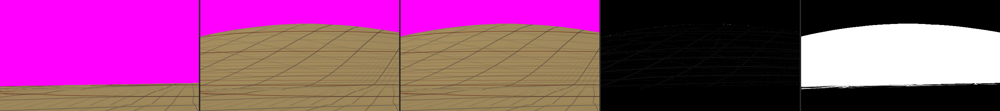
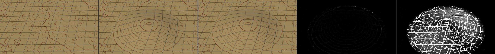

# SPIKE-13 Edit-to-visible latency (sonnet-spikes, 2026-10-18)

Question: time from editing an authored item to the first frame showing the new terrain at full resolution near the camera, and what M6 must build to reach a realistic target.

## Method
| Item | Value |
|---|---|
| Edit | test-only raised disc (stamp), `A (1 - (d/r)^2)^2`, A = min(0.2 r, 100 m), radius r = 50, 150, 500 m; entered by `WorldDefinition::put_item` (cell index, ADR 0007, WDEF-005); read through cell queries (margin 1) |
| Field | eroded terrain over an in-memory bake of 1024 cells per face edge (the product's field type; generation cost as the viewer's eroded tiles) plus the stamp; keys through `inputs_hash_for` per tile |
| Path | the pipelined viewer loop as built: plan worker, residency manager, streamer (10 generation threads), pools, `TerrainRenderer` on the RTX; debug relief view, 2560 x 1440, tau 6, cells 32, finest level 22 |
| Cases | altitude 2 km, 200 m, 1 m above the stamp x radius x camera still or circling the stamp (5, 50, 250 m/s); settled before each edit, edit reverted and settled again after |
| "Exact" | first frame (GPU finished) in which every tile of the newest plan that touches the stamp is resident at its new key |
| "Preview" | first frame (GPU finished) after the edit with the stamp displaced in the vertex stage |
| Hardware | RTX 3080 Ti Laptop, Vulkan; **indicative, not a perf window**; 2026-10-18 about 02:30 to 03:30 local; GPU granted by sonnet-explorer; host load per row in `m*.md` (columns "host load") |
| Disturbed rows | competing load over 50 % (other sessions' builds and tests); marked in the tables |

Prototype code: branch `spike/spike-13-edit-latency` (never merged): `crates/app/src/spike13.rs`, `crates/app/examples/spike13.rs`, hooks in `streaming` (`Streamer::refresh`, `invalidate`), `frame` (`SPIKE_STALE_OK`, `force_replan`, `invalidate_cache`), `render` (stamp preview in the compact vertex stage).

## Variants
| Id | Tiles refreshed | Found by | Old tile while waiting | File |
|---|---|---|---|---|
| A evict | every tile whose key changed | key of each resident tile | dropped; ancestors drawn | `m5-evict-rtx.md` |
| B refresh | every tile whose key changed | key of each resident tile | old version drawn (stale while revalidating) | `m1-refresh-rtx.md` |
| C reach | tiles whose footprint touches the stamp | key, then footprint | old version drawn | `m2-reach-rtx.md` |
| D reach + footprint find | same as C | footprint alone | old version drawn | `m3-footprint-rtx.md` |

## Latency, exact (ms from the edit)
Median (min-max) over three radii (50, 150, 500 m); `!` = rows with competing load over 50 %.

| Altitude | Camera | C reach, find by key | D reach, find by footprint |
|---|---|---|---|
| 2 km | still | 404 (334-595) | 72 (58-103) |
| 2 km | moving | 492 (409-635) | 63 (55-348) ! |
| 200 m | still | 919 (653-1,300) | 443 (144-689) |
| 200 m | moving | 949 (750-1,237) | 1,854 (115-7,613) !! |
| 1 m | still | 1,478 (1,455-1,609) | 773 (772-14,027) ! |
| 1 m | moving | 1,435 (1,313-1,520) | 831 (751-1,582) |

Undisturbed D rows only: 2 km 55-103, 200 m 115-689, 1 m 751-831.

## Latency, preview (ms from the edit; variant D)
| Altitude | Camera | Preview ms median (min-max) |
|---|---|---|
| 2 km | still / moving | 4 (4-4) / 8 (4-12) |
| 200 m | still / moving | 6 (5-7) / 14 (4-158) |
| 1 m | still / moving | 9 (8-94) / 9 (8-12) |

Preview = footprint mask over the resident tiles (0.6-3.7 ms) plus one frame to GPU completion (2-5 ms). Vsync adds up to one refresh interval.

## Stages, 200 m, r = 50 m, camera still
| Stage | A/B naive (all key-changed tiles) | C reach, find by key | D reach, find by footprint |
|---|---|---|---|
| Tiles refreshed | 6,402 | 83 | 83 |
| Find affected (ms) | keys 432, cells 52 | keys 486, cells 52 | footprint 1.6 |
| New plan delivered (ms from edit) | 527 (worker 39) | 567 (worker 24) | 56 (worker 39) |
| First dispatch (ms) | 488 | 540 | 15.5 |
| First new tile resident (ms) | 1,470 | 608 | 96 |
| Exact (ms) | 1,790 | 653 | 144 |
| All refreshed (ms) | 12,942 | 660 | 157 |
| Generation, sum of tile times (ms) / mean queue wait (ms) | 124,224 / 17.1 | 1,105 / 11.2 | 1,306 / 13.2 |
| Upload (ms / tiles) | 184 / 6,402 | - | 3.0 / 81 |
| Exact frame, GPU (ms) | 1.5 | - | 2.4 |

Evict (A) at 2 km, r = 150 m, still: exact 2,171 ms; the same case with reach and find by key (C) 334 ms, with find by footprint (D) 72 ms; evict draws 490 nodes as ancestors for the whole interval.

## Tiles per level
Cell-based invalidation (variant B), r = 150 m, still. Resident tiles before the edit: 6,445 (2 km), 8,977 (200 m), 14,543 (1 m).

| Altitude | Key-changed tiles | Per level (level:count) | Cell-grid method |
|---|---|---|---|
| 2 km | 3,788 | 0:1 1:1 2:2 3:4 4:7 5:21 6:2 7:4 8:9 9:36 10:144 11:536 12:772 13:760 14:740 15:621 16:128 | 3,769 |
| 200 m | 6,950 | 0:1 1:1 2:2 3:4 4:6 5:17 6:2 7:4 8:9 9:36 10:144 11:536 12:764 13:788 14:780 15:788 16:812 17:832 18:836 19:588 | 6,935 |
| 1 m | 12,110 | 0:1 1:1 2:2 3:4 4:6 5:17 6:2 7:4 8:9 9:36 10:144 11:540 12:764 13:788 14:776 15:780 16:808 17:832 18:904 19:1,060 20:1,328 21:1,628 22:1,676 | 12,095 |

Tiles whose footprint touches the stamp (variant D, refreshed): r = 50 m: 35 (2 km), 83 (200 m), 472 (1 m); r = 150 m: 36, 260, 2,812; r = 500 m: 65, 1,462, 4,284.

## Find stage
| Method | Cost, 6,445-16,035 resident tiles (ms) | Result |
|---|---|---|
| Key of every resident tile (`inputs_hash_for`, one `GenContext` per tile) | 260-820 | exact set of changed keys: 59-85 % of the resident tiles for a 50 m stamp |
| Cell grid (`cells_covering`, `with_margin` against the item's cell) | 34-91 | same set (3,769 of 3,788 at 2 km: coarse tiles read the whole body) |
| Footprint test (tile bounding sphere against the disc) | 0.6-3.7 | only the tiles the stamp can change |

## Generation
Tile generation, sum over threads, mean per tile (ms, eroded field): 11-17 for levels 0-16; about 1.6 for the finest levels (1 m, r = 500 m: 6.8 s for 4,268 tiles); 10 threads, mean queue wait 7-18 ms undisturbed.

| Workers | 200 m, r = 150, still, D: exact ms | Generation sum (ms) | Mean queue wait (ms) |
|---|---|---|---|
| 4 | 894 | 3,565 | 12.4 |
| 10 | 443 | 4,212 | 14.6 |
| 20 | 398 | 7,324 | 26.4 |

## Preview fidelity (variant D, still camera, 2560 x 1440)
Preview frame against the exact frame after regeneration; "over 8" = channel difference above 8 of 255.

| Altitude | r (m) | Pixels exact vs before, over 8 | Preview vs exact: differing | over 8 | max | mean of differing |
|---|---|---|---|---|---|---|
| 2 km | 50 | 537 | 1,238 | 6 | 30 | 1.26 |
| 2 km | 150 | 4,888 | 3,306 | 7 | 39 | 1.12 |
| 2 km | 500 | 55,987 | 22,361 | 64 | 62 | 1.18 |
| 200 m | 50 | 47,898 | 19,488 | 82 | 34 | 1.30 |
| 200 m | 150 | 395,501 | 252,916 | 6,228 | 26 | 2.04 |
| 200 m | 500 | 502,843 | 375,553 | 18,848 | 69 | 2.42 |
| 1 m | 50 | 188,197 | 73,382 | 124 | 169 | 1.27 |
| 1 m | 150 | 184,171 | 61,827 | 133 | 201 | 1.35 |
| 1 m | 500 | 191,404 | 67,867 | 312 | 183 | 1.38 |

3.69 M pixels per frame. The preview differs from the exact frame by one or two levels almost everywhere; the largest differences (up to 201) are single contour-line and grid pixels at 1 m.

## Findings
| Finding | Evidence | M6 consequence |
|---|---|---|
| The cell is the invalidation unit: an edit re-keys every tile that reads its cell or the ring around it | 3,788 of 6,445 resident tiles (59 %) at 2 km and 12,110 of 14,543 (83 %) at 1 m for a 150 m stamp; 36-2,812 tiles actually touch it | item `reach_m` (ADR 0021 point 2) with a footprint or sub-cell index; the read set of a tile holds items within reach, not whole cells |
| Evicting edited tiles blanks the view to ancestors | variant A: 490 nodes drawn as ancestors, exact 2,171 ms | stale-while-revalidate: old tile stays drawn until the new one is uploaded (prototype: `Streamer::refresh`, stale draw) |
| The streamer never re-fetches a resident tile whose key changed; the plan only substitutes ancestors | `Streamer` keys by `TileId`; `draw_plan` compares resident and planned key | key-aware residency: a planned key different from the resident key is a refresh request of the same class |
| The plan is not re-requested while the camera is still | `PlanPipeline` asks only when the request changes | an edit event forces a new plan (prototype: `force_replan`) |
| Keys of a cell-reading field are recomputed every plan | `reuse = !reads_cells` in `plan_terrain_threaded`: plan worker 21-134 ms on resident sets of 6-12 k tiles | per-tile key memo invalidated by item revision; today it is off for these fields |
| Item-dependent height bounds: a constant over-estimate breaks fine tiles | first prototype widened every tile's bounds by 120 m: planning failed at 200 m and 1 m ("morph interval empty ... too steep", level 16-18) | bounds by reach (prototype: bump at the nearest point of the cap), and the cached volumes of affected tiles are invalidated with their keys (ADR 0021 point 8) |
| Finding the affected tiles by key costs 0.26-0.82 s | table "Find stage" | find by footprint or cell grid (1-91 ms) |
| Generation parallelism saturates | 4 / 10 / 20 workers: 894 / 443 / 398 ms | 10 threads are enough; the rest is queue and plan |
| Competing CPU load dominates the worst cases | disturbed rows 1.9-14 s against 0.1-0.8 s undisturbed | ADR 0046 (workers below normal priority) matters most while the user edits |

## Floor and targets
| Stage (200 m, r = 50 m, still) | Today's path (B) | Floor measured (D) |
|---|---|---|
| Find | 486 ms | 1.6 ms |
| Plan | 527 ms | 56 ms |
| Dispatch | 488 ms | 15 ms |
| Exact | 1,790 ms | 144 ms |

| Target | Realistic on this hardware, idle host | Needs |
|---|---|---|
| Preview | 15 ms (4-14 ms measured, one frame) | stamp displacement in the vertex stage; footprint mask |
| Exact, stamp up to 150 m, 2 km altitude | 100 ms (55-103) | reach, footprint find, stale-while-revalidate |
| Exact, stamp up to 500 m, 200 m altitude | 700 ms (144-689) | the same; generation of 260-1,460 tiles |
| Exact, 1 m altitude, stamp up to 500 m | 850 ms (751-831 undisturbed) | the same; plan 100-150 ms per frame of new keys |
| Exact on a loaded host | not bounded | workers below normal priority; edited tiles ahead of the rest of R |

## Recommendation
- Targets: preview at most 16 ms (one frame), exact at most 300 ms for stamps up to 150 m at any altitude, at most 1 s for stamps up to 500 m or 1 m altitude; the owner's 1 s is the far end and is reached only with reach-limited invalidation.
- M6 builds, in order: (1) item reach and a footprint-based invalidation set; (2) key-aware refresh in the streamer with stale-while-revalidate; (3) an edit event that invalidates plan keys and cached volumes of affected tiles and forces a plan; (4) the stamp preview as a vertex-stage displacement over tiles under the footprint, removed per tile when its new version is uploaded; (5) edited tiles in their own request class above the rest of R.
- Decision for the owner: none required; ADR 0021 points 2, 5 and 8 need decisions before the first authored stage (reach, region summaries, item-dependent bounds).

## Limits
- One field (eroded over a 1024-cell bake), one world seed, one stamp shape (a disc); real stamps change normals, slopes and materials.
- Debug relief view without the lit path and the atmosphere; the preview shader exists in the debug path only (it uses the unused albedo lanes of the globals).
- Camera paths circle the stamp; the moving cases include extra generation for newly visible tiles.
- Rows with competing load over 50 % are not representative; no case was repeated.
- "Exact" counts the tiles that touch the stamp's bounding sphere in the newest plan; neighbouring-tile halo reads are covered by the 0.8-edge margin of the footprint test.

## Files
`m1-refresh-rtx.md` (B), `m2-reach-rtx.md` (C), `m3-footprint-rtx.md` (D), `m4-workers4-rtx.md`, `m4-workers20-rtx.md`, `m5-evict-rtx.md` (A); each row carries its host load. Column names in the header of each file.

## Visuals
Each sheet: before the edit | preview | exact | preview against exact (x8) | exact against before (x8). RTX, 2560 x 1440 frames cropped to 560 x 315 around the stamp, relief debug view.

