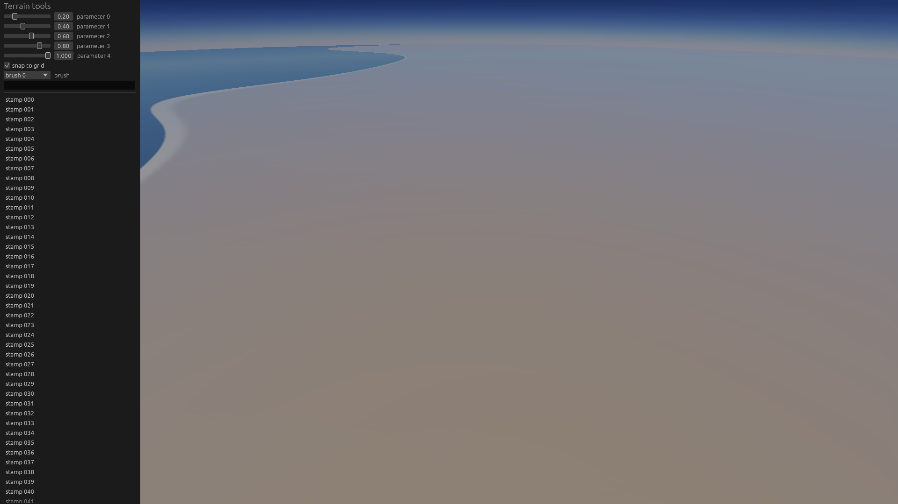
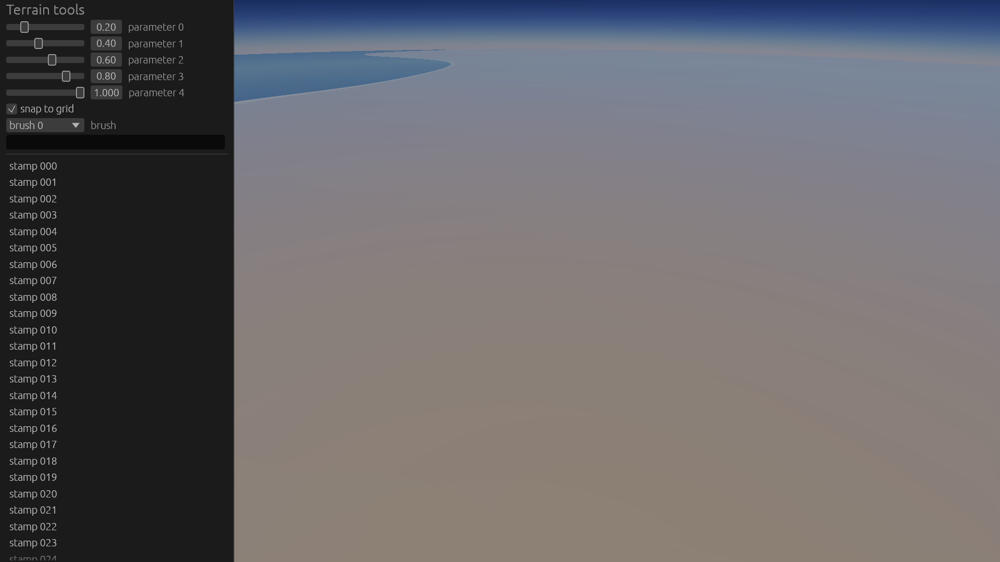
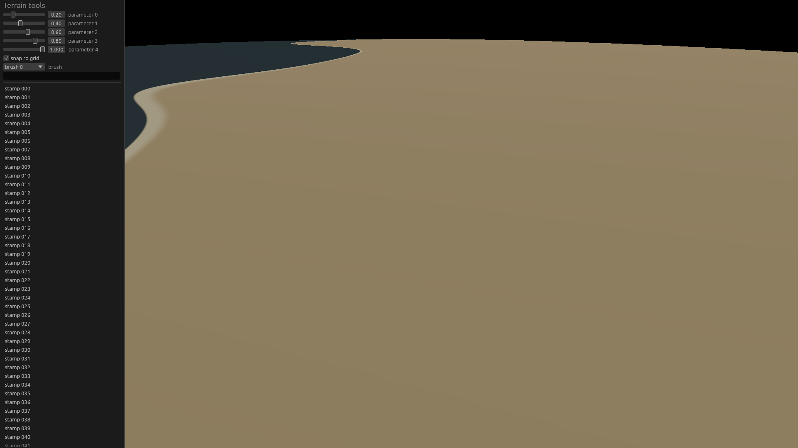

# SPIKE-14 egui in the frame (sonnet-spikes, 2026-10-18)

Question: does egui fit our wgpu and winit pins, does a panel drawn after the tone map into the presented frame work on the RTX and WARP at two DPI scales at a cost the frame can carry, and which input rule keeps panel and camera apart?

## Fit
| Pair | wgpu | winit | Builds against wgpu 30.0.1 and winit 0.30.13 | New crates | Released |
|---|---|---|---|---|---|
| egui, egui-wgpu, egui-winit 0.37.0 | ^30.0 | ^0.30.13 | yes, 0 errors | 36 | 2026-10-15 |
| the same crates 0.36.2 | ^30.0 | ^0.30.13 | yes, 0 errors | 33 | 2026-09-08 |
| the same crates 0.35.0, 0.34.3 | ^29 | ^0.30.13 | no (wgpu 29) | - | 2026-06-25, 2026-05-27 |

| Item | Result |
|---|---|
| Upgrade or fork needed | none; `=0.36.2` pins (`default-features = false`) resolve beside `wgpu =30.0.1`, `winit =0.30.13` |
| Cold `cargo check -p planet-render -p planet`, dev profile | 31 s with the new crates |
| `cargo xtask layering` | ok (`egui`, `egui-wgpu` in `render`; `egui`, `egui-winit` in `app`) |
| `cargo deny` advisories, bans, sources | ok |
| `cargo deny` licenses | **fails with feature `default_fonts`**: `epaint_default_fonts` is `(MIT OR Apache-2.0) AND OFL-1.1 AND Ubuntu-font-1.0`; neither is on the allow-list (CON-27) |
| Without `default_fonts` | no font: every label is blank (the panel draws shapes only) |

## Integration
| Part | Where | Lines |
|---|---|---|
| Painter (`UiPainter`, `UiFrame`: tessellated primitives, texture deltas, pixels per point); no wgpu type in the API | `crates/render/src/ui.rs` | 120 |
| UI pass after the blit into the swapchain image (`WindowSurface::present_with_ui`) | `crates/render/src/window.rs` | 30 |
| Graph node `ui`: reads and writes `presentable` after `tonemap` (`lit_frame_graph_with_ui`) | `crates/render/src/graph.rs`, test `spike14_graph.rs` | 8 + 25 |
| Panel, `Router`, tests | `crates/app/src/spike14.rs` | 190 |
| Window: `egui_winit::State`, events to egui first, panel each frame, `PLANET_UI=1` | `crates/app/src/window.rs` | 70 |

| Rule | Evidence |
|---|---|
| HDR and depth targets untouched: the UI node adds no frame-target byte and moves no lifetime, with and without atmosphere and water | `spike14_graph.rs`, three graph shapes at 2560 x 1440 |
| Pixels outside the panel equal the blit alone | 0 differing pixels, RTX and WARP, 100 % and 150 % |
| Every pass's texture deltas must reach the painter | the font atlas arrives with the first pass; dropping the deltas of passes before the painted one leaves glyphs blank (found in the prototype) |
| The painter loads the scene (`LoadOp::Load`) and blends over the tone-mapped LDR frame | `ui.rs` |

## Cost, 1920 x 1080 lit frame, panel of 5 sliders, checkbox, combo box, text field, 100-item list
Median / p90 over 300 frames (RTX), 120 frames (WARP); ms; **indicative**, taken 2026-10-18 about 03:20 (RTX, GPU granted by sonnet-explorer, no competing GPU work) and 03:25 (WARP).

| Adapter | DPI | Vertices | egui run + tessellate (CPU) | UI pass: record, submit, GPU wait |
|---|---|---|---|---|
| RTX 3080 Ti Laptop, lit with atmosphere | 100 % | 2,730 | 0.175 / 0.186 | 0.116 / 0.168 |
| RTX | 150 % | 2,186 | 0.179 / 0.185 | 0.123 / 0.189 |
| WARP, lit without atmosphere | 100 % | 2,730 | 0.160 / 0.182 | 17.2 / 17.6 |
| WARP | 150 % | 2,186 | 0.153 / 0.159 | 22.9 / 23.8 |

| Window (`editor --smoke`, `PLANET_UI=1`) | RTX | WARP |
|---|---|---|
| Frames drawn / presented | 48 / 48 | 48 / 48 |
| Mean CPU per frame for egui (run, tessellate) | 0.53 ms | 0.70 ms |
| Share of a 16.7 ms frame, RTX: CPU + UI pass | about 4 % (0.7 ms) | - |

## Input routing
`Router` (`crates/app/src/spike14.rs`), tested with egui events at 100 % and 150 %:

| Case | Rule | Result |
|---|---|---|
| Press on the panel | UI when `egui_wants_pointer_input()` or `is_pointer_over_egui()`; the choice is latched until release | camera gets 0 events; the dragged slider changes |
| Press outside the panel, drag across it, release | latched to the world | 10 of 10 motions to the camera; sliders unchanged |
| Hover without a button | decided per motion by the same test | over the panel UI, outside the world |
| Key with a text field focused | UI when `egui_wants_keyboard_input()` | typed `w` lands in the field, not a camera key |
| Same events through winit | `egui_winit::State::on_window_event` first, camera events only when not consumed and the router says world | counters wired; not exercised (a smoke run cannot click): 0 / 0 |

## Recommendation
| Item | Value |
|---|---|
| Toolkit | egui for the M6 editor UI |
| Versions | `egui`, `egui-wgpu`, `egui-winit` `=0.36.2` (0.37.0 fits equally; both need wgpu ^30, winit ^0.30.13); pin with `=`, upgrade with wgpu at milestones (ADR 0004) |
| Features | `default-features = false`; `default_fonts` needs the licence decision below |
| Graph | node `ui` after `tonemap`, ADR 0042 point 2 node 8; painter inside `render` (ADR 0015); editor builds the GPU-free `UiFrame`, accumulating all texture deltas |
| Input | egui first; pointer latched at press; keys to the UI while a text field has focus; camera events only when egui did not consume them |
| Cost | 0.3 ms CPU and GPU together per frame at 1080p on the RTX for a typical panel; WARP 17-23 ms (software rasteriser, test only) |

Owner decision: the font licences. Either add `OFL-1.1` and `Ubuntu-font-1.0` to the `deny.toml` allow-list for `default_fonts`, or ship a chosen font under an allowed licence and load it through egui's font definitions.

## Limits
- Pointer and keyboard events through a real winit window were not injected; routing is tested on egui's own events, the window wiring is compiled and run for 48 frames per adapter.
- No runtime DPI change (`ScaleFactorChanged`), IME, clipboard, accesskit or cursor-icon check; the 100 % and 150 % scales are the pixels-per-point of the egui pass on a 1080p frame.
- Mouse look of SPIKE-11 is not merged; the router decides who gets pointer events and keys, a camera consumer reads only those routed to the world.
- WARP rows are lit without the atmosphere (the known WARP removal with compact tiles and atmosphere, test only).
- One panel, one frame size, indicative timings.

## Files
`t1-offscreen-rtx.md`, `t1-offscreen-warp.md` (the `spike14` example output).

## Visuals
1920 x 1080 lit frames from the offscreen compose (blit, then the UI pass), panel at the top left.

