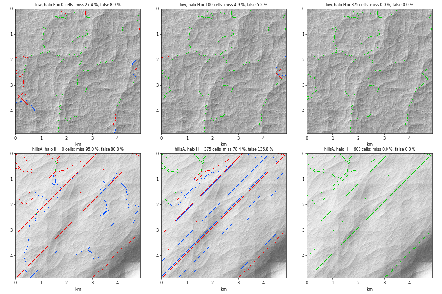

# SPIKE-43: a fine first-order channel network inside chunks that agrees at chunk borders

Opened: 2026-10-26
Question: which scheme gives a border-consistent fine channel network (heads 0.1 to 1 km2, density 0.5 to 3 km/km2) at chunk cost: (a) per-entry-point inflow from the global run's area, (b) 3x3 chunk blocks on a fixed lattice with overlap, (c) another?
Why it matters: ADR 0081 point 3 moved the fine tier to M9; `m8-tributary-tier` records the region-extent constraint (flow accumulated in a region restarts at 0 at its edge).
Time box: 1 day of agent work (opus-planner, 2026-10-25); step 2 half a day (2026-10-26)
Success criteria: density, border mismatch of channel area at shared edges, cost per chunk and thread identity, measured per scheme.
Fallback if it fails: the fine tier waits for a block stage (ADR 0077 point 2).
Code location: `spikes/fine-network/results/proto/` on branches `spike/fine-network` and `spike/fine-network-2` (removed from main 2026-10-30; throwaway; `finespike.rs` and `fine_dump.rs` were copied into `crates/app` for the dump and removed; `fine/` is a standalone crate).

## Method
- Windows of base heights (the 8.04 m chunk cells, `WorldBase`, shared store `global16384`, read-only, the rebuilt run of #681/#683): the chunk's 608x608 core plus 1400 cells each side (3408 x 3408, about 27 km) at four sites: lowland (-11.1657, 23.0493), site 2 (10.4575, -19.1001), hillsA (37.7175, 134.0294), hillsB (8.972, -16.2378).
- Flow on a rectangle: priority flood from the rectangle's border (pits filled, flats routed in the order the flood reaches them), steepest strictly lower neighbour on the filled surface (flood parent on flats), accumulation in cells. The region's border cells are outlets. Channel = accumulation of at least A_t, with A_t = 0.1, 0.3, 1 km2 (1548, 4644, 15481 cells).
- Reference: the whole window (margin of 1400 cells = 11 km round the centre core). A chunk: a rectangle of core + H cells each side, cut from the same window, solved alone.
- Metrics on the centre core (370,000 cells): channel density (km per km2; 1 or 1.414 cell lengths per channel cell), `miss` and `extra` (cells that are channel in the reference only, or in the chunk only, as a share of the reference's channel cells).
- Seam: the reference's links that cross the shared edge from the centre chunk to its east (and north) neighbour at area over A_t; `differ` counts those where the two chunks, each solved alone with the same H, disagree on channel or not; `stepdn` those where the neighbour's area at the receiving cell is below the sender's at the source.
- Thread identity: the nine chunk cores of the window at H = 375, solved with 1 and with 8 workers, FNV hash of every chunk's receivers and areas.
- Ground is the base height, not the A-net's solved ground: see Caveats.

## 1. Base heights have pits at 8 m: a fill is needed, and the fill is the only non-local part
- Raw heights, pits as sinks, no fill: reference density 0.000 km/km2 at all three thresholds at lowland and site 2; at the hill sites 0.44 and 0.50 km/km2 at 0.1 km2, 0.10 and 0.05 at 0.3 km2, 0 at 1 km2.
- With the fill the reference gives the densities of section 2.
- Share of core cells filled by more than 0.5 m, and the deepest fill: lowland 8.9 % / 8 m; site 2 12.0 % / 13 m; hillsB 23.1 % / 112 m; hillsA 79.9 % / 239 m (a bowl: 71.5 % of the core filled by more than 50 m).
- Where a chunk and the reference differ at H = 100 (A_t 0.3 km2), the mismatching cells on ground filled by more than 0.5 m: lowland 177 of 330, site 2 153 of 242, hillsA 6044 of 6187.

## 2. The reference network (what the chunks must reproduce)
| Site | km/km2 at 0.1 / 0.3 / 1 km2 | heads per km2 at 0.1 / 0.3 / 1 | fine channels entering the core at 0.1 / 0.3 / 1 |
|---|---|---|---|
| lowland | 2.35 / 1.36 / 0.76 | 2.93 / 1.17 / 0.42 | 13 / 9 / 3 |
| site 2 | 2.65 / 1.46 / 0.84 | 3.69 / 1.55 / 0.46 | 24 / 14 / 7 |
| hillsA | 3.41 / 1.44 / 0.47 | 1.72 / 0.71 / 0.34 | 25 / 12 / 6 |
| hillsB | 3.07 / 2.00 / 1.35 | 3.60 / 1.42 / 0.67 | 30 / 13 / 8 |

- Target (SPIKE-40): 0.5 to 3 km/km2, heads 0.1 to 1 km2. A_t = 0.3 km2 lands inside it at all four sites (1.36 to 2.00 km/km2); 0.1 km2 sits at or over the top (2.35 to 3.41); 1 km2 is at the bottom (0.47 to 1.35).
- Today's census in `chunk_incision` (0.10 to 0.43 km/km2 over 1e5 m2) counts carved channels; this table counts flow paths on the uncarved base: not the same quantity.

## 3. (c) The threshold network with a halo
A channel at A_t needs only the catchment up to A_t above it, so the restart at 0 at a region's edge (total area) does not touch the mask where the halo holds that catchment and the fill's spill. Chunk solved with a halo of H cells; A_t 0.3 km2; `miss / extra` in %:
| H (cells, metres) | ms, 1 thread | lowland | site 2 | hillsB | hillsA |
|---|---|---|---|---|---|
| 0 | 36 to 39 | 27.4 / 8.9 | 30.2 / 7.5 | 58.2 / 14.1 | 95.0 / 80.8 |
| 50 (400) | 50 to 55 | 14.5 / 9.3 | 7.8 / 3.9 | 15.2 / 0.1 | 89.8 / 85.3 |
| 100 (800) | 62 to 74 | 4.9 / 5.2 | 3.3 / 3.5 | 7.1 / 0.2 | 80.6 / 116 |
| 200 (1.6 km) | 102 to 113 | 3.6 / 4.7 | 1.7 / 3.5 | 0 / 0 | 78.5 / 127 |
| 375 (3.0 km) | 192 to 212 | 0 / 0 | 0 / 0 | 0 / 0 | 78.4 / 137 |
| 600 (4.8 km) | 348 to 391 | 0 / 0 | 0 / 0 | 0 / 0 | 0 / 0 |
| 780 (6.3 km) | 519 to 605 | 0 / 0 | 0 / 0 | 0 / 0 | 0 / 0 |

- At the stage's own halo (375 cells) the centre core's channel mask equals the reference's at three of four sites (0 of 370,000 cells differ), for all three thresholds (rows in `run_<site>.txt`); hillsB from H = 200.
- hillsA fails below 600 because its core is a filled bowl (section 1): the spill outlet is more than 3 km away, and a region that ends sooner spills to its own border instead. At 600 and 780 the result is equal to the reference; the reference's margin is 1400.
- Seam, A_t 0.3 km2, H = 375, reference links across the east / north edge (lowland 5 / 1, site 2 0 / 6, hillsB 1 / 2, hillsA 3 / 4): both chunks call all of them channel at lowland, site 2 and hillsB (`differ` 0). At hillsA both call all of them not-channel (consistent and wrong). At H = 600 the centre chunk is exact and its neighbours are not yet (`differ` 3 / 4); at 780 all agree. Border agreement needs the halo that the worse of the two chunks needs.
- `stepdn` stays at 1 on one link at hillsB at every H (the neighbour's area at the receiver is below the sender's): a residual of flat routing, because the flood reaches a filled flat in an order that depends on where the region ends. It does not change the mask.

## 4. (a) Per-entry-point inflow does not fix it and cannot be supplied
Core plus a ring of one cell (the outlet), the fine area of the reference's donors outside the core added to the core's edge cells. `oracle`: exact positions and areas, an upper bound of what any inflow scheme gives. `smear`: the same total per side spread evenly over the side's cells, the most a 4.9 km run can say. A_t 0.3 km2, `miss / extra`:
| Site | restart (no inflow) | oracle | smear |
|---|---|---|---|
| lowland | 27.4 / 8.9 | 25.2 / 10.3 | 25.9 / 10.5 |
| site 2 | 30.1 / 7.5 | 21.5 / 8.9 | 17.8 / 82.6 |
| hillsB | 58.7 / 14.9 | 38.1 / 20.2 | 37.1 / 74.1 |
| hillsA | 94.9 / 80.2 | 79.8 / 110 | 81.3 / 224 |

- Exact inflow removes only 8 to 35 % of the miss; the rest is the fill (section 1) and the flats at the region border. A smear creates 70 to 224 % false channels at three sites.
- Each chunk border is crossed by 9 to 14 fine channels over 0.3 km2 and 13 to 30 over 0.1 km2 (section 2). Their positions are fine-scale facts of the neighbour; the coarse run (24 km2 cells) names the stems only. An inflow per entry point would have to come from a fine run of the neighbour, which is a halo again.

## 5. (b) 3x3 blocks on a fixed lattice
- A chunk inside a block of 3x3 chunks with overlap is the chunk solved with H = 608: 0.35 to 0.39 s, 1.8x the cost of H = 375, exact at all four sites in the centre core.
- Only the centre chunk of a block has H = 608; the other eight have 0 to 375 on the block's inner sides, so the seams between blocks are the seams of section 3 at H below 375. Using the centre chunk only makes it (c) at H = 608.
- No gain over (c) with a wider halo.

## 6. Cost and thread identity
| H | one chunk, 1 thread | 9 chunks, 1 worker | 9 chunks, 8 workers | hashes at 1 and 8 workers |
|---|---|---|---|---|
| 375 | 0.20 s | 1.80 to 1.86 s | 0.46 to 0.49 s | identical at all four sites |

- Today's A-net chunk is about 4 s: the fine tier adds 5 % at H = 375 and 9 % at H = 600.
- A chunk's solve is single-threaded by construction (priority flood with ties broken by a sequence number, no float reduction across threads); the hashes cover receivers and areas.

## Caveats
- Ground is the base height, not the A-net's solved ground. The stem carve and the incision change basins and spills; the bowl at hillsA is the base's (a coarse river climbing 730 m, SPIKE-42). The fill share and the halo needed at steep chunks should be remeasured on the solved ground.
- The fill routes a filled flat as straight D8 lines (hillsA, bottom row of the image: parallel diagonal channels across the bowl; one at lowland, bottom left). A fine tier on filled flats needs a flat rule (a gradient to the outlet, or a lake) before it looks right; this concerns look, not the border.
- Four sites, one seed; the reference margin is 11 km, so a spill farther than that is not seen.
- Not measured: sinuosity and carved depth of the fine channels, junction angles, the interaction with the coarse-link tributaries of #699 and with the main-stem corridor (the fine network is computed on all cells; the stems appear in it as the largest accumulation).

## Recommendation (the planner decides)
1. The fine tier is a threshold network on local accumulation in a region of core + H cells, not an inflow scheme and not blocks: the mask is exact wherever the catchment up to A_t and the fill's spill lie inside H.
2. A_t = 0.3 km2 gives 1.4 to 2.0 km/km2 and 0.7 to 1.6 heads per km2 (inside the SPIKE-40 target); the density is a parameter of the tier, not a property of the scheme.
3. H = 375 (the stage's halo) is exact at three of four sites; hillsA wants 600. A stage that must hold on every chunk needs one of: the halo from the spill distance of the chunk's basins, a bounded fill (a pit deeper than a stated depth is a lake and an end of channels, not a spill), or the solved ground with the stems carved. The last is the cheapest to test and the next step.
4. Cost 0.2 s at 375 and 0.35 to 0.4 s at 600 per chunk on one thread, bit-identical at 1 and 8 workers.
5. Not recommended: (a) as the only border mechanism, (b) as a separate scheme.

## Step 2 (2026-10-26): a fill that is local by construction, on the A-net's solved ground
Asked by opus-planner: border agreement must hold by construction, not at four sites; run on solved ground (base plus the A-net's clamped change, `ANet::solve` of the nine chunks round the centre chunk, main at #694), H 375 and 600, A_t 0.3 km2. Code: `proto/fine2/` (analysis), `proto/groundspike.rs` and `ground_dump.rs` (dump, removed from `crates/app` after the run), `proto/render2.py`; raw output `run2_<site>.txt`.

### The scheme and its locality argument
Parameters: breach radius `Rb` = 64 cells (0.5 km), carve limit 20 m, area depth `L` = 245 steps. Steps:
1. A pit is an interior cell with no strictly lower neighbour. Each pit searches, by least-excess path (step cost = rise over the pit's height + 1e-3), inside the box of radius `Rb` round it for the nearest cell more than 1 cm lower; the search reads the original heights only.
2. If a falling ramp from the pit to that cell needs a cut of at most 20 m anywhere along the path, the path cells are lowered to a strictly decreasing ramp; else the pit stays a sink (a lake). The carves of all pits are combined by `min`.
3. Receiver: the steepest strictly lower neighbour of the carved heights (ties by neighbour order); cells on the region's border are outlets.
4. Area of a cell: 1 plus the areas, at depth at most `L`, of the cells that drain into it (the cells that reach it in at most `L` steps). Channel = area at least A_t.

Locality (one paragraph): a core cell's area and receiver are a function of the heights inside its Chebyshev ball of radius `Rd` = `L` + 2 `Rb` + 2 = 375 cells, and of nothing else. A pit test reads 8 neighbours. A pit's search reads only original heights inside its own box and writes only cells of its own path, which lie inside that box; no search reads another's carve, and the carves combine by `min`, which is order-free, so the carved height of a cell is a function of the heights within 2 `Rb` of it. A receiver reads the carved heights of 8 neighbours (2 `Rb` + 1). The area counts cells that reach the cell in at most `L` steps; each step moves one cell, so these cells lie within `L` of it, each with its receiver fixed by heights within 2 `Rb` + 1 of itself, and one more ring for the pit test of the neighbours: `L` + 2 `Rb` + 2. A region border only truncates searches, boxes and the area depth for cells less than `Rd` from the border (outlets and clipped boxes act within `Rb` of it, the area depth within `L`). Any region whose halo is at least `Rd` therefore gives every core cell the same receiver and area as any other such region, and two chunks agree on their shared border cells without exchanging data. All arithmetic is +, -, *, / on f64 heights and integer counts, one thread per chunk: no thread-count dependence. The price: a channel is defined by the area within `L` steps, not by the whole catchment (a head 245 steps = 2 km upstream of the cell does not count). `L` = 1400 gives the identical mask at all four sites, so the cap does not bind at A_t 0.3 km2.

### Measured (centre chunk, A_t 0.3 km2, `Rd` 375)
Bounded chunk against the bounded scheme run on the whole 1824-cell window (margin 608 round the core; `mismatch` = core cells whose area or receiver differs in any way, with the mask miss % in brackets):
| H | lowland | site 2 | hillsB | hillsA |
|---|---|---|---|---|
| 100 | 314 (0) | 448 (0) | 1990 (3.8) | 1565 (6.5) |
| 200 | 42 (0) | 80 (0) | 169 (0) | 215 (0.2) |
| 300 | 0 | 0 | 0 | 0 |
| 375 | 0 | 0 | 0 | 0 |
| 600 | 0 | 0 | 0 | 0 |

- Zero mismatches from H 300 at every site, non-zero at 100 and 200: the bound is not vacuous and has margin (300 against 375).
- Seam links across the east and north edges (lowland 4 / 3, site 2 0 / 3, hillsB 2 / 0, hillsA 0 / 0): `differ` is 0 at H 200 and above; at H 100 one link differs at lowland (both edges) and one at hillsB. `stepdn` stays at 2 at lowland (both edges) and 1 at hillsB: the receiver's area is below the sender's because the depth `L` cuts the receiver's count where the sender's tree is deepest; it follows from the definition and is the same in both chunks.
- The unbounded fill of step 1 on the same solved ground, against its own whole-window reference: exact at H 375 at all four sites (miss 0, extra 0), seams `differ` 0; at H 200 lowland 1.9 / 2.5 %, site 2 1.2 / 0, hillsB 0, hillsA 0.7 / 0. The hillsA bowl of step 1 is gone on solved ground (the stem carve and the A-net's breach drain it); nothing guarantees that elsewhere, which is what the bounded scheme adds.

### Density, price of the bound, flats (whole-window core, A_t 0.3 km2)
| | lowland | site 2 | hillsB | hillsA |
|---|---|---|---|---|
| density, fill / bounded (km/km2) | 1.33 / 1.19 | 1.50 / 1.32 | 1.90 / 1.79 | 1.66 / 1.65 |
| flat cells routed by the flood (fill) | 26,064 (7.0 %) | 22,404 (6.1 %) | 21,443 (5.8 %) | 70,517 (19.1 %) |
| sink cells left (bounded) | 2 | 3 | 9 | 21 |
| channel cells in straight runs of 40 or more links, fill / bounded (%) | 13.1 / 9.5 | 1.7 / 1.7 | 4.3 / 0.4 | 20.2 / 0.2 |
| fill channel cells with no bounded channel within 3 / 8 cells (%) | 47.5 / 28.7 | 36.0 / 21.5 | 28.8 / 16.2 | 51.1 / 41.9 |
| bounded channel cells with no fill channel within 3 / 8 cells (%) | 42.1 / 25.3 | 27.4 / 11.0 | 25.9 / 13.1 | 52.5 / 41.2 |

- Density stays inside the SPIKE-40 target (0.5 to 3 km/km2) at 1.19 to 1.79; the bounded scheme is 1 to 12 % below the fill.
- Cell for cell the two networks differ (miss 41 to 65 %, extra 39 to 67 % against the fill reference): they route the same drainage through flats differently (fill: straight along the flood; breach: down the carved ramp). Within 64 m about 71 to 89 % of the channel cells's channel cells of the other network near them at three sites and 58 to 59 % at hillsA. Neither network is the truth; the claim is that the bounded one is local.
- Flats: the fill leaves 6 to 19 % of the core as flood-routed flat cells, which show as straight diagonal runs (20 % of hillsA's channel cells); the bounded scheme leaves 2 to 21 sink cells in the core (lakes, channel ends) and 0.2 to 9.5 % of channel cells in straight runs (the 9.5 % at lowland is the uniform slope of the plain, not flats). Fewer diagonal lines and a few pits, as asked: no flat remains, the carves are ramps.
- Parameters (rows in `run2_<site>.txt`): the carve limit 5 m instead of 20 m lowers density by 2 to 12 % (lowland 1.17, hillsA 1.45); 100 m changes it by up to 2 %; `Rb` 32 with `L` 309 lowers lowland to 0.87 (18 sinks), `Rb` 96 with `L` 181 gives 1.27. `Rb` 64, 20 m, `L` 245 is the middle of the range; the choice is a tuning, not a property of the scheme.

### Cost and threads (centre chunk, H 375 = 1358 x 1358 cells, 1 thread)
| | lowland | site 2 | hillsB | hillsA |
|---|---|---|---|---|
| bounded, ms (breach + receivers + area) | 898 (524 + 11 + 363) | 587 (278 + 11 + 299) | 446 (80 + 10 + 356) | 438 (74 + 11 + 353) |
| fill of step 1, ms | 181 | 179 | 186 | 187 |
| pits searched | 15,855 | 19,308 | 1,930 | 2,797 |
| 9 chunks, 1 worker / 8 workers (s) | 5.24 / 1.40 | 3.55 / 0.96 | 2.64 / 0.80 | 2.40 / 0.83 |

- Hashes of all nine chunks (area and receiver of every cell) are identical at 1 and at 8 workers at every site.
- The bounded scheme costs 2.4 to 5 times the fill: 0.4 to 0.9 s a chunk, 10 to 22 % of the A-net's 4 s. The area rounds (about 350 ms) and the breach on flat plains (many pits) dominate; neither was optimised.

### Step 2 verdict
- Border agreement by construction is available at the stage's own halo: `Rd` = 375 = `L` + 2 `Rb` + 2 with `Rb` 64 and `L` 245; any halo at or above it gives identical cells, and the parameters trade `Rd` against the reach of channels (a larger `L` or `Rb` needs a larger halo).
- It costs 0.4 to 0.9 s a chunk against 0.18 s for the fill, and moves cells (not density) away from the fill's network; it removes the flood-routed flats and their straight lines.
- Not measured: the stems inside the fine network (the carved valley floor of the main stem shows as channel cells along the stem in the images), junctions with the coarse-link tributaries, carved depth and sinuosity, a flat rule for the lake cells.

## Open for M9 (opus-planner, 2026-10-26)
1. **The scheme reads solved ground in its halo.** The step 2 runs took that ground from the neighbours' own A-net solves (3x3). In the stage a chunk solves its own region. Measured read-only at two sites (`halo_diff.txt`, `proto/halospike.rs`): the centre chunk's own solve of its east halo against the east neighbour's solve of its core (base heights identical):
   | Distance from the border (cells) | lowland, mean / max (m) | hillsA, mean / max (m) |
   |---|---|---|
   | 0 (the border cell) | 0.000 / 0.008 | 0.028 / 0.507 |
   | 1 to 9 | 0.035 / 0.47 | 1.76 / 30.9 |
   | 10 to 49 | 0.17 / 1.19 | 7.70 / 67.6 |
   | 50 to 149 | 0.26 / 1.73 | 10.0 / 62.7 |
   | 150 to 374 | 0.13 / 6.67 | 8.10 / 67.1 |
   - `ChunkStage::compute` promises only the chunk's own cells and one ring of apron; the measurement agrees: beyond the border cell the halo heights differ from the neighbour's core, by centimetres to 1.7 m at lowland (6.7 m at the far edge) and by metres to 68 m at hillsA (98 % of cells over 1 cm).
   - A fine tier that runs on the chunk's own solved halo would therefore not agree with its neighbour's: the border agreement of the bounded scheme holds for equal input heights, not for two separate solves.
   - Options: the fine tier takes the neighbours' solves as inputs (a dependency on 8 chunks, each about 4 s: a chunk's fine network waits for 9 solves); or it runs on a ground that is a function of the base and the coarse run alone within the halo (the base heights are identical; the stem carve and incision are what differ); or the A-net's own halo is raised until the solve is exact over 375 rings (SPIKE-35 found 3 km for heights at one site, not for the whole solve).
2. **Stem overlap.** The fine network is computed on all cells; the carved main-stem valley floor appears as channel cells along the stem. The fine tier needs a rule for the corridor: exclude, or merge with the stem's own cells.
3. **Junctions with the coarse-link tributaries** (#699) and with the stems: where a fine channel meets a routed link, the receiver and the area must continue the routed one.
4. Carved depth and cross-section of the fine channels, sinuosity, and the flat rule for the lake cells (sinks) the bound leaves.
5. Tuning of `Rb`, the carve limit and `L` against the halo (`Rd` = `L` + 2 `Rb` + 2): a wider reach needs a wider halo.

## Visuals

