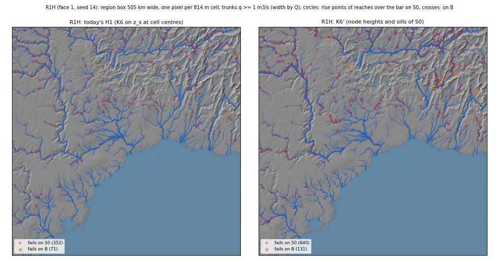
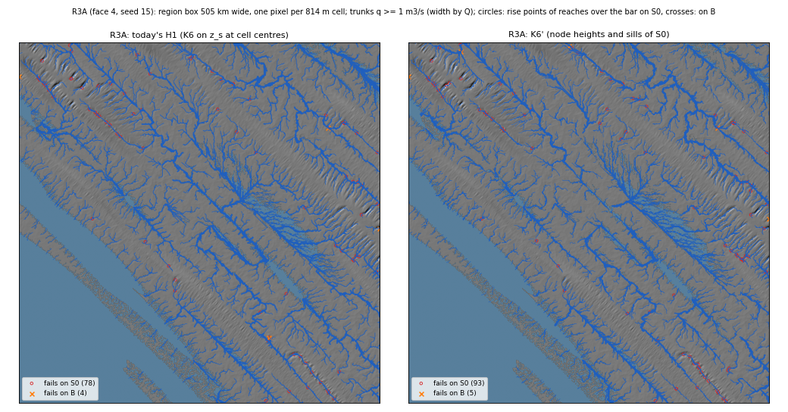
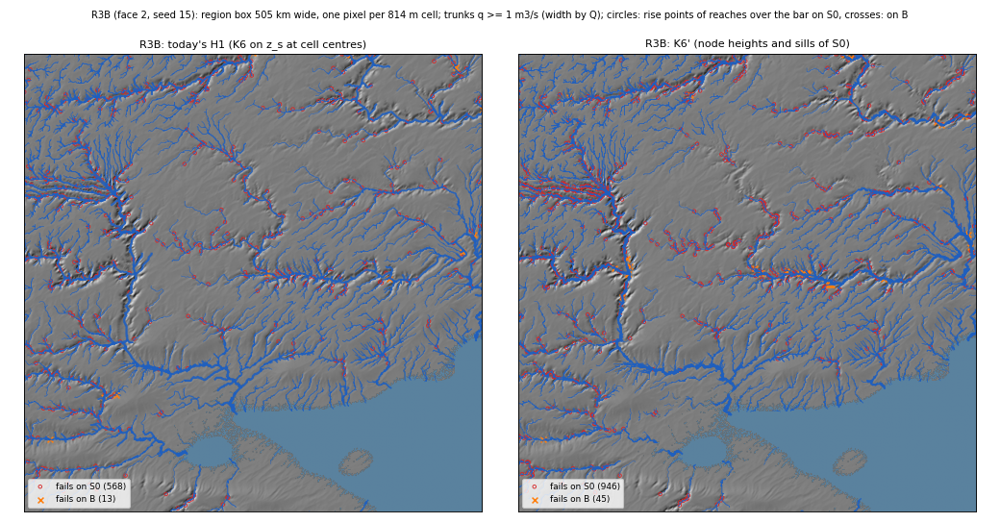
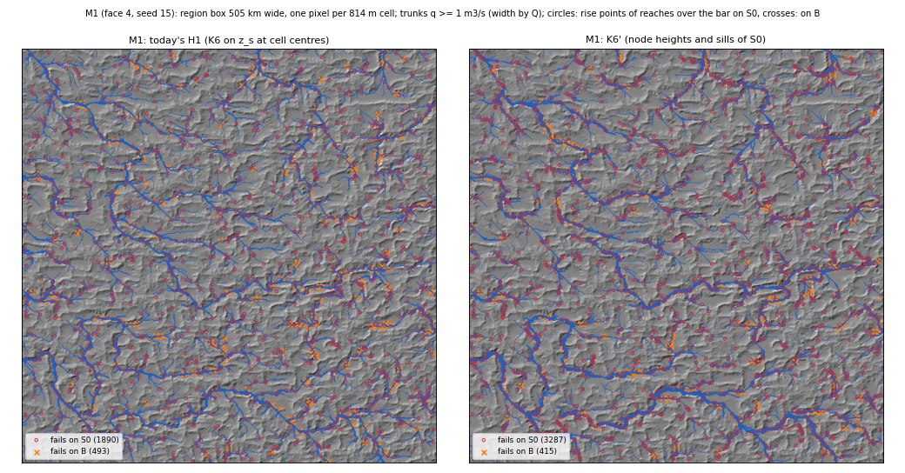
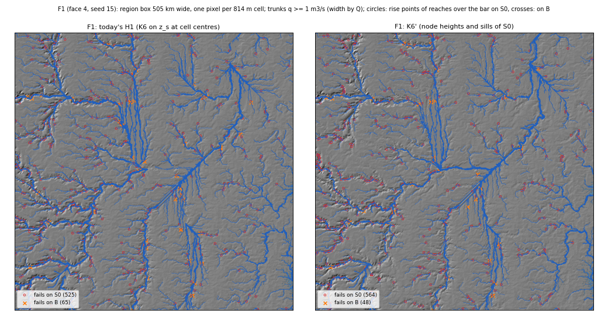

# SPIKE-127: H1 routed on sub-cell sills of S0 (G1a)

Opened: 2026-11-16 (lead #131; owner, 2026-11-16: G0 and G1a approved)
Question: does K6 (H1's flood and routing, 75 km2) on node heights and sill edges of `S0` give a connected trunk graph that follows L's valleys, and at what cost and stability?
Why it matters: river graphs G1a (`digest/river-graph/plan.md` draft 4, §4; addendum §3 G1a): the K5' decision and the D-2 path.
Time box: 2 days (lead #131). Used: about 0.3 day.
Success criteria: the five windows routed; the D-2 list, the K5-channel share, the topology diff, the sensitivity, the exception map, the cost (lead #131 and #131a).
Fallback if it fails: report what fails (plan §4.2). Not needed.
Code location: spike branch `spike/g1a-sills` (`crates/cache/examples/g1a_sills.rs`); tables `tools/g1a_table.py`; maps `tools/g1a_map.py`.

## 1. Method
| Item | Definition |
|---|---|
| `S0` | `B + C1(z_s - z_b)` at L: the river gate's start surface |
| Node height | the lowest L cell of `S0` in the 814 m cell (ties by L index) |
| Sill | minimax `S0` over 8-connected L paths between the two cells' lowest L cells, inside the two cells (8 neighbours) |
| K6' flood | Dijkstra by (level, id): `W(q) = min over p of max(sill(p,q), W(p) + eps, h(q))`; outlets at their node height |
| K6' receiver | steepest jittered slope of `W` among neighbours with `W(q) < W(p)` and `sill <= W(p)` (the open edges) |
| K6' area | clipped (Local) MFD over the open edges, K6's runoff weights; then K6's hydrology and channel graph unchanged (75 km2) on the node heights |
| Unchanged | K5, the outlets (`z_b <= 0` or the window's edge), the runoff, the epsilon, the jitter seed |
| Control | this code on the point heights `z_s` (sills `max(z_s)`): K6 without the flat regrade (GEN-173); it measures what the code alone changes |
| Trunks | graph segments with `q >= 1 m3/s` (the gate's trunk column) |
| Corridor | `trunk_corridor` at k_c 2 snapped, with explorer #163's land-only snap applied locally (merged after the runs as #1562): non-mouth nodes and edge crossings snap to land; routes step over land only; a route that meets the sea ends there. Two edge cases differ from #1562: a crossing with no land edge cell falls back to any edge cell here (#1562 adds no waypoint), and a route whose first node lies on the sea steps on here (#1562 ends it) |
| Surfaces | `S0` (counted over the region's box) and B's store (`b-*`, counted over its tiles) |
| D-2 re-trace | from each D-2 reach's upstream node along K6' receivers until within one cell of its old end node ("rejoins"), an outlet, or 3x its length ("diverted"); that path measured as one reach |
| Sensitivity | `S0 + 0.5 u` per L cell, `u` uniform in [-1, 1) (fixed seed); sills `+ 1 u` per edge, lifted to their nodes; baseline: today's K6 with `z_s + 0.5 u` per H1 cell |
| Stop test (#131a) | the 10 largest rivers leaving the box (20 main-stem cells or more in it): outlet more than 10 cells (8 km) off; a major confluence (tributary D8 area >= 75 km2 and >= 10 % of the stem's) with no confluence of the other graph within 2 cells joined by a segment of 0.5-2x its D8 area |

## 2. Results, five windows
| Measure | R1h | R3a | R3b | M1 | F1 |
|---|---|---|---|---|---|
| Sill over the higher node: zero / p90 / p99, m | 63 % / 25.8 / 137 | 63 % / 3.8 / 25 | 60 % / 4.4 / 28 | 54 % / 150 / 379 | 54 % / 5.0 / 19 |
| `z_s` - node height p50, m | 18.2 | 3.0 | 3.8 | 133.7 | 4.2 |
| Trunk cells in the box, today -> K6' | 14,944 -> 17,948 | 31,495 -> 37,453 | 24,141 -> 30,522 | 23,920 -> 28,343 | 29,690 -> 28,029 |
| K6' trunk cells off K5's channel cells: exact / more than 1 cell | 38.3 / 5.7 % | 35.8 / 5.3 % | 34.0 / 4.0 % | 48.4 / **14.5 %** | 18.2 / 1.0 % |
| The control off K5's channel cells: exact / more than 1 cell | 0.5 / 0.3 % | 0.8 / 0.2 % | 0.1 / 0.1 % | 0.1 / 0.1 % | 0.1 / 0.0 % |
| Stop test: rivers changed (of 10) today -> K6' / control / `z_s` +-0.5 m | 7 / 1 / 1 | 4 / 4 / 8 | 3 / 0 / 1 | 9 / 0 / 0 | 4 / 0 / 0 (of 9) |
| Major confluences lost (of) / gained, today -> K6' | 10 (34) / 3 | 9 (28) / 0 | 5 (40) / 3 | 17 (55) / 7 | 5 (10) / 3 |
| K6': outlets more than 8 km off today's | 0 | 1 | 0 | 0 | 0 |
| K6': box land draining to an outlet over 8 km from today's | 0.41 % | 5.21 % | 0.36 % | 0.20 % | 0.08 % |
| Kept H1 basins today -> K6' | 69 -> 236 | 227 -> 195 | 61 -> 115 | 106 -> 230 | 224 -> 212 |
| Corridor pass on `S0`, today -> K6' | 88.6 -> 87.3 % | 99.1 -> 99.2 % | 90.2 -> 88.3 % | 68.5 -> 63.0 % | 93.7 -> 93.2 % |
| Corridor pass on B, today -> K6' | 98.6 -> 98.4 % | 99.97 -> 99.97 % | 99.85 -> 99.60 % | 95.1 -> 96.9 % | 99.3 -> 99.5 % |
| D-2 list (SPIKE-126) / failing on B under the land-only snap | 97 / 56 | 13 / 4 | 29 / 13 | 427 / 427 | 145 / 65 |
| Of those, gain a route under the bar on K6': on B / on `S0` | 27 / 2 | 1 / 1 | 7 / 1 | 269 / 91 | 30 / 22 |
| Re-traced paths: rejoin / diverted | 85 / 12 | 12 / 1 | 20 / 9 | 279 / 148 | 124 / 21 |

- Five windows: the land-only snap clears 146 of the 711 D-2 reaches; of the 565 left, 334 (59.1 %) gain a route under the bar on B along K6', 202 still fail, 29 are not measurable (corridor skip); on `S0` 117 (20.7 %) gain one.
- Full rows (topology, catchments, sensitivity, the major-river rows, timings): `raw/table.csv`; run logs `raw/run-<w>.txt`; per D-2 reach `raw/d2-<w>.csv`; failing reaches of today and K6' with their class `raw/exceptions.csv`.

### 2.1 Topology diff, today -> K6'
| Measure | R1h | R3a | R3b | M1 | F1 |
|---|---|---|---|---|---|
| Reaches (cell-identical in both) changed | 91.2 % | 82.7 % | 91.2 % | 89.0 % | 56.5 % |
| Reaches with a cell more than 1 cell off the other's trunks, today / K6' | 490 / 733 | 1,101 / 1,387 | 398 / 913 | 1,819 / 2,279 | 1,376 / 521 |
| Junctions today -> K6' (moved more than 1 cell) | 1,660 -> 2,527 (643) | 4,664 -> 5,856 (1,433) | 3,031 -> 4,030 (979) | 3,216 -> 4,436 (1,496) | 4,305 -> 4,270 (1,060) |
| Outlets in the box today -> K6' (moved more than 1 cell) | 35 -> 33 (17) | 146 -> 162 (53) | 35 -> 37 (20) | 0 -> 0 | 2 -> 3 (0) |
| Box land draining to an outlet more than 2 cells away | 46.8 % | 11.8 % | 21.9 % | 0.2 % | 0.7 % |
| The control: reaches changed / cells more than 1 cell off | 9.3 % / 0.7 % | 23.4 % / 0.4 % | 2.5 % / 0.1 % | 0.5 % / 0.1 % | 4.7 % / 0.1 % |

- Cell-identical reaches are a strict measure: a junction moved by one cell changes three reaches. The 1-cell columns are the topology change.
- The 2-cell outlet column is dominated by delta mouths moving a few cells along a coast; the 8 km column (section 2) is the river-scale change.

### 2.2 Sensitivity
| Trunk cells more than 1 cell off / rivers changed in the stop test | R1h | R3a | R3b | M1 | F1 |
|---|---|---|---|---|---|
| Today, `z_s` +-0.5 m (baseline) | 1.5 % / 1 | 5.7 % / 8 | 1.1 % / 1 | 0.1 % / 0 | 1.0 % / 0 |
| K6', `S0` +-0.5 m | 1.7 % / 3 | 5.3 % / 2 | 1.7 % / 1 | 0.3 % / 0 | 2.8 % / 1 |
| K6', sills +-1 m | 3.8 % / 4 | 6.1 % / 1 | 3.1 % / 2 | 2.4 % / 0 | 5.2 % / 1 |

- K6' under a 0.5 m perturbation of `S0` moves about as much as today's K6 under the same perturbation of `z_s`; a 1 m sill perturbation moves 1.2-8x more.
- R3a (flat) is unstable under every perturbation, today's K6 included: its stop test is at noise level (control 4, baseline 8 of 10).

### 2.3 Where the extra trunk cells come from (#131a)
| Today -> K6' | R1h | R3a | R3b | M1 | F1 |
|---|---|---|---|---|---|
| Trunk heads in the box | 1,792 -> 2,948 | 5,394 -> 7,150 | 3,288 -> 4,756 | 3,614 -> 5,249 | 4,982 -> 5,059 |
| Of them with a D8 area under 75 km2 | 92 -> 92 % | 99 -> 98 % | 95 -> 95 % | 89 -> 90 % | 87 -> 87 % |
| Trunk length in the box, km | 12,987 -> 14,904 | 27,229 -> 30,953 | 22,251 -> 26,016 | 21,185 -> 24,351 | 27,742 -> 25,427 |
| K6' with the MFD over all lower neighbours: heads / km | 4,024 / 15,147 | 8,858 / 31,022 | 6,951 / 26,601 | 6,180 / 24,242 | 6,027 / 25,728 |

- The extra trunk cells are new heads, not longer paths: heads +33 to +65 % (F1 +2 %); length per cell within 8 % (0.83-0.93 km).
- 87-99 % of the heads, today and on K6', have a D8 area under 75 km2: a trunk head is mostly where the clipped MFD's share of a valley's flow on a parallel D8 line reaches 1 m3/s, not a new catchment over 75 km2.
- The sill rule on the MFD is not the cause: with the MFD over all lower neighbours the heads rise further. The node heights make the 814 m surface more incised (`z_s - h` p50 3-134 m), which splits more of the valleys' flow onto parallel D8 lines.

### 2.4 Exceptions by terrain
| Failing reaches of K6' (class at the rise: relief over 21 x 21 L cells; coast: sea within 2 km) | R1h | R3a | R3b | M1 | F1 |
|---|---|---|---|---|---|
| On `S0`: coast / low / hilly / rugged / mountain | 21 / 1 / 164 / 369 / 85 | 5 / 42 / 42 / 4 / 0 | 4 / 98 / 721 / 123 / 0 | 0 / 5 / 141 / 646 / 2,495 | 21 / 149 / 394 / 0 / 0 |
| On B | 6 / 7 / 84 / 6 / 28 | 0 / 2 / 3 / 0 / 0 | 0 / 9 / 35 / 1 / 0 | 0 / 14 / 106 / 119 / 176 | 5 / 13 / 30 / 0 / 0 |
| D-2 reaches still failing on B after the re-trace: coast / low / hilly / rugged / mountain | 1 / 2 / 17 / 3 / 4 | 0 / 1 / 1 / 1 / 0 | 0 / 2 / 4 / 0 / 0 | 0 / 14 / 30 / 25 / 62 | 5 / 6 / 24 / 0 / 0 |

### 2.5 Cost
| Item | Per window (1.04 M H1 cells, 4.16 M edges, 8 threads) | Per cube face (151 M H1 cells, 145x) |
|---|---|---|
| Sills (node heights and edges from `S0` in memory) | 2.4-2.6 s | 5.8-6.3 min |
| `S0` at L (the base read K7 also does) | 5.7-7.4 s | 14-18 min |
| K6' flood, routing, hydrology | 1.2-1.6 s | (landmass routing, as K6) |
| Sill arrays (4 sills, node height, lowest cell) | 46 MB | 6.6 GB as f64; 3.0 GB as f32; 0.9 GB at 30 % land |
| Process peak (`S0`, B's ground, two water copies, flags) | 2.69-2.72 GB | streamed: two block rows of `S0` per thread band, 12.6 MB |

- Times from the last run (machine shared with other lanes' prepush runs; an earlier R1h run took 5.4 s for the sills).

## 3. Findings
1. **K5-channel rule (plan §4.2, 10 %; lead #131a: more than one cell off):** R1h 5.7, R3a 5.3, R3b 4.0, F1 1.0 % pass; **M1 14.5 % exceeds it.** Exact cells: 18-48 % on every window.
2. **Stop test (#131a): yes on every window.** K6' loses major confluences on the top rivers of all five windows (5-17 lost, 0-7 gained); outlets stay within 8 km except one on R3a. Above the noise level (control and baseline) on R1h, R3b, M1 and F1; at noise level on R3a. By #131a's rule, K5' (sill edges in K5's rounds) is the next item before #132.
3. **D-2: 59 % of the land-snap D-2 reaches gain a route on B along K6' (334 of 565), 21 % on `S0`.** Over half: not the stop of plan §4.2. On `S0` the rises are mostly not routing: K6' does not raise the corridor share on `S0` on any window (-5.5 to +0.1 points), because `S0`'s band `r` dams the valleys (KS's job, G1b).
4. **Corridor shares on B are unchanged within 1.8 points** (M1 +1.8, F1 +0.2, R1h -0.2, R3b -0.25), though B's store was carved along today's H1 lines.
5. **Stability:** K6' under `S0` +-0.5 m is as stable as today's K6 under `z_s` +-0.5 m (1.7 against 1.5 % of trunk cells on R1h); sills +-1 m move 2.4-6.1 %.
6. **Cost:** the sill field costs about 6 min a face on 8 threads, beside the `S0` read; memory 0.9-3 GB a face as f32, independent of the window when `S0` is streamed.
7. **H1 basins** rise on R1h, R3b and M1 (69 -> 236, 61 -> 115, 106 -> 230): L-scale hollows whose sill lifts the node.

## 4. Recommendation
- K5' (K5's rounds on the sill edges) before #132, on all five windows; M1 first (the K5-channel share over 10 % and 9 of 10 top rivers changed).
- D-2: KG-trunk's demotion and widening stay the fallback, not the main path (59 % over the half).
- The trunk column's `q >= 1 m3/s` counts MFD side lines as heads (87-99 % of heads): for G0's trunk definition, a D8-area or Strahler criterion is the more stable choice.

## Visuals
Analysis renders: hillshade of `S0`'s node heights over the region's box (one pixel per 814 m cell, sun from the north-west), trunks of today's H1 (left) and K6' (right) with width by Q, and the rise points of the reaches over the bar: circles on `S0`, crosses on B. CPU (numpy), no GPU path.

R1h (face 1, seed 14): K6' carries the western river down another valley (the thick north-south line) and thins the central lowland network; its failures on B cluster in the north-eastern uplands.

R3a (face 4, seed 15): ridges and valleys parallel to the coast; both graphs follow the valleys; few failures on either surface.

R3b (face 2, seed 15): K6' joins the central valleys into one east-west trunk; its failures on `S0` lie along the slopes' valleys.

M1 (face 4, seed 15): mountains; failures on `S0` lie along the valleys of both graphs (K6': 2,495 of 3,287 at mountain relief).

F1 (face 4, seed 15): lowland; K6' keeps the main stems in place.
