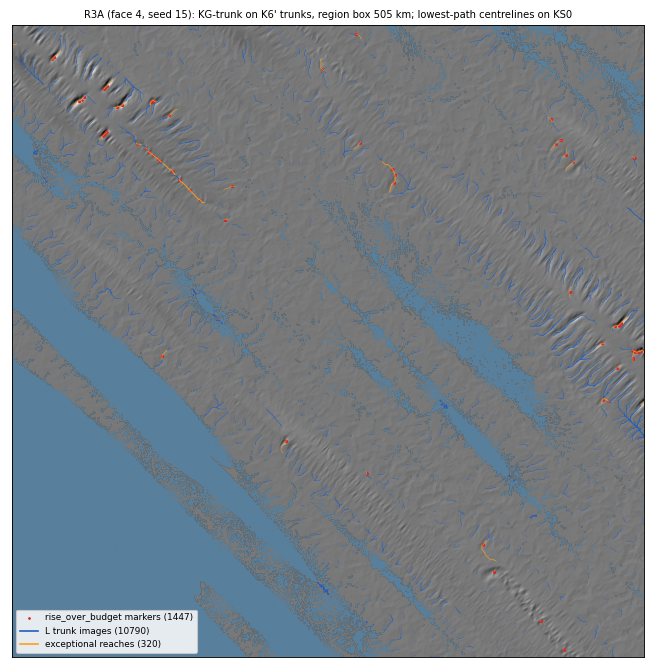
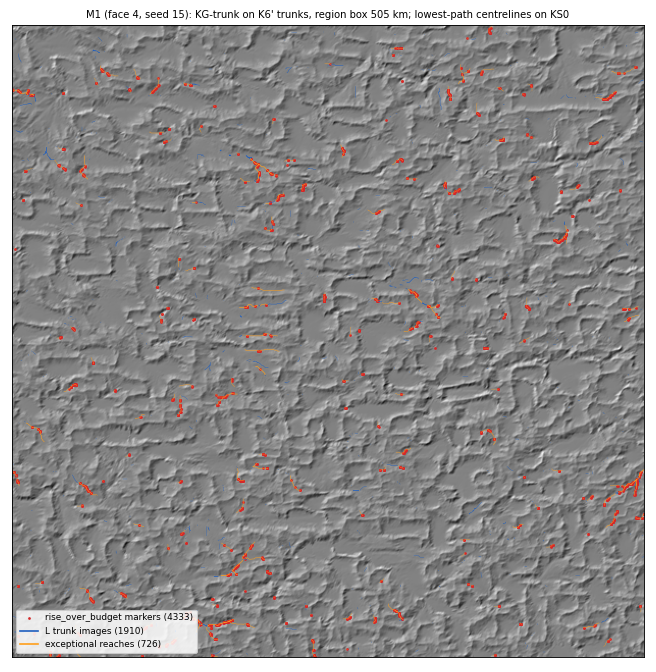
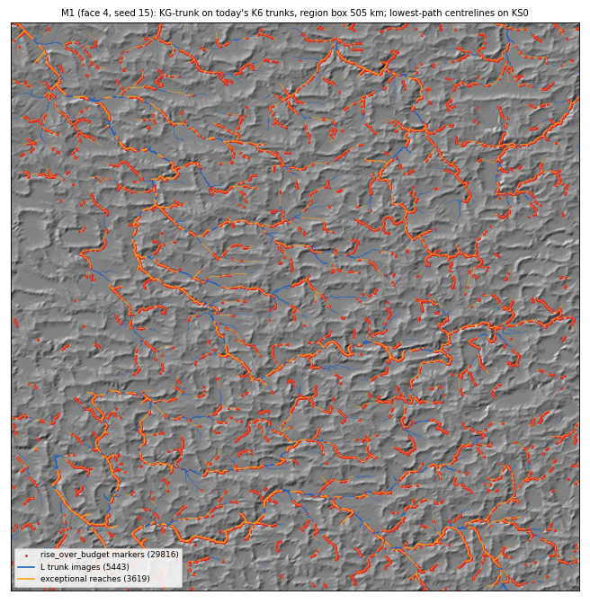

# SPIKE-129: KG-trunk, the trunk graph at L (G1c)

Opened: 2026-11-17 (lead #132; G0 contracts agreed, owner 2026-11-16)
Question: do the G0 contracts and types (GEN-189) carry a continuous L representation of the H1 trunk graph, without an L erosion round, on five windows?
Why it matters: river graphs G1c (`digest/river-graph/plan.md` draft 4, addendum §3); G1d (tributaries) builds on it.
Time box: about 2 days (lead #132). Used: about 0.4 day.
Success criteria: L images of trunk nodes and reaches, centrelines in the corridor on KS0, beds by contract §3 with the §6 remainder, rasterisation by §5; profile continuity through junctions; no uphill step outside exceptions; ids stable on a tile rebuild; one region against two bit-identical; the exception count and map; graph/raster agreement against routed `S0` and KS0 (lead #132).
Fallback if it fails: report what the contracts do not carry. Used in part (section 4).
Code location: spike branch `spike/g1c-trunk-k6p` (fd1b32b7, `crates/cache/examples/kg_trunk.rs`, on main's `bake::river_graph`); maps `tools/kg_map.py`.

## 1. Method
| Item | Definition |
|---|---|
| H1 base | K6' on the node heights and sills of `S0` (SPIKE-127; the default of DEC spikes-3, open); today's K6 beside it (`--base today`) |
| H1 trunk reaches | every channel segment (>= 75 km2), cut at a kept H1 basin: the chain ends at a `lake_inlet` on the basin's first cell and restarts at a `lake_spill` on its spill cell; a segment ending at a sea outlet ends at an `outlet_sea`, one ending on the window's edge also at an `outlet_sea` on the edge cell (a window is not a domain; counted apart) |
| L anchor (§2.1) | the lowest L cell of `S0` within one H1 cell of the H1 node's centre, ties by global cell id; land only for a non-outlet node; an `outlet_sea` image on the first sea cell of its chain (reading 2) |
| KS0 | `S0 - max(0, r - C1(HAND))`, `r = B - C1(z_b)`, HAND = `z_s` over the channel cell the 814 m flow path reaches (`alpha` 1) |
| Centreline | inside the k_c 2 corridor (two H1 cells around the H1 polyline) on KS0, from the up anchor to the down anchor; steps from land only, a sea cell ends the route. Default: the lowest path (Dijkstra, step cost `length x (1 + (z - z_min) / 10 m)`, `z_min` the corridor's lowest cell); beside it BUILD-057's maximin route |
| A route that meets the sea before its down node | ends there at an `outlet_sea` (counted) |
| Bed (§3, §6) | running minimum of KS0 from the up node's bed; the cut at a vertex at most `budget - KS_used` (`KS_used = S0 - KS0`, KS1 not built); beyond it the bed follows the surface and the reach is `exception(rise_over_budget, max excess)` with an `exception` marker at each vertex where the bed rises; a confluence's bed the lowest inflow's; 0.5 m codes |
| Budget field (§6) | `relief_1km` per 814 m cell, its p50 within 25 km, evaluated on every 4th H1 cell and read from the nearest; `min(50, max(10, 0.5 x))` |
| Attributes | per L vertex from the H1 reach's cell at the same share of its length (the last L vertex on the H1 end cell): `a_geo` the H1 D8 area, `q` and `a_run` H1's potential discharge, `q_w` H1's routed discharge, `strahler` the segment's order, `a_ext` 0 |
| Validators | main's `validate` (open slice), `rasterise`, `validate_raster` |
| Agreement (§5) | in the region's box: the share of routed river cells (D8 area >= 75 km2 on the surface flooded with epsilon 1e-6, land) with a rasterised graph cell within 1 cell, and the share of rasterised cells with a routed river cell within 1 cell |
| Determinism and partition | the graph built on 1 and 8 threads; KS0 evaluated over two regions (left and right half, each its own evaluation) and stitched; one tile of KS0 evaluated again |
| H1 basins' L images | the depression of `S0` holding the lowest L cell of the H1 floor cell, flooded inside the H1 basin's box plus 2 H1 cells; its spill against H1's |

## 2. Results, five windows (K6' base / today's K6 base)
| Measure | R1h | R3a | R3b | M1 | F1 |
|---|---|---|---|---|---|
| H1 channel segments | 21,508 / 13,578 | 33,466 / 27,392 | 28,664 / 24,774 | 41,287 / 29,801 | 34,176 / 28,193 |
| Segment cells in kept H1 basins | 74 / 37 % | 63 / 29 % | 49 / 32 % | 93 / 60 % | 84 / 67 % |
| Window cells in kept H1 basins | 11.6 / 4.8 % | 10.1 / 3.3 % | 7.0 / 3.1 % | 30.4 / 14.5 % | 16.4 / 9.2 % |
| H1 trunk reaches after the lake cuts | 5,044 / 6,899 | 11,709 / 18,829 | 12,672 / 14,526 | 2,840 / 10,080 | 4,177 / 5,198 |
| L reaches (vertices) | 4,610 (117 k) / 6,207 (218 k) | 11,110 (206 k) / 17,357 (305 k) | 11,584 (327 k) / 13,421 (423 k) | 2,636 (68 k) / 9,062 (306 k) | 3,760 (121 k) / 4,654 (217 k) |
| Reaches without an L route (no corridor route, one-cell chain) | 434 / 692 | 599 / 1,472 | 1,088 / 1,105 | 204 / 1,018 | 417 / 544 |
| Routes meeting an inland sea cell before their down node | 554 / 1,085 | 2,600 / 5,811 | 792 / 1,094 | 0 / 0 | 389 / 1,751 |
| L anchors of two node kinds on one cell | 134 / 222 | 162 / 525 | 162 / 250 | 33 / 452 | 37 / 166 |
| `rise_over_budget` reaches | 702 (15 %) / 1,279 (21 %) | 320 (3 %) / 487 (3 %) | 1,159 (10 %) / 1,855 (14 %) | 726 (28 %) / 3,619 (40 %) | 663 (18 %) / 1,193 (26 %) |
| Excess over the remainder p50 / p90, m (K6') | 14.2 / 41.3 | 5.1 / 23.8 | 3.5 / 10.3 | 39.5 / 104.7 | 2.6 / 6.7 |
| Bed rises outside exceptional reaches | 0 / 0 | 0 / 0 | 0 / 0 | 0 / 0 | 0 / 0 |
| Validator violations | 618 / 793 | 465 / 1,592 | 906 / 1,140 | 596 / 4,516 | 202 / 399 |
| Agreement with routed `S0`: river cells near the graph / graph cells near a river | 25.0 / 55.9 % ; 40.5 / 50.3 % | 33.5 / 39.1 % ; 61.8 / 39.2 % | 32.8 / 51.2 % ; 46.5 / 48.0 % | 10.5 / 68.9 % ; 26.9 / 30.5 % | 16.3 / 70.8 % ; 23.6 / 60.1 % |
| The same against routed KS0 | within 2 points of `S0` on every window and base | | | | |
| 1 thread against 8 / two regions against one / a tile evaluated again | identical / 0 cells, identical / 0 differences | the same | the same | the same | the same |
| KS0 lowering: share of land, p95 (K6') | 3.2 %, 16.2 m | 4.2 %, 0.7 m | 2.4 %, 0.7 m | 5.2 %, 43.1 m | 3.4 %, 1.3 m |
| Budget field p50, m | 26.7 | 10.0 | 10.0 | 50.0 | 10.0 |
| H1 basins on the trunks; L image spill - H1 spill p50 (p90), m | 125: 0.3 (114) / 41: 1.4 (16) | 162: -0.8 (3.3) / 217: -0.5 (1.5) | 87: -0.6 (7.4) / 51: -0.4 (0.9) | 107: 95.5 (400) / 52: 20 (74) | 108: -0.6 (10) / 165: -0.9 (1.4) |

- The violations are of four kinds only: `ConservationBreak` on L confluences, `DuplicateId` (exception markers, a few reaches), `TwoNodesOneAnchor`, `OutgoingCount`. On R1h and M1 every conservation break sits on an L node that stands for two or more H1 nodes (62 of 62, 13 of 13; rerun logs `raw/run-r1h.txt`, `raw/run-m1.txt`). No `InvalidEdge`, `BedRise`, `Cycle` or raster violation remains.
- Centreline on R1h: BUILD-057's maximin route (it keeps the running minimum as high as possible) gives 8.6 / 11.4 % agreement and 1,434 exceptional reaches; the lowest path 25.0 / 55.9 % and 702 (`raw/run-r1h-maximin.txt`).
- Cost per window (8 threads): KS0 1.7-2.5 s; budget field 0.9-1.5 s; graph 0.9-3.3 s; an L routing of the window for the agreement 33-79 s; run 146-285 s, peak 3.46-3.66 GB.
- Logs `raw/run-<window>[-today].txt`; markers with their excess, K6' base only, `raw/exceptions-<window>.csv`.

## 3. Findings
1. **The contracts carry a continuous trunk image where H1 has trunks.** The validator finds no `InvalidEdge` (every L reach an 8-connected chain from its up anchor to its down anchor) and no `BedNotShared` (beds shared through every junction), no bed rises outside an exceptional reach, conservation breaks only at the merged nodes of finding 4 (R1h and M1, the windows checked), the raster has no cell owned twice, and the L stage is deterministic and partition-invariant (identical canonical form on 1 and 8 threads, over two regions, after a tile rebuild).
2. **H1's kept basins remove most of the trunk network.** 49-93 % of K6''s channel-segment cells and 29-67 % of today's lie in kept H1 basins, which the contract replaces by `lake_inlet`/`lake_spill` pairs. On M1 K6' keeps 2,840 trunk reaches of 41,287 segments. The trunk graph at L is then fragments between lakes (maps).
3. **K6' doubles the basin area of today's K6** (7-30 % of the window against 3-15 %): its sill-lifted node heights become kept basins. On this measure today's K6 gives the more complete trunk graph (more reaches, higher river coverage on every window).
4. **Two H1 nodes within one H1 cell can snap to one L cell** (33-525 per window). On R1h and M1 (the windows checked) that gap explains every conservation break; the duplicate reach ids, `OutgoingCount` and `TwoNodesOneAnchor` fit the same gap (not measured apart).
5. **Exception markers of two reaches on one cell collide** (`DuplicateId` on markers, 0-1,409 per window): the marker id `hash(kind, level, anchor)` cannot hold two reaches' exceptions at one cell.
6. **Inland cells of `S0` at or below the sea level end routes** (389-5,811 per window on the coastal windows): confluence images become `outlet_sea` there, which the contract does not define for a non-outlet node.
7. **The centreline method decides the result.** The contract and the KR note say "routed on S1 inside the corridor"; the maximin route of the corridor measure misses the valleys (11 % agreement), a lowest path follows them (39-71 % of graph cells near a routed river on K6').
8. **Exceptions follow relief:** 3 % of L reaches on R3a, 28-40 % on M1 (excess p50 30-40 m); on the flat windows the excess is a few metres (p50 2.6-5.2 m).
9. **KS0 changes little:** it lowers 1.8-5.2 % of the land (p95 0.7-46 m); agreement against KS0 is within 2 points of `S0`.
10. **L images of K6''s mountain basins spill far above H1's** (M1 p50 95 m): the L depression under the H1 floor is an L pit in `r`, not the H1 basin; on the other windows the p50s agree within a few metres (-0.9 to 1.4 m; R1h's p90 on K6' is 114 m).

## 4. Recommendation
- G1c's exit (a continuous L trunk representation without an L erosion round) holds for the reaches H1 hands over; it fails where H1's kept basins cover the network. The basin question goes to G1e before G1d: whether the H1 kept set (>= 4 cells or >= 2 m) is the right lake set for the trunk graph.
- Contract amendments (lead): (a) an anchor rule that keeps H1 nodes distinct at L (each H1 node takes the lowest free cell of its own disc, by node id); (b) the marker id with its reach (`hash(kind, level, anchor, on_reach)`); (c) a confluence image whose route meets the sea becomes an `outlet_sea` image, or the route is kept on land to its anchor; (d) the centreline as the lowest path in the corridor.
- DEC spikes-3: the trunk base for G1d is today's K6 on this measure (finding 3), unless the basin set changes.

## Visuals
Analysis renders: hillshade of `S0`'s node heights over the region's box (one pixel per 814 m cell, sun from the north-west, sea blue), the L trunk images every second vertex (blue; exceptional reaches orange) and the `rise_over_budget` markers (red). CPU (numpy), no GPU path.

R1h (face 1, seed 14), K6' base: trunk fragments between lakes; exceptions in the northern uplands.

R1h on today's K6: more of the network survives the lake cuts.

R3a (face 4, seed 15), K6' base: trunks in the valleys between the coastal ridges, few exceptions.

R3b (face 2, seed 15), K6' base: exceptions along the mid-slope valleys.

M1 (face 4, seed 15), K6' base: almost the whole network lies in kept basins; 726 of the 2,636 L reaches left are exceptional.

M1 on today's K6: a connected trunk network, 40 % of its L reaches exceptional (dense red markers along the valleys).

F1 (face 4, seed 15), K6' base: lowland fragments; small excesses.
