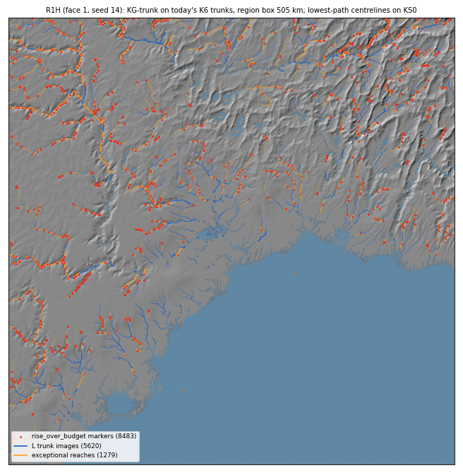
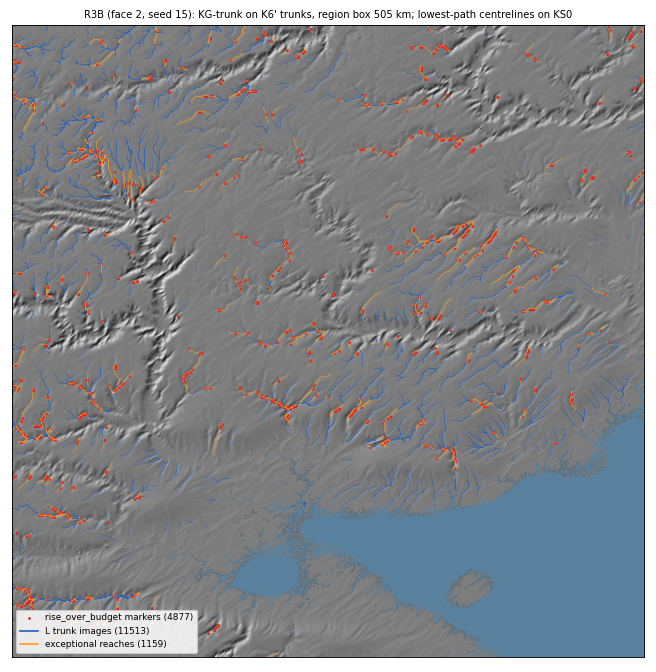
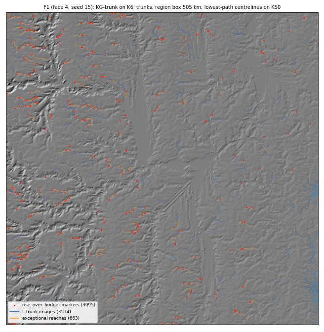

# SPIKE-129: KG-trunk, the trunk graph at L (G1c)

Opened: 2026-11-17 (lead #132, #132a; G0 contracts agreed, owner 2026-11-16)
Question: do the G0 contracts and types (GEN-189) carry a continuous L representation of the H1 trunk graph, without an L erosion round, on five windows?
Why it matters: river graphs G1c (`digest/river-graph/plan.md` draft 4, addendum §3); G1d (tributaries) builds on it.
Time box: about 2 days (lead #132). Used: about 0.6 day.
Success criteria: L images of trunk nodes and reaches, centrelines in the corridor on KS0, beds by contract §3 with the §6 remainder, rasterisation by §5; profile continuity through junctions; no uphill step outside exceptions; ids stable on a tile rebuild; one region against two bit-identical; the exception count and map; graph/raster agreement against routed `S0` and KS0 (lead #132); rules with numbers for inland sea cells and for the kept H1 basins (lead #132a).
Fallback if it fails: report what the contracts do not carry. Used in part (sections 4 and 5).
Code location: spike branch `spike/g1c-trunk-k6p-2` (e29c0bd6, rebased on main, `crates/cache/examples/kg_trunk.rs`, on main's `bake::river_graph` at d65056f7); maps `tools/kg_map.py`.

## 1. Method
| Item | Definition |
|---|---|
| H1 base | K6' on the node heights and sills of `S0` (SPIKE-127; the default of DEC spikes-3, open); today's K6 beside it (`--base today`) |
| H1 trunk reaches | every channel segment (>= 75 km2), cut at a kept H1 basin: the chain ends at a `lake_inlet` on the basin's first cell and restarts at a `lake_spill` on its spill cell; a segment ending at a sea outlet ends at an `outlet_sea`, one ending on the window's edge also at an `outlet_sea` on the edge cell (a window is not a domain; counted apart) |
| L anchor (§2.1, readings 2 and 7) | the lowest L cell of `S0` within one H1 cell of the H1 node's centre, ties by global cell id; land only for a non-outlet node; nodes snapped in order of descending `q_w`, ties by H1 node id, a cell already taken excluded; an `outlet_sea` image on the first sea cell of its chain |
| KS0 | `S0 - max(0, r - C1(HAND))`, `r = B - C1(z_b)`, HAND = `z_s` over the channel cell the 814 m flow path reaches (`alpha` 1) |
| Centreline | inside the k_c 2 corridor (two H1 cells around the H1 polyline) on KS0, from the up anchor to the down anchor; steps from land only, a sea cell ends the route. Default: the lowest path (Dijkstra, step cost `length x (1 + (z - z_min) / 10 m)`, `z_min` the corridor's lowest cell); beside it BUILD-057's maximin route (R1h, before readings 7 and 8) |
| A route that meets the sea before its down node | ends there at an `outlet_sea`; counted, and split into ocean (the sea cell connected through cells at or below the sea level to an L cell of an H1 sea outlet or to the window's edge) and inland |
| Bed (§3, §6) | running minimum of KS0 from the up node's bed; the cut at a vertex at most `budget - KS_used` (`KS_used = S0 - KS0`, KS1 not built); beyond it the bed follows the surface and the reach is `exception(rise_over_budget, max excess)` with an `exception` marker at each vertex where the bed rises (reading 8: marker id with its reach); a confluence's bed the lowest inflow's; 0.5 m codes |
| Budget field (§6) | `relief_1km` per 814 m cell, its p50 within 25 km, evaluated on every 4th H1 cell and read from the nearest; `min(50, max(10, 0.5 x))` |
| Attributes | per L vertex from the H1 reach's cell at the same share of its length (the last L vertex on the H1 end cell): `a_geo` the H1 D8 area, `q` and `a_run` H1's potential discharge, `q_w` H1's routed discharge, `strahler` the segment's order, `a_ext` 0 |
| Validators | main's `validate` (open slice), `rasterise`, `validate_raster` |
| Agreement (§5) | in the region's box: the share of routed river cells (D8 area >= 75 km2 on the surface flooded with epsilon 1e-6, land) with a rasterised graph cell within 1 cell, and the share of rasterised cells with a routed river cell within 1 cell |
| Determinism and partition | the graph built on 1 and 8 threads; KS0 evaluated over two regions (left and right half, each its own evaluation) and stitched; one tile of KS0 evaluated again |
| H1 basins' L images | the depression of `S0` holding the lowest L cell of the H1 floor cell, flooded inside the H1 basin's box plus 2 H1 cells; its spill against H1's |
| Basin census (#132a) | per kept H1 basin: depth `spill - floor`, cells, GEN-145's artefact floor (fewer than 4 cells and shallower than 2 m) and pit limit (0.5 m); the channel-segment cells it holds by depth class; on K6' the same routing on the node heights with each edge at the higher node (no sills): a K6' basin whose floor lies in no basin there is closed by the sills alone |

## 2. Results, five windows (K6' base / today's K6 base)
| Measure | R1h | R3a | R3b | M1 | F1 |
|---|---|---|---|---|---|
| H1 channel segments | 21,508 / 13,578 | 33,466 / 27,392 | 28,664 / 24,774 | 41,287 / 29,801 | 34,176 / 28,193 |
| Segment cells in kept H1 basins | 74 / 37 % | 63 / 29 % | 49 / 32 % | 93 / 60 % | 84 / 67 % |
| Window cells in kept H1 basins | 11.6 / 4.8 % | 10.1 / 3.3 % | 7.0 / 3.1 % | 30.4 / 14.5 % | 16.4 / 9.2 % |
| H1 trunk reaches after the lake cuts = L reaches (L vertices) | 5,044 (118 k) / 6,899 (219 k) | 11,709 (207 k) / 18,829 (308 k) | 12,672 (329 k) / 14,526 (425 k) | 2,840 (69 k) / 10,080 (308 k) | 4,177 (122 k) / 5,198 (219 k) |
| Reaches without an L route | 0 / 0 | 0 / 0 | 0 / 0 | 0 / 0 | 0 / 0 |
| Routes meeting the sea before their down node (of them inland) | 615 (592) / 1,206 (1,193) | 2,865 (2,764) / 6,501 (6,460) | 894 (869) / 1,238 (1,232) | 0 / 0 | 425 (400) / 1,962 (1,949) |
| `rise_over_budget` reaches | 702 (14 %) / 1,279 (19 %) | 320 (3 %) / 487 (3 %) | 1,159 (9 %) / 1,855 (13 %) | 727 (26 %) / 3,612 (36 %) | 663 (16 %) / 1,193 (23 %) |
| Excess over the remainder p50 / p90, m (K6') | 14.2 / 41.3 | 5.1 / 23.8 | 3.5 / 10.3 | 39.5 / 104.7 | 2.6 / 6.7 |
| Bed rises outside exceptional reaches | 0 / 0 | 0 / 0 | 0 / 0 | 0 / 0 | 0 / 0 |
| Conservation breaks | 0 / 0 | 0 / 0 | 0 / 0 | 0 / 0 | 0 / 0 |
| Validator: `IdMismatch` (exception markers, reading 8) + `TwoNodesOneAnchor` | 3,133 + 98 / 8,483 + 49 | 1,447 + 28 / 2,036 + 42 | 4,877 + 62 / 10,590 + 17 | 4,339 + 255 / 29,797 + 1,391 | 3,095 + 15 / 8,612 + 11 |
| Agreement with routed `S0`: river cells near the graph / graph cells near a river | 25.1 / 55.7 % ; 40.5 / 50.0 % | 33.6 / 38.8 % ; 61.9 / 38.6 % | 32.9 / 51.1 % ; 46.5 / 47.9 % | 10.5 / 68.9 % ; 26.9 / 30.4 % | 16.4 / 70.8 % ; 23.7 / 59.9 % |
| The same against routed KS0 | within 2 points of `S0` on every window and base | | | | |
| 1 thread against 8 / two regions against one / a tile evaluated again | identical / 0 cells, identical / 0 differences | the same | the same | the same | the same |
| KS0 lowering: share of land, p95 (K6') | 3.2 %, 16.2 m | 4.2 %, 0.7 m | 2.4 %, 0.7 m | 5.2 %, 43.1 m | 3.4 %, 1.3 m |
| Budget field p50, m | 26.7 | 10.0 | 10.0 | 50.0 | 10.0 |
| H1 basins on the trunks; L image spill - H1 spill p50 (p90), m | 125: 0.3 (114) / 41: 1.4 (16) | 162: -0.8 (3.3) / 217: -0.5 (1.5) | 87: -0.6 (7.4) / 51: -0.4 (0.9) | 107: 95.5 (400) / 52: 20 (74) | 108: -0.6 (10) / 165: -0.9 (1.4) |

- Readings 7 and 8 removed every conservation break, every reach without a route and every duplicate id of the first run (before them: 62 conservation breaks on R1h, all at L nodes standing for two H1 nodes; 204-1,472 reaches without a route; 0-1,409 duplicate marker ids).
- What the validator still reports: `IdMismatch` on every exception marker (main's `node_id` does not yet hash `on_reach`; reading 8 is in the contract, GEN-189 follows); `TwoNodesOneAnchor` mostly at cells holding markers of two or more reaches (such cells: R1h 92, M1 246 in `raw/exceptions-<window>.csv`, against 98 and 255 reports; reading 8 allows them, the validator does not know it yet), `outlet_sea` images on another node's cell (reading 2's first sea cell taken) and markers at a reach's down node (reading 1 allows the up node only).
- Centreline on R1h: BUILD-057's maximin route gives 8.6 / 11.4 % agreement and 1,434 exceptional reaches against the lowest path's 25 / 56 % and 702 (`raw/run-r1h-maximin.txt`, a run before readings 7 and 8).
- Cost per window (8 threads, a machine shared with other lanes' runs): KS0 1.6-2.8 s (M1 K6' 7.7 s); budget field 0.9-1.5 s (M1 K6' 4.6 s); graph 1.1-3.5 s; an L routing of the window for the agreement 32-184 s; run 156-595 s, peak 3.51-3.71 GB.
- Logs `raw/run-<window>[-today].txt`; markers with their excess, K6' base only, `raw/exceptions-<window>.csv`.

### 2.1 Inland sea cells (#132a)
| | R1h | R3a | R3b | M1 | F1 |
|---|---|---|---|---|---|
| L cells of `S0` at or below the sea level, inland (not connected to an H1 sea outlet's L cells or the window's edge) | 164,943 (0.25 % of the window) | 804,618 (1.21 %) | 181,081 (0.27 %) | 0 | 248,583 (0.37 %) |
| Routes meeting the sea before their down node: on an inland cell, K6' / today | 592 of 615 / 1,193 of 1,206 | 2,764 of 2,865 / 6,460 of 6,501 | 869 of 894 / 1,232 of 1,238 | 0 / 0 | 400 of 425 / 1,949 of 1,962 |

- 94-99 % of the early sea ends are inland cells: closed depressions of `S0` below the sea level in the coastal lowlands, not the sea.

### 2.2 Kept H1 basins (#132a)
| | R1h | R3a | R3b | M1 | F1 |
|---|---|---|---|---|---|
| Kept basins, K6' / today | 236 / 69 | 195 / 227 | 115 / 61 | 230 / 106 | 212 / 224 |
| Depth p10 / p50 / p90, m, K6' | 0.7 / 2.8 / 94 | 0.5 / 0.8 / 6.3 | 0.6 / 0.9 / 8.3 | 3.3 / 28 / 556 | 0.6 / 1.3 / 13.7 |
| Depth p10 / p50 / p90, m, today | 2.9 / 35 / 506 | 0.6 / 1.0 / 6.0 | 0.8 / 2.7 / 41 | 28 / 270 / 1,049 | 0.8 / 1.3 / 22 |
| Shallower than the 0.5 m pit limit | 0 / 0 | 0 / 0 | 0 / 0 | 0 / 0 | 0 / 0 |
| Shallower than 2 m, K6' / today (kept by their 4 cells or more) | 102 / 5 | 157 / 187 | 83 / 27 | 11 / 0 | 131 / 152 |
| Fewer than 4 cells, K6' / today (kept by their 2 m depth or more) | 5 / 2 | 0 / 0 | 0 / 0 | 9 / 3 | 1 / 1 |
| K6' without the sills (each edge at the higher node height): kept basins, basin cells | 2,496, 48,972 | 733, 31,404 | 364, 19,227 | 4,901, 141,981 | 674, 93,199 |
| K6' basins closed by the sills alone (cells; segment cells they hold of those in kept basins) | 70 (1,907; 596 of 62,141) | 115 (5,246; 3,701 of 80,709) | 59 (7,942; 5,896 of 60,508) | 5 (883; 182 of 142,025) | 95 (2,422; 584 of 112,245) |
| Segment cells in kept basins by basin depth, K6': under 2 m / 2-10 m / 10 m or more | 2,459 / 6,217 / 53,465 | 50,259 / 16,181 / 14,269 | 32,867 / 10,858 / 16,783 | 304 / 1,641 / 140,080 | 5,579 / 18,097 / 88,569 |
| The same, today | 62 / 366 / 22,436 | 12,713 / 2,238 / 15,544 | 806 / 890 / 31,724 | 0 / 1 / 69,828 | 4,122 / 274 / 74,545 |

- The K6' basin count is not a sill effect: the sills alone close 5-115 basins, holding 0.1-9.7 % of the segment cells in kept basins. Without the sills the node heights (the lowest L cell of each 814 m cell) give 364-4,901 kept basins; the sills join them into fewer, larger ones.
- No kept basin is under the 0.5 m pit limit or under GEN-145's artefact floor (that floor removes only basins that are both small and shallow). K6' keeps 11-157 basins shallower than 2 m by their size.
- Most of the cut trunk lies in basins 10 m deep or more: K6' 18-99 %, today 51-100 % of the segment cells in kept basins. On M1 today's kept basins are 270 m deep at the median (p90 1,049 m): closed 814 m depressions of K5's surface, not lakes.

## 3. Findings
1. **The contracts carry a continuous trunk image where H1 hands over trunks.** With readings 7 and 8: every H1 trunk reach has an L route; no conservation break, `InvalidEdge` (every L reach an 8-connected chain from its up anchor to its down anchor) or `BedNotShared` (beds shared through every junction); no bed rise outside an exceptional reach; no raster cell owned twice; the L stage deterministic and partition-invariant (identical canonical form on 1 and 8 threads, over two regions, after a tile rebuild).
2. **Kept H1 basins remove most of the trunk network**: 49-93 % of K6''s channel-segment cells and 29-67 % of today's lie in them. On M1 K6' keeps 2,840 trunk reaches of 41,287 segments.
3. **K6''s extra basins come from its node heights, not its sills** (section 2.2). On this measure today's K6 gives the more complete trunk graph (more reaches, higher river coverage on every window).
4. **The deep basins are 814 m closed depressions, not lakes**: on M1 the kept basins are 28 m (K6') and 270 m (today) deep at the median, and they hold almost all the cut trunk.
5. **Early sea ends are inland cells** (94-99 %): `S0` below the sea level inside the coastal lowlands.
6. **The centreline method decides the result.** The contract and the KR note say "routed on S1 inside the corridor"; the maximin route of the corridor measure misses the valleys (11 % agreement), the lowest path follows them (39-71 % of graph cells near a routed river on K6').
7. **Exceptions follow relief:** 3 % of L reaches on R3a, 26-36 % on M1 (excess p50 30-40 m); on the flat windows the excess is a few metres (p50 2.6-5.2 m).
8. **KS0 changes little:** it lowers 1.8-5.2 % of the land (p95 0.7-46 m); agreement against KS0 is within 2 points of `S0`.
9. **L images of K6''s mountain basins spill far above H1's** (M1 p50 95.5 m): the L depression under the H1 floor is an L pit in `r`, not the H1 basin; on the other windows the p50s agree within a few metres (-0.9 to 1.4 m; R1h's p90 on K6' is 114 m).

## 4. Recommendation
- G1c's exit (a continuous L trunk representation without an L erosion round) holds for the reaches H1 hands over, with readings 7 and 8; it fails where kept H1 basins cover the network (section 5's DEC).
- GEN-189 follows reading 8 in `node_id` and the validator (markers unique per reach and anchor); then the remaining `IdMismatch` and most `TwoNodesOneAnchor` reports vanish.
- The contract names the centreline: the lowest path in the corridor (step cost as section 1).
- DEC spikes-3: the trunk base for G1d is today's K6 on this measure (finding 3), unless the basin rule below changes the picture.

## 5. DEC spikes-4 (lead #132a): two rules
```
DEC spikes-4: inland sea cells and kept H1 basins in the trunk graph
To: opus-architect   Blocking: no
Problem: (a) 94-99 % of the routes that meet the sea before their down node (425-6,501 per coastal window) stop on inland cells of S0 at or below
the sea level (0.25-1.21 % of the window), turning confluence images into outlet_sea. (b) Kept H1 basins hold 49-93 % (K6') and 29-67 % (today)
of the channel-segment cells; 18-100 % of those lie in basins 10 m deep or more (M1 today p50 270 m), i.e. 814 m closed depressions that cut
the trunk graph into fragments.
Options:
 (a) A  sea at L = cells at or below the sea level connected (8 neighbours, through such cells) to an L cell of an H1 sea outlet or to the
        domain's sea; other such cells are land (closed depressions below the sea level, G1e's basin candidates) | B  any cell at or below the
        sea level ends a route (today's spike rule)
 (b) A  the trunk graph cuts at a kept H1 basin (lake_inlet/lake_spill) only when its depth is at most the budget at its floor
        (min(50, max(10, 0.5 relief10)) m); a deeper kept basin is crossed: the reach continues along H1's chain and the rise at its spill is a
        rise_over_budget exception | B  the cut as in the contract for every kept basin; the basin set is G1e's question (SPIKE-130) |
        C  G1d on today's K6 (fewer basins: 3-15 % of the window against 7-30 %) with the cut as in the contract
Recommendation: (a) A: it changes 94-99 % of the early sea ends and no ocean end. (b) A: it keeps the trunk graph whole where H1's basins are
        deeper than any cut the budget allows (they are not lakes the trunk can end in), and lists their spills as exceptions, as the owner's
        "deep cuts are a fault" asks; shallow kept basins stay lakes.
Default: none taken in code (lead #132a: no rule without the lead's reading); the measurements above are on the contract's rules.
Evidence: spikes/g1c-trunk/results/results.md §2.1, §2.2; raw/run-<window>[-today].txt (KG sea at L, KG basin census lines).
```

## Visuals
Analysis renders: hillshade of `S0`'s node heights over the region's box (one pixel per 814 m cell, sun from the north-west, sea blue), the L trunk images every second vertex (blue; exceptional reaches orange) and the `rise_over_budget` markers (red). CPU (numpy), no GPU path. Runs with readings 7 and 8.


R1h (face 1, seed 14), K6' base: trunk fragments between lakes; exceptions in the northern uplands.


R1h on today's K6: more of the network survives the lake cuts.


R3a (face 4, seed 15), K6' base: trunks in the valleys between the coastal ridges, few exceptions.


R3b (face 2, seed 15), K6' base: exceptions along the mid-slope valleys.


M1 (face 4, seed 15), K6' base: almost the whole network lies in kept basins; 727 of the 2,840 L reaches left are exceptional.


M1 on today's K6: a connected trunk network, 36 % of its L reaches exceptional (dense red markers along the valleys).


F1 (face 4, seed 15), K6' base: lowland fragments; small excesses.
