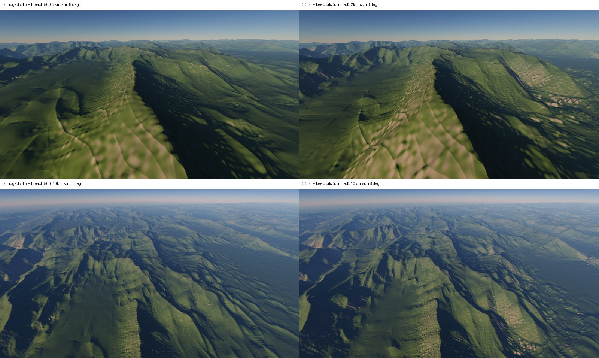
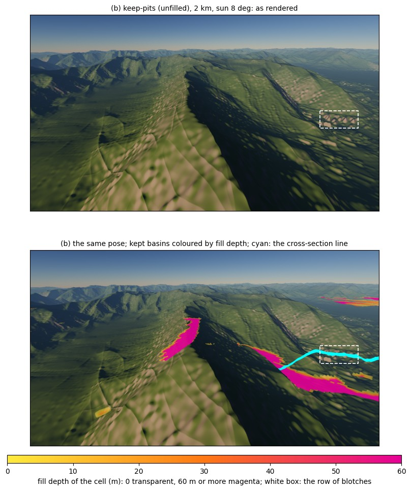
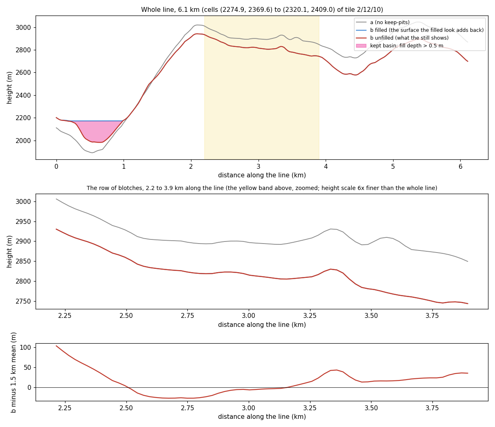

Opened: 2026-11-04
Question: For nine landscape archetypes (coastal, tundra, badlands, alpine, fluvial, glacial, karst, aeolian, volcanic), what does the generator do today, which physical drivers each needs, and how do they fit the CPU-deterministic two-pass bake?
Why it matters: the owner judges realism by archetype, not only by mountains (owner, 2026-11-04); M9's bake fixes which drivers are baked, and anything missed means a rebuild.
Time box: about 2 days of agent work (Opus); an interim note after deliverables 1 and 2.
Success criteria: per archetype the current behaviour with evidence, the drivers mapped to boundary fields, pass 1, pass 2 or runtime, a staged design with cost estimates, a ranked M9-vs-later plan with the owner decisions it needs, and a GLO-30 reference tile list (not downloaded).
Fallback if it fails: rank the archetypes by what the M9 bake must hold, and leave the processes to later layers.
Code location: `spike/generator-archetypes` (the keep-pits switch, `relief_stats --dump`; never merged); everything else is analysis.

# SPIKE-102: the generator by landscape archetype

Status: closed 2026-11-04. Deliverables 1-5 are complete, and the combined run on 2/12/10 is in section 6.

Code paths are relative to `crates/`; `gen` = `generators/src`. State: origin/main at 22f01b48 (#1173, uplift taper).

## 0. Findings first

0. **Measured (section 6): keeping the pits in pass 1 is the strongest relief lever found so far.**
   - On top of the SPIKE-101 pair it reaches 0.85 of Everest's 3 km relief (against 0.62) and 0.94 of the Alps (against 0.86).
   - The gain survives when the runtime fills the pits.
   - The pits are about 10× deeper than real mountain pits, so they stay filled until lake water and a pit-tolerance rule exist.

1. **One pipeline produces every archetype, and its driver set is too small to tell them apart.**
   - The field bake has four channels: continentalness, elevation, temperature and precipitation (`gen/global.rs:121-130`).
   - The class source sets weights for 6 of its 8 classes. Badlands and sand sea are never weighted (`gen/classes.rs:435-456`; GEN-095).
   - There is no erodibility field. K varies only by the class carve factor, which is 0.5 for sand sea and 1 for every other class.
   - Climate ignores relief: there is no wind, no rain shadow and no aridity index (`gen/global.rs:402-411`).
2. **The depression fill is the largest cross-archetype conflict.**
   - The bake fills every basin. Pass 1 breaches at most 50 m and then runs a Barnes flood; pass 2 spreads its pits (`gen/bake/carve.rs:54`, `gen/bake/flood.rs:22`).
   - Water comes only from the ocean (`gen/water.rs:9-14`). Lake ids are reserved but unused.
   - Kettles, thermokarst, dolines, calderas and endorheic basins are therefore impossible.
   - The same fill also costs relief: pass 1's basin fill halves the high-mountain gain (SPIKE-101).
3. **The coast is depositional everywhere by construction.** Three things flatten it:
   - the uplift taper over 0-60 m above the sea (#1173);
   - the 3 m layer fade (GEN-113);
   - the ~64 m coast band.

   There is no shelf, and no rule for cliffed or fjord coasts.
4. **Of the nine archetypes, only fluvial and alpine have processes today.**
   - The other seven exist, if at all, as a shader colour (snow, tundra, sand, beach) or as a hand-placed stamp (crater).
   - Two archetypes rest on processes that are absent: alpine relief on Earth is largely glacial, and so are the glaciated reference sites (Alps, Highlands, Brandenburg).
5. **Most missing features sit below the layer's 101.8 m cell**:
   - dunes 20-500 m;
   - gullies 1-50 m;
   - dolines 10-300 m;
   - patterned ground 1-20 m;
   - solifluction lobes 5-50 m.

   They belong to the runtime detail stack (SPIKE-100's six scales), keyed by drivers. What the bake must hold is the drivers and the processes that move material across km scales.

## 1. Per archetype: what the pipeline does today

Pipeline stages, for reference (ADR 0088, 0089, 0098-0100; GEN-093-114):
- **Field bake.** Four channels plus a lattice of class weights. Base elevation comes from a coast ramp of 620 m, belts at 7,800 m, a back-arc of 2,000 m and plateaus of 600 m.
- **Hill band.** A ridged band at 8/4/2 km, with a per-class amplitude of 30-825 m.
- **Pass 1, per face.** 12,288 cells of about 814 m. Implicit stream power with U/K 20, K·dt 0.05 × the carve factor, 20 steps. It breaches at most 50 m, then runs a Barnes flood with jittered D8 receivers and MFD area.
- **Pass 2, per tile.** 101.8 m cells, incise only (at most 1 km², 10 steps). Then thermal at 33° ±25 % and one deposition sweep with kc 1e5.
- **Runtime.**
  - The layer is read C1 with a 3 m coast fade.
  - Creases are applied only below 200 m.
  - Materials are chosen from slope, height, T and P.
  - Drainage area (GEN-110) and deposit depth (GEN-111) are stored, but no shader reads them.

| Archetype | What exists today | Evidence | Gap |
|---|---|---|---|
| Coastal | Sea level as the pass-1 outlet; uplift taper 0-60 m; layer fade 3 m; coast band ~64 m; beach albedo band 3 m + 5 m fade | `gen/bake/carve.rs:29-31,47,67`; `gen/erosion_layer.rs:18`; `frame/src/look/shading.rs:83-85` | No shelf (ocean floor is one smoothstep to −4,500 m); no cliff, wave-cut platform, marine terrace, spit or barrier; fjords cannot form (no glacial trough to drown) |
| Tundra / periglacial | Tundra colour at −3 to 5 °C; snow colour at ≤ −8 °C on slopes with cos 0.55-0.80 | `render/src/terrain.rs:596-613`; `frame/src/look/shading.rs:79-82` | No permafrost or MAAT field; no lake-pitted plains (fill); no solifluction, patterned ground, eskers or moraines |
| Badlands | A class with k 2 that the default rules never weight; generic thermal at 33° | `gen/classes.rs:28,435-456`; GEN-095 | No soft-rock K; no caprock or strata (mesas, buttes); gully density 100-500 /km sits far below 101.8 m |
| Alpine | Belts to 7,800 m; high-mountains class; band to 825 m; stream-power carve; thermal at 33°; snow by T and slope | GEN-096-101; SPIKE-101: 0.21 of Everest's 3 km relief as built, 0.62 with breach 500 m | No glacial sculpting (cirques, arêtes, horns, troughs); talus is not a material; faces over 45° are outside the heightfield (ADR 0091; Alps 4.3 % of area) |
| Fluvial | Barnes flood; MFD area; implicit stream power; transport-limited deposition; area and deposit channels stored | GEN-100, GEN-101, GEN-110, GEN-111 | Rivers and lakes not rendered; sinuosity 1.07 against real meanders (SPIKE-40); floodplains only as deposit; no terraces |
| Glacial | Lapse rate −6.5 °C/km and snow colour only | `gen/global.rs:407` | No ice extent (present or glacial-maximum), no glacial erosion, no U-troughs, hanging valleys, cirques or moraines. Three of the nine GLO-30 sites (Alps, Highlands, Brandenburg) are glacially shaped. |
| Karst | Nothing | — | No lithology; every depression is filled or breached; towers would exceed 45° |
| Aeolian / desert | Sand-sea class (k 0.35, carve 0.5) never weighted; desert and sand colour by P < 250 mm | `gen/classes.rs:28-31`; `render/src/terrain.rs` | No wind, no sand supply, no dune geometry. Erg Chebbi passes "not worse" only at an authored k 0.35 (SPIKE-77). |
| Volcanic | Hand-placed crater and hill stamps only | `gen/stamp.rs:38-54`; `world-def/stamp.rs:41` | No sources (arcs, hotspots, rifts); no cones, shields, calderas or lava flows |

Measured context from earlier spikes, GLO-30 at 30 m (SPIKE-55):

| Site | Archetype it stands for | Slope p50 / p90 / p99 (°) | 1 km relief p50 |
|---|---|---|---|
| Brandenburg | glacial plain (moraines, kettles) | 1.3 / 7.9 / 17.3 | 25 m |
| Loess hills | aeolian deposit, fluvial dissection | 3.9 / 8.3 / 16.7 | 39 m |
| Badlands, SD | badlands | 2.8 / 8.1 / 17.3 | 34 m |
| Erg Chebbi | aeolian (star dunes) | 1.1 / 4.8 / 21.9 | 16 m |
| Valley and Ridge | fluvial on folded strata | 7.2 / 19.7 / 29.3 | 107 m |
| Black Forest | fluvial upland | 7.3 / 24.9 / 36.6 | 106 m |
| Highlands | glaciated upland | 7.2 / 18.8 / 34.2 | 133 m |
| Alps (Tyrol) | alpine, glacial | 19.3 / 39.0 / 54.4 | 366 m |
| Everest | high alpine, glacial | 29.3 / 44.0 / 58.2 | 516 m |

The scorecard sites cover badlands and aeolian at the 30 m statistics level only. No site covers a cliffed or sandy coast, tundra, karst or volcanic ground (section 5).

Stills: none were taken for this interim note. The gaps are structural (a stage or driver is absent), and no image is needed to show an absence. Section 4 asks for one slot for the combined run, with stills through the product path.

## 2. Physical drivers per archetype and how they map onto the bake

### 2.1 The driver set

The owner's example memo lists uplift U and lithology K as boundary fields, orographic P and T, stream power with diffusion, and a GPU iteration loop. Its fields carry over unchanged. Its GPU loop does not: under CON-14, every height-changing kernel stays a CPU f64 Jacobi gather or a fixed sweep.

| Driver | Kind | Grid (proposal) | Archetypes it serves | Today |
|---|---|---|---|---|
| U: uplift rate | boundary field | class lattice (257² per face) and pass 1 | alpine, coastal (terraces), volcanic (edifices) | implicit: base-elevation belts and a uniform U/K 20 × carve factor |
| K: erodibility, from lithology (hardness, strata K(z), solubility) | boundary field, analytic | evaluated per pass-1 cell, and per pass-2 sample every 4 cells | badlands (soft, caprock), karst (soluble), alpine (hard), coastal (cliff vs beach) | carve factor only (sand sea 0.5) |
| Wind: prevailing direction and steadiness | boundary field, analytic per latitude band plus warp | coarse (2048 per face) | aeolian (dune type), orographic P, coastal (wave exposure) | absent |
| P: orographic precipitation; aridity AI = P/PET | field, from an upwind sweep over the pre-carve base | 2048 per face | badlands, aeolian, glacial (accumulation), karst rate, fluvial (runoff in K·t) | latitude bands × noise, no relief term |
| T: temperature, plus a glacial-maximum offset ΔT (about −6 °C) | field (exists) plus a scalar | as T | glacial, tundra | present-day only |
| Ice: extent and ice flux, from the ELA (from T, ΔT and P) | derived field, then a process | pass 1 (flux), pass 2 (shape) | glacial, alpine, coastal (fjords), tundra (moraines, kettles) | absent |
| Permafrost: MAAT < −2 °C | derived per point | runtime, or with the material drivers | tundra | absent |
| Volcanic sources: a point set of arcs on convergent margins, hotspots and rifts, with type and age | boundary point process from the plate mask (GEN-094) | list per face | volcanic | absent |
| Sand supply | derived from the deposit (GEN-111), aridity and low relief | pass 2 output | aeolian | deposit stored, unused |
| Pit tolerance: the depth of depression the bake keeps | derived from ice history, permafrost, karst and aridity | pass 1 and pass 2 | tundra, glacial, karst, desert (playas), volcanic (craters) | 0 everywhere: fill all |
| Coast type: wave exposure × K × near-shore relief | derived | coastal tiles | coastal | absent: one depositional rule |

### 2.2 Archetype → drivers → bake stage

The stages:
- **Field** is the field bake, which is pre-bake and previewable.
- **P1** is pass 1, per face at 814 m.
- **P2** is pass 2, per tile at 101.8 m.
- **RT** is runtime: the detail stack and materials. It is also where ADR 0091's steep-face technology belongs.

| Archetype | Primary drivers | Field | P1 | P2 | RT |
|---|---|---|---|---|---|
| Coastal | sea level, shelf, wave exposure, K, U (terraces), ice (fjords) | shelf profile; coast type | sea outlet (exists); taper only where depositional | wave-cut platform and cliff line on hard rock; terrace steps where U > 0 | beach, dune and cliff materials; faces over 45° go to ADR 0091 technology |
| Tundra / periglacial | T (MAAT), ice history, pit tolerance | permafrost mask (from T) | keep shallow pits where permafrost or ice history applies | thermokarst and kettle pits kept as lakes | patterned ground, solifluction lobes, frost-shattered rock |
| Badlands | K soft with a caprock (strata K(z)), aridity, base-level drop | default-class rule from K and aridity | carve with high K; strata give mesa steps | thermal and deposition (exist) | gully network as dendritic detail 1-50 m, keyed by K and aridity |
| Alpine | U, hard K, ice, thermal at repose | belts (exist); K hard | carve; breach 500 m (SPIKE-101); glacial trough carve by ice flux | cirques at the ELA; thermal; talus fans from deposition | scree material from slope and deposit; faces over 45° go to ADR 0091 technology |
| Fluvial | P (runoff), K, U | P with orographic term | carve with K·t scaled by runoff (exists, without the P term) | incise and deposition (exist); floodplain flats from the deposit | river water and banks from the area channel (GEN-110); meanders below 100 m as runtime planform detail |
| Glacial | T, ΔT, P → ELA → ice extent and flux | ELA and ice-extent field (glacial maximum) | ice-flux erosion: troughs, overdeepening (pits kept), hanging valleys from the flux ratio | cirques; moraine ridges at the ice margin; kettles (pits kept) | ice and snow material (present-day ice only) |
| Karst | K soluble (lithology), P, T | karst mask from lithology × P | sinks as routing outlets (internal drainage) | doline point process (pits kept); polje flats | small dolines and pavement; towers over 45° go to ADR 0091 technology |
| Aeolian | aridity, wind, sand supply | wind field; sand-sea default rule from aridity × low relief | low carve (exists as factor 0.5) | sand supply from the deposit; draa (km-scale) as a P2 pattern | dune field by type (barchan, transverse, linear, star from supply and wind steadiness), 20-500 m |
| Volcanic | sources, type, age | edifice stamps in the base, or a later additive layer (section 3) | young edifices: carve masked by age; old ones eroded | caldera pits kept (crater lakes) | lava and tephra materials; flow lobes as detail |

### 2.3 Conflicts with today's design

| Conflict | Where | Effect | Resolution (proposal) |
|---|---|---|---|
| Fill everything vs keep lakes | P1 flood plus breach 50 m; P2 pit spread; water from the ocean only | No kettles, thermokarst, dolines, calderas or playas; pass 1's fill also halves high-mountain relief (SPIKE-101) | Route over a filled copy and carve the unfilled heights. Keep depressions where the pit-tolerance driver allows; breach everywhere else (SPIKE-101's 500 m). Store the fill depth as a channel, so the runtime can show the filled look until lake water exists (section 3). |
| Coast taper, coast fade and coast band vs cliffed coasts | #1173 taper; GEN-113 fade; ADR 0056 band | Every coast is a 0-60 m ramp; about 80 % of real coasts are rocky or cliffed (Emery and Kuhn 1982; literature figure, not measured here) | Make the coast type a driver. The taper, fade and band apply where it is depositional; a cliffed coast gets a wave-cut step in P2 and the cliff face goes to ADR 0091's technology. |
| 45° heightfield limit | ADR 0091 | Cliffs, karst towers, arêtes, caldera walls, mesa rims and trough walls exceed it | The heightfield carries the shape up to 45° and marks the faces. The steep share is ADR 0091's coverage goal, not a bake target. |
| Climate independent of relief | `gen/global.rs:402-411` | Arid classes have no rule (SPIKE-77); glaciers have no accumulation pattern; K·t ignores runoff | Wind field plus an orographic upwind sweep over the pre-carve base (relief above 10 km sets rain shadows), in the field bake. |
| No erodibility field | carve factor only | Badlands, mesas, cuestas, karst and the cliff-vs-beach choice all need K | Analytic lithology: hardness noise per province from plate history (SPIKE-81's H), plus strata K(z) (horizontal or folded bands) |
| Uniform uplift, no history | U/K 20 everywhere | No marine terraces; volcanic edifices cannot rise | U as a field on the class lattice (belts high, cratons 0); edifices as stamps (section 3) |
| Two scales only (814 m and 101.8 m) | ADR 0088 | Glacial troughs are 1-4 km wide, 2-5 P1 cells: coarse in P1, so the U shape must come from P2 | P1 carries the ice-flux incision; P2 widens the cross-section by the flux (a parabolic profile). |
| GPU iteration loop (owner's memo) | CON-14 | Fast to iterate, but not bit-exact | CPU f64 for every height-changing kernel; a GPU approximation may serve only as a non-canonical preview, never as a stored result. The coarse CPU preview already takes 12 s at 4 km (SPIKE-77). |

### 2.4 Approximate share of Earth's ice-free land per archetype

Literature figures, not measured here; they rank the work by area.

| Archetype | Share | Source |
|---|---|---|
| Arid lands (badlands and aeolian inside) | about 30-40 % | UNEP aridity |
| Sand seas | about 20-25 % of arid land | Wilson 1973 |
| Glaciated at the glacial maximum | about 25-30 % | |
| Glaciated today | about 10 % | |
| Permafrost | about 20-25 % of Northern Hemisphere land | |
| Mountains | about 24-25 % | Kapos 2000 |
| Carbonate karst | about 15 % | Goldscheider et al. 2020 |
| Volcanic | a few % | |
| Badlands | under 1 % | |
| Coastal zone | thin, but in nearly every view near the sea | |

## 3. Staged design with costs

### 3.1 Cost baseline
The figures below are indicative: the machine is throttled until Sat 2026-11-07 (standing rule). Thread-hours are single-thread figures; wall time is at B = 10.

| Stage today | Cost | Thread-h | Wall at B = 10 |
|---|---|---|---|
| Field bake | 1,020 s on 20 threads (ADR 0097) | about 5.7 | about 0.6 h |
| Pass 1 | 17-23 min a face at B = 10 | about 17-23 | about 2 h |
| Pass 2 | 60-68 s a tile × 2,140 land tiles (SPIKE-98 B) | about 36-40 | about 3.6-4 h |
| Planet total | | about 60-70 | about 6-7 h |
| Terrain share (BUDG-014, 40 % of 24 h) | | | 9.6 h |
| **Room for new stages** | | **about 26-36** | **about 2.6-3.6 h** |

### 3.2 Stages, in order
All boundary fields run before pass 1 and are cheap. Each has a whole-planet preview at 4-16 km within seconds to a minute (ADR 0097 point 5; SPIKE-77's class preview took 12 s at 4 km).

**Boundary fields (previewable before the bake)**

| # | Stage | What it makes | Determinism | Cost (estimate) | Store |
|---|---|---|---|---|---|
| F1 | Lithology | Hardness H per province (plate history: craton, old margin, active margin, rift; SPIKE-81) × noise; strata K(z) as horizontal or folded bands with a caprock flag; a soluble flag (carbonate) | analytic, `libm`, integer hash | Pass 1: 906 M cells × about 1 µs ≈ 0.25 thread-h. Pass 2: one sample every 4 cells ≈ 0.6 s a tile ≈ 0.35 thread-h | none: analytic, keyed by its version |
| F2 | Wind | Prevailing direction by latitude band (trades, westerlies, polar easterlies), warped by noise; steadiness from band-edge distance | analytic | negligible | none |
| F3 | Orographic precipitation | P = bands × moisture advected upwind, rain-out on windward slopes, shadow on the lee; aridity AI = P / PET (PET = 300 + 45 T, SPIKE-81) | fixed-order upwind sweep on a 2048-per-face lattice, f64 | 6 × 4.2 M cells × about 10 passes ≈ under 0.1 thread-h | changes the precipitation channel (GLOBAL_VERSION bump) |
| F4 | Uplift U | U per class lattice point: belts high, back-arc medium, craton 0, arc coasts positive (marine terraces) | analytic over the plate mask | negligible | replaces the uniform U/K 20 by a field; parameter in GEN-100 |
| F5 | Ice history | ELA from T + ΔT (about −6 °C at the glacial maximum) and P; ice extent where ground lies above the ELA, and continental sheets where the glacial-maximum MAAT is low and P is enough | cell rule plus a fixed-radius smoothing | seconds | one small driver channel on the class lattice |
| F6 | Volcanic sources | Points along arc belts (plate mask), hotspots (Poisson, hashed) and rifts; type (strato, shield, caldera, cinder field) and age | hashed point process | negligible | a list per face, keyed |
| F7 | Coast type | Cliffed where wave exposure (fetch along F2) × hard K × near-shore relief is high; depositional otherwise; fjord where F5's ice reached the sea | derived per coast cell | seconds | small channel, or derived on the fly |
| F8 | Pit tolerance (runtime choice, not a bake input) | Which kept depressions show as lakes or dry pits: ice history (kettles, overdeepenings), permafrost (thermokarst), soluble rock (dolines), arid (playas), calderas. Everywhere else the runtime adds the stored fill depth, which gives today's filled look. | derived | negligible | none: the bake keeps every pit that survives the breach, and stores the fill depth (P1b) |
| F9 | Default classes, arid rules | Badlands where soft K × semi-arid × moderate height; sand sea where arid × low relief × supply. These give the two classes a rule (today 0; GEN-095) | rule table, option C interface | negligible | class lattice (exists) |

**Processes (the bake)**

| # | Stage | Change against today | Cost (estimate) | Rebuild if added later |
|---|---|---|---|---|
| P1a | Pass 1 carve with K(x, z), U(x) and runoff from F3 | A per-cell K and U instead of scalars | about +5 % of pass 1 (lookups) ≈ +1 thread-h | full pass 1 and pass 2 |
| P1b | Route over a filled copy, carve the unfilled heights | The flood gives receivers only. A cell below its receiver keeps its height plus uplift; deposition may partly fill it. Every pit that survives the breach (500 m; SPIKE-101) stays in the heights. The fill depth to the spill level is stored: from pass 1's face flood for large basins, and from pass 2's tile-plus-halo flood for small ones. | about 0: the flood exists | full pass 1 and pass 2 |
| P1c | Glacial erosion by ice flux | On F5's ice cells: ice flux from accumulation above the ELA routed on the same receivers; erosion ∝ sliding speed; overdeepening allowed (F8) | +30-60 % of pass 1 on faces with ice ≈ +6-12 thread-h | full pass 1 and pass 2 on ice-affected tiles |
| P2a | Glacial cross-section | Widen the trough to a parabolic profile by the flux; cirque bowls at the ELA heads; moraine ridges at F5's margin; kettles kept | 10-20 s a tile on about 30 % of land tiles ≈ +1.8-3.6 thread-h | pass 2 on ice tiles |
| P2b | Coast step | On cliffed coasts (F7): a wave-cut platform at the sea level and a cliff line with retreat ∝ 1/K; terrace steps where U > 0. The taper, fade and band act only on depositional coasts. | 2-5 s a tile on about 40 % of land tiles ≈ +0.5-1.2 thread-h | pass 2 on coastal tiles, or an additive coast layer |
| P2c | Karst | Sinks as routing outlets on soluble rock (internal drainage); doline point process (kept pits) 50-500 m; polje flats | about 2 s a tile on about 15 % of land tiles ≈ +0.2 thread-h | pass 2 on karst tiles |
| P2d | Volcanic edifices | Young edifices as an additive layer after the erosion layer (cones, shields, calderas with kept pits); old ones in the base before pass 1 | additive layer: under 1 thread-h for the planet | none, if additive |
| — | Strata (mesas, buttes, cuestas) | No stage of its own: they come from P1a with K(z) | in P1a | with P1a |

**Runtime (GPU, detail stack and materials)**

| Feature | Driver keys | GPU (estimate, not measured) |
|---|---|---|
| Dunes (barchan, transverse, linear, star) 20-500 m | aridity, sand supply, wind direction and steadiness | 0.2-0.4 ms where sand dominates |
| Badland gullies 1-50 m | K soft, aridity | 0.1-0.2 ms |
| Periglacial patterns, solifluction lobes | MAAT, slope, moisture | about 0.1 ms |
| River water, banks, meander planform below 100 m | area (GEN-110), deposit (GEN-111) | water system (M10+) |
| Lake water at the fill level | fill-depth channel (P1b) | water system (M10+) |
| Materials: scree, talus, lava, tephra, sand, permafrost ground, wet ground | slope, deposit, K, F5, F6, MAAT | inside I8b's mix |

The detail entries add up only where archetypes overlap. A region has one dominant archetype, so a branch on the driver costs about the largest entry, not the sum, provided the branch stays coherent (regions are km-scale). SPIKE-100's D1 + D2 estimate is already 1.5-2.2 ms against REND-034's 1.0 ms, so archetype detail needs its own budget line.

### 3.3 Totals and what must be in this bake
- **Added bake work** (estimates): P1a + P1c + P2a-c come to about 10-18 thread-h, about 1-2 h wall at B = 10. That fits the 2.6-3.6 h room of 3.1. The boundary fields are negligible.
- **What forces a rebuild if left out of this bake.** Every stage that changes the heights the routing sees: F1/P1a (K), F3 (P in K·t), F4 (U), P1b (keeping pits), P1c/P2a (glacial). Each touches pass 1 on all faces, so adding it later means about a full erosion bake (about 6-7 h plus a preview round). Scorecard tuning (R7), goldens and materials tuned on the old bake also move.
- **What can come later without a rebuild.**
  - The volcanic edifices (P2d, an additive layer).
  - The coast step (P2b), either as an additive coast layer or with a pass-2 rerun of coastal tiles only.
  - Every runtime feature.
  - Lake water, provided P1b stores the fill depth now.
- **Store additions.**
  - The fill-depth channel, a byte like GEN-111 and sparse.
  - The ice-history driver, on the class lattice.
  - Coast type, small.
  - Lithology and wind stay analytic. Precipitation changes values in an existing channel.

## 4. Ranked plan, M9 against later

The ranking weighs three things:
- the area of Earth an item improves (2.4);
- whether it forces a rebuild if left out (3.3);
- its risk: a new process is a risk, a field is cheap.

### 4.1 In M9: before I6's planet bake (owner D7, 2026-11-04: "Yes, delay the bake for this research")

**Items, in rank order**

| Item | What | Archetypes | Risk |
|---|---|---|---|
| 1 | The SPIKE-101 pair: breach 500 m and the ridged ×4.5 band, centred on the mountain classes | alpine, fluvial | low; measured on 2/12/10: 0.62 of Everest, 0.86 of the Alps (section 6) |
| 2 | P1b: route over the filled copy, carve the unfilled heights, store the fill depth. The runtime adds the fill depth back, so the look stays today's until lake water and F8 exist; neither then needs a rebuild. | tundra, glacial, karst, desert, volcanic (later); alpine relief now | low to medium: measured with 1 at 0.85 of Everest and 0.94 of the Alps, and the gain survives the fill (section 6); pits are about 10× deeper than real ones, so the runtime must add the fill depth; the fill depth of basins that cross a tile edge needs pass 1's face flood |
| 3 | F1 lithology (hardness by province, strata K(z), soluble flag) and K(x, z) in both carves (P1a) | badlands, mesas, cuestas, coast choice, alpine contrast; karst later | medium: relief changes everywhere, so R7 re-tunes the class amplitudes |
| 4 | F2 + F3 wind and orographic precipitation (aridity), runoff in K·t, and F9's arid default rules | badlands and sand sea get a rule; rain shadows; aridity for I8b's materials | low to medium: material colours change globally (the owner's look); GLOBAL_VERSION bump |
| 5 | Shelf profile in the field bake | coastal (shallow water colour, distant coasts) | low |

**Buildable plan: one row per PR**

- Lanes: explorer for the bake kernels, crusader for the generator fields, either for the docs.
- Effort follows `docs/archive/M9/briefings/estimates.md`: one code change is 0.5-3 h including CI; research-like items are ×2.
- Requirement IDs come from the planner.
- Each PR's preview follows ADR 0097 point 5; the owner approves before the next dependent bake.

| PR | Scope | Requirement areas | Lane | Depends on | Effort (lane-h) | Preview must show |
|---|---|---|---|---|---|---|
| 0 | OpenSpec change `m9-archetype-drivers`: proposal, design (this section), tasks; deltas for GEN (fields, carve), STRM (fill-depth channel), TEST (class shares, pit share), VIEW (the driver maps) | GEN, STRM, TEST, VIEW | planner or spikes | — | 1 | — |
| 1 | Band ridged ×4.5, centred, on the mountain classes; breach_max_m 500 | GEN-098, GEN-100 | explorer | section 6 | 1-2 | 2/12/10 stills at 2 km and 10 km, low sun; 3 km relief p50 against Everest and the Alps |
| 2 | P1b in pass 1 and pass 2: route over the filled copy, keep pits, fill depth per pass-2 tile from pass 1's face flood plus the tile-plus-halo flood; a byte channel like GEN-111; the runtime adds it (filled look); the bounds pyramid includes it | GEN-100, GEN-101, GEN-111-like, STRM-066, GEN-102 | explorer | 1 (same kernels) | 3-6 (×2: new channel and format) | pit share and depth per class at the preview tiles; stills with the fill on (today's look) and off (pits visible), to show what lake water would show |
| 3 | F1 lithology field: analytic H per plate province (SPIKE-81), strata K(z) with a caprock flag, soluble flag; CPU-canonical (`libm`, hash); whole-planet preview map | GEN (new), CON-14 tests | crusader | 0 | 2-4 | planet maps of H, strata and soluble at 16 km; the preview takes seconds |
| 4 | K(x, z) in both carves (P1a): K from F1 per cell, sampled every 4 cells in pass 2 | GEN-100, GEN-101 | explorer | 2, 3 | 1-3 | stills at a mesa-prone (badlands) site and at 2/12/10; relief per class against the step 1 baseline |
| 5 | F2 wind field + F3 orographic precipitation: an upwind sweep on 2048 per face, fixed order, f64; aridity AI; GLOBAL_VERSION bump; climate channel values | GEN-013, GEN-021 (climate), new GEN | crusader (or a third lane) | 0 | 4-8 (×2: a new process) | planet maps of P against today's, aridity, wind arrows; rain shadows behind the belts; material colours at the four preview regions |
| 6 | Runoff in K·t: the carve's K·t scaled by P from 5 | GEN-100 | explorer | 4, 5 | 1-2 | relief per class, wet against dry flanks of a belt |
| 7 | F9 arid default class rules: badlands from soft K × semi-arid × 250-2,200 m; sand sea from arid × low relief × supply; class shares against Earth (SPIKE-81: badlands 3.3 %, sand sea 7.9 % overshoot, to tune) | GEN-095, GEN-097 | crusader | 3, 5 | 2-3 | planet class map; shares against Earth; Badlands and Erg Chebbi sites "not worse" (TEST-081-084) |
| 8 | Shelf profile: ocean floor to about −130 m over a shelf width set by the coast type (passive wide, active narrow; plate mask), then the slope to −4,500 m | GEN-096 (ocean), GEN-013 | crusader or spikes | 0 | 1-3 | coast region at 2 km and 10 km (shallow water colour); planet bathymetry map |
| 9 | Integrated preview and scorecard: all of 1-8 on the three preview regions plus one coast region; TEST-081-084 and the new class shares; then the owner's approval of I6 | TEST, VIEW-062 | explorer | 1-8 | 3-5 | everything above, through the product path (capture-stills) |

**Order and parallelism**

- Explorer: 1 → 2 → 4 → 6 → 9.
- Crusader: 3 → 5 → 7, with 8 anywhere.
- 0 opens first.
- The longest chain is 0 → 3 → 4 → 6 → 9, with 5 needed before 6 and 7.

**Total**

- 10 PRs, about 19-37 lane-h over two lanes.
- That is about 1.5-2.5 lane-days at the calibrated pace, plus one owner preview round before I6.
- These are estimates, not measured.

### 4.2 After M9 (M10 or a terrain round 2)

| Rank | Item | Archetypes | Rebuild | Why later |
|---|---|---|---|---|
| 1 | Glacial: F5 ice history, P1c flux erosion, P2a troughs, cirques and moraines | glacial, alpine, coastal (fjords), tundra (kettles) | pass 1 for all faces, pass 2 for ice tiles | A new process with tuning risk. A measured stand-in first: one face and three tiles against the Highlands, Alps and a fjord tile (section 5). This follows the lesson of the chunk stage: measure, then gate in the first PR. |
| 2 | Lake water at the fill level, plus pit tolerance F8 switched on | tundra, glacial, karst, desert, volcanic | none, if P1b's channel exists | It needs the water system to render inland water levels |
| 3 | Coast step P2b and coast type F7, plus ADR 0091's steep-face technology | coastal | coastal tiles, or an additive layer | Cliff faces are over 45°; this waits for the cliff technology ADR |
| 4 | Runtime dunes, gullies and periglacial detail | aeolian, badlands, tundra | none | A GPU budget line is needed after I8a and I8b |
| 5 | Volcanic, P2d additive layer and F6 | volcanic | none | Small area on Earth; additive, so no rush |
| 6 | Karst, P2c | karst | pass 2 on karst tiles | Needs F1's soluble flag (M9 item 3) and lake water (rank 2) |

### 4.3 Owner decisions this needs

| # | Decision | Kind | Recommendation | Cost to reverse |
|---|---|---|---|---|
| D1 | Keep every pit that survives the breach and store the fill depth (P1b); the runtime adds it back until lake water and F8 exist | data format | yes, in M9 | a byte channel; a re-bake to drop it |
| D2 | Lithology K(x, z) in the carve (F1, P1a) | generator architecture | yes, in M9, with a preview | a re-bake (the version switches it off) |
| D3 | Wind and orographic P, plus arid default rules (F2, F3, F9); option C stays | generator; owner's look | yes, in M9, with a preview | a GLOBAL_VERSION re-bake |
| D4 | Glacial process: a stand-in spike now, the build after M9 | scope | yes | none until built |
| D5 | Volcanic edifices as a post-erosion additive layer (a new layer kind) | architecture | yes, after M9 | none until built |
| D6 | Coast type: the taper, fade and band act only on depositional coasts; cliffs wait for ADR 0091's technology | scope, look | yes; ADR when built | none until built |
| D7 | Move I6 for 4.1 items 1-5, or bake now and re-bake in M10 | schedule | **decided (owner, 2026-11-04): delay the bake** | — |

## 5. GLO-30 reference tiles (downloaded 2026-11-04 with the owner's go)

The tiles are Copernicus GLO-30 DSM COG, `Copernicus_DSM_COG_10_<lat>_00_<lon>_00_DEM.tif`. Each covers 1° × 1°; above 50° latitude the longitude spacing widens, which makes the files smaller. Sizes are estimated from the nine tiles on disk (29-45 MB); coastal tiles with sea are smaller. The licence and notice are the same as for the existing samples.

| Rank | Tile | Site | Archetype | Size |
|---|---|---|---|---|
| 1 | N61 E006 | Sognefjord, Norway (61.1 N, 6-7 E) | fjord, cliffed coast, glacial troughs, hanging valleys | 20.7 MB |
| 2 | N70 W154 | Teshekpuk Lake, Alaska North Slope (70.5 N, 153.5 W) | tundra, thermokarst lakes | 15.6 MB |
| 3 | N45 E014 | Kras and Postojna, Slovenia (45.7 N, 14.2 E) | karst, dolines, poljes | 39.6 MB |
| 4 | N42 W123 | Crater Lake and the Cascades, Oregon (42.9 N, 122.1 W) | volcanic: caldera, stratovolcano, cinder cones | 41.2 MB |
| 5 | N35 W076 | Outer Banks and Pamlico Sound, North Carolina (35.3 N, 75.5 W) | sandy barrier and marsh coast | 6.7 MB |
| 6 | S25 E015 | Namib Sand Sea, Namibia (24.5 S, 15.3 E) | linear dunes (Erg Chebbi has star dunes) | 41.4 MB |

- Total for 1-6: 165 MB, in `C:/DEV/SeriousPlanetData/dem/glo30-samples/`, one subfolder per tile; never committed. Derived figures carry the Copernicus notice.
- Ranks 1-3 cover the three archetypes with no reference at all.
- Two alternatives: N19 W156 (Mauna Loa, a shield with lava flows) for 4, and N52 W010 (Cliffs of Moher, a cliffed coast without glaciation) for 1.

## 6. The combined run with keep-pits (tile 2/12/10, seed 14)

### Setup
- Spike branch `spike/generator-archetypes` = cd1ae099 (SPIKE-101) plus a keep-pits switch, never merged.
- That base predates #1173's uplift taper. The taper only touches land below 60 m, so this mountain tile is unaffected (planner).
- Both runs: pass 1 of face 2 at 12,288 with MFD and the C1 read; pass 2 standard; the layer read C1 with the 3 m coast fade.
- (a) is the SPIKE-101 pair: the ridged band ×4.5, centred, on the mountain classes, and breach_max_m 500.
- (b) is (a) plus keep-pits: pass 1 routes over the flooded copy, but a cell below its receiver keeps its height plus uplift and is no longer raised to the spill.
- GLO-30 references are SPIKE-101's sites on the same 101.8 m grid. Runs (UTC) are in `runs.log`; raw lines are in `layer.tsv` and `dem.tsv`. Timings are indicative only (throttled machine).

### Relief and hypsometry (relief_stats, per argmax class)

| Measure | (a) | (b) | GLO-30 |
|---|---|---|---|
| High mountains, 3 km relief p50 | 497 m (0.62) | **682 m (0.85)** | Everest 804 m |
| High mountains, 10 km relief p50 | 1,082 m | 1,527 m | Everest 1,467 m |
| High mountains, slope p50 / p90 | 12.3° / 31.1° | 17.5° / 34.4° | Everest 26.9° / – |
| High mountains, elevation p5 / p50 / p95 | 2,557 / 3,236 / 4,281 m | 1,820 / 2,940 / 4,266 m | Everest 662 / 2,157 / 5,344 m |
| Mountains, 3 km relief p50 | 468 m (0.86) | **511 m (0.94)** | Alps 543 m |
| Mountains, 10 km relief p50 | 993 m | 1,142 m | Alps 935 m |
| Mountains, elevation p50 | 1,974 m | 1,862 m | Alps 1,076 m |

- The crests (p95) stay in both runs, so the snow line is not wrecked.
- Keep-pits deepens the valleys (p5 drops 740 m on the high mountains), which moves the spread towards Everest's.

### Pits ("lake ground"): share of land cells deeper than 0.5 m below the spill, and their depth

| Tile | Land in pits | Depth p50 / p95 | Note |
|---|---|---|---|
| (a), all land | 4.6 % | 15 / 129 m | high mountains 8.6 % |
| (b), all land | 6.4 % | 63 / 221 m | mountains 5.4 %, high mountains 11.1 % |
| Pass 1 of (b), last step | 1,243,257 of about 1.5e8 face cells kept below their receiver (0.8 %) | – | – |
| GLO-30 Alps | 5.3 % | 3 / 15 m | lake surfaces are flat in a DSM, so depths are lower bounds |
| GLO-30 Everest | 1.1 % | 7 / 35 m | |
| GLO-30 Highlands | 2.9 % | 3 / 9 m | |

### 3 km relief p50, unfilled against filled
The filled surface is what the runtime shows with the stored fill depth added (non-overlapping 3 km blocks, so the values sit near relief_stats').

| | Mountains, unfilled / filled | High mountains, unfilled / filled |
|---|---|---|
| (a) | 479 / 475 m | 512 / 506 m |
| (b) | 518 / 508 m | 690 / 679 m |

### Findings
1. **Keep-pits is the larger relief lever of the two.**
   - On top of the SPIKE-101 pair it lifts the high mountains from 0.62 to 0.85 of Everest's 3 km relief, and the mountains from 0.86 to 0.94 of the Alps.
   - The basins stop eating the carve's work, which is SPIKE-101's cause.
2. **The gain survives the fill: 679 m against 506 m on the filled surface.**
   - P1b's design holds: bake the pits, store the fill depth, and the runtime shows today's filled look.
   - The relief comes from the carve around the basins, not from open holes.
3. **The pits are about 10× deeper than real mountain pits** (p50 63 m against 3-7 m). Open, they read as deep ravine floors; the pocked texture on the right flank of the stills is not made of pits (section 8).
   - Without lake water they must stay filled at runtime.
   - With lake water, F8 (pit tolerance) must keep only the plausible ones. GLO-30 shows 1-5 % of mountain land with shallow pits.
4. **Pass 1 took 1,471 s for (b) against 2,233 s for (a), on the same machine.**
   - The fill-raise in (a) moves more cells per step. The timing is indicative only, but keep-pits does not cost bake time.

### Other GLO-30 tiles, as references for later archetype work (101.8 m)

| Tile | 1 km / 3 km / 10 km relief p50 | Slope p50 / p90 | Land in pits; depth p50 / p95 |
|---|---|---|---|
| Sognefjord N61 E006 | 300 / 642 / 1,089 m | 19.3° / 39.1° | 2.9 %; 4 / 13 m |
| Teshekpuk N70 W154 | 8 / 13 / 18 m | 0.4° / 1.6° | 14.2 %; 1.1 / 2.5 m (lakes flat in the DSM) |
| Kras N45 E014 | 118 / 239 / 455 m | 9.2° / 20.7° | **15.6 %; 16 / 78 m** (dolines) |
| Crater Lake N42 W123 | 128 / 288 / 559 m | 9.0° / 21.4° | 2.8 %; 3 / 19 m (the caldera lake surface is flat) |
| Outer Banks N35 W076 | 9 / 14 / – m | 0.8° / 2.4° | 10.0 %; 1.4 / 4.4 m |
| Namib S25 E015 | 56 / 88 / 133 m | 3.7° / 12.0° | **22.9 %; 10 / 42 m** (interdunes) |

Karst and dune fields are the archetypes where open pits are the real signal, at depths the bake reaches. That confirms F8 as a per-archetype choice rather than a global one.

## 7. Integrated preview (I4b): the pose list (inbox #87)

The preview runs through the product path, `test-render --scene capture-stills --poses FILE --erosion on`. It uses the m9c14 store re-baked with PRs 1-8 of 4.1, so it is PR 9.
- One poses file per site in the format of `crates/app/src/stills.rs`. The `[look]` sets `ground_detail = 0.6` and `ground_patch = 0.12`, as on main.
- Low sun means `sun_local_hours = 17.5`, as in the m9c14 sheets.
- Every set ends with a low-sun oblique.
- Any omission is written on the sheet: water (sea shaded as seabed, no lakes), instancing, and cliff faces over 45° (ADR 0091).

### Sites
| Site | Tile (face, ti, tj) | Anchor (lat, lon) | Where the poses look |
|---|---|---|---|
| Mountains: the owner's circled wall | 2, 12, 10 | from explorer's `--look-at I,J` of `target/review/erosion-stages/oblique/mountains_oblique_h90_*.png` (start-879e4b), converted with `examples/tile_latlon.rs` | the wall: the oblique h90 pose (back 8 km, heading 90, sun 10°). **Explorer supplies the cell; it is in no log.** |
| Mountains: where the change acts | 2, 12, 10 | the cell at the change's p5 (the deepest carve) in the tile core | heading along the valley, downstream |
| Hills | 0, 8, 24 | 22.4689, −21.0933 (tile centre), moved to the change's p5 cell | heading 90 |
| Plains | to be chosen | a land tile at least 80 % plain or rolling-plain weight, 100 % land, with the largest fine-crease relief (SPIKE-73's plains gap) | heading 90 |
| Coast | 0, 14, 3 | −35.0827, −4.2183, moved 800 m inland of the coastline | heading to the sea; the shelf (PR 8) in view |

### Poses per site (eye `back_m` behind the anchor, `altitude_m` above the ground there)
| Name | altitude_m | back_m | pitch_deg | sun_local_hours | Shows |
|---|---|---|---|---|---|
| 2km | 2,000 | 4,000 | 8 | 17.5 | the erosion layer's valleys and the class band |
| 300m | 300 | 600 | 10 | 17.5 | layer and creases below 200 m |
| 50m | 50 | 120 | 12 | 17.5 | ground detail (I8a) and the material patches |
| 10m | 10 | 30 | 12 | 17.5 | detail octaves at 6 m and 3 m; the material mix |
| 1.8m | 1.8 | 4 | 4 | 17.5 | eye height: the 1.8 m end of the detail stack |
| oblique | 3,000 | 8,000 | from the ground at the anchor (as `erosion_stills`) | 17.5 (sun about 10°) | the whole landform, low raking light |

### Archetype checks inside the same run (PRs 2-8)
- Mountains change pose, run twice: fill depth added (the product look) and fill depth off (pits open). This shows what lake ground would add (PR 2).
- Plains and hills at 2 km: material colour with orographic P (PR 5) against main's sheet, at the same pose and sun.
- A badlands-weighted tile and a sand-sea tile, if PR 7 gives them weight: 2 km and 300 m, in their own sets.

## 8. The blotches on the right flank: hollows or bumps? (inbox #88)

Question (owner): are the blotches on the right flank of `sheet-keep-pits.jpg` (b) at 2 km kept basins, or small hills?

Answer: **bumps and benches, not kept basins.** The box over them holds no kept basin at all, and the same bumps are in (a), which has no keep-pits. The sentence in the Visuals section below, "a pocked texture of open pits on the right-hand flank", was wrong and is corrected there.

Method:
- Tile 2/12/10, seed 14, run (b) (a plus keep-pits), unfilled, the `b.h.f32` dump (3,072 x 3,072 cells of 101.8 m); the fill depth is the priority-flood depth of that dump (open at the tile edge and the sea): `depth = filled - h`.
- The pose of the 2 km still: `erosion_stills` site `mountains=2,12,10`, heading -45° (north-west), 22° down, 60° vertical field of view, eye 2,000 m above the ground at tile cell (2304, 2304); the heading is the tool's own choice of the highest ground ahead.
- The overlay is not a render pass: `overlay_cam` (spike branch) ray-marches each pixel of that camera against the dump and reads the fill depth at the hit cell. It matches the still: the magenta basins lie exactly in the valley floors that the still shows.

Sun: elevation 8°, azimuth 217° clockwise from the view direction, so the sun is behind the camera and over its left shoulder; with the view heading 315° that is about 172° compass (from the south-south-east). The tool's comment says "right shoulder"; its code (`right = heading x up * -1`) puts the sun on the left, and the lit and shaded sides in the still agree with the left.

| What | Value |
|---|---|
| Overlay | kept basins by fill depth, 0.5 m (transparent to pale) to 60 m and more (magenta) |
| White box (row of blotches) | image x 1,330-1,505, y 440-520; cells i 2,291-2,305, j 2,380-2,402 of the tile |
| Fill depth in the box | max 0.0 m over 14,000 pixels |
| Kept basins in the view | 9.6 % of the right flank's pixels (the ravine floors; 9.0 % are 5 m or deeper) |
| Cross-section line | a straight line in cell space from (2274.9, 2369.6) to (2320.1, 2409.0), 6,108 m, 0.25-cell steps, bilinear; face cells add 12 x 3,072 to i and 10 x 3,072 to j |
| Line, kept basin | one, at 0-1 km (fill depth up to 190 m, the ravine floor); none along 2.2-3.9 km |
| Line, the bumps | at 3.33 km a bump of about 25 m over the slope in (b) (about 40 m over the 1.5 km mean); the same bump is in (a) |

Reading:
- A kept basin lies below the filled surface; the blue (filled) and red (unfilled) lines are the same everywhere except the ravine at 0-1 km, so the filled look would change nothing at the blotches.
- The blotches are 300-400 m wide, 10-40 m high steps on the flank; the low sun lights their sunward face (tan: the slope material) and leaves a shaded side, which reads as a rock or a hill.
- They are in (a) as well, so they are not made by keep-pits. Their origin is not traced here (candidates: the base's hill band, pass 2's carve and thermal step). Keep-pits only deepens the ravine next to them (b minus a on the line: p5/p50/p95 of -158/-83/+106 m).
- One transect and one box: a statement about this row, not a count over the tile. The share of such bumps over the tile would need a detector (a local maximum with a closed contour 10-40 m high); not run.

Visuals: `images/sheet-keep-pits-overlay.jpg` (top: the still, (b), unfilled; bottom: the same pose with the overlay, the box and the line in cyan) and `images/section-right-flank.png` (heights along the line: a, b filled, b unfilled, the kept basin in magenta; the middle panel zooms into 2.2-3.9 km, the bottom panel is (b) minus its 1.5 km mean).

## Visuals

Mountains tile 2/12/10, seed 14, stills tool (`erosion_stills` on the spike branch; not the product path, because the candidates exist only there). The layer is read C1 with the coast fade; sun 8°; 2 km (top) and 10 km (bottom) above the ground; software adapter.
- Left, (a): the SPIKE-101 pair.
- Right, (b): (a) plus keep-pits, drawn unfilled (the pits open), which is the worst case.
- (b) has sharper crests and deeper valley shadows, and a pocked texture of bumps and benches on the right-hand flank. Section 8 shows they are not open pits (the pits are the ravine floors) and that (a) has them too.

The 2 km pose of the sheet above with the kept basins coloured by fill depth (section 8).

Height cross-section through the row of blotches (section 8).
