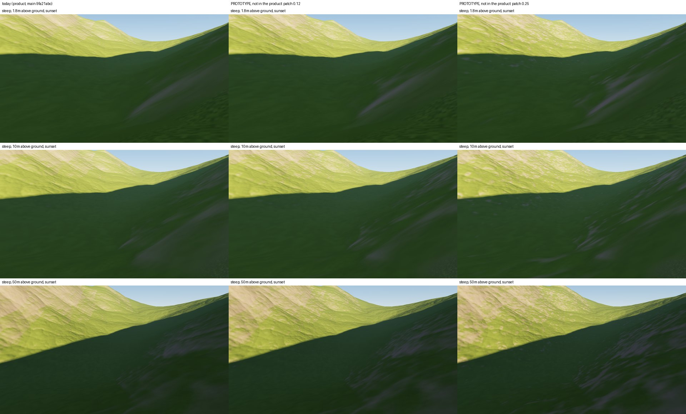
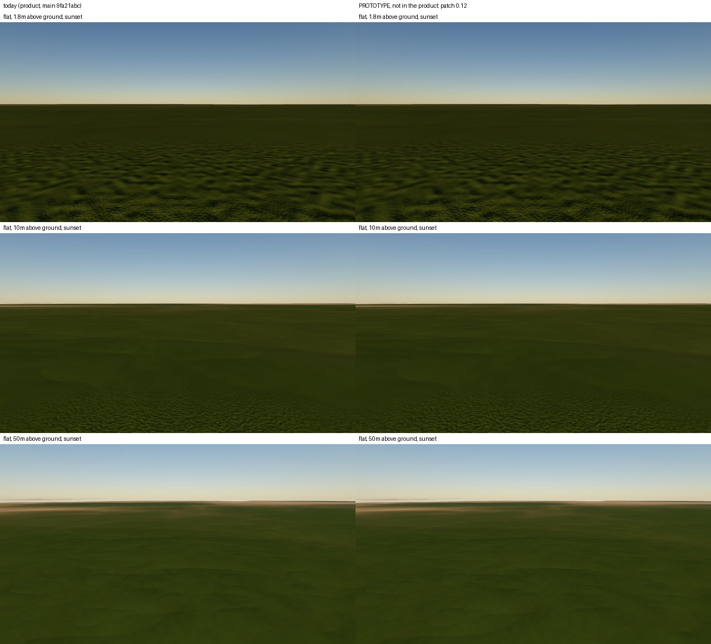

# SPIKE-100 Ground detail and materials for M9 (I8a, I8b)

Opened: 2026-11-04
Question: what geometry detail below the erosion layer's 101.8 m grid and what material mix from the baked channels give the ground the variety of GLO-30 and of the realism reference (s7 sunset), at what GPU cost?
Why it matters: M9 items I8a (ground detail) and I8b (materials from the baked channels, GEN-110 drainage area and GEN-111 erosion/deposition depth); the owner found SPIKE-67's detail uniform and low-frequency (owner, 2026-11-04; planner inbox #82).
Time box: about 1 day of agent work.
Success criteria: per relief class, plains included, the runtime detail's std per band (30-200 m) and 3 km relief against GLO-30; a multi-scale design for 1.8-50 m that varies with slope, the two channels and the material; a material mix (rock, scree, soil, grass, wet ground) from slope, drainage area and deposition depth; the GPU cost per frame against the REND budgets; what stays runtime and what is baked; stills from the viewer path, anything not in the product labelled; a ranked design.
Fallback if it fails: keep SPIKE-67's shader detail and the current materials; record the measured gap.
Code location: branch `spike/spike-100-ground-detail` at 46ab1255 (throwaway; never merged into the main crates). `spikes/ground-detail/` and `spike/ground-detail` are SPIKE-27's (M7 G1), read for reference only.

## 1. What the ground has today (main at 9fa21abc)

- **Geometry below 100 m: about 14 m peak to peak, and uniform.**
  - The runtime field (`ErosionField`, `cpu-erosion-v1`, the viewer's field) has below 200 m only the fine crease octaves 7-11 (ADR 0098), at wavelengths 194, 97, 49, 24 and 12 m.
  - At full carve those octaves are 6.7, 3.7, 2.0, 1.1 and 0.6 m peak to peak: about 14 m in all.
  - Their amplitude follows the base elevation and the bake's slope (`carve`), not the relief class. At the mid-latitude class sites the band stds below 1 km are the same for plain, rolling, hills and mountains (0.30 / 0.15 / 0.25 / 1.2 m).
  - The erosion layer is not read at runtime yet (I5c), and no app code calls `with_crease_band` or `with_relief`.
- **Shader detail (REND-034) moves no geometry.** Its four octaves at 16 m, 2 m, 25 cm and 3 cm tilt the shading normal and scale the albedo. Each material has fixed coefficients; nothing varies by slope within a material. Main still has value noise; SPIKE-67's gradient noise was never merged.
- **Materials:**
  - There are four (rock, sand, grass, soil). `MaterialParams::EARTH` chooses them by slope cosine and precipitation only; soil is off.
  - There is no scree and no wet ground.
  - The driver blocks (soil depth, moisture, insolation) are always neutral.
- **GEN-110 (drainage area) and GEN-111 (erosion/deposition depth) have no spec text and no reader yet.** The nearest data is kind 13's signed change against the base, from which deposition depth can be derived.

## 2. The runtime field against GLO-30 at 30 m

Method: `detail_stats` (spike branch) samples a 30 km window at 30 m.
- For the runtime, it samples the viewer's field (`WorldTerrain::open_store(..).field()`) over `global16384-m9r2` (read-only). The sites are each class's purest window on the class lattice of seed 1 within 45 degrees of the equator, plus the steep stills anchor.
- For GLO-30, it samples the centre of each 1-degree tile.

The measures:
- band std: the std of the difference of two box means, 1-2 cells (30-60 m), 2-4 (60-120 m), 4-8 (120-240 m) and 8-32 (240-960 m);
- local relief: p95 - p5 in 300 m and 3 km blocks, median over the blocks;
- slope at 30 m.

| Site | 30-60 m | 60-120 m | 120-240 m | 240-960 m | relief 300 m | relief 3 km | slope p50 | slope p90 |
|---|---|---|---|---|---|---|---|---|
| GLO-30 plain (Brandenburg) | 1.2 | 0.8 | 1.3 | 3.5 | 5.8 | 20.4 | 1.2 | 6.9 |
| GLO-30 rolling (Loess Hills) | 1.2 | 0.7 | 1.5 | 5.5 | 15.2 | 42.3 | 3.8 | 7.1 |
| GLO-30 hills (2 sites) | 4.2 | 1.6 | 3.4 | 19.6 | 35.2 | 162.4 | 8.0 | 22.6 |
| GLO-30 mountains (2 sites) | 6.6 | 2.3 | 5.2 | 34.2 | 80.3 | 417.5 | 16.9 | 29.2 |
| GLO-30 high mountains (Everest) | 8.8 | 3.3 | 7.5 | 44.7 | 129.6 | 747.4 | 27.2 | 39.8 |
| runtime, plain site | 0.31 | 0.15 | 0.25 | 1.22 | 3.6 | 23.8 | 0.87 | 1.6 |
| runtime, hills site | 0.29 | 0.15 | 0.25 | 1.18 | 3.4 | 20.1 | 0.84 | 1.6 |
| runtime, mountains site | 0.30 | 0.15 | 0.25 | 1.21 | 3.5 | 21.9 | 0.86 | 1.6 |
| runtime, steep stills anchor (10.09 N, 26.26 W) | 2.99 | 0.93 | 1.83 | 14.5 | 38.6 | 289.0 | 8.6 | 17.3 |

Band stds and relief in metres, slopes in degrees.

- On gentle ground the runtime has 20-35 % of GLO-30 plains' detail in every band below 1 km, and 16-24 % of rolling land's. The slope p90 is 1.6 degrees against 6.9-7.1.
- Where the base is steep, the crease amplitude follows the bake slope. At the steep anchor (3 km relief 289 m, between GLO-30 hills and mountains) the fine bands reach 45-70 % of GLO-30 hills or mountains and the slope p50 matches hills.
- The fine bands are small relative to the coarse relief: band 30-60 m over 3 km relief is 1.0 % at the steep anchor and 1.4 % at the flat sites, against 1.6 % (mountains), 2.6 % (hills) and 6 % (plain) in GLO-30.
- At the class lattice's sites the m9r2 store's relief does not follow the class (3 km relief 20-24 m on "hills" and "mountains"). So the runtime rows measure the detail on whatever base the store has; the per-class gap of the base itself is SPIKE-99's.
- GLO-30 is a surface model (trees, buildings). Part of its 30-60 m band on plains is vegetation, so the plain target is an upper bound.

## 3. Stills: today and a prototype

All from the product path: `planet test-render --scene capture-stills` over `global16384-m9r2` with the clipmap march.
- Poses (`poses-steep.toml`, `poses-flat.toml`): 1.8, 10 and 50 m above the ground, heading 90 degrees, sunset (17.5 h).
- Anchors: steep is the store's `steepest-river` anchor (10.09 N, 26.26 W; ground 1,353 m; slope 41.7 degrees and relief 948 m within 3 km); flat is the `largest-river` lowland (4.91 S, 12.68 W; 7 m).
- Ground detail at natural strength (0.6); RTX 3080 Ti.
- **Prototype, not in the product** (spike branch, `PLANET_SPIKE100_PATCH`): two patch octaves at 32 m and 8 m shift the slope input of the material weights by up to 0.12 (and 0.25) of its cosine. The rock tilt of the 2 m and 25 cm octaves grows up to 3x and 2x with steepness. No channels: they do not exist yet.

Seen:
- Today, the steep slopes are smooth green with soft wavy crease relief, and rock shows as pale smooth patches with no texture.
- With the prototype, the rock/grass boundary breaks into irregular patches and mottled rock shows through on the steep faces. That is the direction of s7, at lower contrast.
- On the flat site the prototype changes nothing: flat ground has no slope to shift, so it stays one material. A repeated mottling of the 2 m and 25 cm octaves fills the near field and the crease octaves make soft blobs.
- So variety on plains has to come from drivers other than slope: the channels (wet ground in channels and hollows, deposits and soil on the floodplain) and moisture.

## 4. Design (ranked)

### D1. Material mix from slope and the two channels, with patch break-up (I8b; the largest visible gain)

Five materials. Each threshold is shifted per pixel by two patch octaves (32 m and 8 m, gradient noise, world-anchored like today's octaves), so boundaries break up as in s7:

| Material | Where | Patch shift |
|---|---|---|
| rock | slope over about 38 degrees, or over 28 degrees where erosion depth exceeds 2 m | slope cosine +-0.12 |
| scree | slope 28-38 degrees below rock, or deposits over 0.5 m on slopes over 20 degrees (talus at the feet of steep ground) | slope cosine +-0.12, depth +-0.3 m |
| soil | slope 15-28 degrees with small drainage area, and bare deposits on gentle slopes | log10 area +-0.5 |
| grass | slope under 25 degrees, drainage area under the channel threshold | log10 area +-0.5 |
| wet ground | drainage area over about 1 km² with slope under 5 degrees, or deposits over 1 m with slope under 3 degrees (floodplains, hollows); dark, smooth and glossy (the existing wet gloss modifier turned on) | log10 area +-0.5, depth +-0.3 m |

- Inputs: slope from the shading normal (as today), drainage area (GEN-110) and the signed erosion/deposition depth (GEN-111). Both channels are read per tile like the driver block and blended bilinearly; they replace the neutral driver slots.
- The numbers are starting values for tuning on the owner's stills, not measured fits.

### D2. Detail per material, several scales (I8a, shader)

Six octaves:

| Octave | Role |
|---|---|
| 50 m | albedo patches; the 32 m patch octave can serve here, so the noise is shared |
| 12 m | |
| 3 m | |
| 0.75 m | |
| 0.2 m | |
| 3 cm | |

Each material has its own amplitudes and tilt, and they grow with slope within the material:
- rock: strong tilt at 3-12 m with cracks at 0.2-0.75 m, steeper means rougher;
- scree: blocky albedo and tilt at 0.2-0.75 m;
- soil: low amplitude at 0.75-3 m;
- grass: tufts at 3 cm-0.2 m, patches at 3-12 m;
- wet: nearly flat, darker.

Gradient noise as SPIKE-67, so no block grid.

### D3. Geometry below 100 m (I8a, CPU field)

- Scale the fine crease octaves 7-11 by the local relief of the base (or the layer once I5c reads it), not only the bake slope. Target: 30-60 m band std about 1.5-2.5 % of the 3 km relief, with a floor on gentle ground matching GLO-30 plains (about 1 m in each band below 240 m).
- Add two octaves at 6 m and 3 m, real geometry on the finest levels only, so collision and picking agree with what is seen.
- Today's 14 m peak to peak becomes roughly 25-60 m on relief of 300-750 m, a few metres on plains. Values for tuning.

Ranking:
1. D1: it is what s7 shows and what the plains lack, and it is the only one that uses the channels.
2. D2: it gives variety at the feet.
3. D3: it gives geometry that shading cannot fake at 10-50 m, at CPU cost per tile.

## 5. Cost and where it lives

| Part | Where | Cost |
|---|---|---|
| today's shader detail (4 octaves, 4 materials) | runtime, GPU | 0.88-1.31 ms at 2560 x 1440 (SPIKE-67, indicative) against REND-034's 1.0 ms |
| D1: 2 patch octaves, 2 channel reads, 5 materials | runtime, GPU | estimate +0.4-0.6 ms (one octave is about 0.2-0.3 ms in SPIKE-67's figures; the reads cost about as much as the driver block's) |
| D2: 6 octaves in place of 4, one shared with D1's patches | runtime, GPU | estimate +0.2-0.3 ms |
| D3: crease amplitude by relief, 2 more octaves on the finest levels | runtime, CPU tile build | estimate +15-20 % field evaluation on levels finer than about 6 m; no store change |
| GEN-110, GEN-111 | baked (already planned) | per the bake spec |

- Estimated total for D1 + D2: 1.5-2.2 ms against REND-034's 1.0 ms. That fits inside BUDG-002's 5.0 ms terrain share only if REND-034 is restated, for example 1.5-2.0 ms for detail and materials together. That is the owner's call.
- These are estimates, not measurements; no perf window was run (machine rule, 2026-11-03).
- Nothing is rebuilt: only the two channels are baked, as planned. Everything else is runtime.

## 6. Data

| File | Contents |
|---|---|
| `dem.tsv`, `runtime.tsv` | raw statistics (`label class measure value`) |
| `poses-steep.toml`, `poses-flat.toml` | the stills' poses |
| `NOTICE.md` | the Copernicus notice for the GLO-30 figures |

## Visuals

Product path (`test-render --scene capture-stills`), m9r2 store, RTX 3080 Ti, 2560 x 1440 scaled to 640 x 360. Rows: 1.8 m, 10 m and 50 m above the ground at sunset. Every column but the first is a **prototype, not in the product** (spike branch).

Steep anchor (10.09 N, 26.26 W):
- Today: smooth grass with pale smooth rock bands.
- Patch 0.12: the rock/grass boundary breaks up.
- Patch 0.25: rock patches scatter through the grass on the sunlit slope and streak the shaded face, the kind of break-up s7 shows. It stays a slope-only effect; nothing follows drainage or deposits yet.

Flat lowland (4.91 S, 12.68 W):
- Today and patch 0.12 are identical: flat ground has no slope to shift.
- The near field shows the uniform mottling of the 2 m and 25 cm octaves.
- Variety here needs the channels (D1).

Reference: `spikes/realism/results/images/valley-300m_sunset_s7.jpg` (SPIKE-32, a region-stage prototype with a material map and photo sets; not the product path). Its material patches breaking up the slopes are the target of D1.
