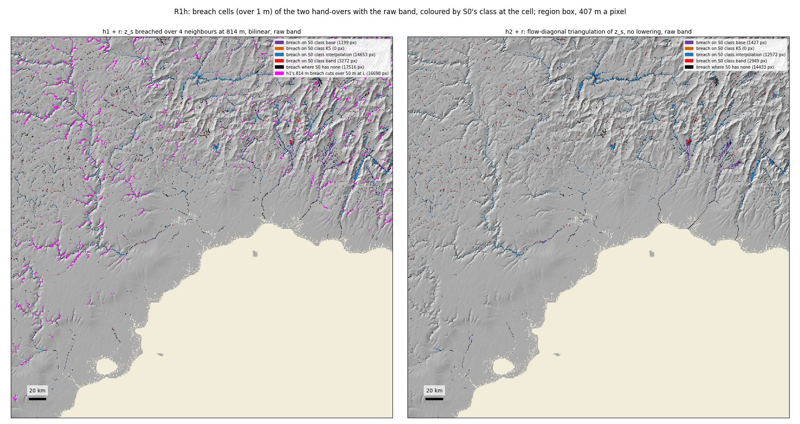
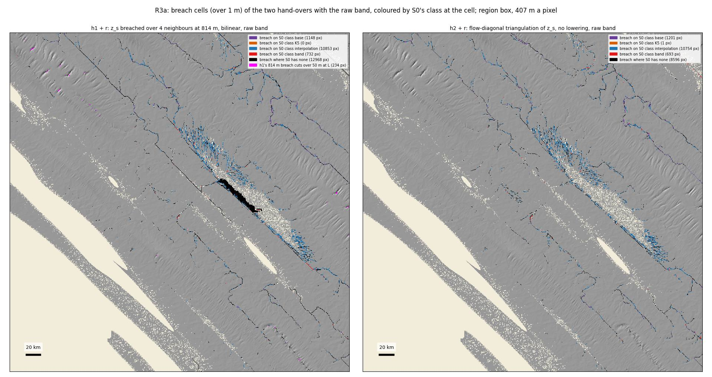
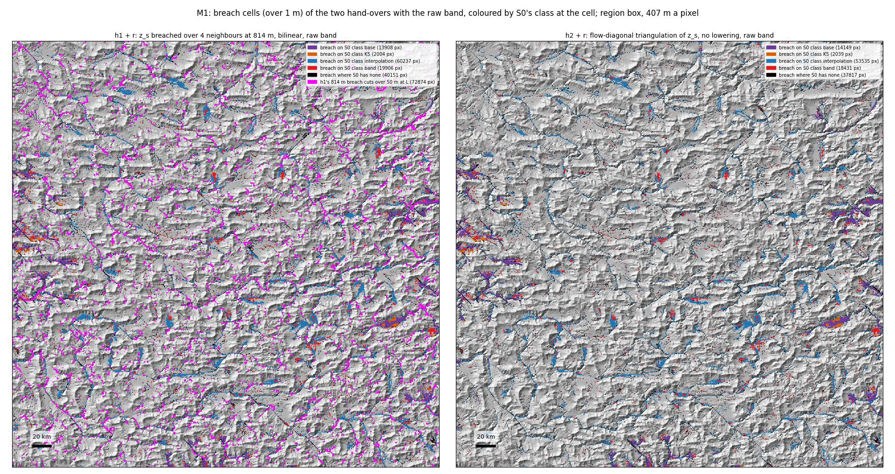
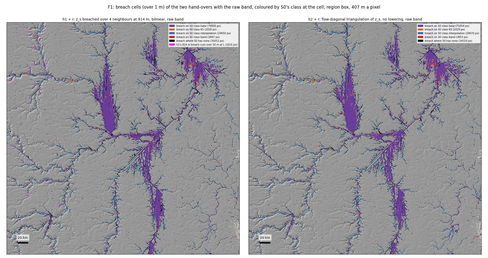

# SPIKE-136: the hand-over at the source, a drainage-preserving read of z_s at L

Opened: 2026-11-17 (lead #136)
Question: which read of `z_s` at L drains by construction and should replace `C1(z_s)` as the start of KS: h1, SPIKE-116's 4-neighbour breach at 814 m read bilinearly, or h2, a flow-diagonal triangulation without lowering?
Why it matters: SPIKE-135 found that 77-93 % of `S0`'s breach cells (four windows) appear when `z_s` is read at L. Fix there first (owner, 2026-11-12: fix at the source stage).
Time box: 1 day (used: about 3 h).
Success criteria: per hand-over, with and without the raw band:
- breach volume and cells against `S0` by SPIKE-135's classes;
- river length on closed depressions;
- D-2 count;
- ridge cells lowered or breached over 10 m;
- relief kept;
- h1's 814 m lowering in full;
- one sheet per window, and a one-line recommendation.

Fallback if it fails: name the hand-over that comes closest and the defect left.
Code location: branch `spike/handover` @ 3c578b2d (never merged):
- `crates/cache/examples/handover.rs`: the ladder, the classes and the four surfaces.
- `crates/cache/examples/handover_low.rs`: each hand-over's own lowering, apart from the interpolant. No routing.
- SPIKE-135's helpers (`rung`, `dilate`) are copied from `spike/repair-debt`.

## Answer
- **h2 + `r` becomes the start of KS. It replaces the plan's `C1(z_s)`.** h2 is the flow-diagonal triangulation of `z_s` with the raw band. Against h1 + `r`:
  - **Drainage is as good or better.** River length on closed depressions: 24-66 %, against 29-68 % for h1 + `r` and 69-89 % for `S0`. D-2 failures: 1-864, against 2-866 and 78-1,890.
  - **Breach volume is 76-98 % lower than `S0`'s on four windows** (h1 + `r`: 68-97 %). On F1 it is 14 % lower (h1: 4 %).
  - **No lowering at 814 m.** h1's 4-neighbour breach lowers 4.0-8.3 % of the land at 814 m, and 0.02-2.05 % by more than 50 m. Its cuts reach 134-1,272 m and lower 17-2,716 ridge cells of `z_s` by more than 50 m.
  - **More relief kept:**

| Relief kept against `S0`, % | h2 + `r` | h1 + `r` |
|---|---|---|
| band std | 94-95 | 84-88 |
| 1 km range p50 | 93-97 | 92-95 |
| 1 km range p95 | 95-97 | 93-97 |

- **h2's cost: cuts inside a quad.** h2 changes no 814 m height. Where `z_s`'s D8 step runs diagonally between two higher cells, the quad is split along that step, and the read cuts the saddle that a bilinear or C1 read would close. That is the intended drainage, but it lowers a bilinear read of `z_s`:

| Window | Cells over 50 m, h2's split | Cells over 50 m, h1's breach | Largest cut, h2 |
|---|---|---|---|
| F1 | 144 | 6,937 | 71 m |
| R3a | 212 | 1,365 | 101 m |
| R3b | 3,496 | 34,006 | 111 m |
| R1h | 41,179 | 129,055 | 265 m |
| M1 | 655,747 | 692,705 | 653 m |

- **Neither hand-over removes the base's debt.**
  - On F1, 88 % of `S0`'s breach cells keep a breach nearby under both hand-overs.
  - On M1, D-2 falls only by half (1,890 to 864).
  - On M1, `z_s` at 814 m is too rough for any linear read. The choice of interpolant alone (C1 against bilinear) moves 1.17 million land cells by more than 50 m.
  - This debt is the base's and K5's (decision 5; SPIKE-134, SPIKE-135).
- **The band stays a defect source after the hand-over.** Adding `r` to h2 raises river length on closed depressions by 5-32 points. This is KS's work on the new start.

## Method
- Windows, margin, box, routing rule, depressions, breach, ridge cells and D-2: as SPIKE-135. The rule is reading 12's sea, the canonical 1e-3 m flood, D8, channels at 75 and 1 km2.
- `S0`'s classes, as SPIKE-135: base, K5, interpolation, band, by the first rung with a breach over 1 m nearby.
- Surfaces at L (cell centres at 8i + 3.5 in the regional grid):

| Surface | Definition |
|---|---|
| h1 | `z_s` breached over 4 neighbours (step 1 cm, land floored at 5 mm; SPIKE-116's `breach_nb` on K5's outlets), read bilinearly |
| h2 | `z_s` read on two triangles per 814 m quad, linear on each. The split is the quad's D8 diagonal step of `z_s` (routing: the ladder's rule at 814 m); if both diagonals step, the larger drainage area wins. Without a diagonal step, the split is along the diagonal whose lower end is higher (the higher pair stays connected; never valley to valley across a divide). No lowering, no damping of the band. |
| h1 + `r`, h2 + `r` | the same plus the raw band `r` = B - `C1(z_b)` (SPIKE-135's L5 for h1) |

- Per surface:
  - the ladder's row: river length on closed depressions, depressions, breach and fill, own ridge cells breached, D-2;
  - relief kept against `S0` (SPIKE-116's measures): the std of the 200 m-1 km band (box means over 3 and 11 cells) and the 1 km block range (10 x 10 cells) p50 and p95, over land of the box;
  - `S0`'s breach cells (over 1 m) with no breach of the surface within 4 L cells, by class;
  - the surface's breach volume by `S0`'s class at the cell.
- Lowering:
  - **In `handover.rs`** each surface is compared with `C1(z_s)` (no band) or `S0` (with the band). The band cancels, so the two give the same numbers. This comparison mixes the hand-over with the change of interpolant (C1 to linear).
  - **`handover_low.rs` separates them against bilinear(`z_s`):**
    - h1's own lowering at L is exactly bilinear(814 m lowering);
    - h2's is bilinear - TIN;
    - the interpolant's alone is C1 - bilinear.
  - For each: cells lowered over 10 and 50 m, raised over 50 m, `S0` ridge cells lowered over 10 and 50 m.
- Runs, under the heavy lock, wall time with setup and peak working set (`raw/peaks.txt`):

| Run | Wall time | Peak working set |
|---|---|---|
| `handover` | 394-560 s | 5.8 GB |
| `handover_low` | 43-64 s | 1.8 GB |

## Results
Rows with "+ `r`" carry the raw band; the others do not. Full tables: `raw/tables.md`.

River length (75 km2 channels) on closed depressions, all / over 5 m deep, %:

| Surface | R1h | R3a | R3b | M1 | F1 |
|---|---|---|---|---|---|
| `S0` | 76.5 / 65.0 | 74.9 / 37.2 | 68.8 / 52.4 | 89.1 / 88.5 | 80.4 / 71.1 |
| `C1(z_s)` | 72.0 / 61.4 | 71.9 / 30.2 | 67.2 / 50.9 | 85.3 / 84.7 | 78.9 / 68.7 |
| h1 | 33.0 / 14.4 | 34.5 / 0.0 | 25.4 / 5.9 | 46.2 / 41.0 | 46.1 / 35.8 |
| h1 + `r` | 49.2 / 28.2 | 49.6 / 0.0 | 28.8 / 6.0 | 68.1 / 65.1 | 54.2 / 36.5 |
| h2 | 24.8 / 12.9 | 33.9 / 0.0 | 19.2 / 7.2 | 34.1 / 32.2 | 46.7 / 37.2 |
| h2 + `r` | 47.6 / 27.3 | 51.3 / 0.6 | 24.3 / 7.2 | 66.4 / 63.3 | 53.8 / 39.5 |

The same at 1 km2 channels, %:

| Surface | R1h | R3a | R3b | M1 | F1 |
|---|---|---|---|---|---|
| `S0` | 47.2 / 37.6 | 54.8 / 14.8 | 37.0 / 27.0 | 69.4 / 69.1 | 70.7 / 64.1 |
| h1 + `r` | 21.4 / 11.6 | 41.0 / 0.0 | 10.1 / 2.2 | 40.5 / 39.3 | 62.1 / 56.3 |
| h2 + `r` | 19.1 / 10.0 | 38.4 / 0.1 | 7.6 / 2.4 | 36.8 / 35.6 | 59.5 / 55.4 |

Breach, land cells lowered / over 10 m / over 50 m, % of the land; volume, km3; max, m:

| Surface | R1h | R3a | R3b | M1 | F1 |
|---|---|---|---|---|---|
| `S0` | 5.86 / 2.07 / 0.50; 155; 291 | 10.6 / 0.04 / 0; 17.2; 80 | 4.08 / 0.72 / 0.04; 53.6; 107 | 11.0 / 7.64 / 3.75; 1,645; 1,324 | 10.6 / 1.37 / 0.002; 127; 65 |
| h1 | 0.85 / 0.03 / 0; 2.7; 24 | 4.02 / 0 / 0; 3.1; 5 | 0.55 / 0 / 0; 1.2; 12 | 1.63 / 0.82 / 0.37; 182; 1,252 | 7.37 / 1.42 / 0; 114; 45 |
| h1 + `r` | 1.93 / 0.23 / 0.01; 14.3; 94 | 6.08 / 0 / 0; 5.4; 6 | 0.73 / 0 / 0; 1.4; 13 | 4.55 / 2.51 / 0.81; 382; 1,286 | 8.71 / 1.45 / 0; 122; 47 |
| h2 | 0.63 / 0.03 / 0; 2.2; 26 | 3.43 / 0 / 0; 1.9; 9 | 0.45 / 0 / 0; 1.0; 12 | 1.19 / 0.68 / 0.34; 166; 1,238 | 6.99 / 1.29 / 0; 97.6; 41 |
| h2 + `r` | 1.92 / 0.23 / 0.02; 14.0; 87 | 6.97 / 0 / 0; 4.2; 9 | 0.74 / 0 / 0; 1.3; 12 | 4.15 / 2.23 / 0.73; 348; 1,246 | 8.62 / 1.34 / 0; 109; 44 |

D-2: H1 trunk reaches failing the corridor measure / measured:

| Surface | R1h | R3a | R3b | M1 | F1 |
|---|---|---|---|---|---|
| `S0` | 352 / 3,094 | 78 / 9,070 | 568 / 5,779 | 1,890 / 6,002 | 525 / 8,277 |
| h1 | 19 / 3,323 | 2 / 9,568 | 28 / 6,122 | 155 / 6,478 | 71 / 8,686 |
| h1 + `r` | 50 / 3,271 | 2 / 9,390 | 29 / 6,090 | 866 / 6,243 | 60 / 8,590 |
| h2 | 1 / 3,364 | 1 / 9,755 | 6 / 6,170 | 110 / 6,605 | 85 / 8,820 |
| h2 + `r` | 46 / 3,192 | 1 / 9,257 | 5 / 6,091 | 864 / 6,123 | 87 / 8,319 |

Own ridge cells (G0 §9) breached over 10 m:

| Surface | R1h | R3a | R3b | M1 | F1 |
|---|---|---|---|---|---|
| `S0` | 62,800 | 570 | 18,498 | 462,624 | 43,996 |
| h1 + `r` | 5,366 | 0 | 9 | 144,928 | 36,272 |
| h2 + `r` | 5,024 | 0 | 0 | 135,916 | 39,020 |

Relief kept against `S0`, band std / 1 km p50 / 1 km p95, %:

| Surface | R1h | R3a | R3b | M1 | F1 |
|---|---|---|---|---|---|
| h1 | 81 / 91 / 92 | 85 / 86 / 95 | 84 / 94 / 93 | 80 / 92 / 92 | 84 / 91 / 93 |
| h1 + `r` | 87 / 95 / 94 | 86 / 92 / 97 | 84 / 95 / 94 | 88 / 95 / 93 | 86 / 94 / 93 |
| h2 | 88 / 91 / 94 | 93 / 84 / 93 | 94 / 95 / 95 | 86 / 94 / 93 | 92 / 93 / 95 |
| h2 + `r` | 95 / 97 / 96 | 94 / 93 / 97 | 94 / 97 / 96 | 95 / 97 / 95 | 94 / 96 / 95 |

`S0`'s breach cells with no breach of the surface within 4 L cells, by class (base / K5 / interpolation / band / all), %:

| Surface | R1h | R3a | R3b | M1 | F1 |
|---|---|---|---|---|---|
| h1 | 42 / 100 / 69 / 94 / 70 | 51 / 84 / 75 / 90 / 74 | 82 / 79 / 75 / 93 / 75 | 11 / 13 / 70 / 95 / 68 | 5 / 8 / 41 / 77 / 20 |
| h1 + `r` | 30 / 100 / 43 / 34 / 42 | 31 / 75 / 53 / 59 / 52 | 72 / 55 / 72 / 85 / 72 | 2 / 2 / 36 / 24 / 31 | 2 / 4 / 30 / 29 / 12 |
| h2 | 30 / 100 / 81 / 96 / 79 | 40 / 76 / 73 / 97 / 71 | 40 / 96 / 80 / 97 / 78 | 10 / 11 / 83 / 97 / 78 | 7 / 10 / 40 / 94 / 21 |
| h2 + `r` | 21 / 100 / 48 / 35 / 46 | 29 / 81 / 52 / 64 / 50 | 39 / 96 / 77 / 90 / 75 | 2 / 2 / 40 / 26 / 34 | 1 / 3 / 29 / 29 / 12 |

- With the band, 25-66 % of the cells `S0` breaches keep a breach nearby on four windows (F1 88 %), on both hand-overs: the band makes its own pits in the same valleys. The breach volume still falls 76-98 % on four windows (h2 + `r`), because the remaining breaches are shallow.
- The surface's breach volume by `S0`'s class is in `raw/tables.md`. On M1 and F1 most of it lies on `S0`'s base class: h2 + `r` 131 and 63 km3, h1 + `r` 133 and 71 km3.

### h1's 814 m lowering
| Window | Lowered, % of land | p50 / p95 / max, m | Over 10 / 50 / 100 / 200 m, cells (over 50 m, % of land) | Volume, km3 | Ridge cells of `z_s` lowered over 10 / 50 m |
|---|---|---|---|---|---|
| R1h | 5.65 | 6.8 / 140 / 491 | 6,653 / 2,541 / 1,206 / 363 (0.95 %) | 226 | 2,250 / 1,092 of 107,411 |
| R3a | 8.27 | 0.3 / 8 / 173 | 874 / 53 / 14 / 0 (0.02 %) | 24 | 437 / 17 of 92,970 |
| R3b | 6.16 | 3.4 / 54 / 207 | 5,594 / 1,216 / 307 / 2 (0.35 %) | 135 | 1,999 / 584 of 118,887 |
| M1 | 4.01 | 52.8 / 490 / 1,272 | 11,883 / 7,879 / 5,697 / 3,210 (2.05 %) | 1,076 | 3,447 / 2,716 of 155,179 |
| F1 | 7.42 | 3.2 / 28 / 134 | 5,342 / 525 / 25 / 0 (0.14 %) | 125 | 2,303 / 327 of 153,286 |

- The 814 m breach cuts ridges: on M1, 2,716 ridge cells of `z_s` are lowered by more than 50 m and 3,210 cells by more than 200 m. These are the deep cuts the owner calls a fault (2026-11-13).
- On the sheets the cuts lie at tributary heads along the valley sides (R3b) and across the whole of M1.

### Lowering at L by its source
Against bilinear(`z_s`), over the land of the box. Per cell: lowered over 10 m / over 50 m; raised over 50 m; `S0` ridge cells lowered over 10 m / over 50 m; lowering p95 / max, m.

| Comparison | R1h | R3a | R3b | M1 | F1 |
|---|---|---|---|---|---|
| h1's breach read at L: bilinear(`z_s`) - h1 | 634,882 / 129,055; 0; 128,898 / 41,201; 47.5 / 432 | 28,984 / 1,365; 0; 3,509 / 417; 3.7 / 152 | 382,872 / 34,006; 0; 67,222 / 12,989; 18.4 / 186 | 1,599,249 / 692,705; 0; 379,450 / 191,137; 174.8 / 1118 | 261,587 / 6,937; 0; 43,786 / 3,736; 10.0 / 118 |
| h2 against bilinear(`z_s`): bilinear - TIN | 726,419 / 41,179; 10,348; 126,795 / 16,589; 13.9 / 265 | 15,899 / 212; 12; 2,611 / 111; 1.9 / 101 | 216,911 / 3,496; 176; 46,751 / 1,974; 4.8 / 111 | 4,409,017 / 655,747; 391,510; 748,675 / 174,886; 48.0 / 653 | 90,783 / 144; 2; 25,593 / 120; 3.4 / 71 |
| `C1(z_s)` against bilinear(`z_s`): C1 - bilinear | 1,096,171 / 8,755; 10,037; 411,020 / 5,378; 18.1 / 103 | 4,537 / 0; 0; 1,665 / 0; 2.0 / 32 | 116,567 / 0; 0; 50,899 / 0; 4.5 / 42 | 6,645,558 / 1,166,080; 754,907; 2,458,248 / 571,706; 65.4 / 255 | 25,494 / 0; 0; 11,297 / 0; 3.3 / 26 |
| h1 against `C1(z_s)` | 1,558,242 / 134,700; 5,547; 505,592 / 49,732; 24.7 / 451 | 33,053 / 1,494; 0; 5,022 / 459; 2.5 / 167 | 457,180 / 37,397; 0; 111,264 / 14,989; 7.6 / 198 | 7,464,019 / 1,732,258; 567,100; 2,635,439 / 748,113; 85.2 / 1185 | 283,715 / 9,508; 0; 55,139 / 4,986; 5.4 / 126 |
| h2 against `C1(z_s)` | 1,325,946 / 38,279; 16,172; 407,685 / 18,206; 20.1 / 250 | 18,512 / 53; 31; 4,464 / 34; 2.6 / 97 | 255,518 / 1,783; 231; 78,576 / 1,183; 5.9 / 105 | 7,247,074 / 1,450,643; 720,500; 2,372,106 / 589,269; 73.4 / 661 | 87,252 / 58; 2; 31,526 / 57; 4.1 / 64 |

- h2's cuts over 50 m against bilinear are 3-48 times fewer than h1's on R1h, R3a, R3b and F1, and reach fewer `S0` ridge cells. On M1 the two are of one size (656 k against 693 k cells over 50 m).
- The interpolant alone (C1 against bilinear) moves M1 by more than 50 m on 1.17 M cells in both directions. M1's `z_s` changes by hundreds of metres between 814 m nodes; no read of it at L keeps both its ridges and its drainage.

### h2's quads
| Window | Split along a D8 diagonal step | Both diagonals stepped | Split along the higher pair |
|---|---|---|---|
| R1h | 260,013 | 0 | 778,348 |
| R3a | 286,365 | 0 | 751,996 |
| R3b | 399,138 | 0 | 639,223 |
| M1 | 359,781 | 0 | 678,580 |
| F1 | 368,273 | 0 | 670,088 |

- 25-38 % of the quads carry a diagonal D8 step. No quad has steps on both diagonals, so every D8 step of `z_s` is an edge of h2's triangulation.

### Inland land at or below 0 m
| Surface | R1h | R3a | R3b | M1 | F1 |
|---|---|---|---|---|---|
| `S0` | 110,974 | 524,775 | 103,289 | 0 | 25,525 |
| h1 | 3,591 | 164,592 | 666 | 0 | 158 |
| h2 | 0 | 0 | 0 | 0 | 0 |
| h2 + `r` | 53,032 | 301,396 | 32,995 | 0 | 13,840 |

- h2 makes no inland cell under 0 m: a linear read never dips below its nodes.
- h1 makes them on R3a (164,592 cells): the breach floors land at 5 mm beside sea nodes, and the bilinear read between them dips under 0 m.
- The band brings them back: 13,840-301,396 cells on h2 + `r`. SPIKE-135's recommendation stands: floor the band at the sea level near the coast.

## Findings
1. **Both hand-overs remove most of the interpolation debt.** h2 does it without lowering at 814 m.
   - On four windows, with the band, h2 + `r` cuts `S0`'s breach volume by 76-98 % and the D-2 failures by 83-99 % (M1: 54 %).
   - h1 + `r` does about as well (68-97 %, 54-97 %), but only by cutting `z_s` by up to 1,272 m.
2. **h1 is the red flag.**
   - It lowers 0.02-2.05 % of the land by more than 50 m at 814 m, and 17-2,716 ridge cells of `z_s` by more than 50 m.
   - At L its own cut lowers 417-191,137 of `S0`'s ridge cells by more than 50 m.
   - These are the deep cuts the owner rules a fault.
3. **h2 keeps more relief:** band std 94-95 % of `S0` with the band, against 84-88 % for h1. It never dips under the sea inland.
   - Its cost is cuts inside the quads it splits along a flow diagonal: 144-655,747 cells over 50 m against a bilinear read, up to 653 m (M1).
4. **M1 and F1 keep their debt whatever the read.**
   - F1's is the base's (88 % of `S0`'s breach cells keep a breach nearby).
   - M1's `z_s` is too rough at 814 m for any linear or C1 read.
   - Both are decision 5's: the base and K5.
5. **The band is the next defect after the hand-over.** It adds 5-32 points of river length on closed depressions to h2. It also brings back inland cells under the sea. KS works on this; a sea-level floor for the band near the coast comes first.

## Recommendation
**h2 + `r`** (the flow-diagonal triangulation of `z_s`, raw band) becomes the start of KS in place of `C1(z_s)` + `r`. It drains as well as h1 without h1's 814 m cuts, keeps 93-97 % of `S0`'s relief, and leaves M1's and F1's base debt to decision 5.

- Before KS: floor the band at the sea level near the coast (finding 5).
- Not measured:
  - the triangulation's facets as seen in a render: the 1 km range and the band std measure height spread, not shading;
  - a C1 or monotone read along the flow diagonals: a smoother h2;
  - bake stills: no world bake.

## Visuals
Analysis renders (CPU), not the production path. No bake of either hand-over exists.

Each sheet shows the window's region box, 4 L cells (407 m) a pixel, over a low-sun hillshade of `S0`:
- Two panels: h1 + `r` (left) and h2 + `r` (right).
- Each panel colours its surface's breach cells over 1 m by `S0`'s class at the cell: purple base, orange K5, blue interpolation, red band, black where `S0` has no breach.
- Left panel only, magenta: blocks where h1's own 814 m breach, read at L, cuts over 50 m. h2 lowers nothing at 814 m.
- Sand: `S0`'s block mean at or below 0 m.
- 20 km scale bar.

R1h: h1's cuts (magenta) along the valley sides; both hand-overs leave short blue reaches on the trunks.

R3a, the flat coastal window: few breach cells on either; h1's cuts are rare (0.02 % of the land over 50 m).

R3b: h1's cuts at the tributary heads on the valley sides; h2 + `r` has 5 D-2 failures, h1 + `r` 29.

M1: h1's cuts across the whole window; both keep wide breach patches in the valleys and the base's basins (purple).

F1: both keep the base's lowland depressions (purple). Neither read removes them.

## Reproduce
- `cargo build --release -p planet-cache --example handover --example handover_low` on `spike/handover`.
- Runs: `cargo xtask heavy target/release/examples/handover.exe --window <w> --out <dir> --tag <tag>`, the same with `handover_low.exe`.
- Tables: `python tools/handover_tables.py raw r1h r3a r3b m1 f1`. Sheets: `python tools/handover_sheet.py <dir> <tag> <title> <out.jpg>` (reads the probe's outputs).
