# SPIKE-136: the hand-over at the source, a drainage-preserving read of z_s at L

Opened: 2026-11-17 (lead #136)
Question: which read of `z_s` at L drains by construction and should replace `C1(z_s)` as the start of KS: h1, SPIKE-116's 4-neighbour breach at 814 m read bilinearly, or h2, a flow-diagonal triangulation without lowering?
Why it matters: SPIKE-135 found that 77-93 % of `S0`'s breach cells (four windows) appear when `z_s` is read at L. Fix there first (owner, 2026-11-12: fix at the source stage).
Time box: 1 day (used: about 3 h).
Success criteria: per hand-over, with and without the raw band:
- breach volume and cells against `S0` by SPIKE-135's classes;
- river length on closed depressions;
- D-2 count;
- ridge cells lowered or breached over 10 m;
- relief kept;
- h1's 814 m lowering in full;
- one sheet per window, and a one-line recommendation.

Fallback if it fails: name the hand-over that comes closest and the defect left.
Code location: branch `spike/handover` @ 3c578b2d (never merged):
- `crates/cache/examples/handover.rs`: the ladder, the classes and the four surfaces.
- `crates/cache/examples/handover_low.rs`: each hand-over's own lowering, apart from the interpolant. No routing.
- SPIKE-135's helpers (`rung`, `dilate`) are copied from `spike/repair-debt`.

## Answer
- **h2 + `r` becomes the start of KS. It replaces the plan's `C1(z_s)`.** h2 is the flow-diagonal triangulation of `z_s` with the raw band. Against h1 + `r`:
  - **Drainage is as good or better.** River length on closed depressions: 24-66 %, against 29-68 % for h1 + `r` and 69-89 % for `S0`. D-2 failures: 1-864, against 2-866 and 78-1,890.
  - **Breach volume is 76-98 % lower than `S0`'s on R1h, R3a, R3b and M1** (h1 + `r`: 68-97 %). On F1 it is 14 % lower (h1: 4 %).
  - **No lowering at 814 m.** h1's 4-neighbour breach lowers 4.0-8.3 % of the land at 814 m, and 0.02-2.05 % by more than 50 m. Its cuts reach 134-1,272 m and lower 17-2,716 ridge cells of `z_s` by more than 50 m.
  - **More relief kept:**

| Relief kept against `S0`, % | h2 + `r` | h1 + `r` |
|---|---|---|
| band std | 94-95 | 84-88 |
| 1 km range p50 | 93-97 | 92-95 |
| 1 km range p95 | 95-97 | 93-97 |

- **h2's cost: cuts inside a quad.** h2 changes no 814 m height. Where `z_s`'s D8 step runs diagonally between two higher cells, the quad is split along that step, and the read cuts the saddle that a bilinear or C1 read would close. That is the intended drainage, but it lowers a bilinear read of `z_s`:

| Window | Cells over 50 m, h2's split | Cells over 50 m, h1's breach | Largest cut, h2 |
|---|---|---|---|
| F1 | 144 | 6,937 | 71 m |
| R3a | 212 | 1,365 | 101 m |
| R3b | 3,496 | 34,006 | 111 m |
| R1h | 41,179 | 129,055 | 265 m |
| M1 | 655,747 | 692,705 | 653 m |

- **Neither hand-over removes the base's debt.**
  - On F1, 88 % of `S0`'s breach cells keep a breach nearby under both hand-overs.
  - On M1, D-2 falls only by half (1,890 to 864).
  - On M1, `z_s` at 814 m is too rough for any linear read. The choice of interpolant alone (C1 against bilinear) lowers 1.17 million land cells and raises 0.75 million by more than 50 m.
  - This debt is the base's and K5's (decision 5; SPIKE-134, SPIKE-135).
- **The band stays a defect source after the hand-over.** Adding `r` to h2 raises river length on closed depressions by 5-32 points. This is KS's work on the new start.

## Method
- Windows, margin, box, routing rule, depressions, breach, ridge cells and D-2: as SPIKE-135. The rule is reading 12's sea, the canonical 1e-3 m flood, D8, channels at 75 and 1 km2.
- `S0`'s classes, as SPIKE-135: base, K5, interpolation, band, by the first rung with a breach over 1 m nearby.
- Surfaces at L (cell centres at 8i + 3.5 in the regional grid):

| Surface | Definition |
|---|---|
| h1 | `z_s` breached over 4 neighbours (step 1 cm, land floored at 5 mm; SPIKE-116's `breach_nb` on K5's outlets), read bilinearly |
| h2 | `z_s` read on two triangles per 814 m quad, linear on each. The split is the quad's D8 diagonal step of `z_s` (routing: the ladder's rule at 814 m); if both diagonals step, the larger drainage area wins. Without a diagonal step, the split is along the diagonal whose lower end is higher (the higher pair stays connected; never valley to valley across a divide). No lowering, no damping of the band. |
| h1 + `r`, h2 + `r` | the same plus the raw band `r` = B - `C1(z_b)` (SPIKE-135's L5 for h1) |

- Per surface:
  - the ladder's row: river length on closed depressions, depressions, breach and fill, own ridge cells breached, D-2;
  - relief kept against `S0` (SPIKE-116's measures): the std of the 200 m-1 km band (box means over 3 and 11 cells) and the 1 km block range (10 x 10 cells) p50 and p95, over land of the box;
  - `S0`'s breach cells (over 1 m) with no breach of the surface within 4 L cells, by class;
  - the surface's breach volume by `S0`'s class at the cell.
- Lowering:
  - **In `handover.rs`** each surface is compared with `C1(z_s)` (no band) or `S0` (with the band). The band cancels, so the two give the same numbers. This comparison mixes the hand-over with the change of interpolant (C1 to linear).
  - **`handover_low.rs` separates them against bilinear(`z_s`):**
    - h1's own lowering at L is exactly bilinear(814 m lowering);
    - h2's is bilinear - TIN;
    - the interpolant's alone is C1 - bilinear.
  - For each: cells lowered over 10 and 50 m, raised over 50 m, `S0` ridge cells lowered over 10 and 50 m.
- Runs, under the heavy lock, wall time with setup and peak working set (`raw/peaks.txt`):

| Run | Wall time | Peak working set |
|---|---|---|
| `handover` | 394-560 s | 5.8 GB |
| `handover_low` | 43-64 s | 1.8 GB |

## Results
Rows with "+ `r`" carry the raw band; the others do not. Full tables: `raw/tables.md`.

River length (75 km2 channels) on closed depressions, all / over 5 m deep, %:

| Surface | R1h | R3a | R3b | M1 | F1 |
|---|---|---|---|---|---|
| `S0` | 76.5 / 65.0 | 74.9 / 37.2 | 68.8 / 52.4 | 89.1 / 88.5 | 80.4 / 71.1 |
| `C1(z_s)` | 72.0 / 61.4 | 71.9 / 30.2 | 67.2 / 50.9 | 85.3 / 84.7 | 78.9 / 68.7 |
| h1 | 33.0 / 14.4 | 34.5 / 0.0 | 25.4 / 5.9 | 46.2 / 41.0 | 46.1 / 35.8 |
| h1 + `r` | 49.2 / 28.2 | 49.6 / 0.0 | 28.8 / 6.0 | 68.1 / 65.1 | 54.2 / 36.5 |
| h2 | 24.8 / 12.9 | 33.9 / 0.0 | 19.2 / 7.2 | 34.1 / 32.2 | 46.7 / 37.2 |
| h2 + `r` | 47.6 / 27.3 | 51.3 / 0.6 | 24.3 / 7.2 | 66.4 / 63.3 | 53.8 / 39.5 |

The same at 1 km2 channels, %:

| Surface | R1h | R3a | R3b | M1 | F1 |
|---|---|---|---|---|---|
| `S0` | 47.2 / 37.6 | 54.8 / 14.8 | 37.0 / 27.0 | 69.4 / 69.1 | 70.7 / 64.1 |
| h1 + `r` | 21.4 / 11.6 | 41.0 / 0.0 | 10.1 / 2.2 | 40.5 / 39.3 | 62.1 / 56.3 |
| h2 + `r` | 19.1 / 10.0 | 38.4 / 0.1 | 7.6 / 2.4 | 36.8 / 35.6 | 59.5 / 55.4 |

Breach, land cells lowered / over 10 m / over 50 m, % of the land; volume, km3; max, m:

| Surface | R1h | R3a | R3b | M1 | F1 |
|---|---|---|---|---|---|
| `S0` | 5.86 / 2.07 / 0.50; 155; 291 | 10.6 / 0.04 / 0; 17.2; 80 | 4.08 / 0.72 / 0.04; 53.6; 107 | 11.0 / 7.64 / 3.75; 1,645; 1,324 | 10.6 / 1.37 / 0.002; 127; 65 |
| h1 | 0.85 / 0.03 / 0; 2.7; 24 | 4.02 / 0 / 0; 3.1; 5 | 0.55 / 0 / 0; 1.2; 12 | 1.63 / 0.82 / 0.37; 182; 1,252 | 7.37 / 1.42 / 0; 114; 45 |
| h1 + `r` | 1.93 / 0.23 / 0.01; 14.3; 94 | 6.08 / 0 / 0; 5.4; 6 | 0.73 / 0 / 0; 1.4; 13 | 4.55 / 2.51 / 0.81; 382; 1,286 | 8.71 / 1.45 / 0; 122; 47 |
| h2 | 0.63 / 0.03 / 0; 2.2; 26 | 3.43 / 0 / 0; 1.9; 9 | 0.45 / 0 / 0; 1.0; 12 | 1.19 / 0.68 / 0.34; 166; 1,238 | 6.99 / 1.29 / 0; 97.6; 41 |
| h2 + `r` | 1.92 / 0.23 / 0.02; 14.0; 87 | 6.97 / 0 / 0; 4.2; 9 | 0.74 / 0 / 0; 1.3; 12 | 4.15 / 2.23 / 0.73; 348; 1,246 | 8.62 / 1.34 / 0; 109; 44 |

D-2: H1 trunk reaches failing the corridor measure / measured:

| Surface | R1h | R3a | R3b | M1 | F1 |
|---|---|---|---|---|---|
| `S0` | 352 / 3,094 | 78 / 9,070 | 568 / 5,779 | 1,890 / 6,002 | 525 / 8,277 |
| h1 | 19 / 3,323 | 2 / 9,568 | 28 / 6,122 | 155 / 6,478 | 71 / 8,686 |
| h1 + `r` | 50 / 3,271 | 2 / 9,390 | 29 / 6,090 | 866 / 6,243 | 60 / 8,590 |
| h2 | 1 / 3,364 | 1 / 9,755 | 6 / 6,170 | 110 / 6,605 | 85 / 8,820 |
| h2 + `r` | 46 / 3,192 | 1 / 9,257 | 5 / 6,091 | 864 / 6,123 | 87 / 8,319 |

Own ridge cells (G0 §9) breached over 10 m:

| Surface | R1h | R3a | R3b | M1 | F1 |
|---|---|---|---|---|---|
| `S0` | 62,800 | 570 | 18,498 | 462,624 | 43,996 |
| h1 + `r` | 5,366 | 0 | 9 | 144,928 | 36,272 |
| h2 + `r` | 5,024 | 0 | 0 | 135,916 | 39,020 |

Relief kept against `S0`, band std / 1 km p50 / 1 km p95, %:

| Surface | R1h | R3a | R3b | M1 | F1 |
|---|---|---|---|---|---|
| h1 | 81 / 91 / 92 | 85 / 86 / 95 | 84 / 94 / 93 | 80 / 92 / 92 | 84 / 91 / 93 |
| h1 + `r` | 87 / 95 / 94 | 86 / 92 / 97 | 84 / 95 / 94 | 88 / 95 / 93 | 86 / 94 / 93 |
| h2 | 88 / 91 / 94 | 93 / 84 / 93 | 94 / 95 / 95 | 86 / 94 / 93 | 92 / 93 / 95 |
| h2 + `r` | 95 / 97 / 96 | 94 / 93 / 97 | 94 / 97 / 96 | 95 / 97 / 95 | 94 / 96 / 95 |

`S0`'s breach cells with no breach of the surface within 4 L cells, by class (base / K5 / interpolation / band / all), %:

| Surface | R1h | R3a | R3b | M1 | F1 |
|---|---|---|---|---|---|
| h1 | 42 / 100 / 69 / 94 / 70 | 51 / 84 / 75 / 90 / 74 | 82 / 79 / 75 / 93 / 75 | 11 / 13 / 70 / 95 / 68 | 5 / 8 / 41 / 77 / 20 |
| h1 + `r` | 30 / 100 / 43 / 34 / 42 | 31 / 75 / 53 / 59 / 52 | 72 / 55 / 72 / 85 / 72 | 2 / 2 / 36 / 24 / 31 | 2 / 4 / 30 / 29 / 12 |
| h2 | 30 / 100 / 81 / 96 / 79 | 40 / 76 / 73 / 97 / 71 | 40 / 96 / 80 / 97 / 78 | 10 / 11 / 83 / 97 / 78 | 7 / 10 / 40 / 94 / 21 |
| h2 + `r` | 21 / 100 / 48 / 35 / 46 | 29 / 81 / 52 / 64 / 50 | 39 / 96 / 77 / 90 / 75 | 2 / 2 / 40 / 26 / 34 | 1 / 3 / 29 / 29 / 12 |

- With the band, 25-66 % (h2 + `r`) and 28-69 % (h1 + `r`) of the cells `S0` breaches keep a breach nearby on R1h, R3a, R3b and M1; on F1 88 % on both. The band makes its own pits in the same valleys. The breach volume still falls 76-98 % on those four windows (h2 + `r`), because the remaining breaches are shallow.
- The surface's breach volume by `S0`'s class is in `raw/tables.md`. On F1 most of it lies on `S0`'s base class: h2 + `r` 63 of 107 km3, h1 + `r` 71 of 120 km3. On M1 base and interpolation hold about equal parts: h2 + `r` 131 and 129 of 347 km3, h1 + `r` 133 and 148 of 382 km3.

### h1's 814 m lowering
| Window | Lowered, % of land | p50 / p95 / max, m | Over 10 / 50 / 100 / 200 m, cells (over 50 m, % of land) | Volume, km3 | Ridge cells of `z_s` lowered over 10 / 50 m |
|---|---|---|---|---|---|
| R1h | 5.65 | 6.8 / 140 / 491 | 6,653 / 2,541 / 1,206 / 363 (0.95 %) | 226 | 2,250 / 1,092 of 107,411 |
| R3a | 8.27 | 0.3 / 8 / 173 | 874 / 53 / 14 / 0 (0.02 %) | 24 | 437 / 17 of 92,970 |
| R3b | 6.16 | 3.4 / 54 / 207 | 5,594 / 1,216 / 307 / 2 (0.35 %) | 135 | 1,999 / 584 of 118,887 |
| M1 | 4.01 | 52.8 / 490 / 1,272 | 11,883 / 7,879 / 5,697 / 3,210 (2.05 %) | 1,076 | 3,447 / 2,716 of 155,179 |
| F1 | 7.42 | 3.2 / 28 / 134 | 5,342 / 525 / 25 / 0 (0.14 %) | 125 | 2,303 / 327 of 153,286 |

- The 814 m breach cuts ridges: on M1, 2,716 ridge cells of `z_s` are lowered by more than 50 m and 3,210 cells by more than 200 m. These are the deep cuts the owner calls a fault (2026-11-13).
- On the sheets the cuts lie at tributary heads along the valley sides (R3b) and across the whole of M1.

### Lowering at L by its source
Against bilinear(`z_s`), over the land of the box. Per cell: lowered over 10 m / over 50 m; raised over 50 m; `S0` ridge cells lowered over 10 m / over 50 m; lowering p95 / max, m.

| Comparison | R1h | R3a | R3b | M1 | F1 |
|---|---|---|---|---|---|
| h1's breach read at L: bilinear(`z_s`) - h1 | 634,882 / 129,055; 0; 128,898 / 41,201; 47.5 / 432 | 28,984 / 1,365; 0; 3,509 / 417; 3.7 / 152 | 382,872 / 34,006; 0; 67,222 / 12,989; 18.4 / 186 | 1,599,249 / 692,705; 0; 379,450 / 191,137; 174.8 / 1118 | 261,587 / 6,937; 0; 43,786 / 3,736; 10.0 / 118 |
| h2 against bilinear(`z_s`): bilinear - TIN | 726,419 / 41,179; 10,348; 126,795 / 16,589; 13.9 / 265 | 15,899 / 212; 12; 2,611 / 111; 1.9 / 101 | 216,911 / 3,496; 176; 46,751 / 1,974; 4.8 / 111 | 4,409,017 / 655,747; 391,510; 748,675 / 174,886; 48.0 / 653 | 90,783 / 144; 2; 25,593 / 120; 3.4 / 71 |
| `C1(z_s)` against bilinear(`z_s`): C1 - bilinear | 1,096,171 / 8,755; 10,037; 411,020 / 5,378; 18.1 / 103 | 4,537 / 0; 0; 1,665 / 0; 2.0 / 32 | 116,567 / 0; 0; 50,899 / 0; 4.5 / 42 | 6,645,558 / 1,166,080; 754,907; 2,458,248 / 571,706; 65.4 / 255 | 25,494 / 0; 0; 11,297 / 0; 3.3 / 26 |
| h1 against `C1(z_s)` | 1,558,242 / 134,700; 5,547; 505,592 / 49,732; 24.7 / 451 | 33,053 / 1,494; 0; 5,022 / 459; 2.5 / 167 | 457,180 / 37,397; 0; 111,264 / 14,989; 7.6 / 198 | 7,464,019 / 1,732,258; 567,100; 2,635,439 / 748,113; 85.2 / 1185 | 283,715 / 9,508; 0; 55,139 / 4,986; 5.4 / 126 |
| h2 against `C1(z_s)` | 1,325,946 / 38,279; 16,172; 407,685 / 18,206; 20.1 / 250 | 18,512 / 53; 31; 4,464 / 34; 2.6 / 97 | 255,518 / 1,783; 231; 78,576 / 1,183; 5.9 / 105 | 7,247,074 / 1,450,643; 720,500; 2,372,106 / 589,269; 73.4 / 661 | 87,252 / 58; 2; 31,526 / 57; 4.1 / 64 |

- h2's cuts over 50 m against bilinear are 3-48 times fewer than h1's on R1h, R3a, R3b and F1, and reach fewer `S0` ridge cells. On M1 the two are of one size (656 k against 693 k cells over 50 m).
- The interpolant alone (C1 against bilinear) lowers 1.17 M and raises 0.75 M of M1's land cells by more than 50 m. M1's `z_s` changes by hundreds of metres between 814 m nodes; no read of it at L keeps both its ridges and its drainage.

### h2's quads
| Window | Split along a D8 diagonal step | Both diagonals stepped | Split along the higher pair |
|---|---|---|---|
| R1h | 260,013 | 0 | 778,348 |
| R3a | 286,365 | 0 | 751,996 |
| R3b | 399,138 | 0 | 639,223 |
| M1 | 359,781 | 0 | 678,580 |
| F1 | 368,273 | 0 | 670,088 |

- 25-38 % of the quads carry a diagonal D8 step. No quad has steps on both diagonals, so every D8 step of `z_s` is an edge of h2's triangulation.

### Inland land at or below 0 m
| Surface | R1h | R3a | R3b | M1 | F1 |
|---|---|---|---|---|---|
| `S0` | 110,974 | 524,775 | 103,289 | 0 | 25,525 |
| h1 | 3,591 | 164,592 | 666 | 0 | 158 |
| h2 | 0 | 0 | 0 | 0 | 0 |
| h2 + `r` | 53,032 | 301,396 | 32,995 | 0 | 13,840 |

- h2 makes no inland cell under 0 m on any window (measured).
- h1 makes them on R3a (164,592 cells): the breach floors land at 5 mm beside sea nodes, and the bilinear read between them dips under 0 m.
- The band brings them back: 13,840-301,396 cells on h2 + `r` (M1: none). SPIKE-135's recommendation stands: floor the band at the sea level near the coast.

## Findings
1. **Both hand-overs remove most of the interpolation debt.** h2 does it without lowering at 814 m.
   - With the band, h2 + `r` cuts `S0`'s breach volume by 76-98 % on R1h, R3a, R3b and M1 (F1 14 %), and the D-2 failures by 83-99 % on R1h, R3a, R3b and F1 (M1 54 %).
   - h1 + `r` does about as well (breach volume 68-97 % on the same four, F1 4 %; D-2 86-97 %, M1 54 %), but only by cutting `z_s` by up to 1,272 m.
2. **h1 is the red flag.**
   - It lowers 0.02-2.05 % of the land by more than 50 m at 814 m, and 17-2,716 ridge cells of `z_s` by more than 50 m.
   - At L its own cut lowers 417-191,137 of `S0`'s ridge cells by more than 50 m.
   - These are the deep cuts the owner rules a fault.
3. **h2 keeps more relief:** band std 94-95 % of `S0` with the band, against 84-88 % for h1. Without the band it makes no inland cell under the sea on any window.
   - Its cost is cuts inside the quads it splits along a flow diagonal: 144-655,747 cells over 50 m against a bilinear read, up to 653 m (M1).
4. **M1 and F1 keep their debt whatever the read.**
   - F1's is the base's (88 % of `S0`'s breach cells keep a breach nearby).
   - M1's `z_s` is too rough at 814 m for any linear or C1 read.
   - Both are decision 5's: the base and K5.
5. **The band is the next defect after the hand-over.** It adds 5-32 points of river length on closed depressions to h2. It also brings back inland cells under the sea. KS works on this; a sea-level floor for the band near the coast comes first.

## Recommendation
**h2 + `r`** (the flow-diagonal triangulation of `z_s`, raw band) becomes the start of KS in place of `C1(z_s)` + `r`. It drains as well as h1 without h1's 814 m cuts, keeps 93-97 % of `S0`'s relief, and leaves M1's and F1's base debt to decision 5.

- Before KS: floor the band at the sea level near the coast (finding 5).
- Not measured:
  - the triangulation's facets as seen in a render: the 1 km range and the band std measure height spread, not shading;
  - a C1 or monotone read along the flow diagonals: a smoother h2;
  - bake stills: no world bake.

## Visuals
Analysis renders (CPU), not the production path. No bake of either hand-over exists.

Each sheet shows the window's region box, 4 L cells (407 m) a pixel, over a low-sun hillshade of `S0`:
- Two panels: h1 + `r` (left) and h2 + `r` (right).
- Each panel colours its surface's breach cells over 1 m by `S0`'s class at the cell: purple base, orange K5, blue interpolation, red band, black where `S0` has no breach.
- Left panel only, magenta: blocks where h1's own 814 m breach, read at L, cuts over 50 m. h2 lowers nothing at 814 m.
- Sand: `S0`'s block mean at or below 0 m.
- 20 km scale bar.

R1h: h1's cuts (magenta) along the valley sides; both hand-overs leave short blue reaches on the trunks.

R3a, the flat coastal window: h1 + `r` breaches a long strip of the central lowland trough where `S0` has none (black, 12,968 px); h2 + `r` does not (8,596 black px over the whole window). h1's cuts over 50 m are rare (0.02 % of the land).

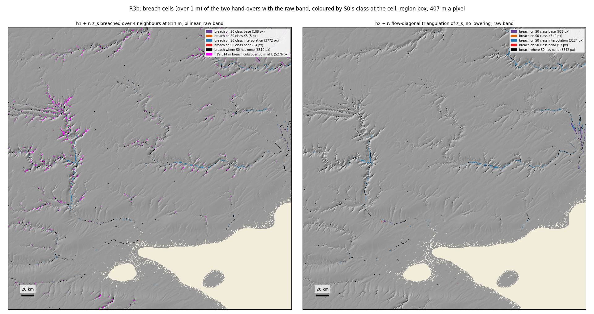
R3b: h1's cuts at the tributary heads on the valley sides; h2 + `r` has 5 D-2 failures, h1 + `r` 29.

M1: h1's cuts across the whole window; both keep wide breach patches in the valleys and the base's basins (purple).

F1: both keep the base's lowland depressions (purple). Neither read removes them.

## Reproduce
- `cargo build --release -p planet-cache --example handover --example handover_low` on `spike/handover`.
- Runs: `cargo xtask heavy target/release/examples/handover.exe --window <w> --out <dir> --tag <tag>`, the same with `handover_low.exe`.
- Tables: `python tools/handover_tables.py raw r1h r3a r3b m1 f1`. Sheets: `python tools/handover_sheet.py <dir> <tag> <title> <out.jpg>` (reads the probe's outputs).

## Addendum: KH as a chain stage, its ridge check and its facet look (lead #137, 2026-11-17)
Question: does KH (h2, G0 contracts §12 reading 19) run as a stage of the RG chain, deterministic and tile-local? How many of its D8-step splits cut across a ridge of `S0`, and by how much? What does KH(`z_s`) + `r` look like at low sun?
Time box: half a day (used: about 2.5 h).

Code location: branch `spike/kh-stage` @ 482f2eb0 (never merged; cut from explorer's `spike/rg-chain` @ d3f3d9cc):
- `crates/generators/src/bake/kh.rs`: `split`, `read` and `routing` (spike code), with a unit test.
- `crates/generators/tests/kh_g0.rs`: KH on the G0 fixture.
- `crates/cache/examples/rg_chain.rs`: `--kh h2`.
- `crates/cache/examples/kh_ridge.rs`: the ridge check and the render crops.

### The stage (interface agreed with explorer, 2026-11-17)
- `--kh h2` builds `ks_base` = KH(`z_s`) + `r`; `--kh c1` keeps `ks_base` = `S0`.
- KS starts from `ks_base`. Its lowered surface is `ks_base - u`, and the reading-17 clamp reads `ks_base`. `want = max(0, r - band)` is unchanged.
- `S0` stays the reference of the ocean, the K6' sills, the budget field, the ridge and residual measures, and river-gate's `--surface`. Reading 19 moves only KS's start.
- KH's split is an H1 field: KH's own routing of `z_s`, with reading 12's outlets, the canonical 1e-3 m flood, D8 steepest, ties to the lower id.
- The L read uses one quad's four heights and one flag: it is per-quad local. The split is a window-global H1 field, like H1's routing; its locality is H1's (landmass-owned), not a tile's.
- What the bit checks below show: the read gives the same bits in any evaluation order (one region or two cut at a tile column) and on any thread count. They evaluate one function of the cell against a split computed once, so they do not test a split recomputed per region. A split built from a region's own block and halo was not run.

| Check | Result |
|---|---|
| G0 fixture (`raw/kh-fixture.txt`) | 114 quads split along a step, 3,060 along the higher pair, none with both diagonals stepped. The read in the two layouts' orders (one region; two regions cut at -15 degrees) gives the same bits; the fixture built on 1 and 4 threads gives the same bits. The largest difference between KH + `r` and `S0` is 409 m (the fixture's antecedent ridge) |
| Five windows, `--kh h2 --ks ks0`, later stages skipped (`raw/kh-chain-<w>.txt`) | The read in two regions' order against one: 0 cells differ on every window; one thread against eight: 0 (evaluation order only, see above). The KH stage takes 4.9-5.4 s; the run 81-94 s, peak 6.3-6.4 GB |
| R1h, the full chain, `--kh h2 --regions 2` (`raw/kh-chain-r1h-full.txt`) | Every stage runs: KS0, KG-trunk, basins, KG-trib, KS1, KV and KC. 282,283 nodes, 235,482 reaches, 28,827 basins after the stitch; 874 s, peak 13.2 GB |

- The runner's "KS0: cells lowered" line counts `ks0 < start`. With `--kh h2` that count also holds KH's own difference from `S0`; it is not KS's lowering.

KH(`z_s`) + `r` against `S0`, over the window's land, from `raw/kh-chain-<w>.txt`:

| Window | Lower over 10 m | Higher over 10 m |
|---|---|---|
| R1h | 4.32 M | 3.27 M |
| R3a | 0.15 M | 0.08 M |
| R3b | 0.50 M | 0.33 M |
| M1 | 18.5 M | 17.8 M |
| F1 | 0.20 M | 0.14 M |

These include the change of interpolant (C1 to linear; SPIKE-136's lowering table).

### Ridge check
- Over the quads KH splits along a D8 step, the check takes `S0`'s ridge cells (contract §9) within 1 L cell of the split diagonal. At each such cell it compares KH(`z_s`) + `r` with `S0` (`raw/kh-ridge-<w>.csv`).

| Window | Quads split along a step (in the box) | Ridge cells on a split diagonal (quads) | Under `S0`, over the cells lying under it: p50 / p95 / max, m | Over 10 m: cells (quads) | Over 50 m: cells (quads) |
|---|---|---|---|---|---|
| R1h | 103,077 | 98,756 (24,386) | 11.5 / 66.9 / 250 | 47,008 (11,830) | 7,703 (2,113) |
| R3a | 124,177 | 4,150 (1,782) | 5.7 / 26.6 / 97 | 976 (328) | 30 (12) |
| R3b | 160,705 | 35,495 (10,113) | 10.2 / 42.7 / 105 | 17,421 (4,824) | 1,043 (359) |
| M1 | 148,014 | 345,836 (70,180) | 29.9 / 158.5 / 661 | 203,576 (44,933) | 83,387 (20,415) |
| F1 | 139,545 | 29,297 (10,196) | 8.3 / 26.7 / 64 | 11,412 (3,646) | 57 (30) |

- Of the stepped quads, 23.7 % (R1h), 1.4 % (R3a), 6.3 % (R3b), 47.4 % (M1), 7.3 % (F1) hold an `S0` ridge cell on their split diagonal; the cut is over 50 m in 0.01-2.0 % of them outside M1, 13.8 % on M1.
- The cut against `S0` includes the C1 read's overshoot above the nodes, which a linear read cannot reproduce. Against a bilinear read, h2 lowers 111-16,589 of `S0`'s ridge cells by more than 50 m on four windows, and 174,886 on M1 (SPIKE-136, `raw/lowering-<w>.csv`).
- The maps put the cuts on the valley sides: where a D8 step runs diagonally between two higher corners, the higher corners read on the maps as the valley's shoulders (not measured). M1's are everywhere.

### The facet look
- The low-sun renders show the triangulation on every window: flat facets and diagonal stripes at the 814 m quad scale. This holds in M1's and R1h's relief and on flat R3a too.
- `C1(z_s)` + `r` shows faint 814 m squares in the same crops. KH's facets are far stronger.
- The band `r` adds the sub-814 m detail on top, but does not hide the facet edges at a 10-degree sun.
- KH as built is the drainage the contract asks for (SPIKE-136), not a terrain surface to show. That look is the owner's call (tier D) before the flight.

### Recommendation (addendum)
- KH (`--kh h2`) is ready as a chain stage: deterministic, its read per-quad local, its split an H1 field, and cheap (5 s a window). It runs through the full chain on R1h.
- **Before the flight: the facet look is a visual fault.** Options, none tested:
  1. A smooth read on the same split, a C1 patch per triangle along the D8 edges (a Clough-Tocher or Powell-Sabin split). It keeps the drainage edges, without facets.
  2. KH only as the drainage skeleton: KS reads its flow paths, while the shown surface stays `C1(z_s)` + `r` away from the cells KH changes.
  3. Leave the facets to KV's valleys and the erosion round at L. Not measured.
- The ridge cuts are the cost of the drainage. Over 50 m they are rare outside M1 (0.01-2.0 % of the stepped quads); on M1, 13.8 %. M1's `z_s` is too rough at 814 m for any linear read (SPIKE-136); that is decision 5's.

### Visuals (addendum)
Analysis renders (CPU), not the production path: no bake of KH exists.
- Ridge maps:
  - KH's D8-step splits over a low-sun hillshade of `S0` (the region box, 2 px an 814 m quad).
  - Blue tint: a quad split along a D8 step. Orange: an `S0` ridge cell on the split diagonal cut over 10 m. Red: over 50 m.
  - Dashed frame: the facet crop.
  - The legend's quad counts are over the box's 620 x 620 quads, so they differ slightly from the table, which counts the quads of the box's ridge cells.
- Facet renders:
  - The 52 km crop of the box with the largest p50 1 km relief, 1 px an L cell.
  - Hillshade at sun altitude 10 degrees from the north-west, no vertical exaggeration.
  - Left: `C1(z_s)` + `r` (`S0`). Right: KH(`z_s`) + `r`.

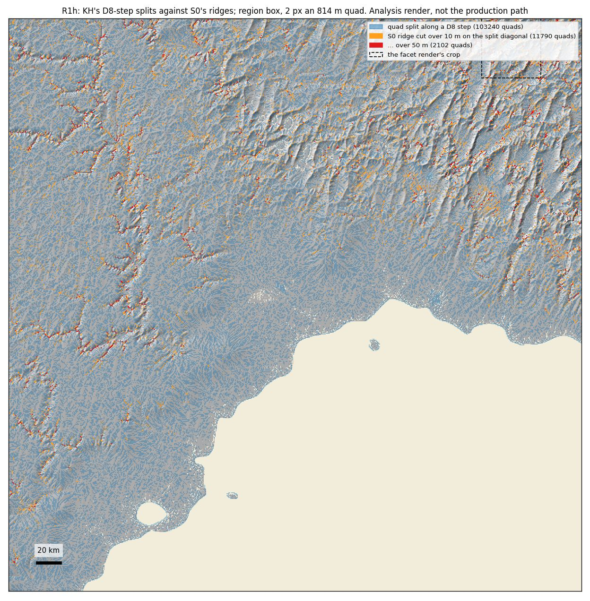
R1h: the cuts lie along the valley sides of the hill country in the north; the plain to the south has no ridge cells on a split. The crop frame sits in the top-right corner, under the legend.

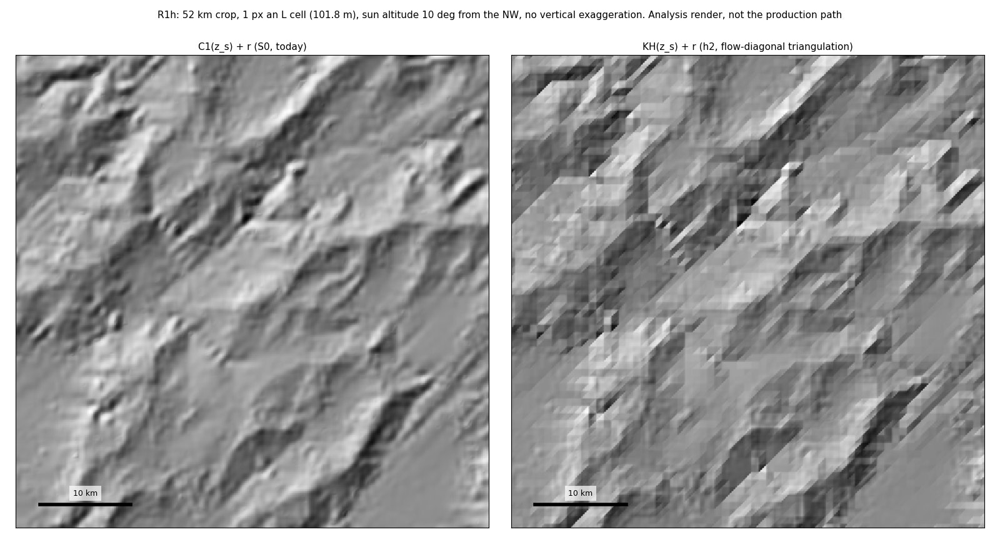
R1h: KH's flat triangles and NE-SW stripes, where `S0` is smooth.

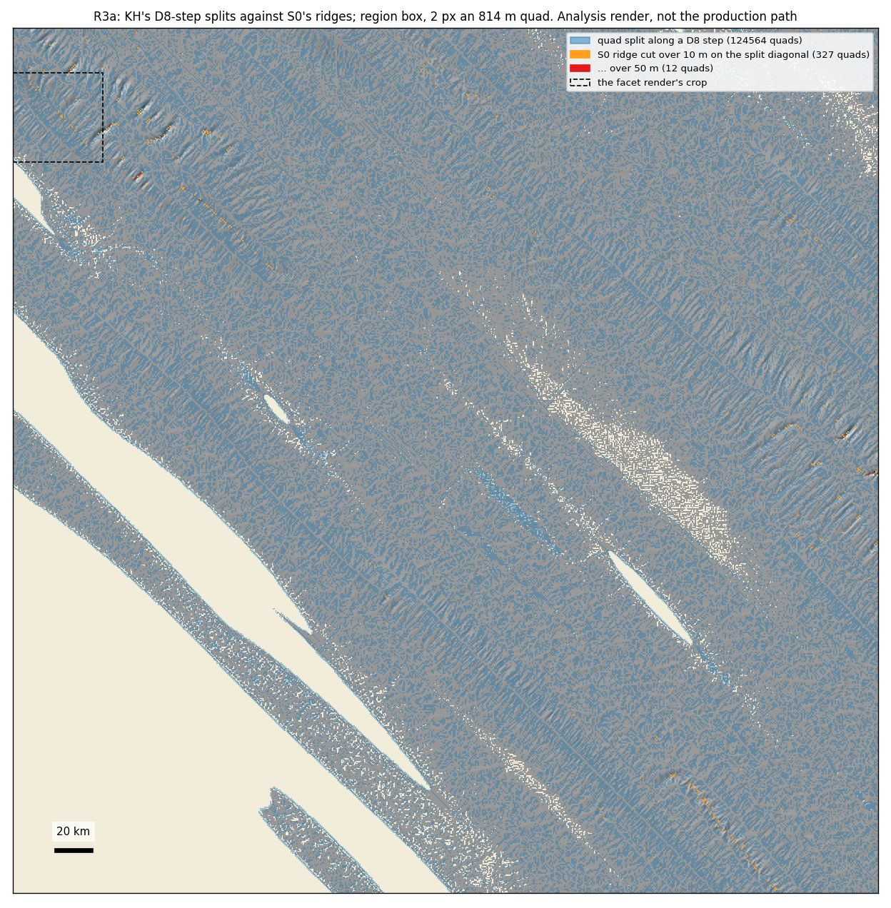
R3a: few ridge cuts (12 quads over 50 m).

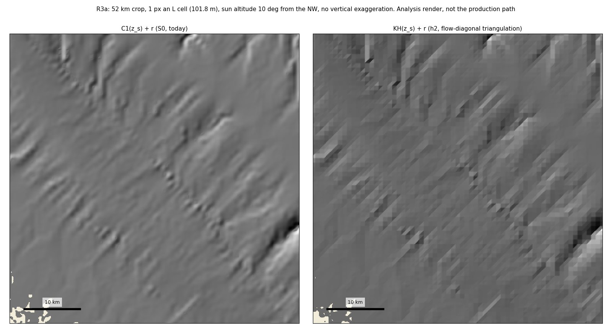
R3a: the facets show even in 42 m of relief.

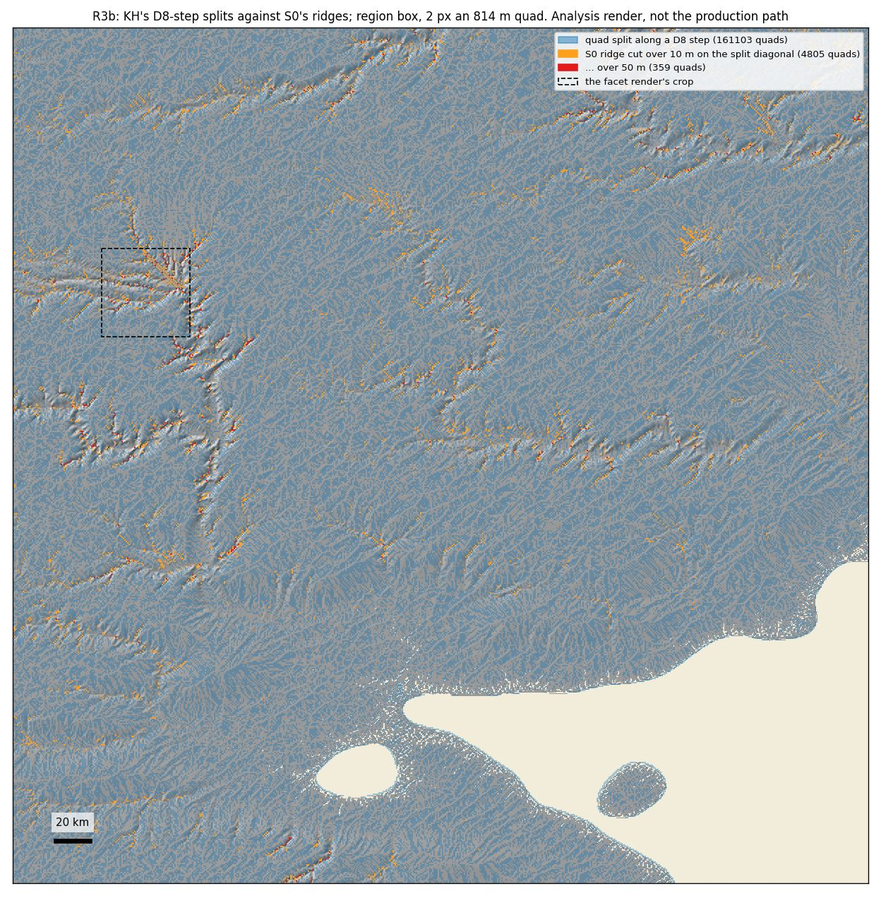
R3b: cuts on the valley sides of the dissected plateau.

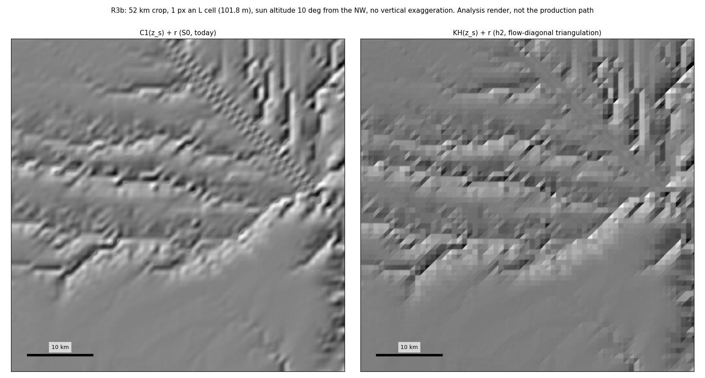
R3b: KH's triangles along the valleys, where `S0` shows soft ridges.

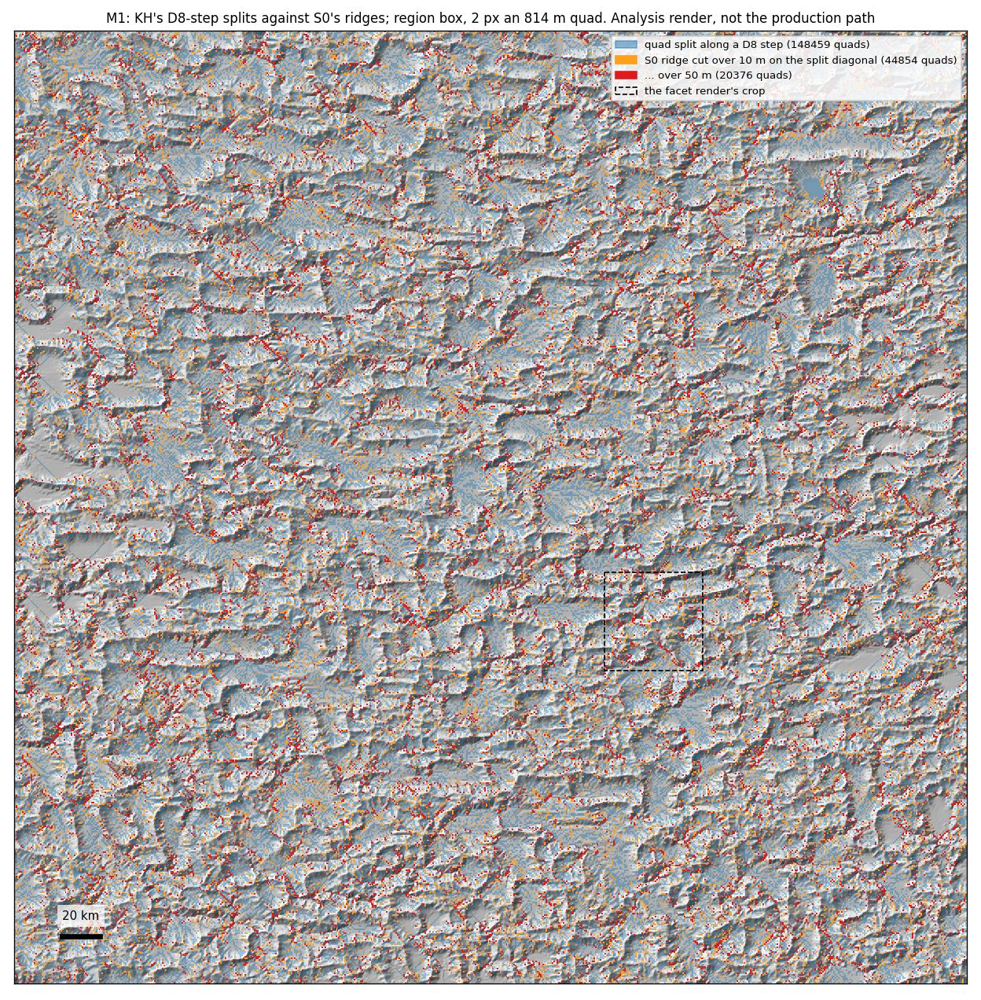
M1: ridge cuts in every valley (20,415 quads over 50 m).

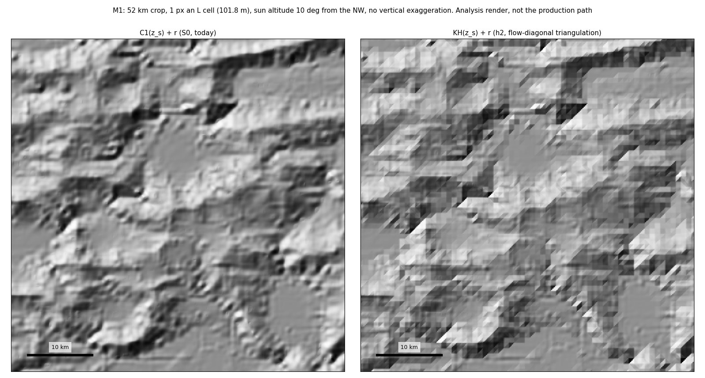
M1: KH's triangles across the whole crop (814 m quads; p50 1 km relief 499 m).

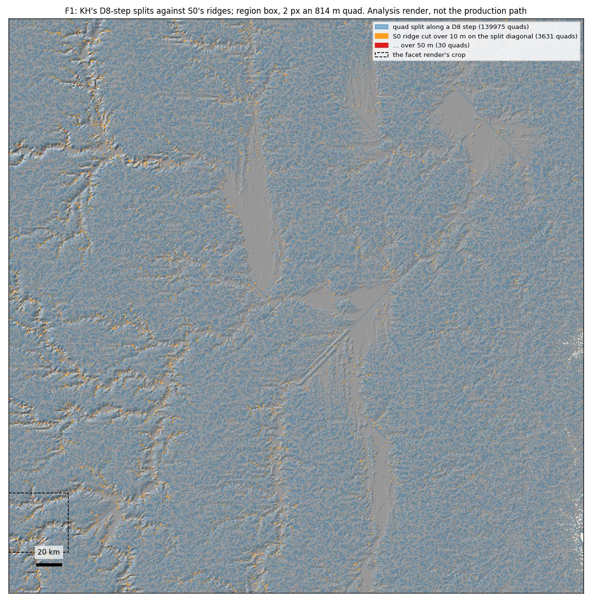
F1: cuts on the valley sides; 30 quads over 50 m.

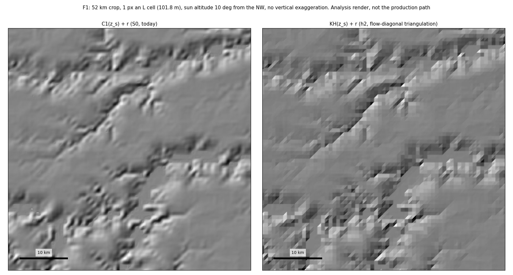
F1: diagonal stripes along the main valley and triangles on the hills.

### Reproduce (addendum)
- On `spike/kh-stage`: `cargo test -p planet-generators --test it kh_g0 -- --nocapture`.
- Chain: `cargo xtask heavy target/release/examples/rg_chain.exe --window <w> --out <dir> --tag <tag> --kh h2 [--ks ks0 --skip kg-trunk,basins,kg-trib,kv,kc] [--regions 2]`.
- Ridge check: `cargo xtask heavy target/release/examples/kh_ridge.exe --window <w> --out <dir> --tag <tag>`.
- Images: `python tools/kh_sheets.py <ridge dir> <SPIKE-136 handover dir> <tag> <name> images/`.

## Addendum 2: two smooth forms of KH (lead #138, 2026-11-17)
Question: which smooth form of KH keeps h2's drainage without its facets?
- h3, the skeleton: `C1(z_s)`, lowered only along each D8 diagonal step.
- h4: Clough-Tocher patches on h2's split.

Time box: half a day (used: about 2 h).

Code location: branch `spike/kh-stage` @ 38ed92c3 (never merged):
- `crates/generators/src/bake/kh.rs`: `read_skeleton` (h3), `read_ct` and `gradients` (h4), with unit tests. h4 reproduces a plane and is continuous across the split and the quad edges, tested without the monotone clamp; only `kh_smooth`'s step check exercises the clamp. h3 lowers to the step line, leaves other cells and never raises.
- `crates/cache/examples/kh_smooth.rs`: SPIKE-136's `handover.rs` with h2, h3 and h4, the overshoot and step checks, and #137's render crops.

### The forms
| Form | Definition |
|---|---|
| h3 | `C1(z_s)` at every L cell, lowered toward each D8 diagonal step line of `z_s` (the segment between the two H1 cell centres) to the line's linear value at the cell's projection: fully within 1 L cell of the line, falling off smoothly (smoothstep) to no change at 2 L cells; never raised. Quads without a diagonal step stay `C1(z_s)`, except within 2 L cells of a step line's end, where the band reaches into the neighbouring quads |
| h4 | Reduced Clough-Tocher on h2's split. Each triangle is three cubic Bezier patches about its centroid, the normal derivative linear along each outer edge. Gradients: central differences of `z_s`. On every edge that is a D8 step (diagonal or axis), the edge control points are clamped between the corner heights in order, so the control polygon is monotone. That breaks C1 at those edges' corners |

- Both are measured as SPIKE-136, with and without the raw band `r`, against `S0` and SPIKE-135's classes. Full tables: `raw/smooth-tables.md`, built by `tools/smooth_tables.py raw r1h r3a r3b m1 f1` from `raw/smooth-ladder-<w>.csv` and `raw/smooth-handover-<w>.csv`. Runs: 441-675 s, peak 6.3 GB (`raw/smooth-peaks.txt`).

### Results
River length (75 km2 channels) on closed depressions, all / over 5 m deep, %:

| Surface | R1h | R3a | R3b | M1 | F1 |
|---|---|---|---|---|---|
| `S0` | 76.5 / 65.0 | 74.9 / 37.2 | 68.8 / 52.4 | 89.1 / 88.5 | 80.4 / 71.1 |
| h2 + `r` | 47.6 / 27.3 | 51.3 / 0.6 | 24.3 / 7.2 | 66.4 / 63.3 | 53.8 / 39.5 |
| h3 | 12.1 / 1.2 | 31.9 / 0.0 | 10.6 / 0.0 | 17.1 / 12.2 | 46.5 / 40.2 |
| h3 + `r` | 49.6 / 23.4 | 54.4 / 0.7 | 27.4 / 2.6 | 67.2 / 62.8 | 58.1 / 40.8 |
| h4 | 33.3 / 16.1 | 39.6 / 0.1 | 25.9 / 8.7 | 44.0 / 38.6 | 50.9 / 39.2 |
| h4 + `r` | 52.7 / 31.5 | 55.7 / 1.6 | 31.9 / 9.8 | 68.8 / 65.7 | 59.3 / 43.5 |

Breach volume, km3, and D-2 failures (H1 trunk reaches, of 3,094-9,804 measured):

| Surface | R1h | R3a | R3b | M1 | F1 |
|---|---|---|---|---|---|
| `S0` | 155; 352 | 17.2; 78 | 53.6; 568 | 1,645; 1,890 | 127; 525 |
| h2 + `r` | 14.0; 46 | 4.2; 1 | 1.3; 5 | 348; 864 | 109; 87 |
| h3 | 0.3; 1 | 1.6; 1 | 0.2; 1 | 143; 52 | 86.6; 52 |
| h3 + `r` | 14.1; 38 | 4.1; 1 | 0.7; 1 | 328; 838 | 98.8; 56 |
| h4 | 9.7; 30 | 3.1; 2 | 4.7; 79 | 231; 768 | 112; 82 |
| h4 + `r` | 23.0; 87 | 5.3; 3 | 5.1; 80 | 406; 1,488 | 119; 81 |

Breach volume against `S0`, % lower, and D-2 failures against `S0`, % fewer:

| Surface | Breach volume: R1h, R3a, R3b, M1 | Breach volume: F1 | D-2: R1h, R3a, R3b, F1 | D-2: M1 |
|---|---|---|---|---|
| h2 + `r` | 76-98 | 14 | 83-99 | 54 |
| h3 + `r` | 76-99 | 22 | 89-100 | 56 |
| h4 + `r` | 69-91 | 6 | 75-96 | 21 |

`S0`'s ridge cells lowered over 50 m against the reference (`C1(z_s)` without the band; the band cancels):

| Surface | R1h | R3a | R3b | M1 | F1 |
|---|---|---|---|---|---|
| h2 | 18,122 | 34 | 1,183 | 594,900 | 57 |
| h3 | 16,243 | 94 | 2,416 | 153,479 | 169 |
| h4 | 8,304 | 21 | 854 | 98,906 | 43 |

Relief kept against `S0` with the band, band std / 1 km p50 / 1 km p95, %:

| Surface | R1h | R3a | R3b | M1 | F1 |
|---|---|---|---|---|---|
| h2 + `r` | 95 / 97 / 96 | 94 / 93 / 97 | 94 / 97 / 96 | 95 / 97 / 95 | 94 / 96 / 95 |
| h3 + `r` | 107 / 102 / 101 | 108 / 99 / 100 | 111 / 102 / 102 | 105 / 101 / 100 | 108 / 102 / 101 |
| h4 + `r` | 104 / 101 / 101 | 105 / 102 / 100 | 107 / 102 / 102 | 104 / 101 / 101 | 105 / 101 / 101 |

- Over 100 %: h3's grooves and h4's overshoot add relief in the 200 m-1 km band.

h4's overshoot beyond the corners of its macro triangle (over 1 cm, land of the box), and h4 sampled along every D8 step (33 samples centre to centre):

| Window | Above the corners: cells (%), max | Below: cells (%), max | Steps rising over 1 mm (of the box's steps), max rise |
|---|---|---|---|
| R1h | 369,060 (2.17 %), 95 m | 292,235 (1.72 %), 66 m | 318 (of 267,606), 0.31 m |
| R3a | 392,170 (1.96 %), 20 m | 348,389 (1.74 %), 18 m | 3,782 (of 321,909), 0.15 m |
| R3b | 489,297 (2.24 %), 37 m | 285,592 (1.31 %), 34 m | 399 (of 342,995), 0.13 m |
| M1 | 506,038 (2.06 %), 227 m | 648,470 (2.64 %), 208 m | 1,140 (of 384,400), 47 m |
| F1 | 737,017 (3.00 %), 18 m | 724,081 (2.95 %), 24 m | 8,026 (of 384,372), 1.6 m |

- The rising steps are most frequent on F1 (2.1 % of its steps) and R3a (1.2 %), and rise most on M1 (47 m) and F1 (1.6 m), where `z_s` keeps closed depressions (SPIKE-135). KH's routing runs on the 1e-3 m flood, so a step inside a depression can rise on `z_s` itself, and the monotone clamp then keeps it rising. This was not traced cell by cell.
- h4 without the band puts 83,573 (R1h), 305,076 (R3a), 89,954 (R3b) and 23,358 (F1) inland land cells at or below 0 m (M1 none), where h3 puts at most 95 and `C1(z_s)` 0-1,340. The cubic patches dip below their corners (the table above); where the corners are near 0 m that leaves land at or below it. Not traced to single coast nodes.

### The look
Four panels per window, #137's crops, at a 10-degree sun: `C1(z_s)` + `r`, h2 + `r`, h3 + `r`, h4 + `r`.
- **h4 + `r` comes closest to `C1(z_s)` + `r` on every window.** The facets are gone; faint diagonal crinkles remain along the steps (R3b, F1). F1 shows a few inland patches at or below 0 m (the undershoot).
- **h3 + `r` keeps `C1`'s shapes but scratches thin diagonal grooves along every step.** They form dense parallel stripes on flat ground (R3a, F1). The grooves are 1-2 L cells wide, the width of the band.
- h2 + `r` is as in #137.

### Findings (addendum 2)
1. **h3 drains best.** Without the band it leaves 10.6-46.5 % of the river length on closed depressions, against h2's 19.2-46.7 % (SPIKE-136). D-2: 1 on three windows, 52 on M1 and F1. With the band it matches h2 + `r`.
   - It looks wrong: grooves 1-2 L cells wide along every diagonal step, visible on flat ground.
2. **h4 looks right, and drains somewhat worse than h2.**
   - With the band: breach volume 69-91 % below `S0`'s on four windows (h2 + `r` 76-98 %), and D-2 75-96 % fewer on four windows (h2 + `r` 83-99 %).
   - M1's D-2 falls only 21 % (h2: 54 %).
   - It cuts the fewest `S0` ridge cells by more than 50 m of the three: 21-98,906, against h2's 34-594,900.
3. **h4's costs:**
   - overshoot beyond the corners on 1.3-3.0 % of the land each way, up to 227 m on M1;
   - undershoot that leaves inland land at or below 0 m (R3a the most, 305,076 cells without the band);
   - rising steps inside `z_s`'s own depressions.
   - All three come from the cubic patches; none is a facet.
4. **The band stays the larger defect.** With `r` added, all three forms fall back to 24-69 % of the river length on closed depressions. KS's work on the new start is the same for each.

### Recommendation (addendum 2)
**h4 + `r` (Clough-Tocher on the flow-diagonal split, monotone step edges) becomes KS's start: it removes the facets and keeps most of h2's drainage (breach volume 69-91 % below `S0`'s on four windows).**
Before it lands:
- clamp h4 to its macro triangle's corner range: the overshoot, and the undershoot that leaves land at or below 0 m;
- floor the band at the sea near the coast (SPIKE-135);
- leave M1 to decision 5.

h3 stays the reference for drainage, for comparison. Not tested:
- the clamped h4;
- h4 with gradients from a wider stencil;
- a narrower h3 band.

### Visuals (addendum 2)
Analysis renders (CPU), not the production path: no bake of any KH form exists. #137's crops: the box's 52 km block with the largest p50 1 km relief, 1 px an L cell, hillshade at sun altitude 10 degrees from the north-west, no vertical exaggeration. Panels: `C1(z_s)` + `r` (`S0`), h2 + `r`, h3 + `r`, h4 + `r`.

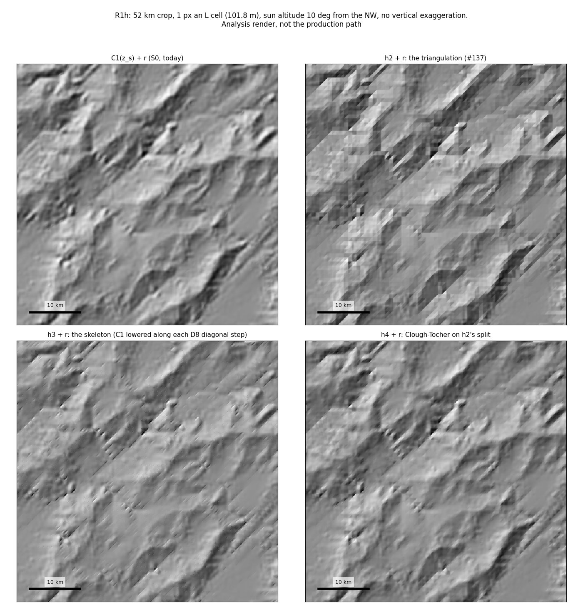
R1h: h4 close to `S0`; h3 with fine diagonal grooves; h2's triangles.

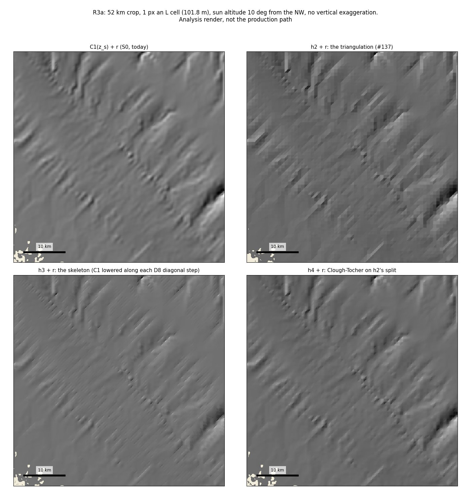
R3a, flat ground: h3's grooves as dense parallel stripes; h4 smooth.

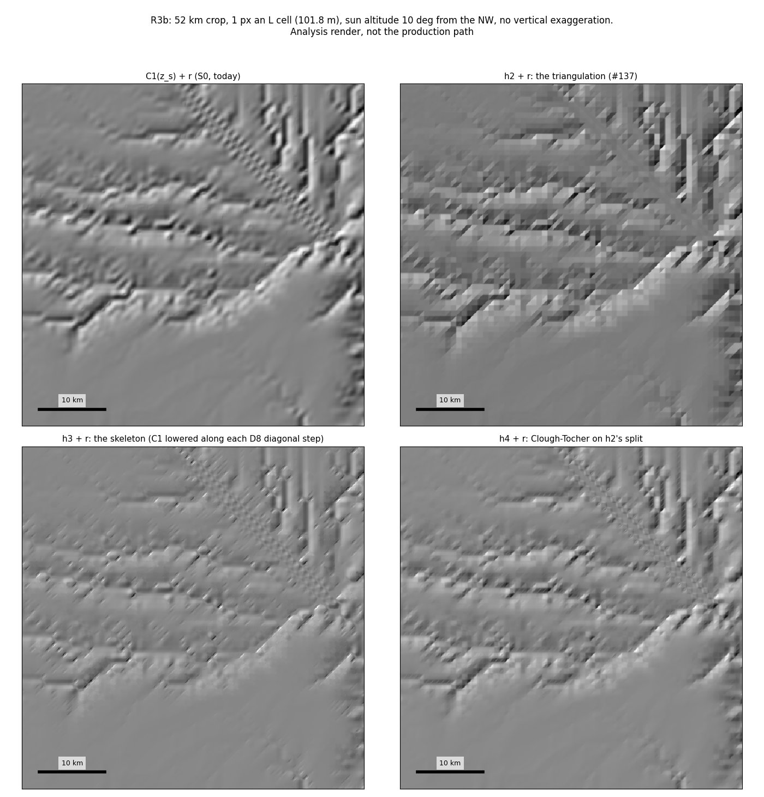
R3b: h4 with faint crinkles along the diagonal valley; h3 with grooves.

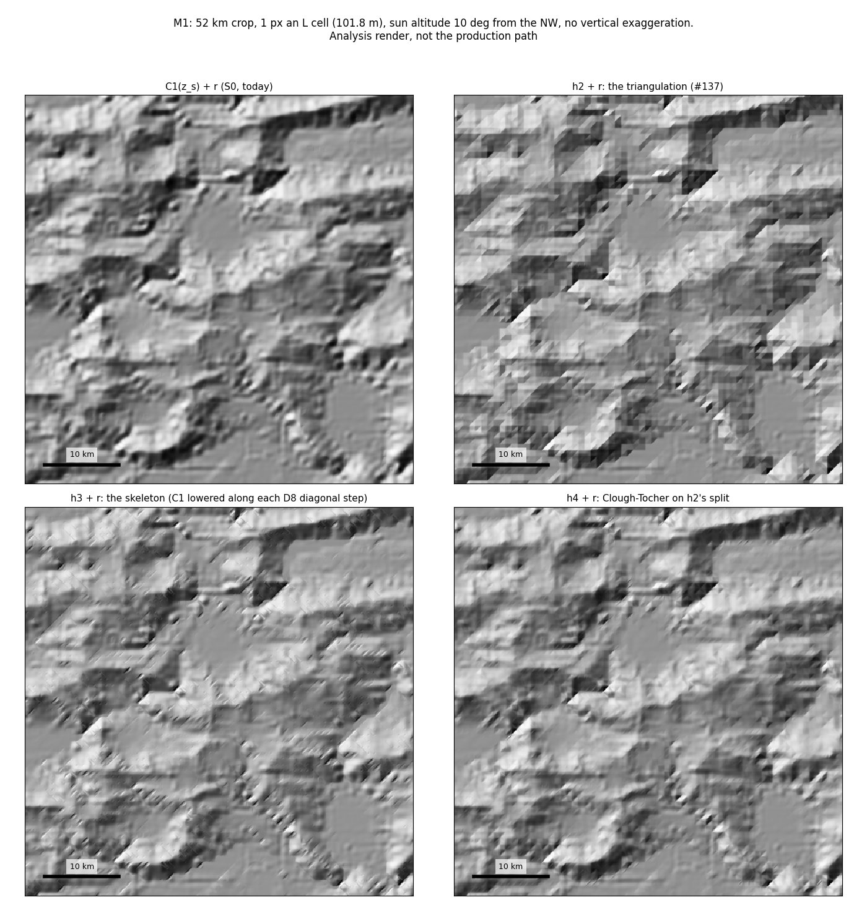
M1: h4 keeps `S0`'s mountain shapes; h3's grooves cross the slopes.

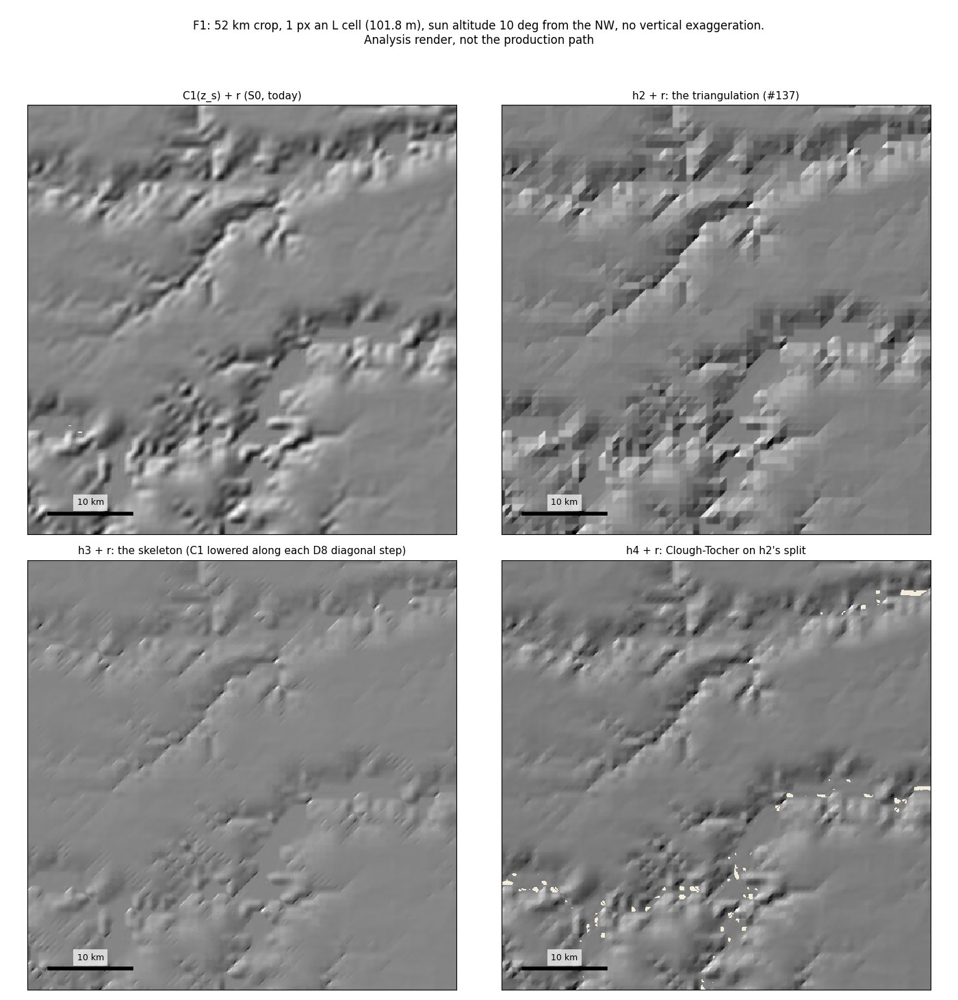
F1: h4 near `S0`, with small inland patches at or below 0 m (sand); h3's grooves on the lowland.

### Reproduce (addendum 2)
- On `spike/kh-stage`: `cargo test -p planet-generators --lib kh`.
- Runs: `cargo xtask heavy target/release/examples/kh_smooth.exe --window <w> --out <dir> --tag <tag> --crop-at <cx,cy,crop>`, with #137's crops from `kh_ridge`'s `<tag>-crop.txt`.
- Tables: `python tools/smooth_tables.py raw r1h r3a r3b m1 f1`. Sheets: `python tools/kh_smooth_sheet.py <dir> <tag> <name> <out.jpg>`.

## Addendum 3: h4 clamped per quad, h4c, as the chain default (lead #139, 2026-11-17)
Question: does clamping h4 to its quad's corners remove its overshoot and keep its drainage gain? If so, h4c becomes the RG chain runner's default.
Time box: 2-3 h (used: about 1.5 h).

Code location: branch `spike/kh-stage` (never merged):
- @ e2d792a4: `kh::read_ct_clamped` (h4c) with a unit test. The read stays within the quad's range, equals h4 where h4 does, and is monotone along a step. `kh_smooth` measures h2 + `r`, h4, h4 + `r`, h4c and h4c + `r`. `rg_chain` gains `--kh h4 | h4c`.
- @ 3a632d48: `rg_chain`'s `--kh` defaults to `h4c` (explorer told, 2026-11-17); `--kh c1` keeps today's surface.

### The form
- h4c = h4's value, clamped to the lowest and highest of its quad's four corner heights. The quad is the one whose cell centres hold the L cell.
- The macro triangle's three corners are a narrower range than the quad's four. h4c may still lie outside the triangle's range, but never outside the quad's.
- Measured as addendum 2. Full tables: `raw/h4c-tables.md`, built by `tools/smooth_tables.py --set h4c raw r1h r3a r3b m1 f1` from `raw/h4c-ladder-<w>.csv` and `raw/h4c-handover-<w>.csv`. Runs: 479-711 s, peak 6.8 GB (`raw/h4c-peaks.txt`).

### Overshoot
Beyond the corners (over 1 cm), over the land of the box; D8 steps rising over 1 mm along the step:

| Window | h4: above / below the triangle | h4: above / below the quad | h4c: above / below the triangle | h4c: above / below the quad | Rising steps, h4 and h4c |
|---|---|---|---|---|---|
| R1h | 2.17 / 1.72 % | 237,370 / 237,613 | 0.81 / 0.45 % | 0 / 0 | 318 |
| R3a | 1.96 / 1.74 % | 226,388 / 287,335 | 0.85 / 0.45 % | 0 / 0 | 3,782 |
| R3b | 2.24 / 1.31 % | 320,972 / 238,985 | 0.81 / 0.29 % | 0 / 0 | 399 |
| M1 | 2.06 / 2.64 % | 296,539 / 547,380 | 0.89 / 0.77 % | 0 / 0 | 1,140 |
| F1 | 3.00 / 2.95 % | 472,080 / 587,043 | 1.15 / 1.04 % | 0 / 0 | 8,026 |

- The clamp leaves no cell beyond its quad's corners.
- The rising steps are the same with and without the clamp: they lie inside `z_s`'s own depressions (addendum 2; not traced).
- Without the band, h4c puts 0-106 inland land cells at or below 0 m. h4 put 0-305,076.

### Drainage and ridges
River length (75 km2 channels) on closed depressions, all / over 5 m deep, %:

| Surface | R1h | R3a | R3b | M1 | F1 |
|---|---|---|---|---|---|
| `S0` | 76.5 / 65.0 | 74.9 / 37.2 | 68.8 / 52.4 | 89.1 / 88.5 | 80.4 / 71.1 |
| h2 + `r` | 47.6 / 27.3 | 51.3 / 0.6 | 24.3 / 7.2 | 66.4 / 63.3 | 53.8 / 39.5 |
| h4 + `r` | 52.7 / 31.5 | 55.7 / 1.6 | 31.9 / 9.8 | 68.8 / 65.7 | 59.3 / 43.5 |
| h4c | 14.5 / 1.7 | 31.3 / 0.0 | 12.1 / 0.0 | 20.8 / 12.7 | 45.5 / 39.0 |
| h4c + `r` | 51.4 / 25.0 | 55.3 / 1.0 | 29.6 / 2.5 | 68.3 / 64.2 | 58.7 / 41.4 |

Breach volume, km3, and D-2 failures:

| Surface | R1h | R3a | R3b | M1 | F1 |
|---|---|---|---|---|---|
| `S0` | 155; 352 | 17.2; 78 | 53.6; 568 | 1,645; 1,890 | 127; 525 |
| h2 + `r` | 14.0; 46 | 4.2; 1 | 1.3; 5 | 348; 864 | 109; 87 |
| h4 + `r` | 23.0; 87 | 5.3; 3 | 5.1; 80 | 406; 1,488 | 119; 81 |
| h4c | 0.3; 1 | 1.7; 1 | 0.3; 3 | 149; 59 | 89.0; 75 |
| h4c + `r` | 14.9; 35 | 4.2; 1 | 0.7; 4 | 338; 874 | 101; 78 |

Against `S0`: breach volume % lower, and D-2 failures % fewer:

| Surface | Breach volume: R1h, R3a, R3b, M1 | Breach volume: F1 | D-2: R1h, R3a, R3b, F1 | D-2: M1 |
|---|---|---|---|---|
| h2 + `r` | 76-98 | 14 | 83-99 | 54 |
| h4 + `r` | 69-91 | 6 | 75-96 | 21 |
| h4c + `r` | 76-99 | 20 | 85-99 | 54 |

- `S0`'s ridge cells lowered over 50 m (the band cancels):

| Window | h4c | h4 | h2 |
|---|---|---|---|
| R1h | 8,286 | 8,304 | 18,122 |
| R3a | 21 | 21 | 34 |
| R3b | 854 | 854 | 1,183 |
| M1 | 101,055 | 98,906 | 594,900 |
| F1 | 43 | 43 | 57 |

- Relief kept against `S0` with the band: band std 103-106 %, 1 km p50 99-101 %, p95 99-102 %.

### Findings (addendum 3)
1. **The clamp keeps the gain and improves on it.**
   - h4c + `r` matches h2 + `r` on breach volume and D-2 (on the river share on closed depressions it is within 5 points: F1 58.7 against 53.8 %, R1h 51.4 against 47.6 %, R3b over 5 m 2.5 against 7.2 %): breach volume 76-99 % below `S0`'s on four windows against h2's 76-98 %; D-2 85-99 % fewer on four against h2's 83-99 %; M1 54 % for both.
   - Unclamped h4 + `r` has 69-91 % and 75-96 %, M1 21 %.
   - With the clamp, R3b's D-2 falls from 80 to 4 and its breach volume from 5.1 to 0.7 km3. That the removed overshoot closed those basins is an inference, not traced.
2. **h4c keeps h4's ridge record.** It cuts the fewest `S0` ridges over 50 m together with h4 (21-101,055, against h2's 34-594,900).
3. **No new look.** The renders show h4c as h4: no facets, the faint crinkles along the steps. The clamp makes no flat tops visible at a 10-degree sun.
4. **Left:**
   - h4c still lies outside its triangle's three-corner range on 0.29-1.15 % of the land, within the quad's range;
   - the rising steps inside `z_s`'s depressions;
   - the band's pits: h4c + `r` keeps 29.6-68.3 % of the river length on closed depressions (h2 + `r` 24.3-66.4 %).

### Recommendation (addendum 3)
**h4c (h4 clamped to its quad's corners) is KH: drainage at h2's level, no facets, no cell beyond its quad's corners. It is `rg_chain`'s default on `spike/kh-stage` @ 3a632d48.** Next, before KS:
- floor the band at the sea near the coast (SPIKE-135);
- leave M1's debt to decision 5.

### Visuals (addendum 3)
Analysis renders (CPU), not the production path. #137's crops at a 10-degree sun from the north-west, 1 px an L cell. Panels: `C1(z_s)` + `r` (`S0`), h2 + `r`, h4 + `r`, h4c + `r`.

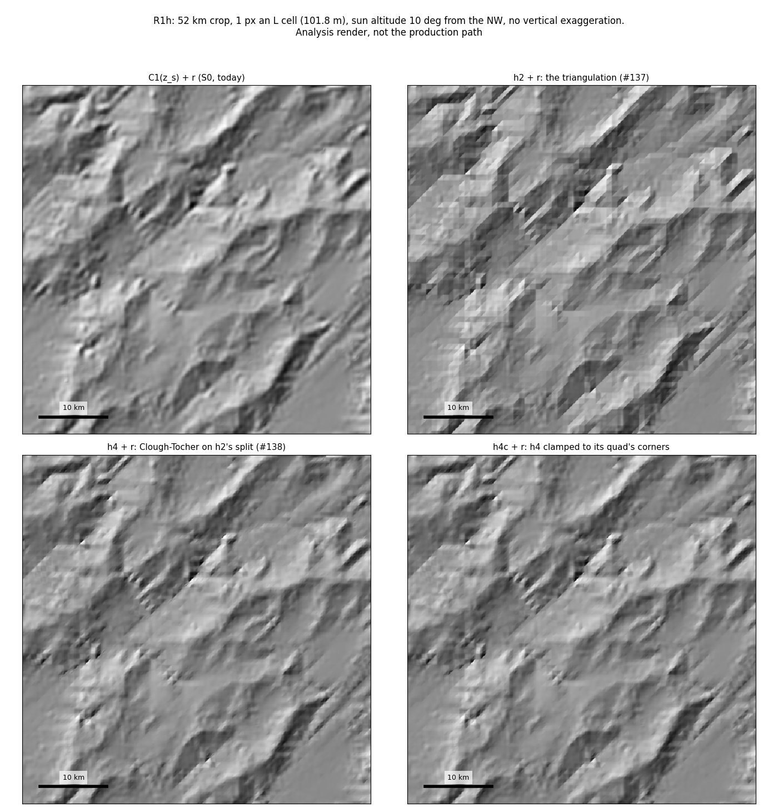
R1h: h4c and h4 alike, both close to `S0`; h2's triangles for comparison.

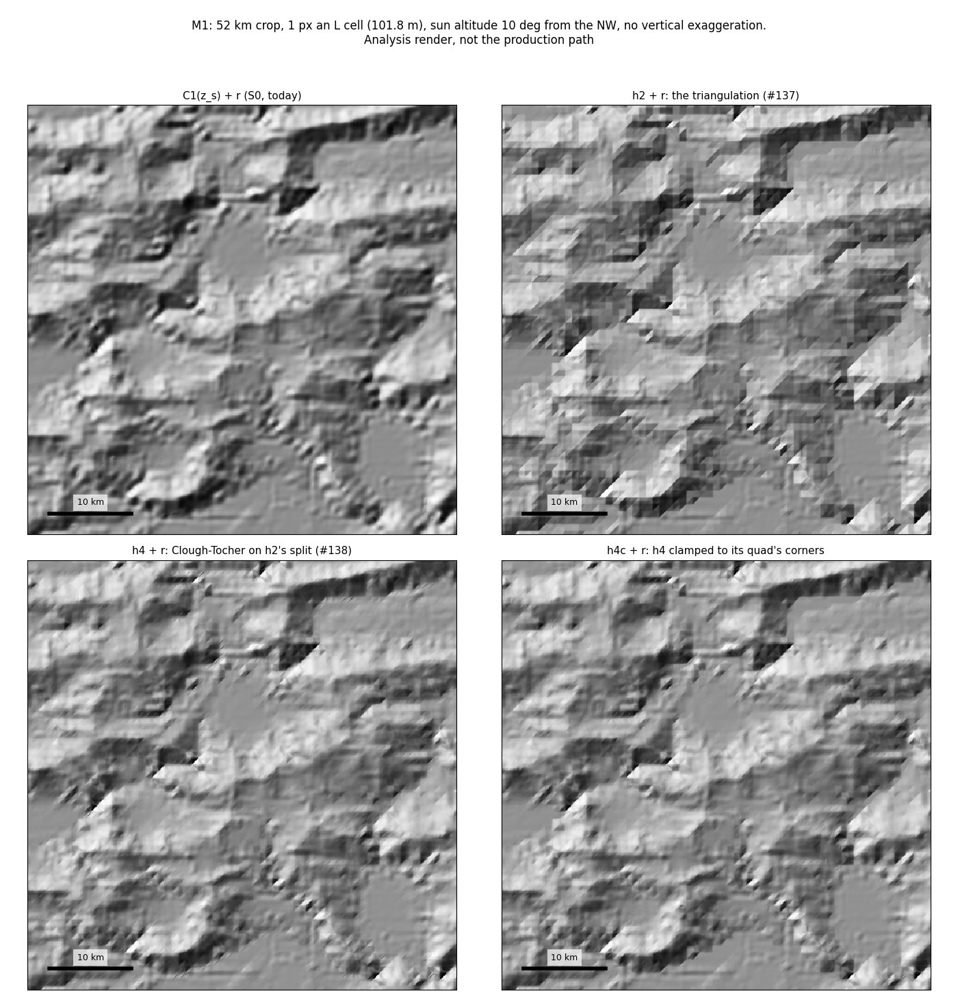
M1: h4c keeps `S0`'s mountain shapes like h4, with no flat tops from the clamp.

### Reproduce (addendum 3)
- On `spike/kh-stage`: `cargo test -p planet-generators --lib kh`.
- Runs: `cargo xtask heavy target/release/examples/kh_smooth.exe --window <w> --out <dir> --tag <tag> --crop-at <cx,cy,crop>` (@ e2d792a4).
- Tables: `python tools/smooth_tables.py --set h4c raw r1h r3a r3b m1 f1`. Sheets: `python tools/kh_smooth_sheet.py <dir> <tag> <name> <out.jpg> --h4c`.
