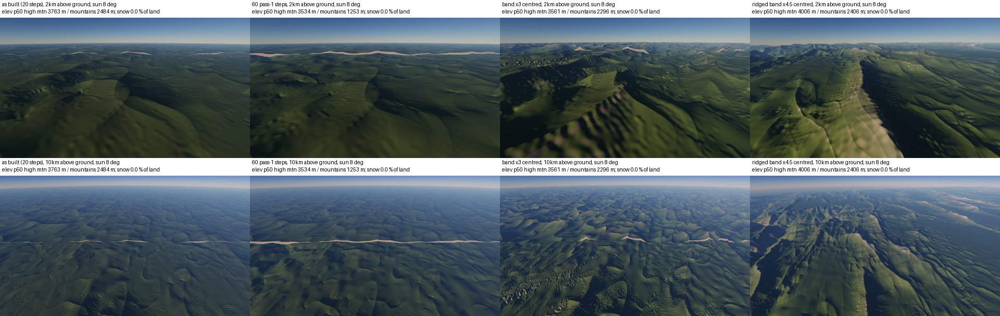

# SPIKE-101 High-mountain relief: why 0.21 of real, and the fix

Opened: 2026-11-04
Question: why does the high-mountain class reach only 0.21 of GLO-30's 3 km relief even as built (SPIKE-99), and which change (a ridged band for the high classes, a larger band amplitude, a steeper belt core, more pass-1 steps on high-mountain tiles) closes the gap without wrecking the hypsometry?
Why it matters: M9 plan item I9; the owner treats the high-mountain gap as its own item (2026-11-04; planner inbox #84).
Time box: about 1 day of agent work.
Success criteria: the cause split by term (belt core, band, erosion, class map); per candidate on seed 14's mountains tile, against the GLO-30 Alps and Everest samples: 3 km and 10 km relief p50, slope p90 and hypsometry, without and (for the best) with the erosion layer; the cost of more pass-1 steps; stills at 2 km and 10 km with a low sun, labelled; a ranked recommendation.
Fallback if it fails: record the decomposition and the gap per term as the input for R7 tuning.
Code location: branch `spike/high-mountain-relief` at cd1ae099 (from SPIKE-99's `spike/relief-driver-k`; throwaway; never merged into the main crates).

## 1. Answer

- **The base: the band's amplitude is the whole cause.**
  - Below 10 km the class source's relief comes from the hill band alone.
  - The belt term (`7800 core (0.5 + 0.5 ridge)`) has wavelengths of 130 km and up, and gives high mountains 21 m of 3 km relief. The band alone gives 214 m. Everest has 804 m.
  - The belt core and the class map are not the limit.
- **A centred band of 3x amplitude, or a ridged band of 4.5x, reaches 0.79-0.80 of Everest's 3 km relief on the base and keeps the median elevation within 230 m.** The ridged band also matches the 10 km relief (1,534 m against 1,467) and draws crest lines instead of blobs.
- **The erosion layer gives about half of it back on high mountains.**
  - With the layer, both reach 0.38 of Everest; the mountains class keeps its gain (0.74 and 0.82 of the Alps).
  - The cause is basin filling in pass 1, not thermal: pass 2 at 33 degrees, at 40 degrees and without thermal gives identical relief.
  - The band's bumps leave closed basins. Pass 1's carve keeps each cell above its receiver and breaches at most 50 m per re-route, so it lifts the basin floors. The layer raises 24-27 % of the cells, p95 +311 to +786 m, against 14 % and +124 m as built.
  - As built, all of today's raising is pass 1's: deposition and thermal add none on this tile (section 4).
- **Breaching instead of filling recovers most of it:**
  - with pass 1's breach limit raised from 50 m to 500 m, band x3 centred reaches 0.62 of Everest's 3 km relief on high mountains and 0.91 of the Alps' on mountains, with the layer;
  - the raised share halves (24 % to 11 %);
  - pass 1 ran faster (1,514 s against about 3,200 s, indicative).
- **More pass-1 steps are not the fix.** 60 steps instead of 20 cut valleys about 1.2 km deeper where drainage collects:
  - the mountains class overshoots to 1.61 of the Alps and its median drops from 2,484 to 1,253 m;
  - the high core gains little (0.37);
  - the pass-1 time rises 2.2x (indicative, with other bakes on the machine).

## 2. The base without the layer (mountains tile 2/12/10, seed 14, 101.8 m)

| Variant | High mtn 3 km | 10 km | slope p90 | elev p50 | Mountains 3 km | 10 km | elev p50 |
|---|---|---|---|---|---|---|---|
| GLO-30 (Everest / Alps) | 804 | 1,467 | 40 | 2,157 | 543 | 935 | 1,076 |
| as built | 217 (0.27) | 389 | 13 | 3,825 | 154 (0.28) | 332 | 2,745 |
| e0 alone (no band) | 21 | 70 | 1 | 3,439 | 48 | 163 | 2,471 |
| band alone (+1,000 m) | 214 | 378 | 13 | - | 138 | 258 | - |
| band x2 | 431 (0.54) | 763 | 24 | 4,199 | 283 (0.52) | 572 | 2,992 |
| band x3 | 644 (0.80) | 1,141 | 34 | 4,579 | 418 (0.77) | 823 | 3,233 |
| band x3 centred | 643 (0.80) | 1,138 | 34 | 3,594 | 414 (0.76) | 787 | 2,475 |
| ridged x4.5 centred | 636 (0.79) | 1,534 | 31 | 3,996 | 373 (0.69) | 966 | 2,579 |
| core ridges 1,500 m (80-20 km) | 228 (0.28) | 442 | 13 | 3,795 | 159 (0.29) | 352 | 2,770 |

Relief p50 and elevation in metres, slope in degrees; ratio to the reference in brackets.

- The band's noise has a mean of about 0.45. A larger band therefore lifts the median elevation (+750 m at 3x); centring the noise (minus 0.45 on the mountain classes) keeps it.
- GLO-30's elevation columns are whole 1-degree tiles (Everest's includes the Nepal foothills); the generator's are one class. Compare the shift between variants, not the absolute value.

## 3. With the layer (pass 1 at 12,288 with MFD and the C1 read, pass 2 standard, coast fade 3 m)

| Variant | High mtn 3 km | 10 km | slope p90 | elev p50 | Mountains 3 km | 10 km | slope p90 | elev p50 |
|---|---|---|---|---|---|---|---|---|
| as built, 20 steps | 170 (0.21) | 298 | 12 | 3,763 | 292 (0.54) | 659 | 26 | 2,484 |
| as built, 60 steps | 300 (0.37) | 558 | 33 | 3,534 | 874 (1.61) | 1,576 | 40 | 1,253 |
| band x3 centred | 305 (0.38) | 517 | 26 | 3,561 | 401 (0.74) | 767 | 30 | 2,296 |
| ridged x4.5 centred | 305 (0.38) | 741 | 27 | 4,006 | 447 (0.82) | 993 | 31 | 2,406 |
| band x3 centred, pass 2 without thermal | 307 (0.38) | 519 | 26 | 3,561 | 402 (0.74) | 772 | 30 | 2,297 |
| band x3 centred, pass 2 at 40 degrees | 306 (0.38) | 519 | 26 | 3,561 | 402 (0.74) | 772 | 30 | 2,296 |
| **band x3 centred, breach 500 m** | **500 (0.62)** | 817 | 31 | 3,311 | **493 (0.91)** | 882 | 31 | 2,162 |
| band x3 centred, breach 500 m, pass 1 only | 516 (0.64) | 838 | 31 | 3,305 | 500 (0.92) | 889 | 32 | 2,158 |

## 4. Where the layer raises the ground

The share of cells raised by more than 0.5 m, and the raise's p95 and maximum (m), on the tile core (3072^2 cells):

| Variant | Raised | p95 raise | max raise | mean change |
|---|---|---|---|---|
| as built, pass 2 standard | 13.7 % | 124.5 | 302.3 | -134.2 |
| as built, pass 2 without deposition | 13.6 % | 124.0 | 302.3 | -135.3 |
| as built, pass 1 only (no thermal, no deposition; the local carve only lowers) | 13.6 % | 124.0 | 302.3 | -135.3 |
| band x3 centred, pass 2 standard | 24.0 % | 553.5 | 1,167.8 | -119.1 |
| ridged x4.5 centred, pass 2 standard | 27.2 % | 1,185.3 | 1,708.9 | -82.2 |
| band x3 centred, breach 500 m, pass 2 standard | 11.0 % | 244.3 | 752.2 | -231.6 |
| band x3 centred, breach 500 m, without deposition | 10.8 % | 239.2 | 719.9 | -234.5 |
| band x3 centred, breach 500 m, pass 1 only | 10.8 % | 239.2 | 719.9 | -234.5 |

- As built, all of the raising is pass 1's: deposition adds 0.1 % of cells and thermal none. Explorer's pit fix (#58.2) on deposition's lake fill therefore changes little on this tile; the fill is in the carve.
- With the band and breach 500 m, deposition adds 0.2 % of cells and the same p95: the fill is pass 1's in every variant.
- Breach 500 m halves the raised share (24 % to 11 %) and the p95 raise (554 to 244 m); the pass-1 time was 1,514 s against 3,223-3,320 s with breach 50 m (indicative, shared machine): fewer floods, not more work.

## 5. Recommendation (ranked)

1. **Breach before fill in pass 1** (the largest lever with the layer):
   - raise `breach_max_m` from 50 m to about 500 m, or scale it with the local relief so plains keep 50 m;
   - with band x3 it lifts high mountains from 0.38 to 0.62 of Everest and mountains from 0.74 to 0.91 of the Alps;
   - it halves the raised share and makes pass 1 faster here.
   - It applies to every class (today 13.6 % of the tile's cells are raised by up to 302 m), so it changes the layer everywhere: a bake parameter for R4, checked on the scorecard sites.
2. **A larger, centred band on the mountain classes:**
   - the ridged multifractal x4.5 (crest lines, the best 10 km relief: 1,534 m against 1,467 on the base, 993 m against 935 with the layer), or the plain band x3 (simpler, bumpier);
   - centred, so the median holds.
   - The ridged band with breach 500 m was not run; it is the next candidate to measure (one pass 1).
3. **Not more pass-1 steps:** 60 steps overshoot the mountains (1.61) and lower their median by 1.2 km while the high core stays at 0.37; 2.2x the pass-1 time.
4. **Not the repose angle, not core ridges:** thermal at 33 or 40 degrees or off changes nothing measurable; mid-scale core ridges add 3 % at 3 km.
- What remains with 1 + 2: high mountains at about 0.62 of Everest's 3 km relief and slope p90 31 against 40 degrees. The rest is the steepest share SPIKE-85 assigns to other technology above 45 degrees, and the 101.8 m grid.

## 6. Method

- **Code** (spike branch): experiment switches in `bake/experiment.rs` read by `ClassSource`:
  - the band amplitude times `--band-scale` on the mountain classes (blended by their weight);
  - `--ridged`: a ridged multifractal (Musgrave) at 16, 8, 4, 2 and 1 km;
  - `--centre`: the noise minus its mean;
  - `--mid-amp`: ridges of 80-20 km in the core;
  - `--parts`: the decomposition.
  - `stair_exp` takes the same switches plus `--steps`, `--breach-max` and `--pass2-variants std,nothermal,nodeposit,p1,thetaNN`, so one pass 1 serves several pass 2s. `erosion_stills` takes them plus `--sun-deg` and a 10 km pose.
- **Statistics:** `relief_stats` (SPIKE-99) on the 3072^2 core at 101.8 m. The class of a cell is the argmax of the lattice weights. GLO-30 is SPIKE-99's (Everest N27 E086, Alps N47 E011; see `NOTICE.md`).
- **Runs** (UTC, `runs.log`):
  - A (no layer) 08:54-09:10 and later;
  - B (layered) 09:12-13:13, 13:30-14:35 and 14:40-16:11;
  - D (stills) 13:20-13:56.
  - Other lanes' bakes shared the machine throughout (explorer's class-store bake from 10:44, its pass 1 later), so every time here is indicative.

## Visuals

Mountains tile 2/12/10, stills tool (`erosion_stills`; spike branch, not the product path, because the candidates exist only there). The layer is read C1 with the coast fade; sun 8 degrees; rows 2 km and 10 km above each base's own ground.
- Each caption gives the class's median elevation and the share of the land drawn as snow (near-white pixels); it is 0 % in every column, so no candidate pushes the ground into snow here.
- As built and 60 steps: rounded green hills; the pale strips at the horizon are flat filled basin floors, widest at 60 steps.
- Band x3 centred: steeper but bumpy forms.
- Ridged x4.5 centred: crest lines, a shadowed flank and ranges that connect: ridges, not blobs.
