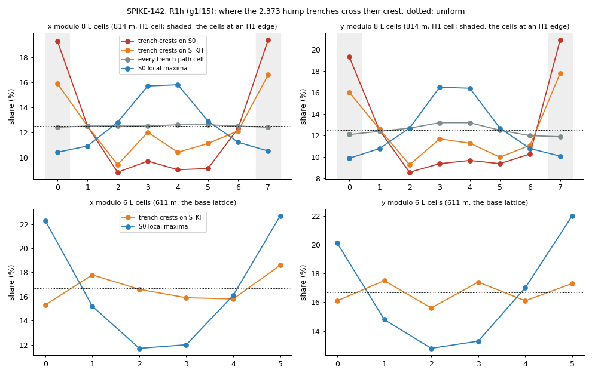

# SPIKE-142: hump trenches against the base's lattice bumps

Opened: 2026-11-23 (lead #173; owner, 2026-11-23: diagnose with a spike)
Question: Do the humps that RG's trenches cut through (R1h: 2,373 trenches over 10 m through S_KH humps over 10 m, spikes #170) come from lattice-scale bumps in the start surface (the base's 611 m facets, K5's 814 m relief, the diamond pattern) or from real relief?
Why it matters: G3's pre-port item "hump trenches"; the source-stage fix depends on which layer makes the humps.
Time box: 1 day of agent work.
Success criteria: the crest histogram against the 611 m and 814 m lattices, the layer attribution, and the smooth-base row.
Fallback if it fails: the trenches stay a known G3 item.
Code location: `spikes/hump-lattice/results/raw/` (lattice173.py to lattice173d.py and plot173.py, on g1f15's R1h chain dumps); the chain is `spike/rg-prototype` faa923f0.
Status: closed 2026-11-23; addendum (#174, #174a) the same day: the three switch forms rejected.

## Answer
- No base-lattice source. The trench crests show no 611 m phase (chi2 48.7, df 35), although S0's local maxima carry one (chi2 3,559).
- The smooth base is already in the chain: rg_chain reads the base lattice with `read_elevation_c1` (GEN-107, `cpu-erosion-v2`'s reader). g1f15 is therefore the smooth-base row, and the 611 m facets are not in RG's base.
- 78 % of the humps are K5 relief at 814 m: z_s's ridges and cols between H1 valleys, p50 45 m of the hump's 56 m. They are real relief at the H1 scale, not a checkerboard: z_s has strict 4-neighbour extrema in 3.8 % / 3.6 % of H1 cells, where a checkerboard would have 50 %.
- 22 % of the crests sit at an H1 cell corner (uniform 6.25 %, 3.5x), and 82 % of those at an H1 saddle block, where one diagonal pair of H1 cells stands above the other.
  - That is H1's D8 routing stepping diagonally between two higher H1 cells; read bilinearly at L, the step crosses a col.
  - It is the H1 analogue of the L corner-only link (SPIKE-141, reading 38). KH's split reduces it (S_KH crests at a corner 14.9 %) but does not remove it.
- Fix candidate (not built, cost unmeasured): 4-connected H1 trunk routing, or KG-trunk's L image routed around an H1 saddle block through the lower orthogonal cell. This reaches the 22 %.
- The 78 % are cols the chain breaches because the H1 graph crosses them. Their fix is the hump-aware breach and KV rule of #170 (candidate b), not the start surface.

## Method
- Input: g1f15's R1h chain (`tmp/g1f15/r1h-exit-chain`; s170's defaults row is bit-equal to it): S_KH (`kh`), the final surface, S0, the base B at L, z_s at H1.
- Trenches: the 8-connected sets of cells the chain lowered by over 0.25 m from S_KH to the final surface, inside the box (1,600-cell margin). A trench cuts over 10 m through an S_KH hump over 10 m: the path's highest S_KH above its highest degree-1 end. This is #170's definition; it gives 2,373 of 112,482 paths.
- Crest: the path cell highest on a layer. Phase: its global L cell index modulo 6 (611 m, the base lattice: 6 L cells per node) and modulo 8 (814 m, one H1 cell).
- References: every trench path cell (the paths' own bias), S0's 3 x 3 local maxima, and every eighth land cell of the box.
- Layers: S0 = B + r, with r K5's regional delta; S0 = Z + rho, with Z z_s read bilinearly at L and rho the sub-814 m detail. Each hump is split at its S0 crest against its highest end.

## Numbers (R1h)
- Trench paths: 2,373. Size p10 10, p50 22, p90 78, max 13,132 cells; 1,918 under 50 cells.
- Hump on S0: p10 14.6, p50 55.9, p90 198.0 m.
- Crest height above S0's 1 km (11 x 11 cell) mean: p50 -3.7 m. 98 % of crests are neither a peak nor a pit of their 3 x 3 (a saddle or a slope): the path's highest point is a col it crosses, not a summit.

| Phase test | trench crests | S0 local maxima | reference |
|---|---|---|---|
| modulo 6 (611 m), chi2 against land | 48.7 (df 35) | 3,559 | - |
| modulo 8 (814 m), chi2 against land | 448 (df 63) | 2,145 | - |
| S0 crest within one cell of an H1 edge | 56.9 % | 36.5 % | uniform 43.8 %, path cells 40.7 % |
| S0 crest at an H1 corner (x and y at an edge) | 21.8 % | - | uniform 6.25 % |
| S_KH crest at an H1 corner | 14.9 % | - | uniform 6.25 % |
| B crest within one cell of an H1 edge | 44.8 % | - | uniform 43.8 % |
| r crest within one cell of an H1 edge | 46.1 % | - | uniform 43.8 % |

| Layer of the S0 hump (crest against highest end) | p10 | p50 | p90 | carries over half |
|---|---|---|---|---|
| Z (K5's z_s, bilinear) | 1.2 m | 44.5 m | 181.6 m | 78.7 % of trenches |
| rho (sub-814 m detail) | -4.7 m | 10.4 m | 39.5 m | 21.0 % |
| B (the base at L) | -12.0 m | 30.2 m | 156.6 m | - |
| r (K5's delta) | -48.6 m | 21.2 m | 133.5 m | - |

- Humps over 50 m: 1,272 (54 %). Z carries over half of 93 % of them.
- Corner crests: 518, of them 426 (82 %) on an H1 saddle block (z_s's 2 x 2 H1 block around the corner, one diagonal pair above the other).
- Median share of the S0 hump carried by Z: 83 %; by rho: 17 % (2,366 trenches with a positive S0 hump).
- Sources: `raw/r1h-lattice.txt` (lattice173.py), `raw/r1h-lattice-b.txt` (lattice173b.py), `raw/r1h-layers.txt` (lattice173c.py), `raw/r1h-corners.txt` (lattice173d.py, the corner, saddle-block and over-50 m figures).

## Step 3: the smooth-base row
- Not run as a separate row. rg_chain's base reads its 16,384-per-face lattice (611 m) with `read_elevation_c1`, GEN-107's C1 reader (`cpu-erosion-v2`), since the runner's first commit (62819068).
- g1f15 and spikes #170's defaults row are that row: hump trenches 2,373 from S_KH to final.
- The bilinear blend's 611 m pyramid facets are main's default bake read (draft #1137), not RG's.

## Recommendation
- No base smoothing and no K5 hillslope term for these trenches: neither layer has a lattice in the trench crests.
- Source-stage fix for the 22 %: H1's diagonal D8 steps across saddle blocks, in the H1 routing or in KG-trunk's L image. Measure it on R1h before the port.
- The 78 % are the chain breaching K5's real cols where the H1 graph crosses them. They belong to the breach and valley rules (#170 candidate b).

## Addendum 2026-11-23: the 22 % as switches (lead #174, #174a)
- Chain: `spike/rg-prototype` 7fe4e73d (readings 43 and 44) plus the lane's local switches, all off by default (spike/rg-prototype-spikes bc751b99, 81294152). Gate main cd84f36a.
- Reference: a fresh R1h defaults row on that tip, with 2,369 hump trenches (SPIKE-142's g1f15 row had 2,373) and S0 corner crests at 21.9 %.

### Where the corner crests are cut (R1h defaults, `raw/s174-r1h-def-corner-stages.txt`)
| Stage (pre -> post) | trenches | S_KH crest at an H1 corner (uniform 6.25 %) |
|---|---|---|
| KS0 | 505 | 12.7 % |
| KS1 | 720 | 6.5 % |
| KS connect | 22 | 22.7 % |
| band6 | 928 | **39.3 % (365)** |
| band6 connect | 136 | **44.1 % (60)** |
| KV | 535 | 4.5 % |
| S_KH -> final | 2,369 | 15.0 % (355) |

- Band6 makes the corner-crest trenches. An H1 diagonal step across a saddle block leaves an L col at the corner, the depression behind it closes at L, and band6 breaches it through the corner.
- Band6's 365 corner blocks (`raw/s174-r1h-def-band6-corners.txt`): 353 on a z_s saddle block; 347 of those with a D8 step of z_s along the low pair; 63 with both low cells H1 channel cells.

### Rejected forms
| Switch | What it does | R1h result | Verdict |
|---|---|---|---|
| `--trunk-saddle-ortho` | KG-trunk's L image of a diagonal H1 trunk step across a saddle block gets the lower orthogonal H1 cell as a line point | fires on 14,541 of 19,268 diagonal trunk steps; 4,653 box cells change; trenches 2,369, corner crests 21.9 %, every bar equal | rejected: no effect; the trunk's lowest-path image already went round the cols |
| `--kh-saddle-split trunk` | KH's h5 takes h4c (lower only) along diagonal trunk steps across a saddle block | all 14,519 such steps lie in KH's channel zone already; the row is identical | rejected: no-op |
| `--kh-saddle-split all` | the same for every D8 diagonal step of KH's routing across a saddle block (37,966; 17,212 in the zone already) | see the table below | rejected: fails §3 and drains most kept lakes |

| R1h (`raw/s174-*-gate.txt`, `raw/s174-analysis-kh-split.txt`) | defaults | `--kh-saddle-split all` |
|---|---|---|
| band6 trenches / corner crests | 928 / 365 | 527 / 113 (-69 %) |
| trenches S_KH -> final | 2,369 | 2,092 |
| S_KH trench crests at an H1 corner | 15.0 % | 7.5 % |
| bars passing; bar_violations | 10/11; 102 | 10/11; 101 |
| agreement 1 / 75 km2 | 92.73 / 98.26 | 92.85 / 98.32 |
| corner-only links at 5 m | 260 | 414 (+154; floor 50) |
| saddles1 against S_KH / S0 | 340 / 1,950 | 324 / 2,618 (+668; floor 195) |
| KH lowered cells | 2,306,202 | 2,663,437 |
| kept basins / kept lakes | 1,491 / 778 km2 | 155 / 97 km2 |
| kept river / basin share | 3.01 / 3.68 | 0.24 / 0.90 |

- The corner cols are also kept-basin rims. Opening them removes most of the trenches, but it also removes the kept lakes the rims hold, and it moves the cut from band6 into KH (saddles against S0 +668).
- Not run: R3a and M1 (R1h fails), and 4-connected H1 routing (not ordered).
- Finding: the corner cols are kept-basin rims. So the 22 % belongs with band6 respecting kept rims, not with KH or the trunk image (lead, 2026-11-23).
- State: #174 closed on 2026-11-23; all three forms stay off. The 22 % stays a G3 item with the 78 %.

## Visuals

- Crest phase on R1h (g1f15). Top: modulo 8 L cells (814 m). The trench crests on S0 (red) peak at the H1 cell edges (shaded); S0's local maxima (blue) peak at H1 centres; the path cells (grey) are flat. Bottom: modulo 6 L cells (611 m). The trench crests are flat, while S0's maxima carry the lattice. CPU analysis plot, no render.
