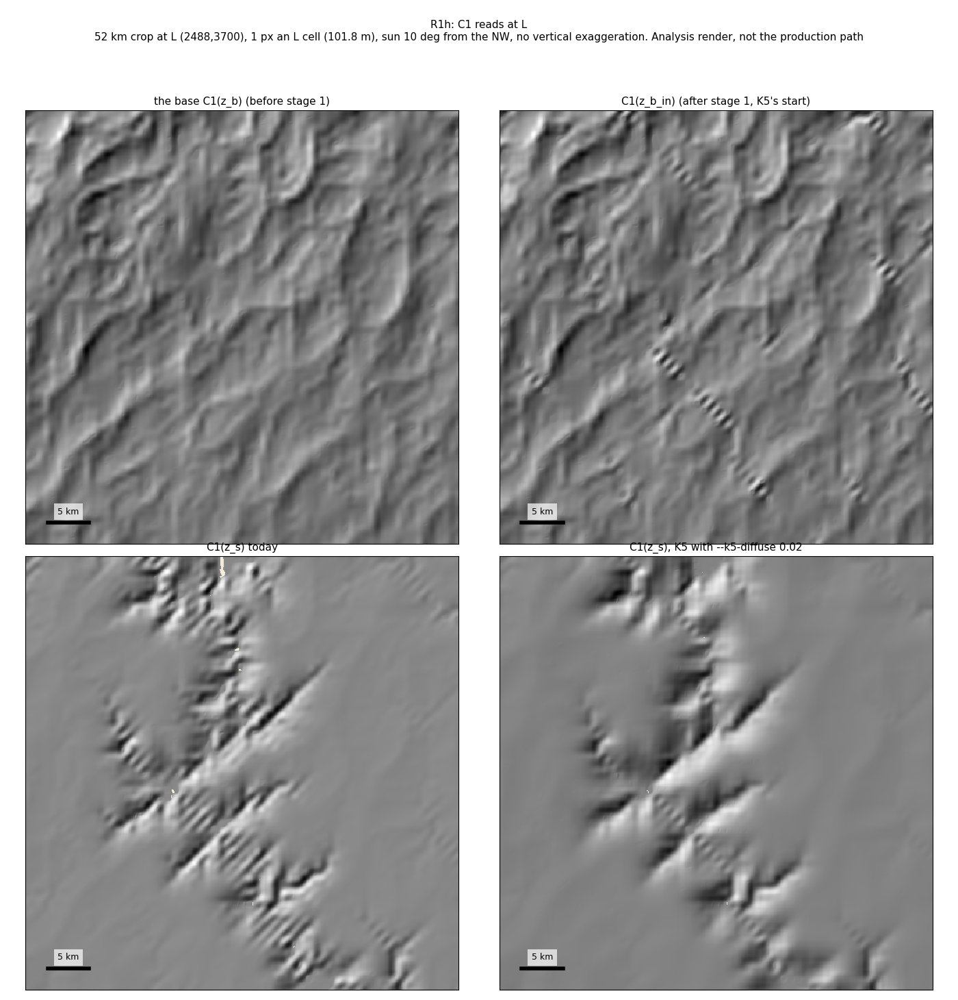

# SPIKE-139: K5's washboard on diagonal valley sides

Opened: 2026-11-18 (lead #148; owner's finding on the g1f5 sheets R1h-t1, F1-t1)
Question: Does K5's 8-direction routing make the comb of parallel ridges about one 814 m cell apart on diagonal valley sides, and which form removes it?
Why it matters: G2 waits for B2; the comb is in `z_s`, S0, KH and the final surface.
Time box: one night of lane work.
Success criteria: a measure that separates the comb from other relief; per form the measure, sheets, gate rows (G-DRAIN, uphill, corridor, agreement) and F1's diagonal channel probe, on R1h and F1.
Fallback if it fails: keep today's K5; the comb stays a known defect.
Code location: branch `spike/rg-prototype-spikes` (on `spike/rg-prototype` 3582b14e; not pushed, prepush refuses the branch); every form is an `rg_chain` switch, default off.
Status: results 2026-11-19; open for the lead's reading.

## Method
- Runner: `rg_chain` with `--stop-after-kh --dump-s0 --dump-c1` for the fields, the full chain plus `river-gate` for the gate rows; reading-30 default (GEN-140's turned noise); R1h `1,8056,8675,760,1379,14`, F1 `4,4800,5419,3300,3919,15`.
- Washboard measure (`raw/washboard2.py.txt`):
  - every 2nd H1 channel cell on a straight reach (structure-tensor coherence >= 0.6);
  - the field sampled on lines parallel to the reach, 0.4-2.0 km to each side, 48 L cells long;
  - per profile: the 600-1300 m share of the 400-4000 m power, and the band RMS;
  - binned by the reach direction, folded 0 (axis) to 45 (diagonal) degrees; values are p50s.
- Checkerboard measure (`raw/parity.py.txt`): P = (diagonal mean - 2 orthogonal mean + z) / 4 at 814 m, zero on any quadratic; RMS on cells 1-4 cells from an H1 channel.
- Relief: p50 and p90 of max - min over 9 x 9 H1 cells (7.3 km), land in the box.
- A first measure over 64 x 64 L-cell windows (isotropic band) diluted the strip along the reach (0.08 axis against 0.09 diagonal) and is not used.

## Results
Washboard band share on 40-45 deg reaches (0-10 deg in brackets):

| Read | R1h | F1 |
|---|---|---|
| C1(z_b), the base | 0.039 (0.024) | 0.034 (0.031) |
| C1(z_b_in), after stage 1 | 0.055 (0.026) | 0.121 (0.042) |
| C1(z_s), after K5, today | 0.139 (0.048) | 0.189 (0.045) |
| C1(z_s), `--base today` (no drains) | 0.120 (0.048) | 0.122 (0.061) |
| S0 | 0.150 (0.060) | - |
| S_KH (KH h5) | 0.178 (0.093) | - |

Forms, R1h (40-45 deg):

| Form | Switch | Band share | Band RMS | Checkerboard | Relief p50 / p90 |
|---|---|---|---|---|---|
| today | - | 0.139 | 2.73 m | 16.3 m | 291 / 899 m |
| read control: z_s smoothed along the contour | `--zs-read contour` | 0.129 | 1.67 m | (z_s unchanged) | (unchanged) |
| read control: 3 x 3 binomial | `--zs-read gauss` | 0.138 | 1.24 m | (z_s unchanged) | (unchanged) |
| D8-LTD (Orlandini 2003), K5 only, no jitter | `--k5-route ltd` | 0.159 | 2.26 m | 13.7 m | - |
| D-infinity (Tarboton 1997) in K5's steps | `--k5-route dinf` | 0.151 | 2.27 m | 14.8 m | - |
| hillslope term, every cell | `--k5-diffuse 0.02` | 0.086 | 0.69 m | 3.8 m | 251 / 807 m |
| hillslope term, every cell | `--k5-diffuse 0.05` | 0.058 | 0.31 m | 1.0 m | 224 / 740 m |
| hillslope term, cells under 2 km2 | `--k5-diffuse 0.02 --k5-diffuse-amax 2` | 0.116 | 1.69 m | 8.2 m | 276 / 836 m |
| hillslope term, cells under 10 km2 | `--k5-diffuse 0.05 --k5-diffuse-amax 10` | 0.119 | 0.80 m | 4.5 m | 266 / 790 m |
| checkerboard damping only | `--k5-parity 1.0` | 0.032 | 0.58 m | 1.4 m | 274 / 891 m |

F1 (40-45 deg): today 0.189; contour 0.175; LTD 0.188; D-infinity 0.203; diffuse 0.02 0.076 (relief p50 55 -> 43 m, -22 %).

Gate rows (river-gate against main's start surface, so the corridor carries step A's open item; `raw/gate-rows.txt`):

| Window | Form | Closed basins (<= 10 %) | Uphill (<= 1 %) | Corridor (>= 97.5 %) | Agreement 1 / 75 km2 (>= 90 %) | Spill missing (0) | Diagonal channel steps | Steps in runs >= 8 |
|---|---|---|---|---|---|---|---|---|
| F1 | today | 9.78 | 0.71 | 67.3 | 86.1 / 91.5 | 154 | 60.1 % | 5.1 % |
| F1 | contour | 7.63 | 0.40 | 69.0 | 87.7 / 94.7 | 149 | 60.1 % | 5.1 % |
| F1 | LTD | 10.79 | 0.68 | 67.3 | 86.2 / 91.7 | 167 | 60.6 % | 5.4 % |
| F1 | D-infinity | 9.87 | 0.70 | 67.4 | 86.0 / 91.6 | 110 | 60.6 % | 5.2 % |
| F1 | diffuse 0.02 | 0.10 | 0.06 | 73.9 | 86.1 / 96.2 | 56 | 56.6 % | 4.3 % |
| R1h | today | 12.05 | 2.58 | 76.9 | 81.8 / 86.7 | 540 | - | - |
| R1h | contour | 10.04 | 1.87 | 77.7 | 80.1 / 88.8 | 492 | - | - |
| R1h | LTD | 11.06 | 2.38 | 77.2 | 80.5 / 87.3 | 534 | - | - |
| R1h | D-infinity | 11.66 | 2.60 | 77.0 | 79.3 / 86.1 | 422 | - | - |
| R1h | diffuse 0.02 | 8.62 | 2.63 | 80.3 | 76.8 / 86.6 | 378 | - | - |

D-infinity: F1's z_s and S0 are bit-equal on 1 and 8 threads (CON-14); K5 takes 15.5 s on 8 threads and 13.4 s on 1 (the steps are sequential); the receivers form a topological order by filled height, so no iteration is needed.

## Reading
1. K5 makes the comb. The base has 0.03-0.04; K5 raises it to 0.14 (R1h) and 0.19 (F1). On F1, stage 1's breach trenches seed it (0.121 before K5; they read as diagonal bead chains).
2. The 8-direction routing is not the cause. D8-LTD and D-infinity leave the comb, the gate rows and F1's diagonal channel share as today's.
3. The cause is K5's lack of a hillslope term. Stream power alone builds 814 m checkerboard relief on valley sides (3.5-16 m RMS against 0.3 m in the base). On a 45-degree side slope every form sends all flow to the diagonal neighbour, so the two parities of diagonal chains never couple. The C1 read shows that relief as the comb along diagonals.
4. The read adds to it but does not make it. The contour and 3 x 3 reads lower its amplitude, not its diagonal share; KH h5 raises it.
5. A hillslope term on every cell removes most of the comb. `--k5-diffuse 0.02` drains F1 (0.10 % closed, 0.06 % uphill) and improves R1h's closed basins, corridor and spill, but not its uphill share or agreement at 1 km2. It costs 14 % (R1h) and 22 % (F1) of local relief.
6. Rejected:
   - `--k5-parity` fills diagonal one-cell channels but not axis ones, so drainage turns axis-aligned (a plaid look) and R1h's trunk moves onto a straight N-S line;
   - hillslope-only diffusion leaves the comb (it sits in cells over 10 km2 too).

## Recommendation
- A hillslope term in K5 (`--k5-diffuse 0.02`), with the relief won back by K5's erodibility (k_dt), measured on the five windows. Not run: it changes K5's calibration and needs the lead's ruling.
- Defaults unchanged until the lead's reading and the owner's look.

## Visuals
All panels: C1 reads at L (102 m), 52 km crops, hillshade with the sun at 10 deg from the NW, no vertical exaggeration, CPU analysis render (not the production path).

R1h: today, the contour-read control, D8-LTD and D-infinity at the owner's place on the NE-SW valley; the comb stays in every panel.

R1h: C1(z_b), C1(z_b_in) (stage 1's breach trenches as diagonal bead chains), C1(z_s) today and with `--k5-diffuse 0.02`.

R1h: today, `--k5-diffuse 0.02`, `--k5-parity 0.5` and `1.0` (axis-aligned drainage, the trunk on a straight N-S line, cells at the sea level in cream).

F1: C1(z_s) today and with `--k5-diffuse 0.02`; the axis-aligned streaks that stay are the base's (SPIKE-140).
