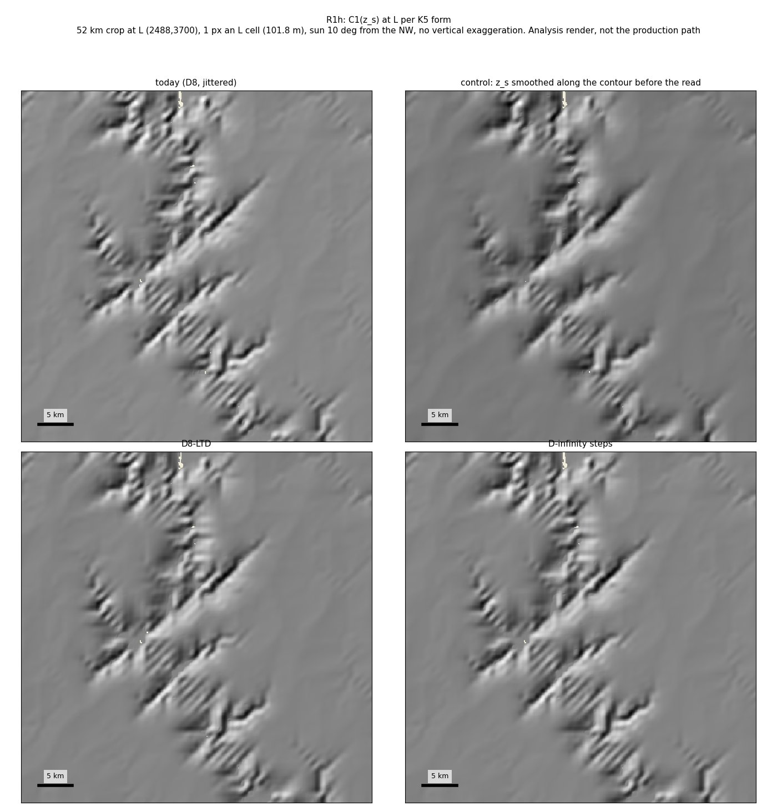
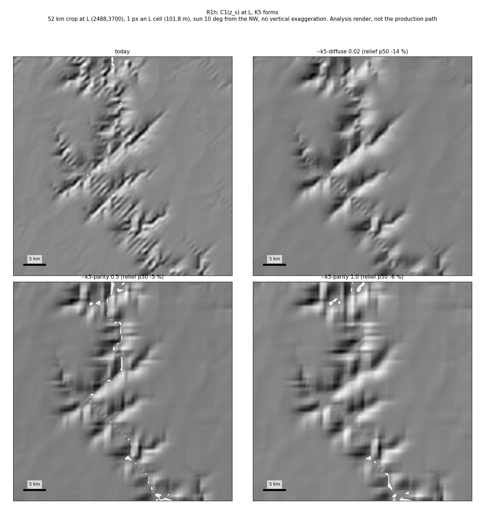
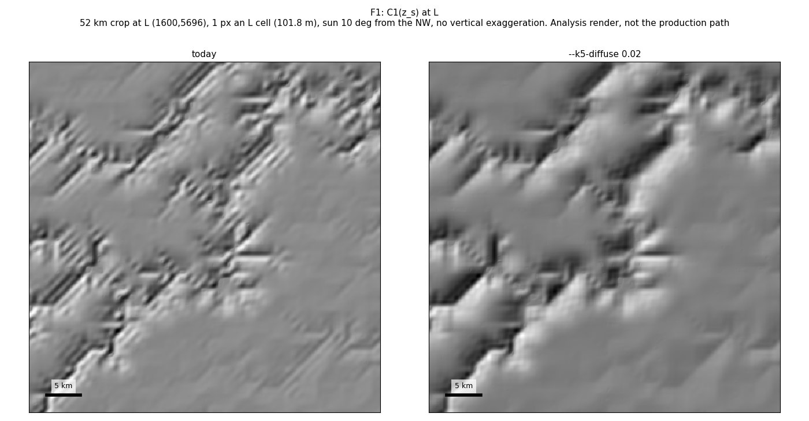
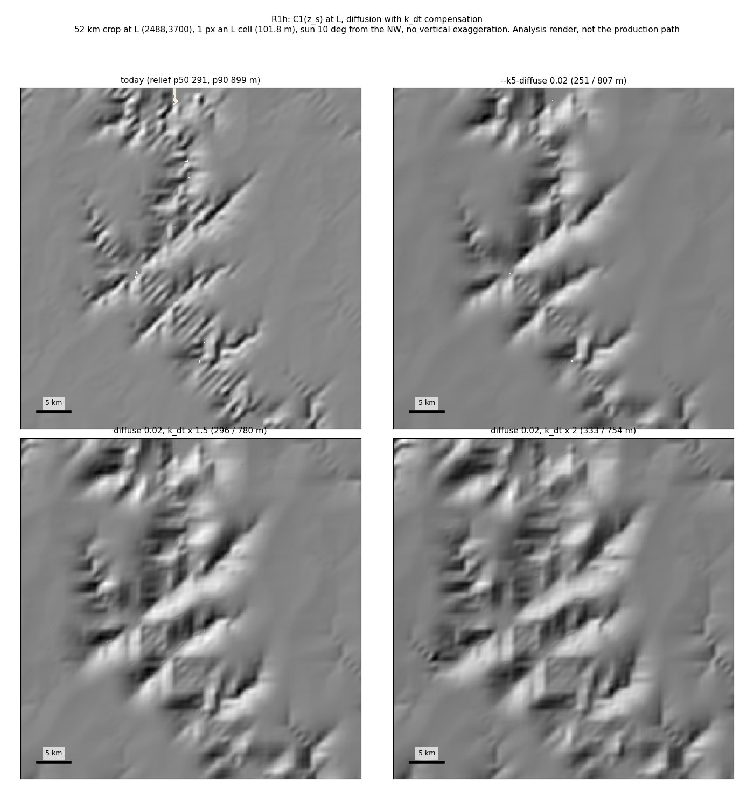
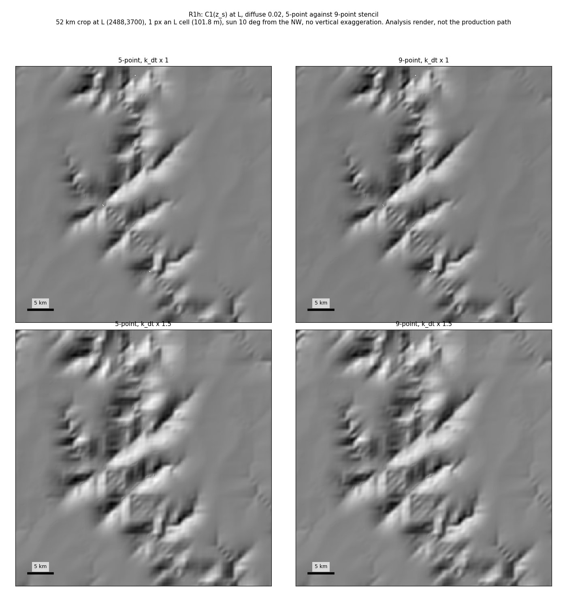
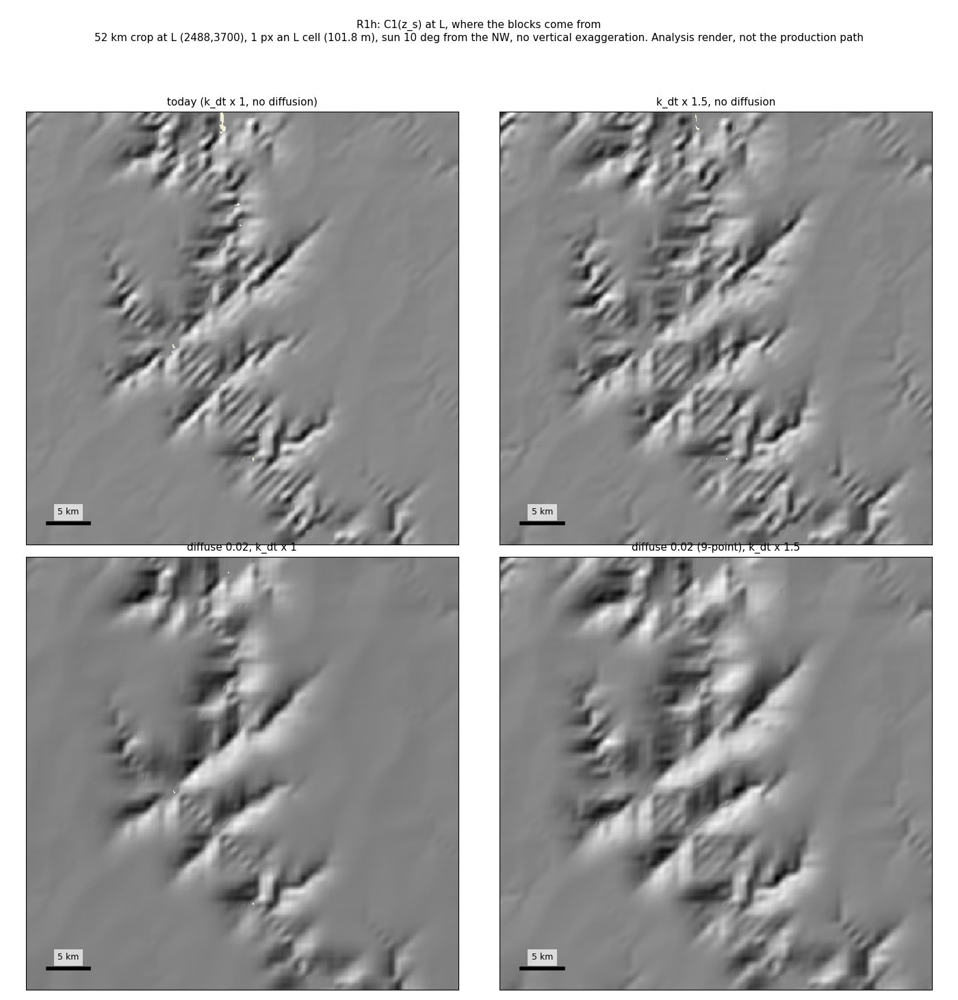
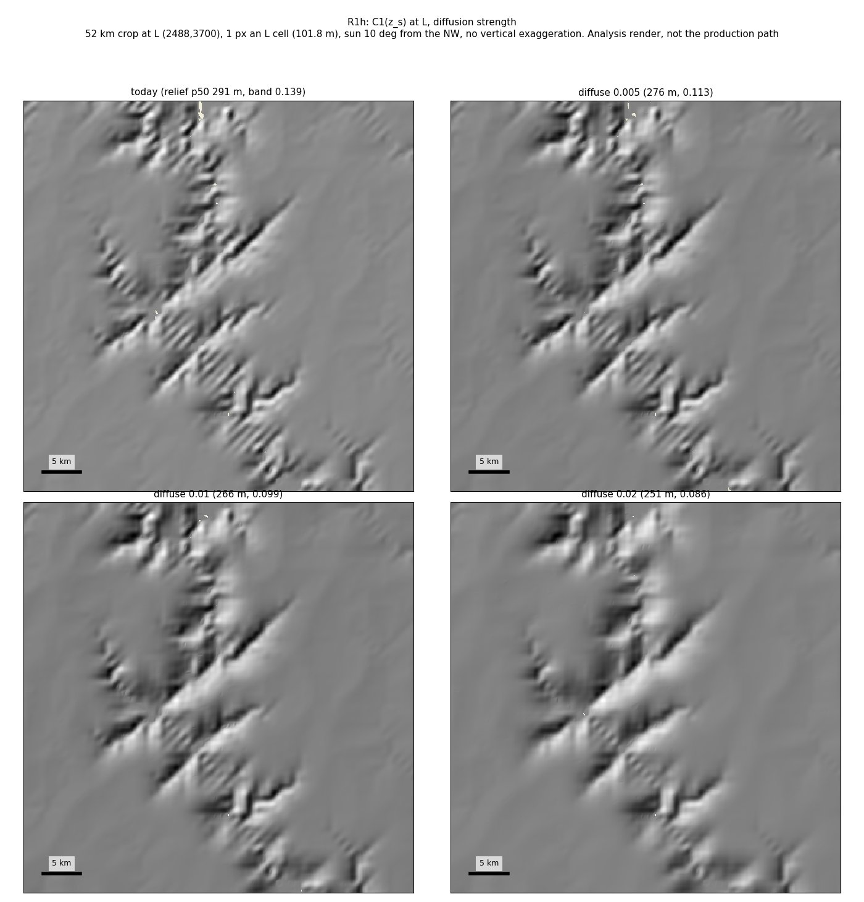
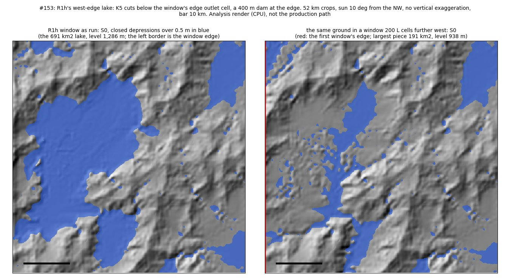
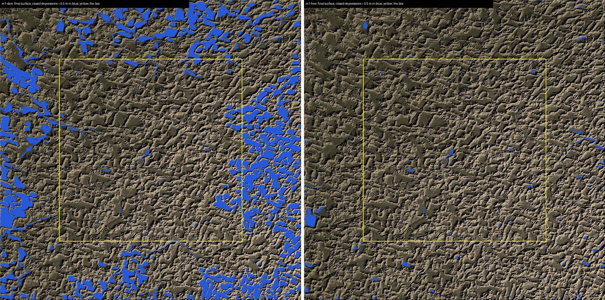

# SPIKE-139: K5's washboard on diagonal valley sides

Opened: 2026-11-18 (lead #148; owner's finding on the g1f5 sheets R1h-t1, F1-t1)
Question: Does K5's 8-direction routing make the comb of parallel ridges about one 814 m cell apart on diagonal valley sides, and which form removes it?
Why it matters: G2 waits for B2; the comb is in `z_s`, S0, KH and the final surface.
Time box: one night of lane work.
Success criteria: a measure that separates the comb from other relief; per form the measure, sheets, gate rows (G-DRAIN, uphill, corridor, agreement) and F1's diagonal channel probe, on R1h and F1.
Fallback if it fails: keep today's K5; the comb stays a known defect.
Code location: branch `spike/rg-prototype-spikes` (on `spike/rg-prototype` 3582b14e; not pushed, prepush refuses the branch); every form is an `rg_chain` switch, default off.
Status: closed 2026-11-19. Owner: `--k5-diffuse` off for G2 (unless g1f8 shows it beats the default on all five windows), k_dt not scaled, no more forms before G2 (lead #150).

## Method
- Runner: `rg_chain` with `--stop-after-kh --dump-s0 --dump-c1` for the fields, the full chain plus `river-gate` for the gate rows; reading-30 default (GEN-140's turned noise); R1h `1,8056,8675,760,1379,14`, F1 `4,4800,5419,3300,3919,15`.
- Washboard measure (`raw/washboard2.py.txt`):
  - every 2nd H1 channel cell on a straight reach (structure-tensor coherence >= 0.6);
  - the field sampled on lines parallel to the reach, 0.4-2.0 km to each side, 48 L cells long;
  - per profile: the 600-1300 m share of the 400-4000 m power, and the band RMS;
  - binned by the reach direction, folded 0 (axis) to 45 (diagonal) degrees; values are p50s.
- Checkerboard measure (`raw/parity.py.txt`): P = (diagonal mean - 2 orthogonal mean + z) / 4 at 814 m, zero on any quadratic; RMS on cells 1-4 cells from an H1 channel.
- Relief: p50 and p90 of max - min over 9 x 9 H1 cells (7.3 km), land in the box.
- A first measure over 64 x 64 L-cell windows (isotropic band) diluted the strip along the reach (0.08 axis against 0.09 diagonal) and is not used.

## Results
Washboard band share on 40-45 deg reaches (0-10 deg in brackets):

| Read | R1h | F1 |
|---|---|---|
| C1(z_b), the base | 0.039 (0.024) | 0.034 (0.031) |
| C1(z_b_in), after stage 1 | 0.055 (0.026) | 0.121 (0.042) |
| C1(z_s), after K5, today | 0.139 (0.048) | 0.189 (0.045) |
| C1(z_s), `--base today` (no drains) | 0.120 (0.048) | 0.122 (0.061) |
| S0 | 0.150 (0.060) | - |
| S_KH (KH h5) | 0.178 (0.093) | - |

Forms, R1h (40-45 deg):

| Form | Switch | Band share | Band RMS | Checkerboard | Relief p50 / p90 |
|---|---|---|---|---|---|
| today | - | 0.139 | 2.73 m | 16.3 m | 291 / 899 m |
| read control: z_s smoothed along the contour | `--zs-read contour` | 0.129 | 1.67 m | (z_s unchanged) | (unchanged) |
| read control: 3 x 3 binomial | `--zs-read gauss` | 0.138 | 1.24 m | (z_s unchanged) | (unchanged) |
| D8-LTD (Orlandini 2003), K5 only, no jitter | `--k5-route ltd` | 0.159 | 2.26 m | 13.7 m | - |
| D-infinity (Tarboton 1997) in K5's steps | `--k5-route dinf` | 0.151 | 2.27 m | 14.8 m | - |
| hillslope term, every cell | `--k5-diffuse 0.02` | 0.086 | 0.69 m | 3.8 m | 251 / 807 m |
| hillslope term, every cell | `--k5-diffuse 0.05` | 0.058 | 0.31 m | 1.0 m | 224 / 740 m |
| hillslope term, cells under 2 km2 | `--k5-diffuse 0.02 --k5-diffuse-amax 2` | 0.116 | 1.69 m | 8.2 m | 276 / 836 m |
| hillslope term, cells under 10 km2 | `--k5-diffuse 0.05 --k5-diffuse-amax 10` | 0.119 | 0.80 m | 4.5 m | 266 / 790 m |
| checkerboard damping only | `--k5-parity 1.0` | 0.032 | 0.58 m | 1.4 m | 274 / 891 m |

F1 (40-45 deg): today 0.189; contour 0.175; LTD 0.188; D-infinity 0.203; diffuse 0.02 0.076 (relief p50 55 -> 43 m, -22 %).

Gate rows (river-gate against main's start surface, so the corridor carries step A's open item; `raw/gate-rows.txt`):

| Window | Form | Closed basins (<= 10 %) | Uphill (<= 1 %) | Corridor (>= 97.5 %) | Agreement 1 / 75 km2 (>= 90 %) | Spill missing (0) | Diagonal channel steps | Steps in runs >= 8 |
|---|---|---|---|---|---|---|---|---|
| F1 | today | 9.78 | 0.71 | 67.3 | 86.1 / 91.5 | 154 | 60.1 % | 5.1 % |
| F1 | contour | 7.63 | 0.40 | 69.0 | 87.7 / 94.7 | 149 | 60.1 % | 5.1 % |
| F1 | LTD | 10.79 | 0.68 | 67.3 | 86.2 / 91.7 | 167 | 60.6 % | 5.4 % |
| F1 | D-infinity | 9.87 | 0.70 | 67.4 | 86.0 / 91.6 | 110 | 60.6 % | 5.2 % |
| F1 | diffuse 0.02 | 0.10 | 0.06 | 73.9 | 86.1 / 96.2 | 56 | 56.6 % | 4.3 % |
| R1h | today | 12.05 | 2.58 | 76.9 | 81.8 / 86.7 | 540 | - | - |
| R1h | contour | 10.04 | 1.87 | 77.7 | 80.1 / 88.8 | 492 | - | - |
| R1h | LTD | 11.06 | 2.38 | 77.2 | 80.5 / 87.3 | 534 | - | - |
| R1h | D-infinity | 11.66 | 2.60 | 77.0 | 79.3 / 86.1 | 422 | - | - |
| R1h | diffuse 0.02 | 8.62 | 2.63 | 80.3 | 76.8 / 86.6 | 378 | - | - |

D-infinity: F1's z_s and S0 are bit-equal on 1 and 8 threads (CON-14); K5 takes 15.5 s on 8 threads and 13.4 s on 1 (the steps are sequential); the receivers form a topological order by filled height, so no iteration is needed.

## Reading
1. K5 makes the comb. The base has 0.03-0.04; K5 raises it to 0.14 (R1h) and 0.19 (F1). On F1, stage 1's breach trenches seed it (0.121 before K5; they read as diagonal bead chains).
2. The 8-direction routing is not the cause. D8-LTD and D-infinity leave the comb, the gate rows and F1's diagonal channel share as today's.
3. The cause is K5's lack of a hillslope term. Stream power alone builds 814 m checkerboard relief on valley sides (3.5-16 m RMS against 0.3 m in the base). On a 45-degree side slope every form sends all flow to the diagonal neighbour, so the two parities of diagonal chains never couple. The C1 read shows that relief as the comb along diagonals.
4. The read adds to it but does not make it. The contour and 3 x 3 reads lower its amplitude, not its diagonal share; KH h5 raises it.
5. A hillslope term on every cell removes most of the comb. `--k5-diffuse 0.02` drains F1 (0.10 % closed, 0.06 % uphill) and improves R1h's closed basins, corridor and spill, but not its uphill share or agreement at 1 km2. It costs 14 % (R1h) and 22 % (F1) of local relief.
6. Rejected:
   - `--k5-parity` fills diagonal one-cell channels but not axis ones, so drainage turns axis-aligned (a plaid look) and R1h's trunk moves onto a straight N-S line;
   - hillslope-only diffusion leaves the comb (it sits in cells over 10 km2 too).

## Recommendation
- A hillslope term in K5 (`--k5-diffuse 0.02`), with the relief won back by K5's erodibility (k_dt), measured on the five windows. Not run: it changes K5's calibration and needs the lead's ruling.
- Defaults unchanged until the lead's reading and the owner's look.

## Addendum 2026-11-19: relief compensation, the owner's two readings (lead #149 to #150)
Relief compensation for `--k5-diffuse 0.02` (relief p50 / p90 of max - min over 9 x 9 H1 cells, `raw/relief.txt` for the forms whose fields are kept; band share on 40-45 deg reaches, `raw/washboard-runs.txt`):

| Window | Form | Relief p50 / p90 | Land mean | Band share | Look |
|---|---|---|---|---|---|
| R1h | today | 291 / 899 m | 484 m | 0.139 | comb |
| R1h | diffuse 0.02 | 251 / 807 m | 485 m | 0.086 | comb mostly gone |
| R1h | + k_dt x 1.5 | 296 / 780 m | 446 m | 0.081 | axis-aligned blocks |
| R1h | + k_dt x 2 | 333 / 754 m | 408 m | 0.065 | axis-aligned blocks |
| R1h | + u_over_k x 1.25 / 1.5 / 4 | 251-253 / 802-807 m | 490-538 m | 0.085 (x 1.25) | as diffuse 0.02 |
| R1h | diffuse 0.01 | 266 / 839 m | 485 m | 0.099 | comb weaker |
| R1h | diffuse 0.005 | 276 / 864 m | - | 0.113 | comb |
| F1 | today | 55 / 143 m | 101 m | 0.189 | comb |
| F1 | diffuse 0.02 | 43 / 116 m | 102 m | 0.076 | comb mostly gone |
| F1 | + k_dt x 2 | 55 / 123 m | 103 m | 0.051 | axis-aligned blocks |
| F1 | + u_over_k x 1.25 | 43 / 109 m | 107 m | - | as diffuse 0.02 |
| F1 | diffuse 0.01 | 47 / 126 m | - | 0.115 | - |
| F1 | diffuse 0.005 | 50 / 133 m | - | 0.139 | - |

- k_dt x 1.5 without diffusion makes the same blocks; the 9-point stencil (`--k5-diffuse-stencil 9`) does not remove them. So the blocks are K5's own response to a larger k_dt, not the hillslope term's. Dropped (lead #149b).
- u_over_k lifts the land nearly evenly in K5's 4 rounds and leaves the relief: no compensation.
- Weaker diffusion trades relief for comb continuously; no value removes the comb at no relief cost.
- F1 gate rows (river-gate against main's start surface, so the corridor carries step A's open item): diffuse 0.02 + k_dt x 1.5 closed 0.00 %, uphill 0.05 %, corridor 71.2 %; x 2 0.02 / 0.03 / 71.0 %; 9-point 0.00 / 0.06 / 73.3 %; diffuse 0.01 0.07 / 0.08 / 70.8 %, agreement 87.0 / 94.5 %, spill missing 100. The 73.6 % corridor quoted for F1 at k_dt x 1.5 is likewise against main's start.

Owner's reading (a): diffuse 0.02 diffuses valley walls into the carved channels and closes them. Confirmed on R1h (the post-K5 drain's line of each run, `raw/postk5-drain.txt`):

| R1h | Depressions met by the post-K5 drain | Deep, left | Lowered |
|---|---|---|---|
| today | 241 | 32 | 0.27 km3 |
| diffuse 0.02 | 2,766 | 97 | 22.1 km3 |
| diffuse 0.01 | 2,519 | 33 | 17.3 km3 |
| diffuse 0.005 | 2,159 | 31 | 7.7 km3 |

F1 has 7-8 deep basins left without compensation and 3-6 with the k_dt and u_over_k forms.

Owner's reading (b): the ~4.9 km blocks at raised k_dt match the 2,048-per-face lattice's bilinear hinges (12,288 / 2,048 = 6 H1 cells = 4.886 km). Not confirmed (`raw/hinge.txt`, `raw/hinge.py.txt`):
- the mean |second difference| of z_b, z_b_in and z_s, binned by the global H1 index mod 6, varies by at most 1 % across the phases (max / mean 1.00-1.01), today and at k_dt x 1.5;
- the change z_s(k_dt x 1.5) - z_s(today) has no peak near 4.9 km: the 4.5-5.3 km band holds 0.087-0.092 of the 2-12 km power against 0.082 for white noise;
- rg_chain reads the base from a 16,384-per-face lattice (`LATTICE`), and K5's uplift in `solve_region` is uniform (no driver field); the 2,048 lattice is the coupled store's, which this chain does not read.
- The blocks' source stays open; a candidate is K5's axis-aligned D8 routing at the stronger incision.

Tried and rejected: `--k5-parity` (checkerboard damping: diagonal channels filled, axis ones not, so plaid drainage and a straight N-S trunk); `--k5-diffuse-amax` (hillslope term on small-area cells only: the comb stays, it sits in cells over 10 km2 too).

What a G3 form would need:
- a hillslope term that couples the two cell parities without filling one-cell channels, for example diffusion only between cells not on the same receiver chain, or transport-limited deposition instead of linear creep;
- relief kept by calibration of K and diffusivity together against GLO-30 (relief and spectrum), not by k_dt alone;
- the base's stage-1 breach trenches made wider than one cell, since they seed the comb on F1.

## Addendum 2026-11-20: K5's window-edge dam (lead #153, #154, #156)
Finding (#153): R1h's 691 km2 west lake in the margin is a K5 dam at the window edge.
- In z_s, a pit at 875 m lies beside an edge cell at 1,271 m. The lake is closed in z_s, S0 and the final surface, but not in the base B (`raw/edge-west-lake.txt`).
- With the window shifted 200 L cells west, the lake shrinks to 191 km2.

Cause, in `round.rs`:
- A window-cut catchment's edge outlet has no base: `exit_base` gives it -infinity. So the pre-step breach cuts the catchment up to `breach_max_m` below the edge.
- `catchment_round` skips the cells whose receiver is an outlet, so the edge cell keeps its height and becomes a dam.

Switch `rg_chain --k5-edge dam | free` (`round::K5_EDGE_FREE`, spike only):
- `free` breaches the edge outlet of a window-cut catchment like any receiver; sea outlets keep their height.
- CON-14: R1h's z_s and S0 are bit-equal on 1 and 8 threads.
- The rule acts per catchment, before any region split.
- Lead #156 (reading 36): `free` is the default on `spike/rg-prototype`.

Survey (`raw/edge-survey.txt`). Each field is flooded with the window edge and the sea as outlets. An edge lake is a closed depression over 1 km2 and 0.5 m with a cell within 2 H1 (16 L) cells of the edge:

| Window | z_s edge lakes: dam | z_s: free | S0 edge lakes: dam | S0: free | in the box (z_s / S0, dam) |
|---|---|---|---|---|---|
| R1h | 32, 13,619 km2, max 981 m | 0 | 100, 10,506 km2, max 1,201 m | 89, 876 km2, max 230 m | 0 / 0 % |
| R3a | 2, 2,718 km2, max 141 m | 0 | 25, 892 km2 | 18, 64 km2 | 0 / 0 % |
| R3b | 9, 17,110 km2, max 369 m | 0 | 24, 5,092 km2 | 18, 61 km2 | 0.21 / 0 % |
| M1 | 89, 106,027 km2, max 1,773 m | 0 | 150, 96,499 km2, max 2,025 m | 153, 4,714 km2, max 629 m | 2.57 / 2.19 % |
| F1 | 8, 8,214 km2, max 220 m | 0 | 54, 4,248 km2 | 36, 156 km2 | 0 / 0 % |

- With `dam`, every closed depression over 1 km2 in z_s is an edge lake. With `free`, z_s has none (M1 keeps 3, 389 km2, inside).
- The S0 edge lakes left with `free` are S0's own pits near the edge (KH and C1 at L).

Gate rows: the full chain, `dam` against `free`, same build, the river gate against each run's own S0 (`raw/edge-gate.txt`):

| Field | R1h dam | R1h free | M1 dam | M1 free |
|---|---|---|---|---|
| basin_pct (bar <= 10 %) | 11.40 | 11.40 | 10.50 FAIL | 4.07 PASS |
| bar_uphill (<= 1 %) | 1.25 FAIL | 1.25 FAIL | 0.93 | 0.92 |
| bar_agree_1km2 (>= 90 %) | 91.64 | 91.64 | 89.66 FAIL | 90.11 PASS |
| bar_agree_75km2 | 97.63 | 97.62 | 92.90 | 93.84 |
| bar_corridor | 99.93 | 99.93 | 97.85 | 98.75 |
| river steps rising over 0.25 m | 2.34 % | 2.34 % | 4.36 % (max 398 m) | 1.81 % (max 80 m) |
| kept basins inside | 1,999 | 1,189 | 15,558 (778,208 cells) | 4,920 (176,559 cells) |
| final-surface edge lakes over 1 km2 | 35, 12,396 km2 | 5, 118 km2 | 98, 102,062 km2 | 41, 2,567 km2 |
| closed over 1 km2 inside the box | 832 km2 | 832 km2 | 7,715 km2 | 1,493 km2 |

- R1h: the west lake is gone (686 km2 in the final surface with `dam`, none with `free`). The box's bars are unchanged; the graph changes only in the margin (basins 10,464 to 3,465).
- M1 has no sea, so every K5 catchment is window-cut. With `dam`, the edge lakes reach into the box: the largest is 22,113 km2 and 1,523 m deep, with 3,167 km2 inside the box. With `free`, M1 passes the basin and 1 km2 agreement bars.
- `bar_spectrum_steep` fails on M1 in both rows (-4.19).

Production (G3 port item, region seams): main's region bake has the same rule.
- `crates/cache/src/region_bake.rs:221` and `crates/cache/src/layer_store.rs:297` set `CarveParams { window_cut: true }`.
- `crates/generators/src/bake/round.rs:57` skips the edge outlet (GEN-172's window-cut breach).
- So a region's edge is a dam in production too: it makes lakes along region seams, and inside a region without sea.
- The port needs a free outflow edge, or a halo, in GEN-177's region bake, with CON-14 and partition identity tested.

## Visuals
All panels: C1 reads at L (102 m), 52 km crops, hillshade with the sun at 10 deg from the NW, no vertical exaggeration, CPU analysis render (not the production path).

R1h: today, the contour-read control, D8-LTD and D-infinity at the owner's place on the NE-SW valley; the comb stays in every panel.

R1h: C1(z_b), C1(z_b_in) (stage 1's breach trenches as diagonal bead chains), C1(z_s) today and with `--k5-diffuse 0.02`.

R1h: today, `--k5-diffuse 0.02`, `--k5-parity 0.5` and `1.0` (axis-aligned drainage, the trunk on a straight N-S line, cells at the sea level in cream).

F1: C1(z_s) today and with `--k5-diffuse 0.02`; the axis-aligned streaks that stay are the base's (SPIKE-140).

R1h: today, diffuse 0.02, and diffuse 0.02 with k_dt x 1.5 and x 2 (axis-aligned blocks).

R1h: diffuse 0.02 with the 5-point and the 9-point stencil, at k_dt x 1 and x 1.5: the stencils look alike.

R1h: today, k_dt x 1.5 without diffusion (blocks and the comb), diffuse 0.02, diffuse 0.02 (9-point) with k_dt x 1.5.

R1h: today, diffuse 0.005, 0.01 and 0.02: the comb weakens as the relief falls.

R1h's S0 before the switch: left, the window as run, with the 691 km2 lake (level 1,286 m) against the west edge; right, the same ground in a window 200 L cells further west, largest piece 191 km2. 52 km crops, sun 10 deg from the NW; CPU analysis render (not the production path).

M1, final surface at H1 resolution (8 x 8 L cells averaged), closed depressions over 0.5 m in blue, the box in yellow; left `--k5-edge dam`, right `free`; CPU analysis render (not the production path).
