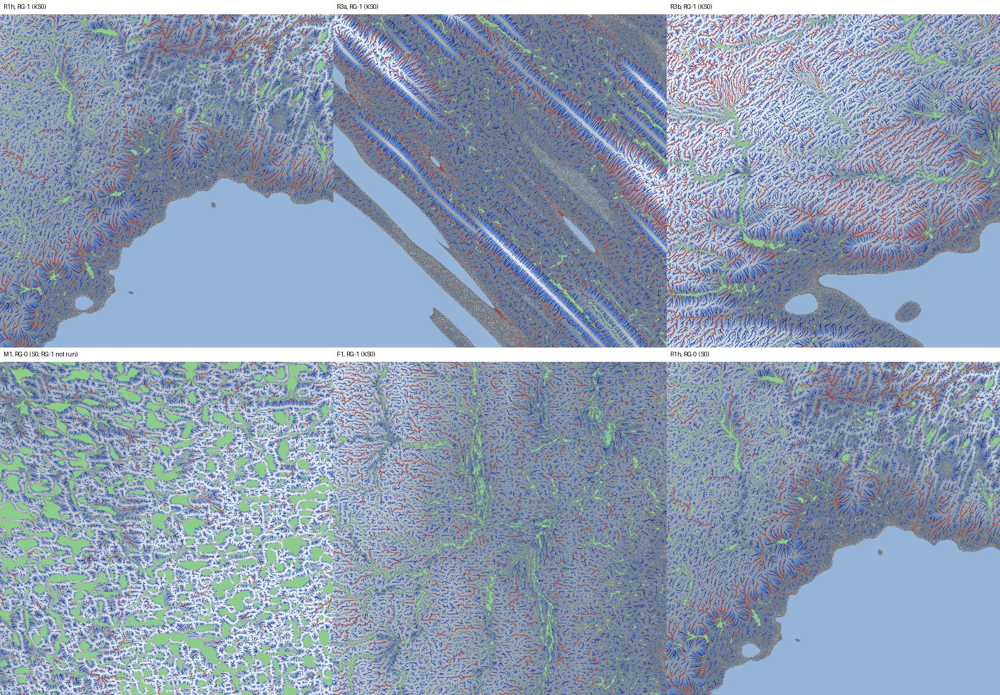

# SPIKE-133: KG-trib extractor-1 on the G0 fixture (G1d)

Opened: 2026-11-17 (lead #158)
Question: does extractor-1 extract the L tributaries behind the reach contract, with ids, tile crossings and the halo seed, on the fixture? The method is the canonical flood plus clipped MFD (GEN-141), with trunk cells as forced receivers and `A_crit` 1 km2.
Why it matters: G1d of the river-graph plan; KV and KC (G1f) read its beds and `q_w`.
Time box: about 2 days (used: about 1 day).
Success criteria:
- every reach valid, none dangling or duplicate;
- conservation and Strahler at confluences;
- the same topology under both layouts;
- the halo cases measured: catchments just below and above the halo's reach, and sources outside a tile with confluences inside.

Fallback if it fails: RG-3 behind the same contract (addendum G1d).
Code location: branch `spike/g1d` (local, never merged):
- `crates/generators/src/bake/kg_trib.rs`;
- `crates/generators/tests/kg_trib_g1d.rs`.

Inputs:
- The trunks are the fixture's expected L trunk image (TEST-140) with its beds and attributes.
- KS is off (labelled): the stage input is `S0`.
- The L basins come from SPIKE-130's producer on `S0`.
- The five windows (section 5) run on spikes' G1c trunks (#132), on `S0` (RG-0) and explorer's KS0 (RG-1, #164).

## 1. Method
| Step | Rule |
|---|---|
| Routing | `route_rules` with round rules (canonical flood, local MFD clip, epsilon 1 mm, seed 1). Outlets: the sea, the window's exits, and the trunk's L cells (forced receivers, no burn). |
| Channel | clipped-MFD area plus the propagated seed at least `A_crit`, and every D8 receiver of a channel cell (a tree); never a kept-basin cell |
| Nodes | `source`; `lake_spill` (a head fed by a kept basin); `confluence`; `tile_crossing` (the last vertex inside a core a chain leaves); the ends `trib_junction` (on a trunk vertex), `outlet_sea` (the first sea cell), `lake_inlet` (the first kept-basin cell) |
| Attributes | D8 accumulation of true cell areas, with (`a_geo`, `a_run`) and without (`a_run_no_ext`) the seed; `a_ext` the seed at its entry vertex; `q = q_w = a_run r`; Strahler one order a reach; the bed the running minimum of 0.5 m codes, lifted to a junction's trunk bed; a reach on a trunk takes the trunk's attributes on its last vertex |
| Ids, owners | GEN-189's ids; a node owned by its anchor's tile (`trib_junction`: landmass); a reach by its second vertex's tile |
| Window | a region's H1 cells plus a halo of H1 rings. The border cells are exits, except the entry cells: for each outside H1 cell whose H1 receiver lies inside, the lowest border L cell of that receiver next to it, seeded with the outside cell's `A_d` |
| Basins | the producer on the domain with the trunks; the extractor; the producer again with all reaches (spill receivers, inlets) |

## 2. Results on the fixture
| Measure | MFD initiation (extractor-1) | D8 initiation (comparison) |
|---|---|---|
| Reaches; channel cells | 466; 1,566 | 205; 2,326 |
| Channel length; density | 159.3 km; 0.45 km/km2 | 236.7 km; 0.66 km/km2 |
| Sources, confluences, tile crossings | 258, 187, 21 | 112, 55, 38 |
| Junctions, sea outlets, lake inlets, lake spills | 27, 12, 16, 1 | 27, 13, 17, 1 |
| Reach length p50 / p90 / max | 204 / 712 / 3,765 m | 712 / 2,747 / 3,866 m |
| End area p50 by order 1, 2, 3 (D8 `a_geo`) | 0.07, 3.27, 7.13 km2 | 1.58, 8.27, 38.32 km2 |
| Channel cells below `A_crit` in D8 area | 445 (28 %) | 0 |
| GEN-189 violations of the whole graph | 0 | 0 |
| Same bytes on 1 and 4 threads | yes | not run |

| Check | Result |
|---|---|
| No dangling or duplicate reaches (ids, vertex chains, ends) | holds |
| Conservation at confluences (one shared value, at least the inflows) | holds at 187 |
| Strahler: heads 1, the standard rule at confluences, unchanged across tile crossings | holds |
| Both layouts, 13 km halo (16 H1 cells) | the same 466 reach ids as the whole body, bit-identical attributes |
| The expected graph's tributary nodes reproduced | 7 of 10; 243 of its 265 cells on the network |

Halo cases, reduced halo of 2 H1 cells (1.6 km; labelled: the fixture's body is 78 km round, so the 13 km halo covers almost all of it). Tiles of faces 0 and 2. A reach's class is how far the clipped-MFD catchment of its end reaches beyond the tile.

| Class | Reaches | Found unseeded / seeded | Same vertices and `a_geo` within 1 % | `a_geo` error max, unseeded / seeded |
|---|---|---|---|---|
| inside the window (within 1 ring) | 43 | 36 / 36 | 36 / 36 | 0 / 0 |
| just below the halo's reach | 6 | 5 / 5 | 4 / 4 | 0.015 / 0.015 |
| just above it (one ring beyond) | 41 | 37 / 37 | 21 / 21 | 0.055 / 0.055 |
| far above | 376 | 94 / 95 | 49 / 49 | 0.78 / 0.51 |
| confluences fed by a source outside their tile | 81 | 29 / 30 | - | - |
| D8 initiation: catchment inside the window / beyond | 68 / 137 | 59 / 48 (unseeded) | - | - |

## 3. Findings
1. The extractor meets the reach contract on the fixture:
   - the whole graph validates (GEN-189), deterministically;
   - confluences conserve and order by Strahler;
   - both layouts give the same topology with the 13 km halo.
2. **Clipped-MFD initiation makes valley-floor stubs.**
   - A channel cell shares its MFD area with its lower side neighbours on a valley floor, and those cells pass `A_crit` and start short parallel reaches that rejoin within a few cells.
   - Against D8 initiation: 187 confluences against 55, reach length p50 204 m against 712 m.
   - 445 channel cells (28 %) have a D8 area below `A_crit`; order-1 reaches end at a p50 D8 area of 0.07 km2.
   - The stored `a_geo` (D8, conserving) disagrees with the area that initiated the channel.
3. **The clip reads more than a catchment.**
   - A head's clipped-MFD area takes area from cells outside its D8 catchment, from anywhere in the same D8 tree.
   - The clip drops a lower neighbour whose D8 root differs. In a window, the border exits change those roots.
   - At the reduced halo, 7 of 43 reaches whose catchment lies inside the window are missed, with the same receivers but other initiation areas.
   - D8 initiation misses 9 of 68 (kept basins and the flood near the border).
   - The halo needed for exact invariance is the extent of the neighbours' D8 trees, not the catchment's.
4. **The H1 seed adds little.**
   - Seeding one entry cell per entering H1 channel with `A_d` finds 1 more reach of 376 beyond the halo, and cuts the largest `a_geo` error from 0.78 to 0.51.
   - Heads near the border depend on hillslope area that no H1 channel carries.
   - The 13 km halo is what holds partition invariance; the seed only corrects large rivers' areas.
5. **With KS off, `S0`'s dam basin swallows the trunk's head.**
   - The upper course and T1 end at a `lake_inlet` of the kept basin around the trunk's source, not at the expected `trib_junction` at vertex 0.
   - Two of T1's tile crossings move with it (3 of the 10 expected nodes).
   - This is reading 5's reason for KS1: on KS0 this basin is expected to go.
6. **The producer's inlet rule (SPIKE-130) put a `lake_inlet` on a reach's vertex 0 when the reach starts inside a kept basin** (the trunk image). The spike's copy now takes inlets from the second vertex and only from outside that basin.

## 4. Recommendation
- Lead decision (default): initiate channels on the D8 accumulation, so that the stored `a_geo` is the initiation area. Keep the clipped MFD as the diffuse field (GEN-141), where it already serves.
- Alternative: keep MFD initiation and require a D8 area of at least `A_crit / 4` at a head (one parameter; not measured).
- Keep the 13 km halo; keep `a_ext` as the large-river correction only (finding 4); measure the halo on the five windows with KS0.
- G1d next: the five windows on KS0 once spikes' G1c trunks and explorer's KS0 are readable; then the density, length and junction-angle distributions there (junction angles not measured here).

## 5. Five windows (lead, 2026-11-17)
Setup:
- Spike branch `spike/g1d`, `crates/cache/examples/kg_trib.rs`: SPIKE-129's G1c example (`spike/g1c-trunk-k6p-2` at e29c0bd6, on main's types). It runs the extractor on G1c's L trunks (K6' base) after the trunk graph.
- Initiation on the D8 area (reading 14), `A_crit` 1 km2.
- RG-0, the control rung: the stage input is `S0`.
- RG-1: explorer's KS0 (`spike/ks-g1b`, H from SPIKE-127's K6').
- The kept L basins are SPIKE-130's producer on the stage input.
- Runoff: the window's mean (H1 land cells).
- Validation: GEN-189 on G1c's graph plus the tributaries (an open slice).
- Counts are in the region's box (a reach counts when its second vertex lies there).

| Measure (RG-0 / RG-1) | R1h | R3a | R3b | M1 | F1 |
|---|---|---|---|---|---|
| Tributary reaches | 81,720 / 82,157 | 102,054 / 102,388 | 110,944 / 110,988 | 98,412 / not run | 109,389 / 109,607 |
| Density, km/km2 | 0.381 / 0.383 | 0.445 / 0.446 | 0.398 / 0.398 | 0.326 / - | 0.325 / 0.326 |
| Reach length p50 / p90, m (RG-0) | 611 / 1,832 | 611 / 2,036 | 611 / 1,731 | 611 / 1,832 | 509 / 1,629 |
| Max order; order-1 end area p50 (RG-0) | 4; 1.69 km2 | 5; 1.65 km2 | 5; 1.64 km2 | 4; 1.70 km2 | 4; 1.76 km2 |
| Ends (RG-0): confluence / lake inlet / junction / sea | 60,190 / 14,916 / 2,765 / 2,689 | 80,448 / 7,388 / 5,775 / 6,947 | 84,607 / 15,715 / 7,590 / 1,602 | 70,999 / 24,602 / 1,455 / 0 | 77,097 / 28,021 / 1,901 / 1,194 |
| Kept L basins; share of the box's land (RG-0) | 46,130; 6.8 % | 9,461; 3.0 % | 29,572; 5.6 % | 103,066; 22.3 % | 44,299; 8.7 % |
| Violations added to G1c's (RG-0 / RG-1) | 1 / 2 | 4 / 6 | 0 / 0 | 0 / - | 0 / 0 |
| Run after the lock; peak commit (RG-0) | 302 s; 14.0 GB | 225 s; 7.9 GB | 340 s; 20.3 GB | 944 s; 55.5 GB | 351 s; 8.1 GB |

- Validators:
  - The added violations are `TwoNodesOneAnchor` at cells where G1c's nodes already meet: a confluence and an outlet, a lake inlet beside a junction, a source on a sea cell.
  - No conservation break, no invalid marker, no dangling reach.
  - Before two fixes in this run, R1h had 7,123 violations. The fixes: the junction vertex keeps the tributary's own areas, sharing only the trunk's bed; a tributary reaching a trunk's last vertex ends at that trunk's down node.
- RG-1 against RG-0: within 0.6 % on every measure. KS0 lowers 1.0-1.8 M L cells (1.6-2.7 % of the window).
- Lakes: lake inlets end 7-25 % of the reaches, 25 % on M1. These are `S0`'s and KS0's kept basins (reading 5 names KS1, not built).
- Trunk area breaks (a junction where G1c's trunk carries less `a_geo` than the tributary arriving): 334-2,909 a window. G1c's trunk attributes are H1 values sampled along the reach; the landmass pass must give the L trunk its tributaries' areas.

## 6. Findings from the windows
7. The extractor holds the reach contract on the five windows. On G1c's trunks it adds at most 6 violations to G1c's own, all at cells where G1c's nodes already meet.
8. **The G1e basin producer does not fit the memory budget.**
   - Peak commit is 8-20 GB on four windows and 55 GB on M1 (paged); M1's RG-1 run failed on an allocation.
   - The producer keeps the sorted cell list of every depression's subtree, so nesting multiplies the cells. M1 has 103,066 kept basins on 22 % of its land.
   - The world-build budget is 12 GB.
   - G1e's producer needs basin cells by reference (a node's own cells and its children), not copied subtree lists, before it runs on real windows.
9. **G1c's trunk attributes break at junctions.** The trunk's `a_geo` and `q` are H1 values sampled along the reach, below the inflow of 334-2,909 tributaries a window. The graph validator does not compare values at a junction, so this does not show as a violation.
10. Density 0.33-0.45 km/km2 and order-1 reaches ending near 1.7 km2 are what `A_crit` 1 km2 and D8 initiation give. The order reaches 4-5 in a window's box.

## 7. Recommendation (windows)
- G1d meets its exit on the fixture and the five windows, M1's RG-1 apart. Close SPIKE-133 when the lead accepts.
- Before KV and KC run on windows (G1f): the producer's memory (finding 8) and the trunk's L attributes from its tributaries (finding 9).
- The density, length and order distributions are in the table. Junction angles are not measured.

## 8. Order #159 (lead, 2026-11-17): producer memory, reading 18, the density check, M1's RG-1
Code: spike branch `spike/g1d` (never merged):
- `bake/basins_rg.rs` (the producer);
- `bake/kg_trib.rs` (`accumulate_trunks`);
- `bake/kv_kc.rs` (`flag_residuals`);
- `crates/cache/examples/kg_trib.rs` (`--density-check`, `--write-graph`).

Run logs are in `raw/159/`.

### 8.1 The G1e producer's memory
- Each depression's subtree is a contiguous range of one flat cell array, not a sorted copy per node.
- A subtree is sorted into one reused buffer only where the old code read sorted cells: the area sum, kept in cell order so the result keeps the same bits, and the spill walk's membership test.
- A per-cell basin array replaces the cell-to-basin map.
- `Produced::cells[&id]` gives a basin's cells as a slice, unsorted.

| Check | Result |
|---|---|
| Fixture digests (H1 and L: basins, nodes, sorted cell sets) | unchanged (a tier-A test pins them) |
| Kept L basins on the windows, RG-0 | 46,130 / 9,461 / 29,572 / 103,066 / 44,299, the same as before |
| Peak commit, 10 runs | 7.83-8.09 GB (before: 7.9-55.5 GB; M1's RG-1 failed) |

### 8.2 Reading 18: the landmass pass
- `accumulate_trunks` orders the L trunk reaches topologically: a reach comes after every trunk reach ending at its up node.
- A vertex carries the vertex before it plus its own cell plus the D8 inflow into it: its tributaries and the hillslope draining straight into the trunk cell, with and without the halo seed.
- A node shares one value with all its reaches: the sum of its inflowing trunk reaches' second-to-last vertices plus its own inflow.
- A head with no inflowing trunk takes the larger of its H1 seed and its own L inflow.
- `q = q_w = a_run r`.

| | R1h | R3a | R3b | M1 | F1 |
|---|---|---|---|---|---|
| Junction breaks before / after (RG-0) | 630 / 0 | 2,877 / 0 | 2,275 / 0 | 511 / 0 | 322 / 0 |
| Heads whose L inflow exceeds the H1 seed (of trunk reaches) | 1,086 of 5,044 | 2,027 of 11,709 | 2,480 of 12,672 | 891 of 2,840 | 964 of 4,177 |
| Violations added to G1c's | 1 | 4 | 0 | 0 | 0 |

- Fixture: the trunk's mouth carries 228.5 km2, equal to the expected graph's D8 area. The graph validates (closed) and no tributary brings more than its trunk carries (tier-A test).

### 8.3 The density check (BUILD-059 at 1 km2)
Combined graph means the river gate's `graph_report` (BUILD-060, `river-gate --graph`'s code) over the rasterised L graph. The other columns apply BUILD-059's rule to the stage input (outlets the sea and the window's edge, round rules, seed 7). They differ only in which area defines a channel cell.

| Window | Bar (`S0`, network-bar.md) | D8 area | MFD area | D8 outside kept basins | Extractor's channel cells | Combined graph RG-0 / RG-1 |
|---|---|---|---|---|---|---|
| R1h | 0.656 | 0.659 | 1.314 | 0.468 | 0.452 | 0.487 / 0.490 |
| R3a | 0.679 | 0.644 | 1.179 | 0.560 | 0.531 | 0.571 / 0.573 |
| R3b | 0.664 | 0.671 | 1.323 | 0.510 | 0.478 | 0.535 / 0.536 |
| M1 | 0.859 | 0.870 | 2.269 | 0.392 | 0.385 | 0.397 / 0.401 |
| F1 | 0.615 | 0.632 | 1.313 | 0.394 | 0.383 | 0.404 / 0.404 |

- `river-gate r1h --graph` on R1h's written graph gives 0.4867, the same as the example's own `graph_report` call, and the gate's routed network 0.6561 beside it.
- **The bar is a D8 network.** BUILD-059's rule with the D8 accumulation reproduces the bar within 0.04 on every window. With the routing's MFD area it gives about double.
- **Outside kept basins the extractor is the D8 network**, within 0.007-0.032 km/km2. The rest is the trunk cells, which are outlets in the extractor.
- **The gap is the kept basins' channel length.** A tributary ends at a lake inlet, so the channel length inside kept L basins is not in the graph. That is 13 % (R3a), 24 % (R3b), 29 % (R1h), 38 % (F1) and 55 % (M1) of the D8 network.
- These are `S0`'s and KS0's basins; reading 5 names KS1, which is not built.
- Answer: not a definition difference of the density, and not a shortfall of the extractor. The shortfall is the lakes of the unconditioned surface. On these numbers it is no RG-3 trigger: the extractor's network is the D8 network wherever it runs.
- What to measure next: the same check on KS1 once built. The density then follows how much of the network KS1 leaves in kept basins.

### 8.4 M1's RG-1
Ran in 485 s at a peak commit of 7.94 GB. Within 1 % of RG-0 on every measure (99,338 tributary reaches in the box, density 0.329; combined graph 0.401).

### 8.5 Fixes for the chain runner (explorer, R1h)
- `kv_kc::flag_residuals` flags every residual's reach `exception(budget_residual)`, with its largest `needed - available`. The fixture test uses it, and every residual names a reach.
- `basins_rg::produce_ids` takes the window's cell ids both ways (`CellIds { gid, local }`): reach vertices are read as global ids, and every anchor, basin cell and id is written global. `produce` is the identity case.
- A spill onto a reach's last vertex names that reach's down node.
- A spill path joins a reach vertex before it can become another basin's inlet.
- No lake inlet goes on a reach's node cell.
- A spill junction is owned by the reach it sits on.
- Explorer on R1h: invalid markers 452 to 0; `TwoNodesOneAnchor` 992 to 421. 99 of those 421 are lake inlets on node cells with no reach of their own, from a basin pass that did not see those tributaries (open with explorer).

## Visuals

The whole-body extraction on the G0 fixture (CPU, no GPU path; KS off, input `S0`; L cells of 101.8 m). Left: MFD initiation (extractor-1); right: D8 initiation. Red: the expected graph's trunk. Blue: tributaries by Strahler order. Black: confluences. Purple: tile crossings. Green: `S0`'s kept basins and their inlets. Dotted lines: the tile lines at -15 and 15 and the cube edge at 45. The run's numbers are in `report.txt`.

The extracted networks of the five windows, each cropped to its region's box (CPU, no GPU path; one pixel per 6 L cells). RG-1 on explorer's KS0, with R1h on `S0` (RG-0) for comparison and M1 on `S0` (its RG-1 run failed, section 6). Red: G1c's trunks. Blue: tributaries, darker by Strahler order. Green: kept L basins. Grey: land, lighter higher. Pale blue: sea. Run logs are in `raw/`.
