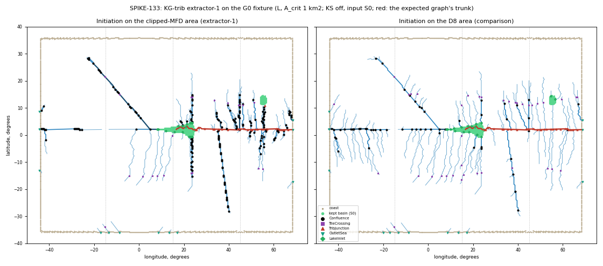

# SPIKE-133: KG-trib extractor-1 on the G0 fixture (G1d)

Opened: 2026-11-17 (lead #158)
Question: does extractor-1 extract the L tributaries behind the reach contract, with ids, tile crossings and the halo seed, on the fixture? The method is the canonical flood plus clipped MFD (GEN-141), with trunk cells as forced receivers and `A_crit` 1 km2.
Why it matters: G1d of the river-graph plan; KV and KC (G1f) read its beds and `q_w`.
Time box: about 2 days (used: about 0.5 day).
Success criteria:
- every reach valid, none dangling or duplicate;
- conservation and Strahler at confluences;
- the same topology under both layouts;
- the halo cases measured: catchments just below and above the halo's reach, and sources outside a tile with confluences inside.

Fallback if it fails: RG-3 behind the same contract (addendum G1d).
Code location: branch `spike/g1d` (local, never merged):
- `crates/generators/src/bake/kg_trib.rs`;
- `crates/generators/tests/kg_trib_g1d.rs`.

Inputs:
- The trunks are the fixture's expected L trunk image (TEST-140) with its beds and attributes.
- KS is off (labelled): the stage input is `S0`.
- The L basins come from SPIKE-130's producer on `S0`.
- The five windows wait for spikes' G1c trunks (#132) and explorer's KS0 (#164).

## 1. Method
| Step | Rule |
|---|---|
| Routing | `route_rules` with round rules (canonical flood, local MFD clip, epsilon 1 mm, seed 1). Outlets: the sea, the window's exits, and the trunk's L cells (forced receivers, no burn). |
| Channel | clipped-MFD area plus the propagated seed at least `A_crit`, and every D8 receiver of a channel cell (a tree); never a kept-basin cell |
| Nodes | `source`; `lake_spill` (a head fed by a kept basin); `confluence`; `tile_crossing` (the last vertex inside a core a chain leaves); the ends `trib_junction` (on a trunk vertex), `outlet_sea` (the first sea cell), `lake_inlet` (the first kept-basin cell) |
| Attributes | D8 accumulation of true cell areas, with (`a_geo`, `a_run`) and without (`a_run_no_ext`) the seed; `a_ext` the seed at its entry vertex; `q = q_w = a_run r`; Strahler one order a reach; the bed the running minimum of 0.5 m codes, lifted to a junction's trunk bed; a reach on a trunk takes the trunk's attributes on its last vertex |
| Ids, owners | GEN-189's ids; a node owned by its anchor's tile (`trib_junction`: landmass); a reach by its second vertex's tile |
| Window | a region's H1 cells plus a halo of H1 rings. The border cells are exits, except the entry cells: for each outside H1 cell whose H1 receiver lies inside, the lowest border L cell of that receiver next to it, seeded with the outside cell's `A_d` |
| Basins | the producer on the domain with the trunks; the extractor; the producer again with all reaches (spill receivers, inlets) |

## 2. Results on the fixture
| Measure | MFD initiation (extractor-1) | D8 initiation (comparison) |
|---|---|---|
| Reaches; channel cells | 466; 1,566 | 205; 2,326 |
| Channel length; density | 159.3 km; 0.45 km/km2 | 236.7 km; 0.66 km/km2 |
| Sources, confluences, tile crossings | 258, 187, 21 | 112, 55, 38 |
| Junctions, sea outlets, lake inlets, lake spills | 27, 12, 16, 1 | 27, 13, 17, 1 |
| Reach length p50 / p90 / max | 204 / 712 / 3,765 m | 712 / 2,747 / 3,866 m |
| End area p50 by order 1, 2, 3 (D8 `a_geo`) | 0.07, 3.27, 7.13 km2 | 1.58, 8.27, 38.32 km2 |
| Channel cells below `A_crit` in D8 area | 445 (28 %) | 0 |
| GEN-189 violations of the whole graph | 0 | 0 |
| Same bytes on 1 and 4 threads | yes | not run |

| Check | Result |
|---|---|
| No dangling or duplicate reaches (ids, vertex chains, ends) | holds |
| Conservation at confluences (one shared value, at least the inflows) | holds at 187 |
| Strahler: heads 1, the standard rule at confluences, unchanged across tile crossings | holds |
| Both layouts, 13 km halo (16 H1 cells) | the same 466 reach ids as the whole body, bit-identical attributes |
| The expected graph's tributary nodes reproduced | 7 of 10; 243 of its 265 cells on the network |

Halo cases, reduced halo of 2 H1 cells (1.6 km; labelled: the fixture's body is 78 km round, so the 13 km halo covers almost all of it). Tiles of faces 0 and 2. A reach's class is how far the clipped-MFD catchment of its end reaches beyond the tile.

| Class | Reaches | Found unseeded / seeded | Same vertices and `a_geo` within 1 % | `a_geo` error max, unseeded / seeded |
|---|---|---|---|---|
| inside the window (within 1 ring) | 43 | 36 / 36 | 36 / 36 | 0 / 0 |
| just below the halo's reach | 6 | 5 / 5 | 4 / 4 | 0.015 / 0.015 |
| just above it (one ring beyond) | 41 | 37 / 37 | 21 / 21 | 0.055 / 0.055 |
| far above | 376 | 94 / 95 | 49 / 49 | 0.78 / 0.51 |
| confluences fed by a source outside their tile | 81 | 29 / 30 | - | - |
| D8 initiation: catchment inside the window / beyond | 68 / 137 | 59 / 48 (unseeded) | - | - |

## 3. Findings
1. The extractor meets the reach contract on the fixture:
   - the whole graph validates (GEN-189), deterministically;
   - confluences conserve and order by Strahler;
   - both layouts give the same topology with the 13 km halo.
2. **Clipped-MFD initiation makes valley-floor stubs.**
   - A channel cell shares its MFD area with its lower side neighbours on a valley floor, and those cells pass `A_crit` and start short parallel reaches that rejoin within a few cells.
   - Against D8 initiation: 187 confluences against 55, reach length p50 204 m against 712 m.
   - 445 channel cells (28 %) have a D8 area below `A_crit`; order-1 reaches end at a p50 D8 area of 0.07 km2.
   - The stored `a_geo` (D8, conserving) disagrees with the area that initiated the channel.
3. **The clip reads more than a catchment.**
   - A head's clipped-MFD area takes area from cells outside its D8 catchment, from anywhere in the same D8 tree.
   - The clip drops a lower neighbour whose D8 root differs. In a window, the border exits change those roots.
   - At the reduced halo, 7 of 43 reaches whose catchment lies inside the window are missed, with the same receivers but other initiation areas.
   - D8 initiation misses 9 of 68 (kept basins and the flood near the border).
   - The halo needed for exact invariance is the extent of the neighbours' D8 trees, not the catchment's.
4. **The H1 seed adds little.**
   - Seeding one entry cell per entering H1 channel with `A_d` finds 1 more reach of 376 beyond the halo, and cuts the largest `a_geo` error from 0.78 to 0.51.
   - Heads near the border depend on hillslope area that no H1 channel carries.
   - The 13 km halo is what holds partition invariance; the seed only corrects large rivers' areas.
5. **With KS off, `S0`'s dam basin swallows the trunk's head.**
   - The upper course and T1 end at a `lake_inlet` of the kept basin around the trunk's source, not at the expected `trib_junction` at vertex 0.
   - Two of T1's tile crossings move with it (3 of the 10 expected nodes).
   - This is reading 5's reason for KS1: on KS0 this basin is expected to go.
6. **The producer's inlet rule (SPIKE-130) put a `lake_inlet` on a reach's vertex 0 when the reach starts inside a kept basin** (the trunk image). The spike's copy now takes inlets from the second vertex and only from outside that basin.

## 4. Recommendation
- Lead decision (default): initiate channels on the D8 accumulation, so that the stored `a_geo` is the initiation area. Keep the clipped MFD as the diffuse field (GEN-141), where it already serves.
- Alternative: keep MFD initiation and require a D8 area of at least `A_crit / 4` at a head (one parameter; not measured).
- Keep the 13 km halo; keep `a_ext` as the large-river correction only (finding 4); measure the halo on the five windows with KS0.
- G1d next: the five windows on KS0 once spikes' G1c trunks and explorer's KS0 are readable; then the density, length and junction-angle distributions there (junction angles not measured here).

## Visuals

The whole-body extraction on the G0 fixture (CPU, no GPU path; KS off, input `S0`; L cells of 101.8 m). Left: MFD initiation (extractor-1); right: D8 initiation. Red: the expected graph's trunk. Blue: tributaries by Strahler order. Black: confluences. Purple: tile crossings. Green: `S0`'s kept basins and their inlets. Dotted lines: the tile lines at -15 and 15 and the cube edge at 45. The run's numbers are in `report.txt`.
