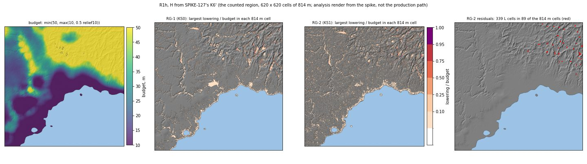
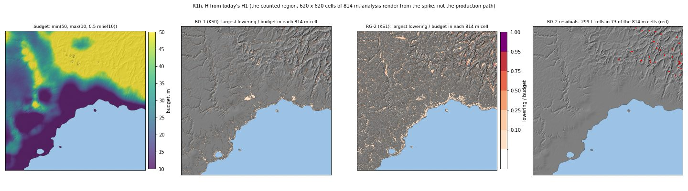
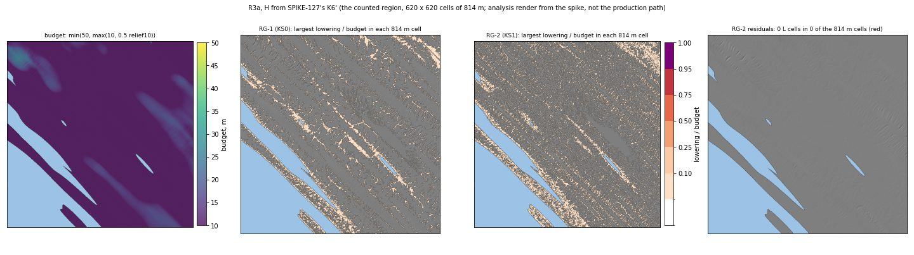
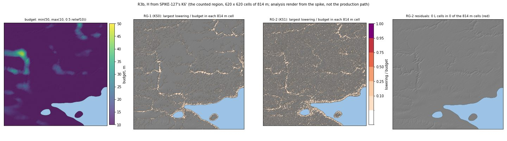
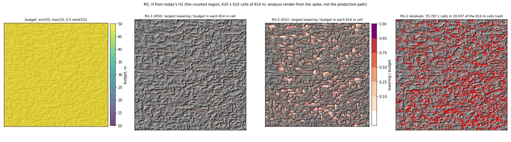
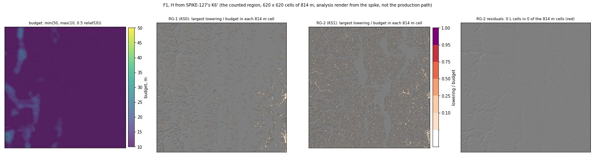

# SPIKE-128: KS in isolation on the five windows (G1b)

Opened: 2026-11-17 (lead #164; owner, 2026-11-16: contracts agreed)
Question: what does the conditioned start surface KS (KS0 on H1's HAND, KS1 on a fine HAND by flow path) do to `S0` on the five windows against the terrain-change budget, and does it need broad or deep change?
Why it matters: river graphs G1b (`digest/river-graph/plan.md` draft 4; addendum §3 G1b): KS is the band of RG-1 and RG-2; the stop rule decides whether constrained reconstruction opens as a separate prototype.
Time box: about 2 days (lead #164). Used: about 0.4 day.
Success criteria: RG-0, RG-1 and RG-2 on the five windows; per window the lowering against the budget as a distribution, the clipped band, new basins, G-DRAIN without an L round, ridges and saddles against `S0`, relief lost, the effect near divides, the residuals and where they lie; the stop rule answered.
Fallback if it fails: report the residuals and stop KS (plan §4.2). Not needed.
Code location: spike branch `spike/ks-g1b` (`crates/cache/examples/ks_g1b.rs`, never merged); maps `tools` in the session scratch, not kept.

## 1. Method
| Item | Definition |
|---|---|
| `S0` | the river gate's start surface of the window, `B + C1(z_s - z_b)`, at L (8,160 x 8,160 cells of 101.8 m) |
| `r` | `B - C1(z_b)` = `S0 - C1(z_s - z_b) - C1(z_b)`, through the regional field's own C1 read |
| `H` (today) | per 814 m cell, `z_s` over the first H1 channel cell (a cell of today's channel graph) on its receiver chain, or over the outlet (the sea at 0 m); read at L through the same C1 read |
| `H` (K6') | the same on SPIKE-127's K6': node heights (the lowest L cell of `S0`), the sill flood and routing, K6's hydrology and channel graph; copied from `spike/g1a-sills` 1d4e63f5 |
| RG-0 | `S0` |
| RG-1 | KS0 = `C1(z_s) + min(r, H)` = `S0 - max(0, r - H)`, `alpha` = 1 |
| RG-2 | KS1 = `S0 - max(0, r - H_f)`; `H_f` = KS0 over the first channel cell (drained area at least 1 km2, land) on its receiver chain in a routing of KS0 at L (epsilon 1 mm, the window's seed, default round rules); stand-in lines until G1d |
| Budget | G0 contracts §6: `relief_1km` per 814 m cell (range of `S0` over the L cells within 5 cells of its centre L cell, taken as index 4 of 8), `relief10` its p50 over the 814 m cells within 25 km, `budget = min(50, max(10, 0.5 relief10))` m |
| Clamp | lowering = `min(max(0, r - band), budget)`; a residual where `r - band` exceeds the budget |
| Protected | the L cells under H1's lake water cells at 814 m (today's kept basins, `front.lakes.water`) are never changed; L basins from 0.25 km2 (G1e) and K6''s own basins are not in this run; the gate's G-DRAIN does not exclude protected basins here (no H1 input), unlike G0 contracts §9 |
| Counted | land (`S0` > 0) inside the region's box; KS itself is applied on all land of the window, margin included |
| Gate | BUILD-055 and BUILD-057 on each surface with `S0` as the start, no H1 input, no L round: basins, G-DRAIN, `lowered`, relief at 1 km |
| Ridge, saddle | G0 contracts §9: a ridge cell of `S0` (land, inside, at least 2 m above both cells 2 cells away on an axis or diagonal); a cut-through saddle is a ridge cell lowered over 20 m with a channel at 1 km2 (5 km2) within one cell where `S0` has none; counted as 8-connected groups |
| Divides | the catchments of `S0`'s 75 km2 streams (a stream runs from a head down through every confluence along its larger donor; land draining straight to an outlet is one catchment); a divide cell has a land 4-neighbour of another catchment; "near" is within 10 cells (1 km, Chebyshev) |
| Stop rule (#164) | residuals over 1 % of land, or the budget's top 5 % used (lowering at 95 % of the budget or more, residuals included) on over 10 % of land |

## 2. Results, H from K6' (the KS0 that G1d reruns on)
| Window | Rung | Land lowered % | Lowering p50 / p95 / max, m | Volume km3 (requested) | Residual % of land | At 95 % of the budget or more, % | Land below the sea, cells | `r > 0` cells clipped % | Ridge cells lowered > 20 m % | Saddles 1 / 5 km2 | Basins | G-DRAIN % | Relief 1 km, m |
|---|---|---|---|---|---|---|---|---|---|---|---|---|---|
| R1h | RG-0 | 0 | - | 0 | 0 | 0 | 0 | 0 | 0 | 0 / 0 | 15,469 | 67.33 | 54.91 |
| R1h | RG-1 | 3.44 | 0.43 / 8.90 / 50.0 | 11.81 (11.84) | 0.002 | 0.002 | 30,143 | 7.29 | 0.31 | 159 / 127 | 15,389 | 66.72 | 55.00 |
| R1h | RG-2 | 5.76 | 0.55 / 7.78 / 50.0 | 18.55 (18.59) | 0.002 | 0.003 | 30,312 | 12.19 | 0.26 | 258 / 215 | 14,407 | 66.02 | 55.11 |
| R3a | RG-0 | 0 | - | 0 | 0 | 0 | 0 | 0 | 0 | 0 / 0 | 8,897 | 53.52 | 9.34 |
| R3a | RG-1 | 4.73 | 0.03 / 0.50 / 2.9 | 1.10 (1.10) | 0 | 0 | 60,414 | 10.09 | 0 | 0 / 0 | 8,589 | 51.38 | 9.37 |
| R3a | RG-2 | 6.46 | 0.06 / 0.59 / 3.1 | 1.91 (1.91) | 0 | 0 | 60,775 | 13.78 | 0 | 0 / 0 | 8,342 | 51.87 | 9.38 |
| R3b | RG-0 | 0 | - | 0 | 0 | 0 | 0 | 0 | 0 | 0 / 0 | 18,214 | 62.33 | 10.71 |
| R3b | RG-1 | 2.73 | 0.05 / 0.53 / 2.6 | 0.79 (0.79) | 0 | 0 | 18,533 | 6.02 | 0 | 0 / 0 | 18,026 | 61.15 | 10.72 |
| R3b | RG-2 | 5.44 | 0.06 / 0.52 / 2.7 | 1.58 (1.58) | 0 | 0 | 18,651 | 12.01 | 0 | 0 / 0 | 17,639 | 61.94 | 10.73 |
| M1 | RG-0 | 0 | - | 0 | 0 | 0 | 0 | 0 | 0 | 0 / 0 | 13,267 | 87.96 | 378.68 |
| M1 | RG-1 | 4.39 | 4.72 / 42.49 / 50.0 | 112.50 (120.71) | 0.152 | 0.171 | 0 | 9.16 | 2.08 | 1,688 / 1,608 | 13,422 | 87.10 | 378.84 |
| M1 | RG-2 | 9.07 | 4.25 / 37.66 / 50.0 | 209.66 (221.35) | 0.232 | 0.266 | 0 | 18.91 | 2.81 | 3,809 / 3,472 | 12,334 | 86.44 | 379.54 |
| F1 | RG-0 | 0 | - | 0 | 0 | 0 | 0 | 0 | 0 | 0 / 0 | 30,046 | 73.05 | 11.59 |
| F1 | RG-1 | 1.11 | 0.22 / 1.22 / 5.2 | 1.04 (1.04) | 0 | 0 | 2,653 | 2.32 | 0 | 0 / 0 | 29,694 | 72.69 | 11.60 |
| F1 | RG-2 | 3.37 | 0.23 / 1.16 / 5.0 | 3.12 (3.12) | 0 | 0 | 2,679 | 7.05 | 0 | 0 / 0 | 27,651 | 72.16 | 11.63 |

### 2.1 Lowering against the budget, % of land (H from K6')
| Window | Rung | <= 10 % | 10-25 % | 25-50 % | 50-75 % | 75-95 % | 95-100 % | residual |
|---|---|---|---|---|---|---|---|---|
| R1h | RG-1 | 3.00 | 0.33 | 0.09 | 0.02 | 0.004 | 0.001 | 0.002 |
| R1h | RG-2 | 4.98 | 0.61 | 0.13 | 0.02 | 0.004 | 0.001 | 0.002 |
| R3a | RG-1 | 4.70 | 0.03 | < 0.001 | 0 | 0 | 0 | 0 |
| R3a | RG-2 | 6.41 | 0.05 | < 0.001 | 0 | 0 | 0 | 0 |
| R3b | RG-1 | 2.71 | 0.01 | 0 | 0 | 0 | 0 | 0 |
| R3b | RG-2 | 5.41 | 0.02 | < 0.001 | 0 | 0 | 0 | 0 |
| M1 | RG-1 | 2.26 | 0.98 | 0.61 | 0.26 | 0.11 | 0.02 | 0.15 |
| M1 | RG-2 | 4.91 | 2.04 | 1.19 | 0.47 | 0.19 | 0.03 | 0.23 |
| F1 | RG-1 | 1.03 | 0.08 | 0.004 | < 0.001 | 0 | 0 | 0 |
| F1 | RG-2 | 3.14 | 0.22 | 0.008 | 0 | 0 | 0 | 0 |

### 2.2 Near divides (H from K6')
| Window | Land within 1 km of a divide % | Lowered near / elsewhere, % (RG-1) | (RG-2) | Lowering p95 near / elsewhere, m (RG-2) | Volume near divides % (RG-1 / RG-2) |
|---|---|---|---|---|---|
| R1h | 68.1 | 2.81 / 4.80 | 4.74 / 7.92 | 8.12 / 7.31 | 66.8 / 61.3 |
| R3a | 51.7 | 2.93 / 6.66 | 4.49 / 8.58 | 0.70 / 0.50 | 55.6 / 48.7 |
| R3b | 75.1 | 2.59 / 3.14 | 4.52 / 8.18 | 0.56 / 0.43 | 84.6 / 70.9 |
| M1 | 64.3 | 5.33 / 2.71 | 8.19 / 10.67 | 40.58 / 33.26 | 81.4 / 62.1 |
| F1 | 75.7 | 1.14 / 1.02 | 2.55 / 5.90 | 1.21 / 1.09 | 83.6 / 60.5 |
- A 75 km2 stream's catchment is about 9 km across, so half to three quarters of the land lies within 1 km of a divide.

### 2.3 Budget field and inputs
| Window | Budget p5 / p50 / p95 over the whole solve window (1,020 x 1,020 cells, margin included), m | Channel cells at 814 m, today / K6' | 814 m cells of H1 lake water (protected), % of the whole solve window |
|---|---|---|---|
| R1h | 10.0 / 26.6 / 50.0 | 47,951 / 63,095 | 4.8 |
| R3a | 10.0 / 10.0 / 24.0 | 78,235 / 95,778 | 3.7 |
| R3b | 10.0 / 10.0 / 21.2 | 80,945 / 95,452 | 3.1 |
| M1 | 50.0 / 50.0 / 50.0 | 87,512 / 112,030 | 14.5 |
| F1 | 10.0 / 10.0 / 13.0 | 89,067 / 99,892 | 9.4 |

## 3. Today's H against K6' (RG-1; RG-2's land lowered differs by at most 0.31 points between the two, its saddles by up to 18 %)
| Window | Land lowered %, today / K6' | Residual %, today / K6' | Ridge > 20 m %, today / K6' | Saddles 1 km2, today / K6' | G-DRAIN %, today / K6' |
|---|---|---|---|---|---|
| R1h | 1.47 / 3.44 | 0.001 / 0.002 | 0.13 / 0.31 | 67 / 159 | 67.26 / 66.72 |
| R3a | 2.21 / 4.73 | 0 / 0 | 0 / 0 | 0 / 0 | 52.83 / 51.38 |
| R3b | 1.02 / 2.73 | 0 / 0 | 0 / 0 | 0 / 0 | 61.86 / 61.15 |
| M1 | 1.70 / 4.39 | 0.064 / 0.152 | 0.89 / 2.08 | 586 / 1,688 | 87.58 / 87.10 |
| F1 | 0.40 / 1.11 | 0 / 0 | 0 / 0 | 0 / 0 | 73.02 / 72.69 |
- Full rows for both: `raw/ks.csv`; run logs `raw/run-<h1|k6p>-<window>.txt`.

## 4. Reading
- **Stop rule: not reached.** The largest residual share is 0.23 % of land (M1 RG-2), against 1 %; the largest share at 95 % of the budget or more is 0.27 % (M1 RG-2), against 10 %. KS needs no broad or deep change; constrained reconstruction is not opened.
- **The change is shallow except on M1.**
  - R3a, R3b and F1: the lowering never exceeds 5.2 m and stays under 25 % of the budget on all but at most 0.008 % of land.
  - R1h: p95 8.9 m; 339 residual cells (RG-2), all in the high north-east where the budget is 50 m.
  - M1: p95 38-42 m against a 50 m budget everywhere; RG-2 wants 221 km3 and gets 210; the residuals (57,129 cells, RG-2) are spread over the whole window, not clustered.
- **KS1 lowers more cells than KS0, not deeper ones.** `H_f` on the 1 km2 network reaches into every small valley, so RG-2 lowers 3.4-9.1 % of land against RG-1's 1.1-4.7 %, with a p95 within 0.1 m of RG-1's or lower.
- **K6' lowers more than today's H1** in RG-1 (2.1-2.8x the cells; 12-32 % more channel cells at 814 m), because its HAND is measured from node heights (the lowest L cell); RG-2 hardly depends on the H source.
- **Ridges and saddles.** No ridge cell is lowered over 20 m on R3a, R3b and F1. R1h: 0.26-0.31 % of ridge cells, 159-258 saddles at 1 km2. M1: 2.1-2.8 % of ridge cells, 1,688-3,809 saddles at 1 km2; the 50 m budget is what allows a ridge cut there.
- **New basins: none net.** Every KS surface has a lower G-DRAIN than `S0` (by 0.03 to 2.14 points) and fewer basins, except M1 RG-1 with more basins at a lower G-DRAIN: 155 more with K6' (13,422 against 13,267), 24 more with today's H. The gate counts basins, not their identity, so a basin made and another removed cancel.
- **Relief:** 1 km relief rises by at most 0.87 m (M1): KS deepens valley floors and leaves the tops.
- **Near divides:** in RG-2 on R1h, R3a, R3b and F1 a cell near a divide is lowered less often than one elsewhere ( 2.6-4.7 % against 5.9-8.6 %). On M1, RG-1 lowers near divides twice as often (5.3 % against 2.7 %); RG-2 then lowers elsewhere more.
- **Coasts:** KS lowers 2,653 (F1) to 60,775 (R3a) land cells below the sea (up to 0.30 % of land), low coastal plains near a channel. They become outlets in any routing; the budget does not stop it (it limits depth, not the sea line).

## 5. For G1d, G1f and the lead
- KS0 with H from K6' is written for G1d's RG-1 rerun (lead, 2026-11-17): `C:/DEV/SeriousPlanetData/tmp/ks-g1b2/k6p/<window>/ks0-k6p-8160x8160.f64` with a note `ks0-k6p.txt` (crusader told).
- Open points:
  - land lowered below the sea: KS needs a rule (hold land at the sea level plus a margin, or let the coast move and report it);
  - protected basins: only H1's lake water is held; G1e's L basins (0.25 km2) join when they land;
  - M1's saddles at a 50 m budget: a ridge-protection term or a lower cap on ridge cells is a G1f or G2 question, not a KS stop.

## Visuals
Each sheet: the counted region (620 x 620 cells of 814 m) over a hillshade of `z_s` at 814 m, sea in blue. Panels: the budget field; the largest lowering / budget in each 814 m cell for RG-1 and RG-2; RG-2's residual cells (red). Analysis renders from the spike, not the production path.

R1h, H from K6': lowering along the valleys; residuals only in the high north-east.

R1h, H from today's H1: RG-1 lowers fewer cells; RG-2 is near-identical to K6'.

R3a, H from K6': the budget at the 10 m floor on most of the region (up to about 20 m top left); lowering at most 3.1 m, no residual.

R3b, H from K6': the budget at the 10 m floor except a few patches up to about 40 m (top left); lowering at most 2.7 m along the channel network, no residual.

M1, H from K6': a 50 m budget everywhere; RG-2's residuals spread over the whole window.

M1, H from today's H1: RG-1 lowers about 40 % of K6''s cells; RG-2 as K6'.

F1, H from K6': lowering at most 5.2 m; no residual.

## Addendum: KS on the new start, KH(h4c) + r' (spikes lane, lead #140, 2026-11-17)
Question: what does KS do on the start that SPIKE-136 settled, KH(h4c) + the band with a sea floor, against KS on `C1(z_s)` + `r` above? How much of KS's work did the hand-over take over?
Time box: half a day (used: about 3 h).

Code location: spikes' branch `spike/kh-stage` @ c9344138 (never merged): `crates/cache/examples/ks_kh.rs`, a copy of this spike's `ks_g1b` (e359dfae). Explorer told (2026-11-17); `spike/ks-g1b` is untouched.
- `--kh c1`: the code above, unchanged except `g2: None` for main's `GateInput`. It reproduces this spike's R1h rows exactly (`raw/ks-c1check-r1h.csv` against `raw/ks-c1-r1h.csv`).
- `--kh h4c`: KS's base is KH(h4c)(`z_s`) + `r'` (`planet_generators::bake::kh`, reading 20).
  - `r'` = max(`r`, sea + 0.5 m - KH) on the cells where KH(`z_s`) lies above the sea level + 0.5 m, so the base stays at or above that level there (reading 17).
  - KS lowers the base by min(max(0, `r'` - band), budget, base - (sea + 0.5 m)).
- `S0` stays the reference of every measure (ridges, saddles, the gate's relief), as above.
- KS's lowering (RG-1, RG-2) is dumped, and SPIKE-135's probe (`repair_debt`, spike/repair-debt) splits it by `S0`'s defect class.
- H from today's K6. The other rules are those of section 1 (budget, protected cells, counted cells, gate).
- Tables: `raw/ks-kh-tables.md`, built by `tools/ks_kh_tables.py raw r1h r3a r3b m1 f1` from `raw/ks-kh-<w>.csv` (this run), `raw/ks-c1-<w>.csv` (section 3's runs, H from today; the same values as `raw/ks.csv`'s `h1` rows) and the split lines `raw/split-kh-<w>.txt`, `raw/split-c1-<w>.txt` (SPIKE-135's probe; `split-c1` from SPIKE-135's `raw/ladder-<w>.csv`).

### The band's sea floor
Over the box (from `raw/ks-kh-run-<w>.txt`):

| Window | Cells floored | Of them within 2 km of KH's sea | Volume raised, km3 | Base against `S0`: lower / higher over 10 m, cells | Reading 17's clamp held KS below its budget, cells summed over RG-1 and RG-2 |
|---|---|---|---|---|---|
| R1h | 24,186 | 3,712 | 0.637 | 372,341 / 191,685 | 257,889 |
| R3a | 57,806 | 412 | 0.065 | 5,915 / 993 | 1,018,149 |
| R3b | 6,004 | 41 | 0.004 | 110,658 / 29,943 | 233,493 |
| M1 | 0 | 0 | 0 | 2,607,168 / 2,118,673 | 0 |
| F1 | 11,964 | 0 | 0.033 | 41,331 / 8,823 | 246,443 |

- "Within 2 km of KH's sea": within 20 L cells (Chebyshev) of a cell where KH(`z_s`) lies at or below 0 m.
- Most floored cells lie inland, where the band dips the base under 0.5 m, not on the coast.
- The clamp is broad on R3a's coastal plain, where the base lies just above 0.5 m.
- The base's differences from `S0` are SPIKE-136's: KH against the C1 read.

- Cells where KH(`z_s`) itself lies at or below the sea level + 0.5 m are not floored. "Land at or below 0 m" counts the cells of `S0`'s land in the box whose base is at or below 0 m: 0 (M1) to 71,615 (R3a) in RG-0. They include cells with KH(`z_s`) between 0 and 0.5 m where `r` is negative.
- Reading 17's clamp keeps KS from adding any: these counts are the same in RG-1 and RG-2. On `C1` + `r` KS pushed 2,454-57,118 land cells under the sea on four windows (M1 none).

### Results
River gate on the stages, G-DRAIN (% of river cells in closed basins):

| Start | Stage | R1h | R3a | R3b | M1 | F1 |
|---|---|---|---|---|---|---|
| `C1(z_s)` + `r` | RG-0 | 67.3 | 53.5 | 62.3 | 88.0 | 73.0 |
| `C1(z_s)` + `r` | RG-2 | 66.0 | 52.0 | 62.0 | 86.5 | 72.2 |
| KH(h4c) + `r'` | RG-0 | 36.3 | 32.0 | 11.8 | 61.4 | 54.0 |
| KH(h4c) + `r'` | RG-1 | 32.1 | 29.9 | 11.2 | 55.2 | 53.2 |
| KH(h4c) + `r'` | RG-2 | 21.0 | 22.6 | 8.1 | 43.5 | 49.7 |

KS's lowering, volume / requested, km3:

| Start | Stage | R1h | R3a | R3b | M1 | F1 |
|---|---|---|---|---|---|---|
| `C1(z_s)` + `r` | RG-1 | 4.68 / 4.70 | 0.44 / 0.44 | 0.27 / 0.27 | 46.15 / 49.50 | 0.33 / 0.33 |
| `C1(z_s)` + `r` | RG-2 | 18.24 / 18.27 | 1.84 / 1.84 | 1.56 / 1.56 | 208.74 / 220.11 | 3.10 / 3.10 |
| KH(h4c) + `r'` | RG-1 | 4.57 / 4.70 | 0.35 / 0.44 | 0.26 / 0.27 | 46.15 / 49.50 | 0.32 / 0.33 |
| KH(h4c) + `r'` | RG-2 | 12.57 / 12.65 | 1.52 / 1.59 | 1.07 / 1.08 | 105.71 / 109.95 | 2.64 / 2.64 |

- **RG-1 asks for the same.** KS0's want is `r` - H, with H from H1 at 814 m; the hand-over does not change it. The volume falls only where reading 17's clamp holds it (R1h, R3a; by 0.01 km3 on R3b and F1).
- **RG-2 asks 14-50 % less and lowers 15-49 % less.** Its H_f comes from the routing of KS0, which drains better on the new start.
- Residuals: the same in RG-1. In RG-2: 141 against 299 (R1h), 23,480 against 55,787 (M1), 0 elsewhere.

SPIKE-135's split of KS's lowering, share on interpolation-class cells / on cells with no `S0` breach, %:

| Window | RG-1, `C1` | RG-1, KH | RG-2, `C1` | RG-2, KH |
|---|---|---|---|---|
| R1h | 41 / 50 | 42 / 49 | 33 / 63 | 22 / 74 |
| R3a | 5 / 92 | 6 / 91 | 7 / 91 | 4 / 95 |
| R3b | 8 / 90 | 9 / 90 | 19 / 80 | 7 / 92 |
| M1 | 51 / 36 | 51 / 36 | 46 / 47 | 28 / 64 |
| F1 | 14 / 78 | 14 / 77 | 16 / 81 | 14 / 79 |

- On the new start, KS1 spends less of its lowering on the interpolation defects (M1 46 to 28 %, R3b 19 to 7 %): the hand-over already removed them. Its remaining work lies more on cells `S0` does not need breached. That is the band against H_f, not a drainage repair.

Ridges and saddles against `S0` (`raw/ks-kh-tables.md`):
- On the new start, RG-0 already has 0.49-7.10 % of `S0`'s ridge cells lower than `S0` by over 20 m. That is the hand-over itself: KH against the C1 read (SPIKE-136 addendum 3).
- KS adds 0.00-0.93 points.
- The cut-through saddle count (a ridge cell lowered over 20 m next to a channel `S0` does not have) rises to 54-13,008 at RG-2, against 0-3,432 on `C1`. It is not measured at RG-0 (no channels are routed there), so the RG-0 cells of `raw/ks-kh-tables.md` read "-".
  - It is measured against `S0`'s ridges and channels, so on the new start it also counts the hand-over's own moves of channels and ridges.
  - It does not compare with section 3's count. KS's own share was not separated.

### Reading
1. **The hand-over took over most of the drainage repair; KS's lowering is about the same.**
   - Before KS, the new start already brings G-DRAIN from 53.5-88.0 % (`S0`) to 11.8-61.4 %.
   - KS then takes it further, to 8.1-49.7 % after RG-2. On `C1` + `r`, KS took it only from 53.5-88.0 % to 52.0-86.5 %.
   - KS's requested lowering is unchanged in RG-1 and 14-50 % lower in RG-2.
2. **KS works on the band, not on the drainage defects.** Of KS1's lowering on the new start, 64-95 % lies on cells `S0` does not need breached (`C1`: 47-91 %).
3. **Reading 17 holds.**
   - The band's floor lifts the base on the cells where KH lies above the sea + 0.5 m.
   - KS adds no land below the sea.
   - Land at or below 0 m stays only where KH itself is that low: coastal strips, 0-71,615 cells.

One line: **the hand-over takes over the drainage repair. River length in basins before KS falls from 54-88 % to 12-61 %, and after KS1 it reaches 8-50 %, against 52-86 % on `C1` + `r`. KS0's request is unchanged (its lowering 0-19 % smaller, where reading 17's clamp holds it) and KS1's lowering is 15-49 % smaller; KS stays the band against HAND.**
