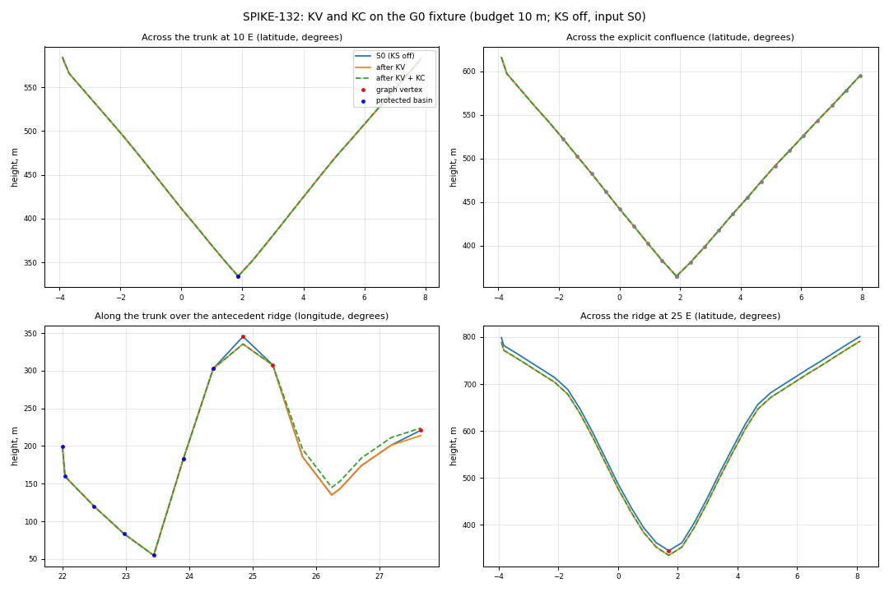
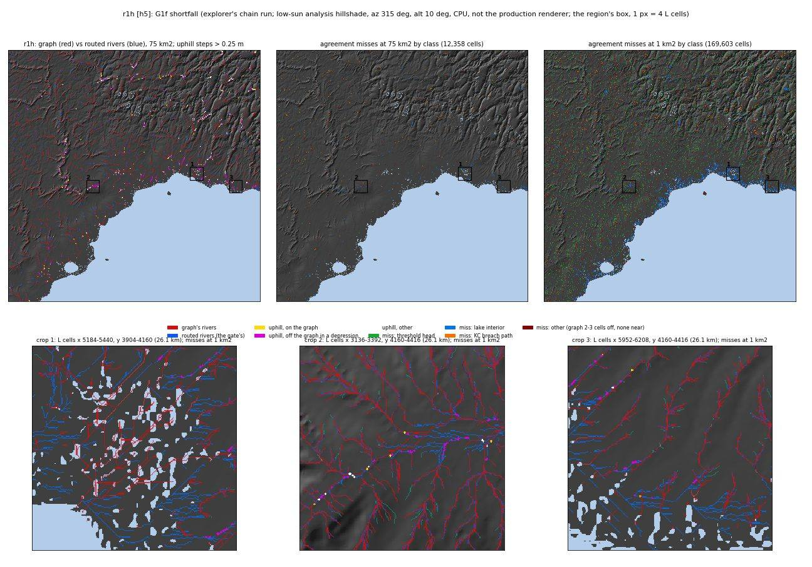
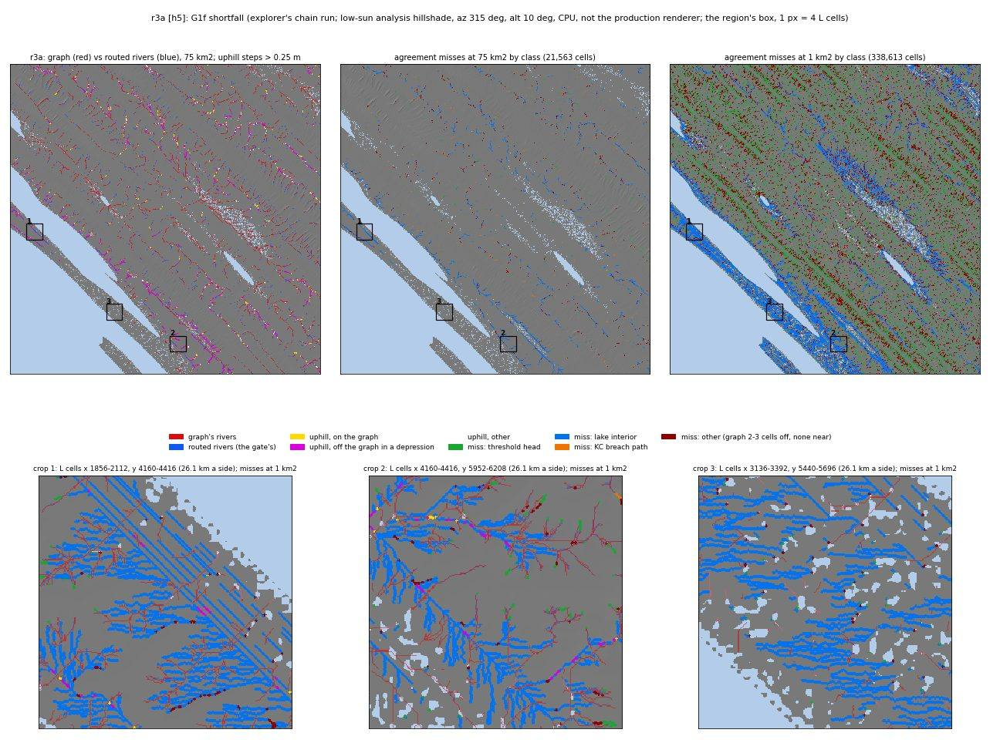
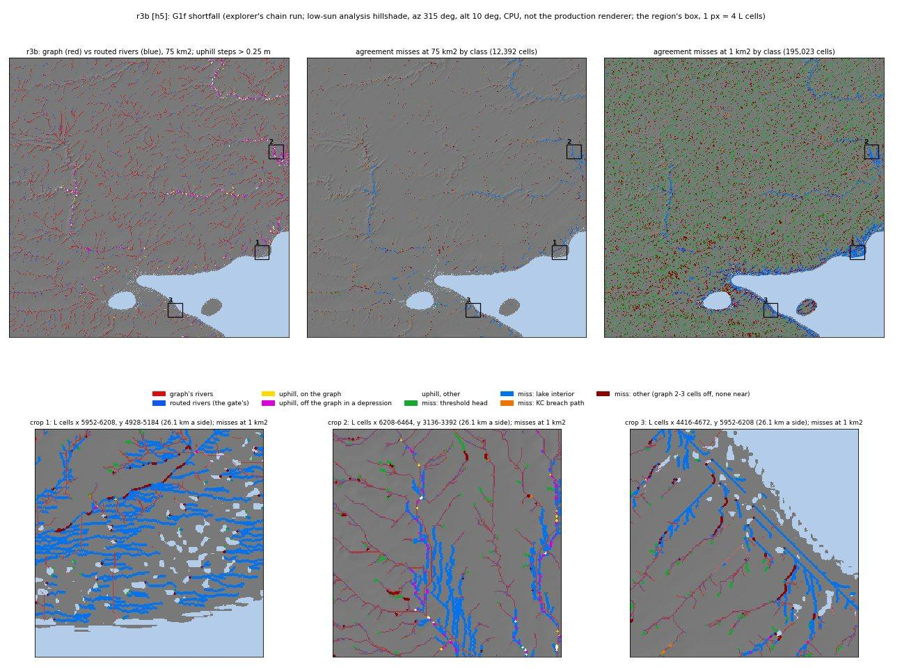
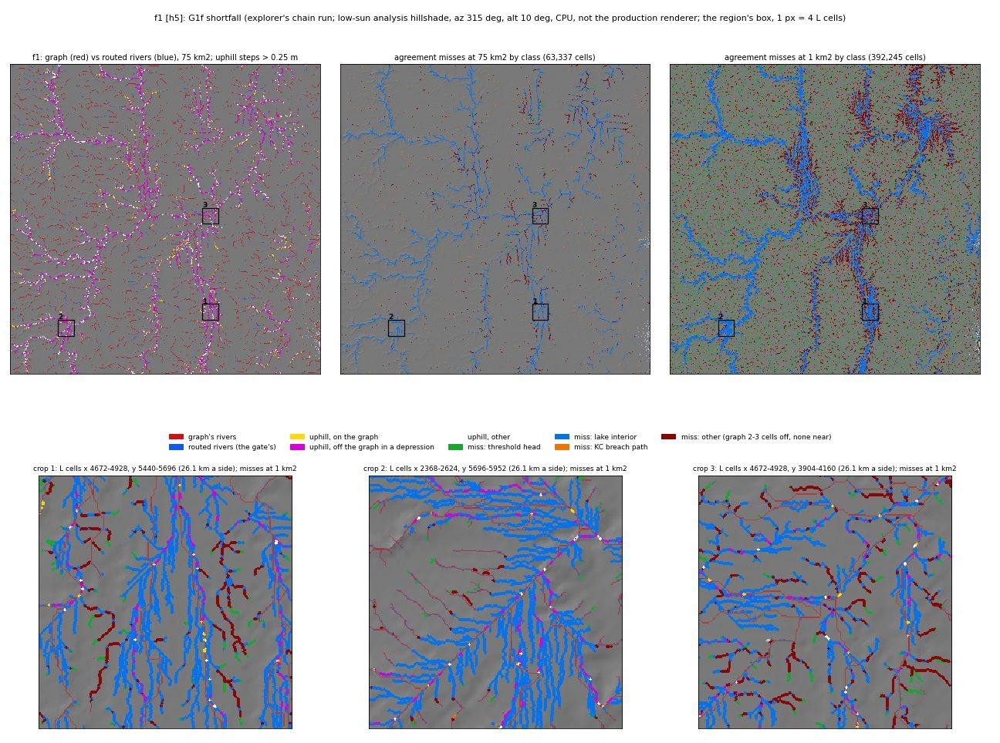
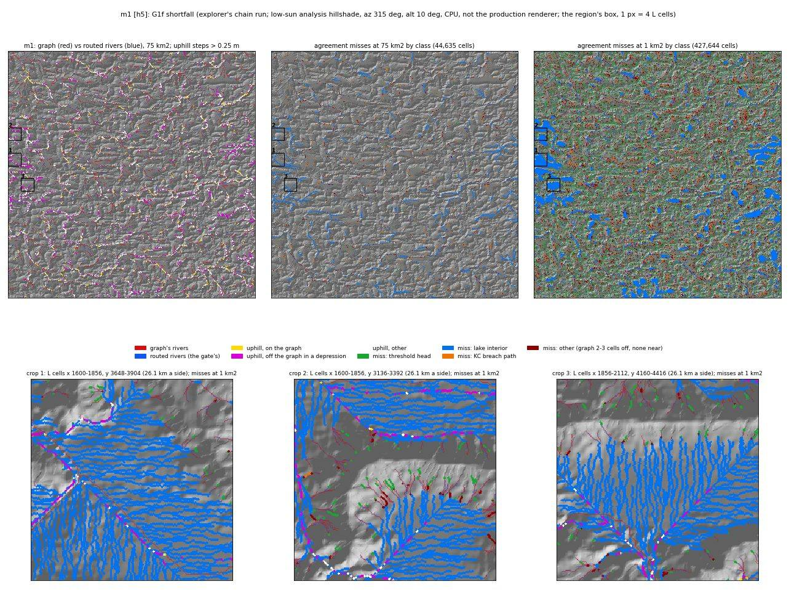

# SPIKE-132: KV and KC on the G0 fixture (G1f, early)

Opened: 2026-11-17 (lead #157)
Question: do KV (valleys around the graph's beds) and KC (non-basin pits) hold the G0 contracts' budget, divides, protected basins and exceptions, switchable, on synthetic graph inputs before KG lands?
Why it matters: G1f of the river-graph plan; the addendum's section 6 lets the terrain lane prototype on synthetic inputs.
Time box: 1-2 days (used: about 0.5 day).
Success criteria: each switch (KV only, KC only, both) keeps the budget (no overrun, every clamp recorded), leaves the divide buffer, the protected basins and the antecedent ridge's exception as the contract says, and reports per-stage use and residuals; cross-sections of the trunk, a confluence and the ridge.
Fallback if it fails: name the contract rule the prototype cannot meet.
Code location: branch `spike/kv-kc` (local, never merged):
- `crates/generators/src/bake/kv_kc.rs`;
- `crates/generators/tests/kv_kc_g1f.rs`.
Inputs: the fixture's expected graph (TEST-140: L beds, `q_w`, the trunk's `exception(rise_over_budget)`) on `S0` with KS off (labelled). The protected basins are `S0`'s kept L basins: reading 5 names KS1, and with KS off KS1 is `S0`. The budget is the fixture's: the 10 m floor everywhere on this tiny body.

## 1. Stages (plan sections 3.2 and 3.4)
| Stage | Rule |
|---|---|
| KV | Around every L vertex, `V(x) = bed + S_wall max(0, d - W_floor/2)`: `S_wall` 0.20, `W_floor` = 3 x GEN-165's width of `q_w`, `d` the chamfer distance to the nearest vertex (ties by cell id). KV lowers to `V` and never raises. Weight zero within `d_buf` = 200 m of a divide and on protected cells. The lowering is held at the budget left; a clamp writes a residual (feature: the nearest reach). |
| Divide | Cells whose D8 paths (the graph's routing seed) reach different river chains (reaches joined across tile crossings) or the sea; a path reaches a chain within 1.5 cells of a vertex. |
| KC | The cells of KV's output in a depression of the hierarchy (SPIKE-130's sweep), outside protected basins, filled to their tree's spill height within the budget; a deeper fill is held at the budget with a residual. Patches counted with their volume. |
| Switch | KV only, KC only, both; checked with GEN-189's `validate_budget` |

## 2. Results on the fixture
| Measure | KV only | KC only | KV + KC |
|---|---|---|---|
| KV: cells lowered; lowering p50 / p99 / max, m | 1,310; 4.48 / 10.00 / 10.00 | 0 | 1,310; 4.48 / 10.00 / 10.00 |
| KV clamps (residuals) | 525 | 0 | 525 |
| KC: cells filled, patches, volume | 0 | 31, 2, 2.22e6 m3 | 29, 2, 2.10e6 m3 |
| KC fills held at the budget (residuals) | 0 | 21 | 19 |
| Overruns, raises in a lowering stage, unrecorded clamps | 0 | 0 | 0 |
| Divide cells (within `d_buf`); KV changes there | 3,474 (6,741); 0 | same; 0 | same; 0 |
| Protected cells; changed | 243; 0 | 243; 0 | 243; 0 |
| Trunk: largest lowering (budget 10 m); rise over its running minimum after the stage | 10.00; 261.9 m | 0; 271.9 m | 10.00; 261.9 m |
| Residual features already exceptional (cannot be flagged `budget_residual`) | 458 | 21 | 477 |
| Same bits on a second run | yes | yes | yes |

- The antecedent ridge's exception is left uncut: the crest falls only by the budget (345 to 335 m along the trunk), and the rise stays.
- KV is nearly idle on this body. The 10 m budget holds 525 of 1,310 lowered cells at the cap. The valley floor upstream of the ridge lies in the protected basin that `S0`'s C1 trough forms behind the crest, so KV only touches the walls there.
- KC fills the reported basin at 26.3 E (floor 135 m, spill 234.5 m) by its 10 m budget, and a 5-cell coastal pit.

## 3. Findings
1. The prototype meets the switches' hard rules on the fixture:
   - no overrun, every clamp recorded;
   - divides, protected basins and the ridge exception kept;
   - deterministic.
2. Contract gap, a fill clamp: GEN-189's `Stage` states a wanted lowering, not a wanted fill. A fill held at the budget (KC: 19-21 cells) leaves a residual the validator reads as recording nothing. The test checks those apart: the fill equals the budget and the need is above it. Proposal: a `wanted_fill` per stage, its clamp recorded like a lowering clamp.
3. Contract gap, one status per reach: the residual's feature must be `exception(budget_residual)`, but the trunk is already `exception(rise_over_budget)`. That is 458-477 residuals whose feature cannot carry both. Proposal: a list of exceptions per reach, or the residual list as the record for a reach that is already exceptional.
4. Divides meet the rivers at every confluence and junction, so the 200 m buffer leaves KV idle there. The confluence section shows it: every cell is in the buffer. G1f's integrated run should measure the share of graph cells inside the buffer.
5. With KS off, `S0`'s dam basin behind the ridge protects the valley floor upstream (reading 5's reason for KS1). On the integrated run KS1 removes it, and KV then acts on the floor.

## 4. Recommendation
- Keep the KV and KC structure for G1f: cross-section from the nearest vertex, divide buffer from chain catchments, KC from the hierarchy (the flood's grading ramp on flats would make plateau patches).
- Lead decisions for the contract: a wanted fill for fill clamps (finding 2); several exceptions per reach (finding 3).
- Run KV and KC on KS1 once G1b lands, before judging valley shape.

## 5. Addendum (lead #162 and #163, 2026-11-18): lake share under reading 22, uphill steps and agreement on five windows
Runs:
- Lake share: the producer's `produce_drain` (reading 22) on KS1, crusader's runs (#161 setup).
- Uphill steps and agreement: the gate's own routing (BUILD-057, BUILD-060) on the final surface of explorer's h5 chain runs, one per window.
- Classes from `crates/cache/examples/g1f_diag.rs` on `spike/g1f-diag-crusader`; the logs are in `raw/162/`.
- A step's upper cell gets the first matching class in this order: exception, lake inlet, junction, tile crossing, budget full, on a trunk, on a tributary, off the graph.
- A miss is a routed river cell with no graph cell within 1 cell. Its class:
  - lake interior: inside a depression of the final surface, flood epsilon 1e-3, depth over 0.1 m;
  - KC breach: on a KC breach path;
  - threshold head: routed area under twice the threshold;
  - graph offset: a graph cell 2-3 cells away;
  - other: none of these.

### 5.1 Lake share under reading 22
| Window | Reading 5 (#160) | Reading 22 |
|---|---|---|
| R1h | 3.3 % | 0.03 % |
| R3a | 0.7 % | 0 % |
| R3b | 0.2 % | 0 % |
| F1 | 11.2 % | 1.2 % |
| M1 | 19.8 % | 15.1 % |

- M1 alone stays over the owner's 10 % trigger. 39,630 depressions drain there, and 42,127 kept basins remain on 4.8 % of its land.
- Peak 7.9-8.1 GB.

### 5.2 Uphill steps (bar 1.0 %)
| Window | Uphill | Off graph | Junction | On trunk | Lake inlet | Budget full | Exception |
|---|---|---|---|---|---|---|---|
| R1h | 1.37 % | 54.8 % | 17.1 % | 13.1 % | 7.7 % | 2.0 % | 2.3 % |
| R3a | 3.32 % | 70.9 % | 10.0 % | 14.0 % | 2.6 % | 0.1 % | 0.2 % |
| R3b | 0.80 % | 65.7 % | 15.3 % | 9.7 % | 2.8 % | 1.5 % | 0.8 % |
| F1 | 8.17 % | 71.7 % | 10.0 % | 9.2 % | 5.5 % | 3.3 % | 0.2 % |
| M1 | 15.74 % | 49.6 % | 11.5 % | 6.8 % | 14.3 % | 6.8 % | 10.9 % |

- The largest class on every window is off the graph. Every off-graph step lies inside a depression of the final surface, and KC left most of them untouched (R3b 80 %, R1h 93 %, R3a 98 %, F1 and M1 100 %); KC partly filled the rest.
- Depression depth at the step:

  | Window | p50 | p90 |
  |---|---|---|
  | R1h | 1.6 m | 15.9 m |
  | R3a | 1.2 m | 3.5 m |
  | R3b | 1.2 m | 2.6 m |
  | F1 | 4.0 m | 20.8 m |
  | M1 | 41 m | 404 m |

- Cause: the gate's routing crosses depressions that no stage removed. Their p50 on R1h, R3a and R3b lies under the producer's 2 m kept depth, so most are below the producer's candidate size and no stage sees them. On M1 and F1 the depths match the kept lakes of 5.1.
- Not checked: the share of these steps inside a kept basin, and the stage that made each depression (KS, KV or KC).

### 5.3 Agreement (bar 90 %)
| Window | Agree, 1 km2 | Agree, 75 km2 | Misses at 1 km2 (head / lake / offset / KC / other) | Misses at 75 km2 (lake / KC / offset / head / other) |
|---|---|---|---|---|
| R1h | 81.0 % | 89.5 % | 46.5 / 20.9 / 17.9 / 8.5 / 6.1 % | 32.4 / 32.2 / 18.1 / 12.7 / 4.6 % |
| R3a | 71.3 % | 78.8 % | 34.1 / 45.8 / 14.9 / 0.9 / 4.4 % | 75.7 / 3.1 / 10.1 / 7.6 / 3.5 % |
| R3b | 83.2 % | 92.8 % | 55.3 / 20.1 / 18.3 / 2.1 / 4.3 % | 56.4 / 8.2 / 22.6 / 9.4 / 3.5 % |
| F1 | 68.5 % | 70.8 % | 22.4 / 52.6 / 8.4 / 2.9 / 13.6 % | 76.7 / 2.2 / 6.1 / 8.5 / 6.5 % |
| M1 | 72.2 % | 74.8 % | 28.7 / 52.5 / 11.1 / 5.2 / 2.5 % | 74.8 / 10.7 / 8.8 / 4.1 / 1.7 % |

- At 75 km2, lake interiors are the largest class on four windows. On R1h, KC breach paths match them.
- At 1 km2, threshold heads lead on R1h and R3b, and lake interiors on R3a, F1 and M1.
- The sheets show three patterns:
  - lake interiors: the routed rivers cross the depressions of 5.2 as parallel combs. On M1 (crop 3) they cover a whole basin floor.
  - threshold heads: short head segments, where the routed network starts upslope of the graph's heads.
  - graph offset: graph lines that run 2-3 cells beside the routed channel on flat valley floors.

### 5.4 Proposed source fixes (no tuning)
1. **Depressions below the kept size (uphill off the graph, lake misses on R1h, R3a and R3b).**
   - Reading 22 drains every depression unless both breach and fill exceed the budget left. The producer, however, tests only candidates from 0.25 km2 and 2 m, so smaller depressions reach the final surface.
   - Proposal: KC applies reading 22 to every depression of its output, not only to the producer's candidates.
   - First, find the stage that made them (a depression count per stage surface in `stages/`). If KV makes them, the fix belongs in KV (fix at the source stage).
2. **Kept lakes (M1 and F1, and part of the lake misses).**
   - A kept basin is water by reading 22. The gate routes across its bed and so counts both uphill steps and misses.
   - Proposal: BUILD-057 and BUILD-060 route a kept basin at its spill level and leave its interior out of both counts.
   - This changes the gate's rule, so it needs a decision. Default: count kept-basin interiors apart, and judge the bars without them.
3. **KC breach paths (R1h: 32 % of misses at 75 km2).**
   - A KC breach makes a new outlet path, and the graph does not hold it.
   - Proposal: the breach path becomes the basin's outlet reach in the graph, joining the graph at the breach's end node, so KV and the gate see the same line.
4. **Threshold heads (R1h and R3b at 1 km2).**
   - KG-trib places its heads by D8 initiation (reading 14) on the surface before KV and KC. The gate initiates on the final surface, where KV and KC have moved the accumulation.
   - Proposal: re-run the head initiation on the final surface (one more KG-trib pass after KC), or the gate's agreement starts at the graph's own heads.
   - The first form changes the chain order and needs a decision. Default: the second, as a rule of BUILD-060.
5. **Graph offset (6-23 % of misses).**
   - Graph lines run 2-3 cells beside the routed channel on flat floors. KV carves the valley, but on a flat floor the routing does not have to follow the carved line.
   - Proposal: KV's floor profile keeps a cross-slope toward the line. This is a small form change in KV; measure it on R1h first.

## Visuals

The KV + KC run on the G0 fixture (CPU, no GPU path), budget 10 m, KS off. Panels: across the trunk at 10 E; across the explicit confluence (every cell within the divide buffer); along the trunk over the antecedent ridge (crest lowered by the budget only, the pit at 26.3 E filled by KC); across the ridge at 25 E. Dots: graph vertices (red), protected basin (blue), divide buffer (grey). CSVs in `sections/`, the run's report in `report.txt`.

Shortfall sheets (#163). Each one shows one window's counted box from explorer's h5 chain run as a low-sun analysis hillshade (CPU, az 315 deg, alt 10 deg, not the production renderer). Panels:
- the graph's rivers against the routed rivers at 75 km2, with the uphill steps by class;
- the misses at 75 km2 and at 1 km2 by class, dilated so that single cells stay visible (sparse classes look larger than their counts);
- three full-resolution crops, 26 km a side, of the densest miss clusters.

R1h (h5).

R3a (h5); crop 1: routing in straight parallel lines over a flat coastal lowland.

R3b (h5).

F1 (h5); lake-interior combs along the main valleys.

M1 (h5); crop 3: a kept basin floor crossed by the routed rivers.
