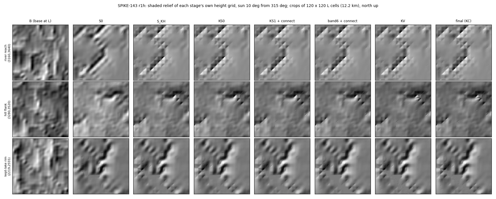
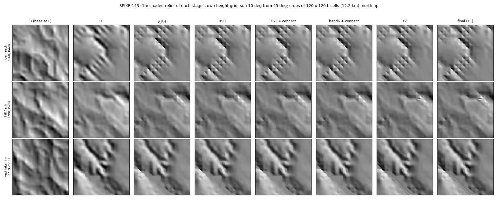
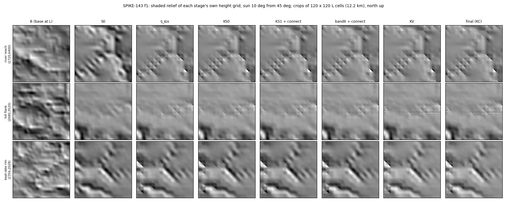
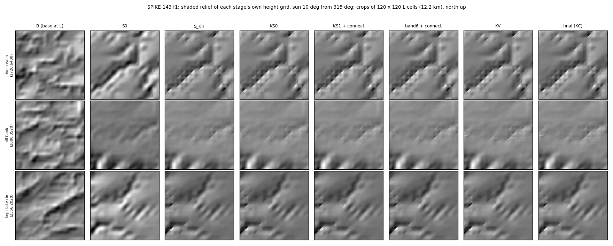
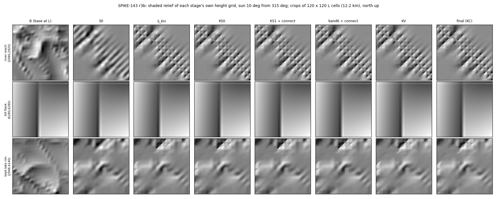
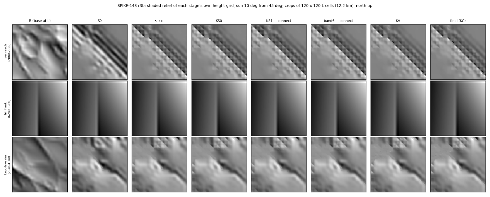
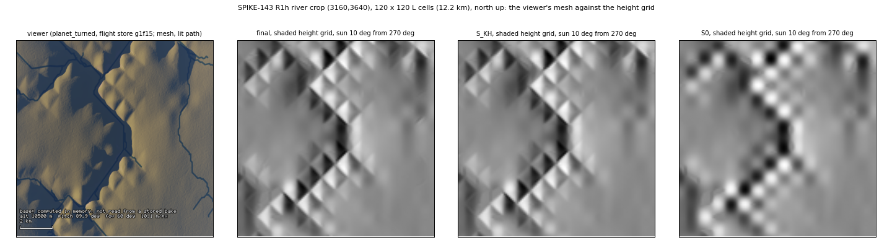
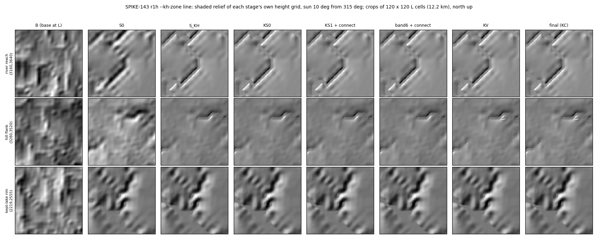
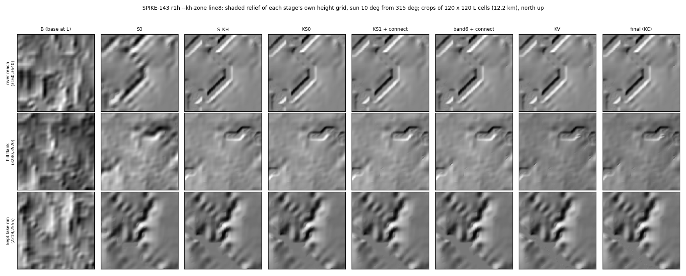

# SPIKE-143: which stage makes the pyramid and chainsaw looks?

Opened: 2026-11-23 (lead #176, amended #176b; G3 gate row G3-9, risks R11 and R12, adopted by the owner on 2026-11-23)
Question: On RG's own chain (spike tip, today's defaults), which stage makes (a) the pyramid look (lattice-scale facets or bumps at 611 m or 814 m) and (b) the chainsaw look (triangles and saw-tooth banks along river beds)? Which layer makes the parked looks: K5's diagonal washboard (SPIKE-139), straight rivers, diamond hills?
Why it matters: G3-9 removes the pyramid and chainsaw looks at their source stage before the port; O5 decides which parked look items join it; O8 decides on straight rivers.
Time box: 1.5 days of agent work.
Success criteria: renders per stage on R1h, F1 and R3b; the pre-registered metric per stage and window; each look attributed to its stage and mechanism, with candidate source fixes named.
Fallback if it fails: the looks stay unattributed G3-9 items, judged on renders only.
Code location: `spikes/look-attribution/results/raw/` (analysis and render scripts). The chain is `spike/rg-prototype` 7fe4e73d with this lane's local switches, all off.
Status: closed 2026-11-23. The metric was registered before any render was looked at (#176b, commit 5a17b104); the post-hoc measures are labelled.

## Answer
| Look | Stage that makes it | Mechanism | Whose code | Candidate source fix (not built) |
|---|---|---|---|---|
| Chainsaw: triangles and saw-tooth banks along river beds | S_KH (KH h5) | h4c's triangulated read of z_s along the channel zone: each 814 m quad on a diagonal river is split into triangles. The renders show the triangles from S_KH on, none in S0. Post-hoc in-zone quad-diagonal excess Xdiag is 0.003-0.005 on S0 and 0.105-0.117 on S_KH in all three windows, and it stays to the final surface. | RG (KH, this lane's stage) | a zone read in KH that does not follow the quad split (the clamped Clough-Tocher of h4c draws the split as facets), for example C1 with only the step carved, or a sub-cell channel centreline. Touches KH only. |
| Pyramid at 814 m (bumps and facets on the H1 grid) | S0 | K7's regional read (`RegionField::at`: Catmull-Rom clamped to the four cells) of K5's delta has its kinks on the lines through the H1 centres. X8 of S0 is 0.74 (R1h), 0.98 (F1), 1.07 (R3b). Along rivers KH then shapes the bumps into faceted pyramids (the mesh crop). | main (K7's regional read) | main's read: no clamp, or a C2 read. Candidate-neutral, a main change, not an RG switch. |
| Pyramid at 611 m (base facets) | B, the base at L | the C1 read of the 611 m base lattice (`read_elevation_c1`, GEN-107) still concentrates curvature on the lattice lines: X6 of B 0.79-0.89. It is diluted in S0 (0.01-0.24) and under the threshold on the final surfaces (0.01-0.09). | main (GEN-107's reader) | main's read; its effect on RG's final surfaces is under the threshold. |
| K5's diagonal washboard (SPIKE-139) | S0 | diagonal ridges of z_s in S0 on R3b and F1 (river and rim crops), already in z_s before any RG stage. Rendered, not measured. | K5 | the K5 hillslope term (O5, parked). |
| Diamond hills | S0, sharpened at S_KH | the 814 m bumps of S0 along channels (the R1h mesh crop: a bead chain of round H1-cell bumps in S0), which KH's triangles turn into diamonds | main's regional read, then KH | the two fixes above. |
| Straight rivers | the graph (KG-trunk's L image of the H1 D8 trunk) | KG-trunk length in straight runs over 2 km: R1h 34.8 %, F1 52.2 %, R3b 40.9 %, against GLO-30's 7.3 % (0.0-25.8 % per tile). Sinuosity p50 1.11-1.12 against GLO-30's 1.25 (length-weighted 1.13-1.16 against 1.37). | RG (KG-trunk) and H1's D8 | a sub-cell centreline with meanders (O8). |
| Mesh-only cause | none found | the viewer's straight-down still of the R1h river crop shows the same triangle facets as the shaded final height grid. The mesh adds no look of its own at this scale. | - | - |

- Straight runs and the chainsaw (decides O8): the coincidence ratio is mixed. R1h 1.14 and F1 1.41 are under the pre-registered 1.5; R3b 1.76 is over it. The two looks overlap on R3b only and have separate mechanisms (KG-trunk's centreline, KH's triangles).
- Pre-registered results that missed:
  - M2's bank saw-tooth at +-2 cells finds no chainsaw on any stage: final p90 is 1.03-1.08 x S0's.
  - M1 over the whole window keeps Xdiag under its 0.10 threshold (0.06-0.10).
  - Both missed what the renders show, because the triangles are 814 m wide and lie in the 19-25 % of land along the channels. The in-zone split (post-hoc, labelled below) carries the attribution, together with the renders.

## Pre-registered metric (committed before any render is looked at)
Inputs per window (R1h, F1, R3b) and per stage surface:
- S0;
- S_KH (`kh`);
- after KS0 (`ks0`);
- after KS1 and its connect (`ks1c`);
- after band6 and its connect (`band6c`);
- after KV (`kv`);
- final (`final`).
Also the base B at L (`base`) and z_s at H1 (`zs`), as layers. All are counted inside the box (1,600-cell margin) on land (S0 above the sea).

### M1: lattice facet excess (the pyramid look)
- Kink field: the squared second differences of the surface, d_xx = z(x+1) - 2 z(x) + z(x-1) along x and d_yy along y; d_d1 along the (1,1) diagonal and d_d2 along (1,-1), each divided by 2 for the sqrt(2) spacing.
- Phase profile, per lattice period P (6 L cells = 611 m, the base lattice; 8 L cells = 814 m, one H1 cell): the share of d_xx energy at each x mod P (all rows), and of d_yy energy at each y mod P. Global L cell indices are used.
- Line share LS_P: the largest share held by two adjacent phase bins (cyclic), the mean of the x and y profiles. A lattice-free surface gives 2/P (33.3 % for P = 6, 25.0 % for P = 8).
- Lattice excess X_P = LS_P / (2/P) - 1.
- Quad-diagonal excess X_diag: the same with d_d2 energy against (x + y) mod 8 and d_d1 energy against (x - y) mod 8 (kinks on the diagonals of 814 m quads), the mean of the two.
- Reference: the same metric on GLO-30 (Copernicus 1 arc-second tiles in SeriousPlanetData/dem/glo30-samples), resampled to 101.8 m, with the lattice phase taken from the tile's own grid. Its excesses give the lattice-free noise level X_ref (the largest of the tiles' |X_P| per P).
- A look is present on a surface when X_P (or X_diag) > max(0.10, 3 X_ref).
- The stage that makes it is the first stage whose value is present and exceeds the previous stage's by more than 0.05.

### M2: channel saw-tooth (the chainsaw look)
- Lines: the vertex cells of the final graph's L reaches inside the box (graph.txt), in reach order.
- Diagonal-step share: the share of consecutive vertex steps that are diagonal (8-connected), per window. This is a property of the graph, not of a stage.
- Bank saw-tooth, per stage surface. At an interior vertex k:
  - n is the unit normal of the chord from vertex k - 1 to vertex k + 1.
  - The bank heights b+(k) and b-(k) are bilinear samples at +-2 cells along n.
  - The saw-tooth is s(k) = |b(k) - (b(k-1) + b(k+1)) / 2|, per bank.
- Reported per stage: p50, p90 and the mean of s over every interior vertex of reaches with at least 5 vertices; separately on diagonal-step vertices and on axis-step vertices.
- Reference: the same lines sampled on S0, which carries no carving.
- A chainsaw look is present on a stage when its p90 exceeds both 1.5 x S0's p90 and S0's p90 + 1 m.
- The stage that makes it is the first stage where the look is present and p90 rises by more than 20 % over the previous stage.

### M3: straight runs and sinuosity (straight rivers)
- Straight-run share: the share of KG-trunk image length (the L reaches whose parent is an H1 trunk reach) lying in runs of one repeated step direction longer than 2 km.
- Sinuosity per reach: the vertex path length over the straight distance between its ends, for reaches over 2 km. Reported as p50 and the length-weighted mean.
- GLO-30 reference: D8 channels with over 75 km2 of area on the same tiles as M1 at 101.8 m, cut at confluences into reaches over 2 km, with the same two numbers.
- Coincidence with the chainsaw: the share of vertices with s(k) above the final surface's p90 that lie in straight runs, against the share of all vertices in straight runs (a ratio above 1.5 counts as coinciding).

### Renders and the mesh
- Shaded relief from each stage's own height grid at a 10-degree sun from two azimuths (45 and 315 degrees), on the same crops per stage: a river reach, a hill flank, a lake rim per window.
- The crops are chosen from the final surface's M2 hot spots and the kept-lake rims before the stage renders are drawn.
- Mesh: one crop of the final surface drawn as the viewer's triangulation (each cell split along (i, j) to (i + 1, j + 1), `planet_generators::mesh::grid_indices`) beside the shaded height grid, so a renderer-only cause shows apart.
- Looks whose source is main's own read (for example the 611 m bilinear facets of draft #1137) are named as main's, not as an RG switch.

## Amendment before any render
- M1's GLO-30 reference uses 3 x 3 block means of the 1 arc-second tiles (about 93 m), not a resample to 101.8 m. A linear zoom beats against the source grid and made a false 8-cell phase on six tiles (X8 up to +1.4).
- Reference over 15 tiles (`raw/glo30-m1.txt`): X6 at most 0.015, X8 0.019, Xdiag 0.008. So the threshold is 0.10 for all three.

## Inputs
- Chain rows on today's tip (7fe4e73d plus this lane's switches, all off) with `--dump-s0 --dump-ks-steps`, R1h, F1 and R3b, under the heavy lock. g1f15 lacks KS0, KS1 and band6 apart.
- The g1f15 dumps gave the same M1, M2 and M3 numbers on R1h to the second decimal.

## M1 per stage (pre-registered; `raw/m1m2-r1h-f1.txt`, `raw/m1m2-r3b.txt`)
| Stage | R1h X6 / X8 / Xdiag | F1 X6 / X8 / Xdiag | R3b X6 / X8 / Xdiag |
|---|---|---|---|
| B (base) | **0.81** / 0.01 / 0.00 | **0.89** / 0.01 / 0.00 | **0.79** / 0.00 / 0.00 |
| S0 | **0.24** / **0.74** / 0.00 | 0.08 / **0.98** / 0.00 | 0.01 / **1.07** / 0.00 |
| S_KH | **0.13** / **0.39** / 0.07 | 0.03 / **0.26** / 0.09 | 0.00 / **0.26** / 0.10 |
| KS0 | **0.13** / **0.39** / 0.07 | 0.03 / **0.26** / 0.09 | 0.00 / **0.27** / 0.10 |
| KS1 + connect | **0.12** / **0.34** / 0.07 | 0.03 / **0.23** / 0.09 | 0.00 / **0.23** / 0.10 |
| band6 + connect | 0.10 / **0.27** / 0.07 | 0.02 / **0.11** / 0.07 | 0.00 / **0.22** / 0.10 |
| KV | 0.09 / **0.25** / 0.06 | 0.02 / 0.07 / 0.08 | 0.01 / **0.17** / 0.09 |
| final | 0.09 / **0.23** / 0.06 | 0.02 / 0.07 / 0.08 | 0.01 / **0.17** / 0.09 |

- Bold: present (over 0.10). The 814 m profile of S0 peaks at L cells 3 and 4 of each H1 cell, the lines through the H1 centres where K7's regional read has its kinks.

## M1 in and outside KH's channel zone (post-hoc, after the renders; `raw/m1-zone-*.txt`)
| Stage | R1h Xdiag in / out | F1 Xdiag in / out | R3b Xdiag in / out | R1h X8 in / out |
|---|---|---|---|---|
| S0 | 0.003 / 0.004 | 0.005 / 0.003 | 0.003 / 0.006 | 0.96 / 0.58 |
| S_KH | **0.105** / 0.012 | **0.117** / 0.035 | **0.116** / 0.051 | 0.26 / 0.62 |
| final | 0.096 / 0.013 | **0.116** / 0.063 | **0.110** / 0.055 | 0.16 / 0.36 |

- The zone is the H1 channel cells and their 8 neighbours at L: 18.7 % / 21.3 % / 25.1 % of land.
- KH replaces the 814 m bumps in the zone (X8 0.96 -> 0.26 on R1h) with quad-diagonal kinks (Xdiag 0.003 -> 0.105). Outside the zone the 814 m excess stays (0.58 -> 0.36 on the final surface).

## M2 and M3 (pre-registered; same files)
| | R1h | F1 | R3b | GLO-30 (15 tiles) |
|---|---|---|---|---|
| diagonal vertex steps | 47.7 % | 49.1 % | 51.6 % | - |
| bank saw-tooth p90, S0 -> final | 4.98 -> 5.23 m | 1.48 -> 1.60 m | 1.58 -> 1.62 m | - |
| KG-trunk length in straight runs over 2 km | 34.8 % | 52.2 % | 40.9 % | 7.3 % of D8 channel length (0.0-25.8 %) |
| sinuosity of reaches over 2 km, p50 / length-weighted | 1.117 / 1.144 | 1.118 / 1.160 | 1.107 / 1.129 | 1.251 / 1.371 |
| coincidence ratio (high saw-tooth in straight runs) | 1.14 | 1.41 | 1.76 | - |

## Crops (chosen from the final surface before the stage renders; `raw/*-crops.json`)
- 120 x 120 L cells each: R1h river (3160, 3640), hill (3280, 3520), rim (2219, 2555); F1 river (1720, 6400), hill (2680, 3520), rim (2356, 2028); R3b river (2080, 2920), hill (6280, 6280), rim (2948, 4140).
- R3b's hill crop is a straight north-south step that is already in B (the base). The crop rule picked it for its X8; it is not a hill flank.

## Addendum 2026-11-23: the chainsaw fix (lead #177, #177a)
### M4, registered before the `line8` row runs (#177a)
- Why: the in-zone Xdiag bar (1.5 x S0's 0.003) cannot be met while a channel runs on an H1 D8 diagonal. A straight valley along a quad diagonal is itself a run of quad-diagonal kinks: `line`, which shows no facets on the renders, keeps 0.045.
- M4: kinks along the channel direction. A straight valley has its kinks parallel to the channel; triangle facets cut across it.
  - Lines: every H1 channel cell (h1-rivers.u8) and its D8 receiver by steepest descent on z_s, each a segment between the two H1 cell centres.
  - Cells: L land cells inside the box within 4 L cells of a line, each taking the direction t of its nearest line.
  - k2(p) = z(p + 2t) - 2 z(p) + z(p - 2t), bilinear. M4 is the p90 of |k2| (`raw/m4_along.py`).
- Values from the existing dumps (`raw/m4-registration.txt`, R1h, today's tip):

| Surface | M4 (p90, m) |
|---|---|
| S0 | 18.94 |
| S_KH, h5 (h4c, the defaults) | 17.07 |
| final, h5 | 18.53 |
| S_KH, `line` | 11.80 |
| final, `line` | 13.31 |

- S0 is not a facet-free reference: it holds the 814 m bumps along channels (SPIKE-143's mesh crop), so its along-channel kinks are as large as h5's.
- The bar is relative to h5 instead: `line8` passes M4 when its final surface's M4 is at most 0.75 x h5's final, i.e. 13.90 m. That is a quarter less along-channel kink than the defaults; `line` itself meets it.
- `line8` must also pass the ablation rule (review-response section 3) against the same defaults row.

### Rows (R1h, today's tip; gate main cd84f36a; `raw/s177-*`)
| R1h | defaults (h4c) | `line` | `h4` | `line8` |
|---|---|---|---|---|
| M4, final (registered bar 13.90 m) | 18.53 | 13.31 | - | **8.61 (pass)** |
| in-zone Xdiag, S_KH / final | 0.105 / 0.096 | 0.045 / 0.040 | 0.104 / 0.092 | 0.011 / 0.008 |
| triangles on the river crop (renders) | yes | none | (Xdiag unchanged) | none |
| bars passing; bar_violations (fails on all) | 10/11; 102 | 10/11; 65 | 10/11; 473 | 10/11; 36 |
| corner-only links at 5 m, final (S_KH) | 260 (261) | 410 (38) | 502 (281) | **331 (52)** |
| saddles1 against S_KH / S0 | 340 / 1,950 | 427 / 3,061 | 420 / 1,963 | 388 / **3,602** |
| kept river / basin share | 3.01 / 3.68 | 3.56 / 4.21 | 3.31 / 3.66 | 3.45 / 4.10 |
| agreement 1 / 75 km2 | 92.73 / 98.26 | 92.71 / 97.73 | 92.79 / 98.19 | 92.63 / 97.25 |
| L depressions over 0.5 m, S_KH / final | 10,556 / 485 | 11,014 / 618 | 11,091 / 482 | 11,107 / 600 |
| KH lowered cells | 2,306,202 | 1,147,417 | 2,346,401 | 2,048,843 |

- `h4` (the unclamped Clough-Tocher) is rejected: the triangles are the split itself, not the clamp.
- `line8` passes the registered M4 bar and removes the triangles on the renders. Its in-zone Xdiag (0.008) is near S0's 0.003. It fails the ablation rule:
  - corner links +71 (floor 50);
  - saddles cut through against S0 +1,652 (floor 195);
  - agreement at 75 km2 -1.01 points. That is within 10 % relative as now, but the miss grows 1.74 -> 2.75 (+58 %) taken of the miss.
  - Violations fall 102 -> 36 and the kept shares stay within 0.5.
- #177 closes: no form is adopted, and every form stays off on the spike branch (`--kh-zone`, default h4c).

### Design note: one root for the chainsaw, the straight rivers and the corner links
- The chainsaw is the trunk's D8 geometry made visible. h5 splits each 814 m quad along the H1 D8 step that the channel follows, so the facets trace that step.
- Removing the split (`line`, `line8`) removes the facets but leaves the channel as a chain of straight D8 segments between H1 centres:
  - the straight rivers (35-52 % of trunk length in straight runs over 2 km, SPIKE-143);
  - diagonal segments, which need a 4-connected rule at L, hence the corner links;
  - a lowering along straight segments, which cuts the cols that a curved valley floor would go round (saddles against S0 +1,111 / +1,652).
- So the three looks share one root: the trunk is confined to H1 D8 segments at L.
- A sub-cell trunk centreline (G3 decision O8) would address all three:
  - a smooth curve through the trunk's H1 cells, following the lowest ground inside its corridor, with meanders scaled to the channel width;
  - rasterised 4-connected at L;
  - with KH's correction lowering toward that curve.
  - There would be no quad split (no facets), less straight length, and no corner-only steps. The cut through cols would fall only as far as the curve can bend round them inside the H1 corridor: the trunk still crosses where H1 drains.
- It would touch:
  - KG-trunk (the L image from the curve, not the D8 cells);
  - KH (the correction along the curve, `line8`'s form);
  - KS1 (it clips toward the rasterised bed);
  - KV (it widens along the vertex lines);
  - the trunk's attributes (length and slope: a sinuosity of 1.2-1.4 lowers the slope by the same factor).
  - H1 routing and the graph's format stay as they are: the vertices are still L cells.

## Visuals

- R1h, shaded relief of each stage's own height grid, sun 10 deg from 315 deg. Rows: the river, hill and rim crops; columns: B, S0, S_KH, KS0, KS1, band6, KV, final. The triangles along the river start at S_KH. CPU hillshade, no render engine.

- The same, sun from 45 deg.

- F1, sun from 45 deg. S0 shows K5's diagonal washboard in the river and rim crops; the triangles start at S_KH; KV adds thin straight scars on the hill crop.

- The same, sun from 315 deg.

- R3b, sun from 315 deg. The river crop has the washboard in S0 and the triangles from S_KH on. The hill crop is a straight step in B (see Crops).

- The same, sun from 45 deg.

- R1h river crop seen straight down. Left: the viewer's still (planet_turned, flight store flight-r1h-g1f15, real GPU, lit path, sun about 10 deg from the west; poses in `raw/poses-r1h-top.toml`). Then the shaded height grids of the final surface, S_KH and S0 at 10 deg from 270 deg. The viewer shows the same facets as the height grid; S0 holds the round 814 m bumps that KH turns into pyramids.

- R1h with `--kh-zone line` (#177): the same crops and sun as the defaults' sheet. The river crop shows a straight valley without triangles from S_KH on.

- R1h with `--kh-zone line8` (#177a): no triangles, and a wider valley than `line`. The owner judges the look; the ablation rule fails on corner links and saddles.
