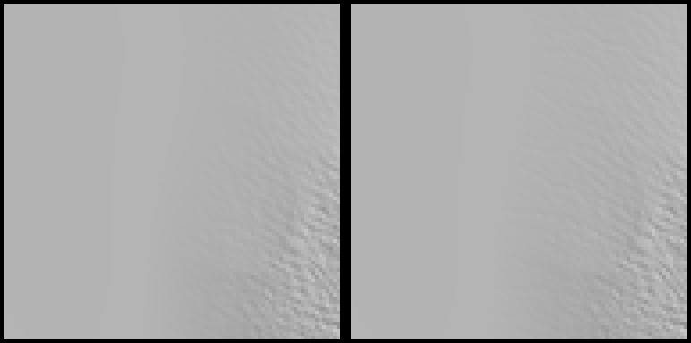
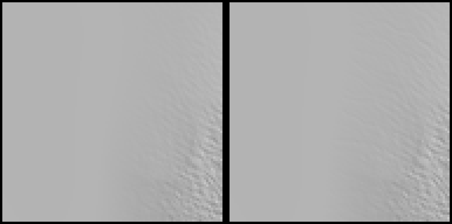
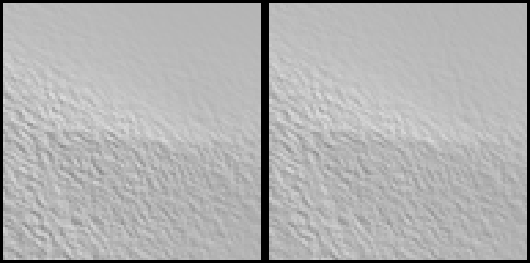
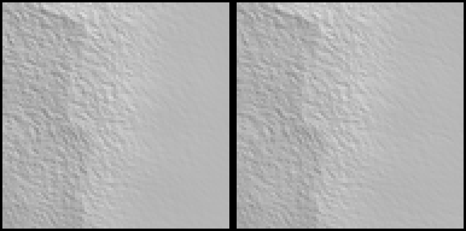

Opened: 2026-10-27
Question: Does a one-pass carve in the coupled run (fill, accumulate, z = fill - d(A) with GEN-057's law, max 100 m, one re-route) hold the chunk's change, so coarse levels show the valleys the chunk adds (ADR 0084)?
Why it matters: owner test 2026-10-27, D0 (findings 2 and 3): coarse levels show uneroded ground, a harsh step to the chunk's level.
Time box: half a day
Success criteria: run time added, relief kept per band, coarse-to-fine step before and after at the finding sites (max, p99), a still, what the base field and tiles must read
Fallback if it fails: ADR 0084 point 2 stays open (a coarse carve needs a finer lattice than 2048)
Code location: branch `spike/m8-coarse-carve` (local, not pushed); copies in `proto/` (`coarse_carve.rs.txt`, `tribspike.rs.txt`)
Closed: 2026-10-27

## Method
- Input and lattice as SPIKE-48: the 2048-cell run's heights reduced from `C:/DEV/SeriousPlanetData/global16384` (read-only), 7,370,117 land cells, one cell 4,886 m.
- The carve: the run's own fill, receivers and area (`filled_state`'s pass), then `z = fill - min(3 m (A / 1e8)^0.5, 100 m)` on land (floor `min_height_m`), then one flood, re-route and accumulation on the carved surface.
- Sites: the chunk of the owner test at (5.93, -20.49) (frames 31358 and 32034) and at (5.86, -20.54) (frames 41356 and 50119), positions read from the frames' path files; plus two hill chunks of SPIKE-47, (-37.689, 3.140) and (8.972, -16.238), for contrast.
- Chunk change = the production chunk solve's core minus the base's core (`tribspike::run_site`, off the corridor). Carve = carved minus input of the coarse cell holding each chunk cell (nearest cell: one coarse cell is 4.9 km, a chunk core is 4.9 km). "After" = chunk change plus the carve's lowering, what the chunk would still add to a carved base.
- Raw output: `raw/carve.txt`.

## Results
1. **Added time**: carve, second flood, re-route and accumulation 2.56 s (the run's fill, route and accumulate is 5.81 s here; the whole stored run is about 20 s with the bake read). The second flood fills nothing over 0.5 m.
2. **Relief kept** (carved minus input, median by input band 0-500 / 500-1000 / 1000-2500 / 2500-5000 / >5000 m): -1.4 / -1.4 / -1.4 / -1.4 / -1.3 m (the 1.5 m of a one-cell catchment, 3 m x sqrt(2.4e7 / 1e8)); p1 lowering 59, 67, 40, 24, 12 m. Local 3 x 3 relief, input to carved (median): 10 to 17, 13 to 24, 79 to 82, 266 to 224, 343 to 282 m. 27.5 % of the receivers change; cells over 1e11 m2: 50,312 to 49,801.
3. **Step between the coarse level and the chunk's level** (off the corridor, metres):
| Site | chunk change p50 / p99 / max | carve lowering (one value per chunk) | chunk change after the carve p50 / p99 / max |
|---|---|---|---|
| (5.93, -20.49) frames 31358, 32034 | 0.5 / 4.8 / 6.8 | 4.91 | 4.4 / 4.9 / 5.1 |
| (5.86, -20.54) frames 41356, 50119 | 0.4 / 1.2 / 1.9 | 1.42 | 1.0 / 1.4 / 1.6 |
| hills (-37.689, 3.140) | 9.7 / 27.8 / 41.3 | 1.84 | 7.9 / 26.0 / 39.5 |
| site 3 (8.972, -16.238) | 10.8 / 31.4 / 79.5 | 21.46 | 10.8 / 21.5 / 58.1 |
   - **The carve holds almost none of the chunk's change and cannot**: it is one number per 4.9 km cell, so over a chunk it is a constant offset of the cell's catchment depth (1.4 to 21 m here), not the valley's shape. The step the chunk adds to a carved base is as large as before (hills: 9.7 to 7.9 m median, 27.8 to 26.0 m p99), and at the coast sites it is made larger or flipped in sign (4.4 m median after, against 0.5 m before: the carve lowers a whole cell that the chunk leaves almost where it was).
   - The two coast sites' chunk change is small (p99 1.2 and 4.8 m): the finding's cuts there are not the chunk's lowering. They match the base's block seams and the held-back tiles (findings 3 and 7), not the carve.
4. **Still** (`images/`, left input, right carved, 96 x 96 cells = 470 km, hillshade, heights x4): no visible difference at any site; 1.4 to 100 m valleys on 4.9 km cells do not show at that scale.
5. **What the field and tiles read today**: the base's heights are the 16384 bake read by bilinear interpolation (ADR 0027); `CoupledLensField` passes the base's height through unchanged and uses the run's heights and area only for the climate texture of the K views (GEN-043). The run itself is the stored coupled channel beside the bake (2048 cells, `z` and `area_m2` per cell); the chunk stage reads its receivers and areas through `stage.run` for its network, not its heights. So no level of the base shows the run's heights today.

## Recommendation
- ADR 0084 point 2 as drafted (a carve of the 2048 run read at all levels) does not remove the step: a 4.9 km cell cannot hold a valley a chunk resolves at 8 m, and it only offsets the base by the catchment depth. Do not build it as the fix for D0.
- To show valleys at every level the carve must live at the base's resolution: a per-bake-cell (611 m) depth from the area of a finer network, stored beside the bake as a channel the base field adds to the bake's height (the field would read that channel at every level, from stored data, no chunk solve). The 16384 lattice is 1.6e9 cells: the area on it needs the A-net's own coarse-to-fine routing (SPIKE-43's threshold network on the chunk) rather than a global run; not tried here.
- Cheaper candidate to try next: carve at 611 m only where the 2048 run's area is over a threshold (the trunk and its tributary chains, about 284,000 cells over 1e10 m2 at 2048 resolution, 50,000 over 1e11), by routing the bake's cells along the run's receivers; untested.
- Limits: one carve law (3 m, exponent 0.5, max 100 m); the nearest coarse cell, not bilinear (bilinear would spread a coarse cell's offset over about 5 km, still no valley); production chunk solve (30 steps), not the SPIKE-47 variants; two coast and two hill sites.

## Visuals

Coast site of frames 31358 and 32034, window of 96 x 96 coupled-lattice cells, left input, right carved, grey hillshade, sun north-west at 45 degrees, heights x4.

Coast site of frames 41356 and 50119, same view.

Hills chunk, same view.

Site 3, same view (the block edge on the left is the bake's).
