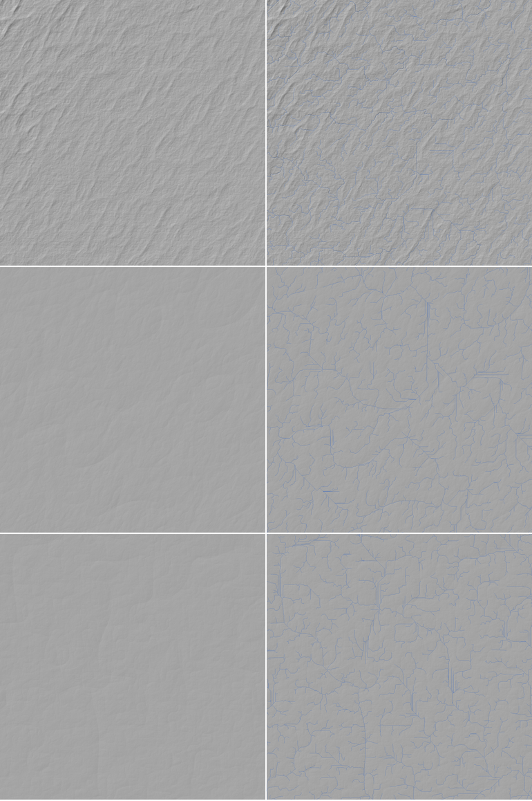

# SPIKE-61 M9 R3: bake pre-run at about 100 m

Opened: 2026-10-30
Question: how long and how large is a 100 m bake of one cube face with the coupled run's network routed on the ground (SPIKE-60 recommendation 2) and a stream-power carve, extrapolated to the planet; does it fit the M9 draft's criterion 7 (10 h, about 28 GB)?
Why it matters: M9 step R3 (`docs/briefings/m9-draft.md`); R4 (the bake) is sized from it.
Time box: 3 h of work plus machine hours overnight (opus-planner, 2026-10-30); used about 2.5 h and 1.3 h of machine time (20:28 to 21:33).
Success criteria: measured time per phase and stored size on sampled tiles of a face, a planet extrapolation, and a yes or no against criterion 7 with what would change it.
Fallback if it fails: report the phase that dominates and its scaling.
Code location: local branch `spike/m9-bake-prerun` (not pushed; spike code, never merged): ignored test `bake_prerun_report` in `crates/app/src/globalperf.rs`, `miniz_oxide` as an uncommitted dev-dependency.
Closed: 2026-10-30

## Method
- **Store:** `C:/DEV/SeriousPlanetData/global16384`, read only; its stored coupled run (2048 cells a face, 4.9 km).
- **Grid:** 98,304 cells per face edge (48 per coupled cell), uniform in face coordinates like the coupled lattice: 101.8 m mean spacing. Tiles of 3,072^2 core cells (64 coupled cells) with a 256-cell halo: 3,584^2 = 12.8 M cells a window; 1,024 tiles a face.
- **Land tiles:** a tile with any coupled cell above 0 m. The planet has 2,140 land tiles of 6,144 (face 0: 707, face 3: 519, face 4: 33); land share 0.296, so about 1.72e10 land cells at 101.8 m. Ocean tiles are skipped.
- **Per tile:**
  1. Sample the store's field (`world.field()`, f64) at every window cell.
  2. Route on the tile's own ground: a priority flood with a 1e-3 m epsilon from the window border and the sea, then steepest descent on the filled surface. Coupled cells outside the window whose receiver lies inside add their network area at the window cell nearest them (the global network as inflow).
  3. D8 area.
  4. Implicit stream power (n = 1, m = 0.5, Braun and Willett), outlets first. The cut is capped at half the 5 km block relief and at most 100 m (SPIKE-60 consequence 3).
  5. Steps 2 to 4 repeat for every step, re-routing each time.
- **Size:** the core's carve delta in 0.25 m steps (u16) and, for comparison, the carved heights in 0.5 m steps (i16), each deflated at level 6 (`miniz_oxide`).
- **Runs:**

  | Run | Tiles | Steps | Parallel tiles (sample threads each) |
  |---|---|---|---|
  | a | face 0, every third tile: 121 (79 land) | 10 | 4 (4) |
  | d | face 3, every fourth: 64 (33 land) | 10 | 4 (4) |
  | e | face 0, other tiles: 60 (50 land) | 10 | 8 (2) |
  | b | 6 tiles | 30 | 3 (4) |
  | c | 2 tiles | 1 | 1 (16) |
- **Priority:** BelowNormal for every run (`start /belownormal`; children inherit it).
- **CPU state:** `PercentProcessorPerformance` (_Total) every 10 s (`raw/cpuperf*.txt`):
  - runs a to d: p10 74 %, p50 93 %, p90 129 %, utility p50 48 %;
  - run e: p50 77 %, utility p50 67 %.

  Other processes beside the runs were not logged.
- **Not a perf verdict** (opus-planner): cost on a shared machine, no window.

## Results
### Time per land tile (seconds)
| Run | Sample p50 / p90 | Route per step | Carve per step | Total p50 / p90 (10 steps) | Land tiles per hour |
|---|---|---|---|---|---|
| a: face 0, 4 parallel | 19.6 / 33.8 | 5.4 | 0.81 | 81 / 142 | 157 |
| d: face 3, 4 parallel | 11.8 / 15.1 | 4.1 | 0.40 | 53 / 86 | 233 |
| e: face 0, 8 parallel | 38.4 / 144 | 7.5 | 1.36 | 146 / 280 | 176 |
| b: 30 steps, 3 parallel | 15.8 | 3.0 | 0.36 | 102 (30 steps) | 86 |
| c: 1 tile, 16 sample threads (warm store) | 3.8 | 2.7 | 0.17 | 8.8 (1 step) | - |

- **Routing dominates:** a single-threaded priority flood plus steepest descent over 12.8 M cells, 3-7.5 s per step and tile; about 60 % of a 10-step tile.
- **Sampling** is 3.8 s on a warm store with 16 threads, 12-60 s cold (first reads of the store's blocks; the first trial of the night took 63 s).
- **8 tiles in parallel add 12 % over 4:** processor performance falls from 93 % to 77 %, and the cold reads slow the sampling (p90 144 s).

### Size (deflated, per land cell)
| Steps | Carve delta (0.25 m) | Carved heights (0.5 m) |
|---|---|---|
| 10 (runs a, d, e) | 0.34-0.42 B | 0.92-0.98 B |
| 30 (run b) | 0.60 B | 1.03 B |

### Planet extrapolation (2,140 land tiles, 1.72e10 land cells)
| Item | As measured (re-route every step) | With re-routing every 5th step and the other steps on fixed receivers (estimate) |
|---|---|---|
| Bake time, 10 steps | **9.2-13.6 h** (233 to 157 land tiles an hour) | about 5-7 h |
| Bake time, 30 steps | about 25-35 h | about 10-14 h |
| Stored carve delta | 7.2 GB (10 steps), 10.3 GB (30 steps) | same |
| Stored carved heights instead | 16-18 GB | same |

- Disk free: 135 GB; today's store is 28 GB.

## Findings
1. **Time: criterion 7 fails as measured for face 0-like terrain** (13.6 h at 10 steps) and passes for face 3-like terrain (9.2 h); routing every step is 60 % of it. Re-routing every few steps and a faster flood bring a 10-step bake to an estimated 5-7 h. 30 steps do not fit without that change.
2. **Disk: the carve delta adds 7-10 GB to the 28 GB store**, so 35-38 GB in total. It fits about 28 GB only if the new store replaces bake channels the 100 m data supersedes. Storing carved heights instead (16-18 GB) does not fit.
3. **Parallelism saturates at about 4 tiles** on this laptop; more tiles in parallel lower the CPU's performance and add little. A bake is CPU-bound and runs best on the whole machine at a fixed tile parallelism.
4. **Tiles make the bake checkpointable for free.** Each tile is independent given the coupled network's inflow, so a resumed bake repeats at most the tiles in flight (criterion 7's checkpoint rule).
5. **The network follows the ground.** Local routing with the global inflow gives dendritic networks on the 100 m ground (stills). On low-relief plains D8 draws straight axis-parallel runs (the third row of the stills); a multiple-flow or jittered direction (SPIKE-35's jittered D8) would be needed there.
6. **The carve is shallow at these parameters:** channel cells (area at least 1 km2) are cut a median 0.75 m after 10 steps and 2.8 m after 30, with maxima of 30-100 m at the relief cap. The carve was not tuned (cost, not look). Stream-power depth needs either more steps or a larger erodibility, and both feed back into finding 1.

## What it says for R4
| # | Consequence |
|---|---|
| 1 | Re-route every k steps (k about 5) and replace the binary-heap flood by a faster one (a bucket queue, or a plain queue on flats, Barnes 2014). Then measure again with the same harness before the overnight bake. |
| 2 | Store the carve as a delta over the regenerable field, and decide which bake channels the 100 m store replaces, so that it stays within about 28 GB. Otherwise the cap needs the owner (ADR 0045). |
| 3 | Run at 4 tiles in parallel and take the whole machine overnight (BelowNormal keeps the lanes usable but not fast). |
| 4 | Fix the step count and erodibility against the scorecard on a few tiles before the full bake. The cost in finding 1 scales with the step count. |
| 5 | Cross-face routing and the plains' straight runs are open items for R4's design. |

## Limits
- Tiles at a face edge do not route across faces (the global inflow covers only the coupled network).
- Halo 256 cells (26 km); the inflow enters at the window cell nearest the coupled source, not along the true path.
- One sampled set per face (faces 0 and 3); land tiles vary 4x in time.
- No thermal or deposition pass (SPIKE-57's kernels), no driver channels; R4 adds them on top.
- Disk breakdown by channel of the 28 GB store not measured.

## Visuals

Hillshade (sun from the north-west), about 156 km square crops at 101.8 m. Left the field as sampled, right after 30 steps of the capped carve with channels of at least 10 km2 tinted blue. The rows are tiles 1, 2 and 4 of run b: a rough upland; a smooth lowland with a dendritic network; and a plain where D8 draws straight axis-parallel runs. Generator data only (no GLO-30).
