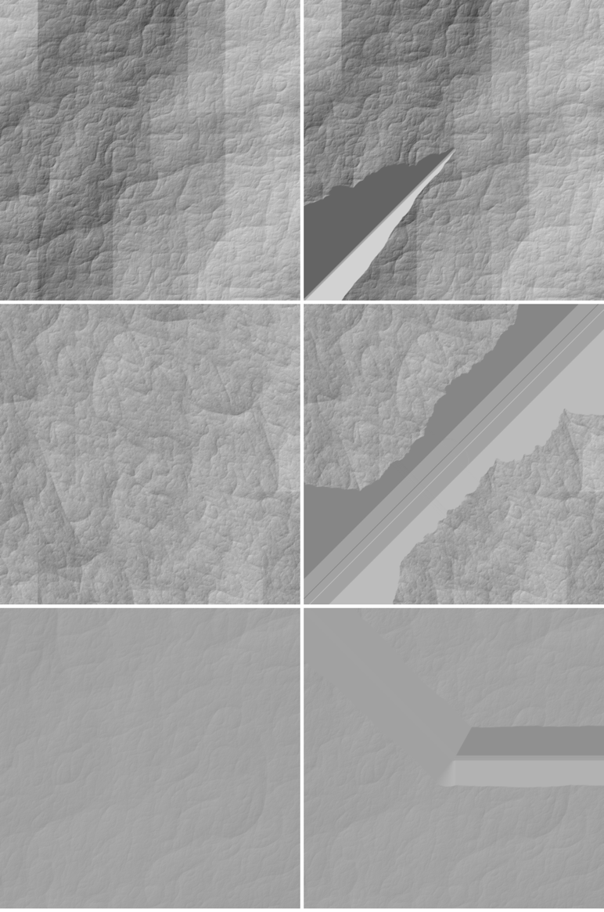

# SPIKE-60 River channel per point (A1) and no-chunk steps (A2)

Opened: 2026-10-30
Question: (A1) does a per-point river channel along the stored coupled-run network, with a monotone bed and a bank clamp, draw rivers that never rise downstream at any tile level; (A2) does the terrain without a chunk stage have no entry step, no level step and no held-back tile on the real store?
Why it matters: Option B item B7, M9 step R2; SPIKE-52 candidate A, experiments A1 and A2 (`spikes/m9-hydrology-literature/results/results.md`, row A, finding 5); input to M9's R5 (channels).
Time box: half a day (used about 3 h).
Success criteria: SPIKE-51's rise metric at site9 and the 48 random chunks: 0 rises over 0.5 m expected; A2: 0 steps and 0 held tiles.
Fallback if it fails: report what makes the bed rise.
Code location: local branch `spike/m9-channel-a1` (commit aba28e9d, not pushed; spike code, never merged): ignored tests `channel_a1_report` and `held_nochunk_report` in `crates/app/src/globalperf.rs`.
Closed: 2026-10-30

## Method
- **Store:** `C:/DEV/SeriousPlanetData/global16384`, read-only; CPU only.
- **Network:** the stored coupled run at 2048 cells a face (about 4.3 km cells), receivers on its heights (`CoupledMaps::receivers`), rivers where the drainage area is at least 100 km2 (`RIVER_AREA_M2`) on land. Around each chunk, the coupled cells within 3 rings (about ±15 km). Segments are straight lines between cell centres.
- **Bed:** sampled every 4 m along each segment, as a running minimum downstream of (ground − valley depth − bankfull depth), falling at least the least slope.
  - The laws are the A-net's `AnchorLaw`: valley depth GEN-057, capped 30 to 100 m by relief; width and depth GEN-060, `7.2 Q^0.5` and `0.18 Q^0.47` with `Q = 0.01 A[km2]`; floor 1 to 5 widths; sides 0.15 to 0.9 rise over run.
  - Segments are processed upstream first, so a confluence takes the lower incoming bed.
  - The bed is therefore monotone along every path by construction.
- **Drawn height of a point:** the ground lowered to every channel profile within reach (bed inside the half width; bed + bankfull depth on the floor; then the side slope), lifted to the nearest bed within its floor (the bank clamp).
- **Drawn surface of level L:** the tile lattice (33 x 33 per tile, uniform in face coordinates) evaluated per vertex, bilinear between vertices. The real draw triangulates and morphs; neither is modelled.
- **Rise metric (SPIKE-51):** a maximal non-falling run downstream that gains over 0.5 m, along the centre line, sampled at a quarter of the vertex spacing. Paths are split where they leave the chunk.
- **Populations:** SPIKE-51's 48 random land chunks (same seed), and the chunk under the owner's frame-139490 with its 8 neighbours. Only path parts inside a chunk count.
- **Morph amplitude:** a level's odd vertex against its parent's surface at that point, the motion a refinement shows; the same for the ground alone, for comparison.
- **A2 probes:** `base_steps_report` (existing, on main), and `held_nochunk_report`, SPIKE-51's held-back probe reduced to the default field, run on today's main.
- **River length:** SPIKE-51 counted 210 km in the same 48 chunks, because it included the chunk solve's fine channels down to 0.05 km2. Here only the stored network's rivers of 100 km2 and more count, 74.5 km.

## Results
### A1: rises of the drawn bed
| Population | River in chunks | Exact centre line | Level 12 (76 m) | Level 14 (19 m) | Level 16 (4.8 m) | Level 18 (1.2 m) |
|---|---|---|---|---|---|---|
| 48 random chunks | 74.5 km | 0 | 181 (243 per 100 km): 12 over 2 m, max 2.1 m, p50 1.1 m | 0 | 0 | 0 |
| site frame-139490, 9 chunks | 3.1 km | 0 | 32 (all 5.9 to 6.2 m) | 0 | 0 | 0 |

- Channel width: p50 17.5 m, p99 86 m (random); 8 m (site).
- A rise appears only where the level's vertex spacing is wider than the channel: at level 12 the vertices sit on the banks, and the bilinear surface between them follows the banks.

### A1: what the monotone bed costs
| Population | Cut (ground − bed on the centre line) p50 / p90 / p99 / max | Cut beyond the valley law p50 / p99 | River length cut over 20 m / over 50 m beyond the law |
|---|---|---|---|
| 48 random chunks | 39 / 65 / 197 / 229 m | 30 / 159 m | 64.5 % / 22.0 % |
| site frame-139490 | 119 / 206 / 213 / 213 m | 116 / 209 m | 91.1 % / 73.4 % |

- The running minimum keeps the bed at the lowest ground passed upstream. Along a 4.3 km straight segment the ground rises and falls (the coarse network does not follow the ground's valleys at that scale), so the bed cuts through every rise.
- In the chunk windows (5 km, 9.5 m pixels) the carve reaches up to 73 m in lowlands of 28 to 43 m relief and carves 24 to 40 % of the area; at site9, 214 m in 561 m of relief; at a 224 m-relief chunk, 234 m.

| Population | Morph amplitude near the river, p99 / max | Ground alone, p99 / max |
|---|---|---|
| random, level 12 | 6.6 / 13.9 m | 3.7 / 4.8 m |
| random, level 14 | 1.6 / 13.9 m | 1.2 / 2.7 m |
| random, level 16 | 0.2 / 13.9 m | 0.3 / 1.0 m |
| random, level 18 | 0.01 / 7.0 m | 0.06 / 0.25 m |
| site, level 12 | 15.0 / 15.0 m | 7.3 / 9.7 m |

- **Bank clamp:** it lifted 1,681 of 316,116 evaluated vertices (random) and 0 of 15,301 (site), by at most 0.0 m. The bed lies under the ground on every centre line, so the clamp only rounds.

### A2: no chunk stage (today's main, the default field)
| Probe | Result |
|---|---|
| Level steps, base field against its parent (`base_steps_report`), levels 12 to 16 | p99 0.000 m, max 0.000 m at every level (1,089 to 278,784 vertices) |
| Entry step | none by construction: no stage adds content at a level |
| Held-back tiles (ADR 0074), 224 envelope flight poses | 0 of 394,932 selected nodes |
| owner bundles (14 poses) | 0 of 18,714 |
| stall-report poses (37) | 0 of 39,198 |

- Not measured: held-back tiles with the A1 channel in the field (sides up to 0.9 rise over run). That needs the channel as a `HeightField` with its own bounds, which is R5's change.
- The descriptor scorecard side check (SPIKE-57) was not run: the scorecard is not built, so it was not cheap.

## Findings
1. **A monotone bed by construction holds on the drawn surface wherever the vertex spacing is no wider than the channel:** 0 rises at levels 14, 16 and 18 and on the exact centre line, at both populations. Level 12 (76 m spacing) draws 243 rises per 100 km (p50 1.1 m, max 2.1 m), and 32 at site9 of about 6 m: the channel falls between vertices.
2. **The coarse network does not agree with the ground.** Holding the bed monotone along straight 4.3 km segments cuts a median 30 m deeper than the valley law (site9: 116 m), and 65 % of river length (site9: 91 %) by more than 20 m. The stills show straight trenches, valleys that start at full depth at a river's head, and lowland valleys twice as deep as the land's relief.
3. A2 holds: without a chunk stage, steps are 0.000 m at levels 12 to 16 and no tile is held back at 275 poses (452,844 nodes). The entry step does not exist.
4. Refining near a channel moves vertices by up to 13.9 m (p99 6.6 m at level 12 against 3.7 m for the ground alone): the motion is visible when a channel first resolves.

## What it says for M9's R5 (channels)
| # | Consequence |
|---|---|
| 1 | The per-point channel is the right drawing technique: it is monotone by construction and has no level step or held tile (A2). |
| 2 | It needs a network that follows the ground. Either route the network on the stored base at 100 to 600 m in the bake (curved polylines along valleys, as the A-net's chunk routing did, GEN-066), or carve the base with the same network in the bake (R4), or both. Today's straight 4.3 km segments demand 30 to 116 m of extra cut. |
| 3 | Cap the valley depth by local relief and taper it from the head: lowland valleys come out deeper than the land is high, and heads start at full depth. |
| 4 | Do not draw a channel narrower than about two vertex spacings at a level (or widen it there): that is the only source of rises in A1 (level 12). |
| 5 | Measure held-back tiles and morph amplitude with the channel in the field once it is a `HeightField` (sides up to 42 degrees). |

## Visuals

Hillshade (sun from the north-west), CPU, 5 km chunk windows at 9.5 m per pixel; left the ground, right the ground with the A1 channels. Top: site frame-139490's river chunk (cut up to 214 m in 561 m of relief). Middle: a 224 m-relief chunk (cut up to 234 m). Bottom: a lowland of 33 m relief, cut 73 m, the valley starting at full depth at the river's head. The vertical bands in the top row's ground are in the ground itself (not the channel; not investigated here).
