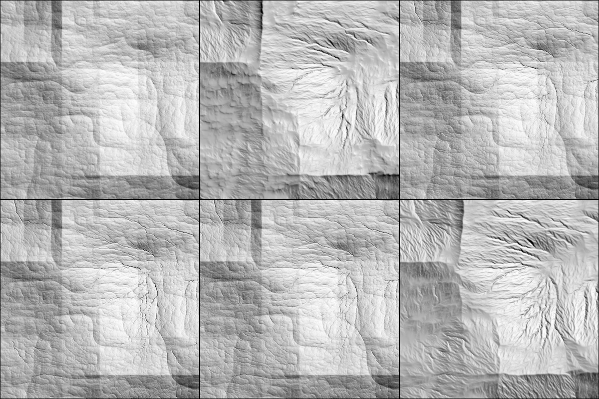
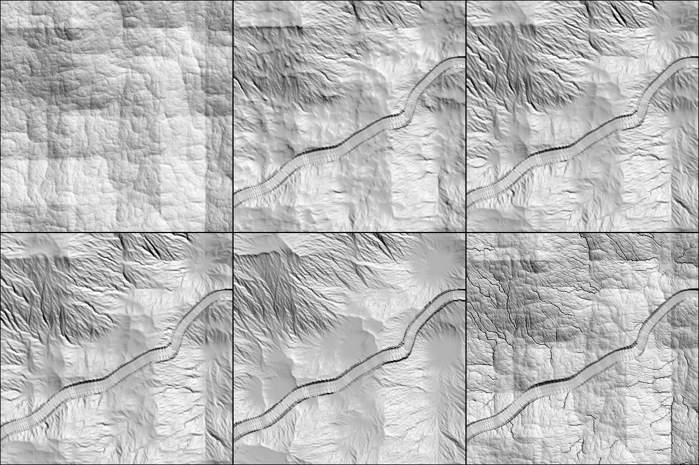
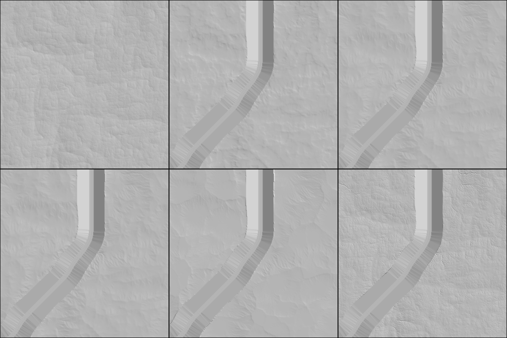

Opened: 2026-10-27
Question: Can the A-net chunk stage grow its own tributaries and hillslope forms at 8 m within GEN-052's budget (a variant may cost up to 2x), and how close does the drainage density get to 0.5 to 3 km per km2 over 1e5 m2?
Why it matters: M9's fine tier (ADR 0081 point 3) and SPIKE-46's hill-terrain checks need a chunk surface with a real tributary network.
Time box: 1 day of agent work
Success criteria: density, a hillshade still per variant, time per chunk, bit identity across thread counts, at 2 to 3 real chunks of the 16384 store (read-only)
Fallback if it fails: the fine tier waits for a block stage (ADR 0077 point 2)
Code location: branch `spike/m9-chunk-tributaries` (local, not pushed); copies in `proto/` here (`tribspike.rs.txt`, `chunk_tributaries.rs.txt`, `wiring.patch.txt`)
Closed: 2026-10-27

## Method
- Store `C:/DEV/SeriousPlanetData/global16384`, read-only. Four chunks of the stage's own geometry (608 x 608 core of 8.04 m cells, 24 km2, halo 3 km, 1.84 million cells):
  - hills (-37.689, 3.140), the review site of SPIKE-40;
  - lowland (-11.166, 23.049), the other review site;
  - site 3 (8.972, -16.238), hillsB of SPIKE-43;
  - hillsA (37.7175, 134.0294) of SPIKE-43.
- `variant_solve` (`proto/tribspike.rs.txt`) is the production solve (`anet::solve`: the corridor, the anchors and the ring fixed; `K` 2e-5, `m` 0.45, `dt` 1e4 years, 30 steps, jitter 0.4, diffusion 0.005, slump 0.09) with these knobs:
  - **routing**: receivers over a priority-flood filled surface (SPIKE-43's rule), a cell filled by more than `maxfill` a lake; production's own routing leaves a pit an outlet;
  - **reroute**: route again every `N` steps on the current surface (production routes once, on the start surface);
  - **fmax, k**: the cap of `f` off the corridor (production 0.5) and a multiplier of `K` there;
  - **cap**: an incision limit, a cell at most `cap (A / 1e5)^0.5` metres under the base height (at most 60 m);
  - cells are only lowered (`detach`).
- Not in the variants: the breach along the corridor, the no-uphill pass and the bank settle (GEN-058).
- Census of every surface, independent of the solve's own area: flow over the filled surface of the final heights (ring as outlet, jittered steepest descent, no inflow), cells off the corridor; density = link length of cells at or over a threshold per km2 of core. Slope at 32 and 88 m is the slope of the 4 x 4 and 11 x 11 box means; relief is the range in 1 km windows.
- Runs through `cargo xtask heavy` (one waited 451 s behind another session's prepush). Times are one thread unless stated; 4 concurrent copies of one chunk model the production's 4 chunk workers.

## Findings
1. **Density is measured on the carved ground, not on the solve's network.** The production census (`chunk_incision`, 0.10 to 0.43 km/km2) counts cells of the frozen network, whose area stops at every pit and starts at the ring; the same chunk's final ground, flowed over a filled surface, holds 1.4 to 1.8 km/km2 at 1e5 m2 at the three hill chunks. The target 0.5 to 3 is met there by production already.
2. **Re-routing every 10 steps costs nothing and raises the density by 0.2 to 0.3 km/km2** (1.36 to 1.66, 1.77 to 2.09; solve alone 1.9 to 2.0 s against 2.0 to 2.3 s). Every 5 steps costs 1.3 to 1.4x (3.1 to 3.3 s), every 3 steps 2x (4.4 to 4.9 s); the density gain beyond every 10 is 0.05 to 0.15.
3. **The lowland cannot be given tributaries by erosion**: the base there has 10 m of relief per km (density 0.00 on the base); production 0.31, re-routing every 5 steps 0.44, every 3 steps 0.50, K x 3 and `f` up to 1: 0.81. Channels need a gradient the base does not hold.
4. **The incision cap trades density for relief**: a cap of 3 m (or 10 m at 1e5 m2 over 1e5) leaves the surface within 0.1 to 0.4 m of the base (median lowering), keeps relief and slope, draws hair-thin dendritic notches (still panels) and gives 0.35 to 0.99 km/km2, under production's.
5. **Stronger incision (K x 3, `f` up to 1) over-lowers**: at site 3 the median lowering is 29 m (10.9 % of cells over 50 m) against production's 11 m (0.2 %), the density 2.53 and the still shows round funnels (flow converging on filled pits).
6. **Slope and relief hardly move** with any variant: 32 m median slope 7.1 to 8.3 degrees at the hill chunks (p90 13 to 23), relief 1 km median 141 to 157 m, within 5 % of the base; the stage already lowers 77 to 80 % of the hill core by over 5 m (median 10 to 12 m) with every variant (86 to 90 % with re-routing).
7. **Thread identity** (site 3, 4 copies of one chunk at once): production and the re-routed variant give the same core hash in all four copies (`766c062c471ac343` for the variant). The variant's solve is single-threaded and orders everything by cell key, so thread count and chunk concurrency cannot change it by construction; one run is the evidence. A 4-variant by 4-copy run exited without output once and was not reproduced (probably memory).
8. **The base itself limits the forms**: all four stills show rectangular seams and a vertical band in the base (a block structure) and a cobbled texture that no variant removes; the dendritic gullies are drawn only where the base slopes (the hill chunks); the cap variants keep the seams fully visible.
9. **Lakes are untested**: no core of the four chunks holds a pit deeper than 0.5 m on the filled surface (0.0 % in every row), so the `maxfill` rule did the same as no rule (hillsA, rows `rr5` and `rr5lake`). SPIKE-43's bowl at hillsA has moved with the rebuilt base.

## Numbers
Density at 1e5 m2 in km/km2 of core (flow over the filled surface of the final heights, off the corridor); the variant names are the keys of `Variant::parse` (`rr N` = reroute every N steps, no cap).
| Chunk | base | production | rr 10 | rr 5 | rr 3 | rr 5, K x 3, f up to 1 | cap 3 | rr 5 with cap 3 | rr 5 with cap 10 |
|---|---|---|---|---|---|---|---|---|---|
| hills | 0.42 | 1.47 | | 1.70 | | | 0.94 | 0.69 | |
| lowland | 0.00 | 0.31 | | 0.44 | 0.50 | 0.81 | | | 0.35 |
| site 3 | 0.40 | 1.77 | 2.09 | 2.23 | 2.26 | 2.53 | | | 0.99 |
| hillsA | 0.30 | 1.36 | 1.66 | 1.71 | | | | | |

Density at 3e5 and 1e6 m2 (production, rr 5): hills 0.37, 0.03 and 0.47, 0.07; site 3 0.67, 0.04 and 0.94, 0.27; hillsA 0.38, 0.03 and 0.64, 0.20; lowland 0.02, 0.00 for both. Rows in `raw/`.

Time of the solve (seconds, one thread, without the network build of 3.6 to 4.2 s):
| Chunk | production | rr 10 | rr 5 | rr 3 | rr 5 with cap |
|---|---|---|---|---|---|
| hills | 2.07 to 2.24 | | 2.92 | | 3.98 |
| lowland | 1.77 | | 2.91 | 4.36 | 4.28 (cap 10) |
| site 3 | 2.02 to 2.26 | 1.91 | 3.23 | 4.93 | 4.16 (cap 10) |
| hillsA | 2.27 | 1.97 | 3.13 | | |

4 concurrent copies of one chunk (site 3): production 3.30 s each (wall 3.34 s; GEN-052's measured 3.30 s), rr 5 4.55 s each (wall 4.63 s, 1.38x), `identical: true` for both. rr 10 was not run concurrently (its one-thread time equals production's).

## Recommendation
- M9 takes **re-routing every 10 steps** (a cost-neutral change of the production solve: route again on the current surface at steps 10 and 20), and measures density on the carved ground with the SPIKE-43 threshold network (the same filled-surface flow), not on the solve's frozen network. The target 0.5 to 3 is then met at every hill chunk (1.66 to 2.09); GEN-052's 4 s cap is not touched (rr 5 would be 4.55 s on 4 threads: over the cap, inside the 2x allowance).
- The lowland needs a different answer (a gradient or an authored network); erosion cannot make channels on ground with 10 m of relief per km.
- The hill forms are limited by the base's block seams and cobbled texture more than by the solve; a hillshade check of M9's hill ground has to look at the base first (a separate item, not measured here).
- Open: the border agreement of a variant's routing (SPIKE-43's halo result is for the threshold network on a filled surface, not for the changing surface of a re-routed solve; not tested), lakes (no pit chunk found), and the bank settle and breach (GEN-058) after the variant.

## Visuals
Hillshade stills of the centre 400 x 400 cells (3.2 km) of each chunk, sun from the north-west at 45 degrees, heights x 2, grey, panels left to right, top row then bottom row.

Hills chunk, panel order: base, production, cap 3 (production's routing, filled), rr 5 with cap 3, rr 5 with cap 3 and 60 steps (K x 1, f up to 1, diffusion 0.02), rr 5 without cap: the last has the most dendritic gullies.

Site 3, panel order: base, production, rr 5, rr 3, rr 5 with K x 3 and f up to 1 (round funnels at the filled pits), rr 5 with cap 10 (hair-thin notches); the river corridor runs through the middle.

Lowland, same panel order as site 3.
