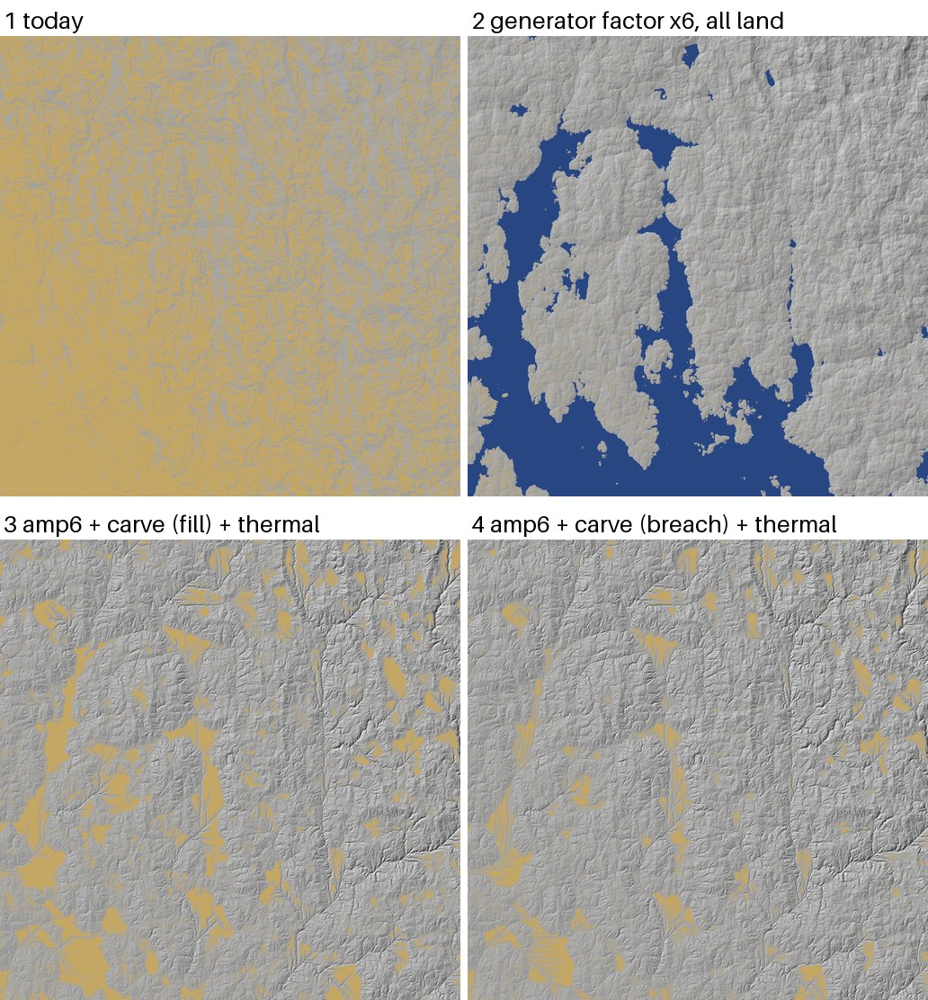

# SPIKE-66 Relief factor in the generator

Opened: 2026-10-31
Question:
- (a) Does a relief factor per landform inside the generator, not a post-scale, bring the SPIKE-65 sites to real relief?
- (b) What does it do to tile bounds, held-back tiles and level steps?
- (c) What Alps factor gives 0.8 of real?
- (d) Can the carve keep its valley floors from flooding?
Why it matters:
- SPIKE-65 put the amplitude in the landform drivers and the transient carve and thermal in R4.
- This spike tests whether the generator can carry the amplitude and what that costs.
Time box: 3 h at BelowNormal, no writes to `global16384` (opus-planner inbox #3, 2026-10-31); used about 2 h, with 35 min of machine time.
Success criteria: scores against GLO-30 as SPIKE-65; plan-check and level steps with the factor; the Alps factor; a carve variant and its flat share.
Fallback if it fails: name what blocks the factor in the generator.
Code location: branch `spike/m9-relief-factor` (pushed, no PR; commit 0d9301d3; spike code, never merged).
- In `erosion.rs`: `PLANET_RELIEF_K`, `PLANET_RELIEF_KM` and `PLANET_RELIEF_W`, the ring mean, the widened bounds and the batch reach (`GRADIENT_REACH_CELLS` 26).
- In `globalperf.rs`: the ignored tests `relief_window_dump` (SPIKE-65) and `relief_level_error`.
- The carve variant is in `proto/s66carve.rs.txt` (SPIKE-65's program plus the breach).
Closed: 2026-10-31

## Method
**(a) The factor in the eroded field.** At each point the field returns `m + k (e - m) + k detail`.
- `e` is the bake and `m` is the bake's mean over the point and 8 points on a 10 km ring. This is SPIKE-65's amplitude inside the field, with a 10 km ring for the 20 km box.
- `k = 1 + (K - 1) w`:
  - `K` goes from the hill factor to the mountain factor as `m` rises from 800 to 2,000 m;
  - `w` is the landform driver (GEN-062), or 1 on all land with `PLANET_RELIEF_W=1`.
- Settings:

| Setting | Hills | Mountains | Weight |
|---|---|---|---|
| k4 | 4 | 4 | landform |
| k6 | 6 | 6 | landform |
| k6m10 | 6 | 10 | landform |
| k6m14 | 6 | 14 | landform |
| k4all | 4 | 4 | all land |
| k6all | 6 | 6 | all land |
| k8all | 8 | 8 | all land |
- Windows of 2,560^2 at the four SPIKE-65 sites, sampled read-only from `global16384` into `C:/DEV/SeriousPlanetData/spike-r3/relief66/`.
- Scored over the central 2,048^2 against GLO-30 at about 100 m, as in SPIKE-65.

**(b) Bounds and level steps:**
- `generate --plan-check` over `global16384` (read only).
- Engine `capture-stills` at the Alps and Black Forest sites (300 m and 30 m), whose plans report capped nodes.
- The probe `relief_level_error`. At levels 10 to 22, for the site's tile and its 8 neighbours (cells 32), it measures:
  - the field at the 65^2 child points against the bilinear surface of the tile's 33^2 vertices (the step when the tile splits);
  - the centre tile's height bound against the range of its samples.
- Run without the factor, with k6all and with k6m10.
- The gate (`cargo xtask gate`) needs the editor window and was not run (no window, as briefed).

**(d) The carve without flooded floors.** SPIKE-65's transient carve (U/K 20, K dt 0.05, 20 steps) with a breach before each routing:
- going upstream to downstream, a receiver above its donor is cut to 0.1 % below it, by at most 50 m;
- only what the breach cannot reach is filled.
- On SPIKE-65's post-scaled windows (amp4, amp6), with and without thermal at 33 degrees.

**Machine:** heavy lock, BelowNormal; CPU 0-26 % before each run (`raw/*.log`); 09:32 to 10:06.

## Results
### (a) and (c): the factor in the generator (generator / real: slope p50, slope p99, 1 km relief p50, 5 km relief p50)
| Site | today | k6 (landform) | k4all | k6all | k8all |
|---|---|---|---|---|---|
| Black Forest | 0.22/0.17/0.22/0.28 | 0.38/0.41/0.39/0.48 | 0.85/0.63/0.86/1.09 | 1.33/0.92/1.35/1.76 | 1.83/1.18/1.88/2.43 |
| Highlands | 0.13/0.13/0.12/0.15 | 0.19/0.34/0.18/0.20 | 0.56/0.50/0.53/0.58 | 0.88/0.74/0.85/0.95 | 1.22/0.97/1.18/1.34 |
| Valley and Ridge | 0.17/0.14/0.18/0.18 | 0.28/0.29/0.30/0.30 | 0.71/0.53/0.74/0.74 | 1.12/0.79/1.16/1.13 | 1.52/1.03/1.56/1.46 |
| Alps | 0.12/0.31/0.11/0.15 | 0.24/0.88/0.23/0.26 | 0.45/0.93/0.41/0.45 | 0.69/1.16/0.63/0.69 | 0.92/1.31/0.85/0.94 |

**Weighted by the landform driver:**
- The factor barely acts at the hill sites: k6 gives 0.18-0.48.
- At the Alps k6m14 gives p99 1.30 at p50 0.33: the driver is low here and peaks in spots.

**Land share** over the central 2,048^2:
| Site | today | k6all | k8all |
|---|---|---|---|
| Highlands | 93 % | 70 % | 63 % |
| Valley and Ridge | 99 % | 72 % | 61 % |
| Black Forest | 100 % | 86 % | 77 % |
- The creases' sum is mostly negative (it cuts into the ground), and scaled lowland drops below sea level (`images/`, panel 2).

**Cost:** the ring mean is 8 more bake reads per height: a window sampled in 7-8 s instead of 4.3 s (+75 %).

### (b) Bounds, plan and level steps
**Step when a tile splits** (p99, metres; max in `raw/s66bounds.log`):
| Level | Alps today | Alps k6all | Black Forest today | Black Forest k6all |
|---|---|---|---|---|
| 10 | 5.37 | 32.5 | 4.12 | 24.8 |
| 12 | 1.67 | 10.0 | 1.29 | 7.75 |
| 14 | 0.50 | 2.98 | 0.39 | 2.33 |
| 16 | 0.13 | 0.80 | 0.11 | 0.63 |
| 18 | 0.03 | 0.17 | 0.02 | 0.14 |
- The step scales with the factor: x6, at every level.

**Bound width against the sampled range** of the centre tile:
| | Today | k6all | k6m10 |
|---|---|---|---|
| Fine levels | 5-200x | 13-700x | 70-3,200x |
| Level 10 | 4.5-6.8x | the global range (+-58 km) | the global range (+-97 km) |
- With the landform weight a cap does not know its factor, so the bound covers every k from 1 to K: a width of (K - 1) times the point's deviation from the ring mean.

**Plan-check and stills:**
- Today: plan-check passes (deepest levels 12-22). The Alps and Black Forest stills plan 1,490-1,580 nodes, 116-124 capped.
- With the factor (k6all and k6m10): plan-check fails on a bake cell outside a batch's footprint, and the views plan only to level 8. Both engine stills panic in the mesh thread on NaN heights (`target/review/crashes/20261031-08*.txt`).
  - The ring reads the bake 10 km (about 17 cells) from a point, beyond the 8-cell footprint every batch read promises (GEN-020).
  - Widening the reach to 26 cells fixed the threaded window path but not the plan's read path.
- Held-back tiles were not measured: the gate needs the window, and no plan with the factor completed.

### (d) Carve with a breach (flat share; real 6-9 %)
| Site | amp6 + carve (fill) + thermal | amp6 + carve (breach) + thermal |
|---|---|---|
| Alps | 16.2 % | 12.2 % |
| Black Forest | 21.1 % | 10.5 % |
| Highlands | 18.1 % | 10.9 % |
| Valley and Ridge | 20.8 % | 11.1 % |

The breach also deepens valleys, so less amplitude is needed (generator / real: slope p50, p99, 1 km relief, 5 km relief):
| Variant | Ratios |
|---|---|
| Black Forest amp4 + breach | 1.18/1.30/1.08/1.07 |
| Valley and Ridge amp4 + breach | 0.94/1.05/0.89/0.68 |
| Highlands amp6 + breach + thermal | 0.97/1.00/0.84/0.71 |
| Alps amp6 + breach + thermal | 0.72/0.79/0.59/0.61 |
- Cost: the breach adds 0.5-1 s of routing per window (4.6-6.0 s against 4.1-4.7 s).

## Findings
1. **The amplitude works inside the generator, but not weighted by today's landform driver.**
   - On all land the factor reproduces SPIKE-65: hills 0.74-1.76 at x6, Black Forest best at x4.
   - The landform driver is low at the hill sites and patchy at the Alps.
   - The factor needs its own map: a relief driver per landform, calibrated against the scorecard sites.
2. **(c) The Alps reach 0.8 of real at about x7.5 on all land** (x6: 0.63-0.69; x8: 0.85-0.94). Slope p99 then overshoots (1.31 at x8), so thermal at 33 degrees has to cap it (SPIKE-65: 58 to 48 degrees at amp6).
3. **(b) A factor computed per point from a 10 km stencil does not fit the generator's contracts:**
   - batch reads (GEN-020: an 8-cell reach) give NaN, plan-check fails and the mesh thread panics;
   - bounds become 25-700x looser at fine levels and global at level 10, because a cap does not know its factor;
   - the step between levels grows with the factor (x6 at every level), so the same distance-based LOD shows x6 larger steps.

   The factor and the mean it scales about must be **baked channels** (stored at the bake's 1 km, read at a point, with per-cap bounds). This is R4's job, not a runtime stencil.
4. **The factor must taper towards the coast and the sea.** Scaling down to sea level costs 14-38 points of land at k6-k8. A taper by the ring mean's elevation, or scaling only above the coast band (ADR 0056), keeps the coastline.
5. **(d) Breaching before the fill brings the flats from 16-21 % to 10-12 %** (real 6-9 %) for about 1 s more per window, and deepens valleys. The breach goes into R4's carve.
6. **Proposal for R4 and the landform drivers:**
   - a baked relief-driver channel: a factor of about x4-6 for hills and about x7.5 for mountains, tapered at the coast;
   - a baked ring-mean channel, with bounds from both;
   - the transient carve with the breach, then thermal;
   - judged on the scorecard at the four sites.

## Open points
- The factor here is a runtime stencil, so no plan, held-back count or engine still exists with it. A baked-channel prototype is the next test, and it needs a bake with the extra channels (R4).
- The level-step growth was measured at two sites, on 9 tiles per level.
- The coast taper and the relief driver map are proposals, not run.
- The spike branch's `erosion.rs` was rewritten with CRLF line ends by the patch script (spike code only, never merged).

## Visuals


Highlands site, a 1,024-cell crop (about 104 km) at 101.8 m. Hillshade from the north-west; flat ground (slope under 1 degree) is tinted orange, sea blue.
1. Today: mostly flat.
2. The generator factor x6 on all land: relief, but the lowland turns to sea inlets.
3. SPIKE-65's amp6, the carve with the fill, and thermal: flat patches in the valleys.
4. The same with the breach: fewer and smaller flats.

Generator data only (no GLO-30).

## Handover
- **Windows with the factor:** on branch `spike/m9-relief-factor`, run as in SPIKE-65 with `PLANET_RELIEF_K=6 PLANET_RELIEF_W=1` (or `PLANET_RELIEF_KM`).
- **Level steps and bounds:**
  ```
  PLANET_ANET_STORE=C:/DEV/SeriousPlanetData/global16384 PLANET_ANET_RES=16384 RELIEF_SITES=alps:11.5:-18.5 cargo test -p planet --release --lib relief_level_error -- --ignored --nocapture
  ```
- **Breach carve:** build `proto/s66carve.rs.txt` as SPIKE-65's program, then run `S65_MODE=3 s66carve <relief dir> <out> <sites>`.
- **Drivers:** `proto/dump.sh.txt`, `proto/check.sh.txt` and `proto/bounds.sh.txt` (Git Bash, under `cargo xtask heavy`).
- The windows (about 500 MB) are in `spike-r3/relief66/`.
