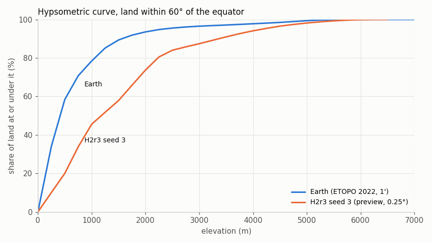
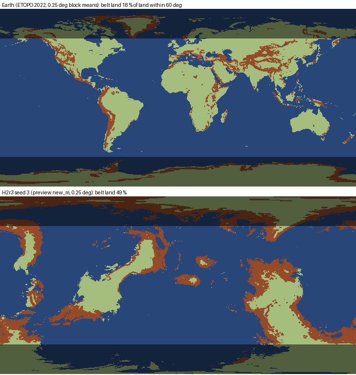

# SPIKE-93: Earth's relief bands as the reference for generator round 3

Opened: 2026-11-02
Question: What are Earth's relief bands (hypsometry, high-land shares, mountain-belt share, relief classes, a `k`-step analogue) on land, and where does H2r3 seed 3 stand against them and against TEST-082's bands?
Why it matters: explorer's M9 generator round 3 (the relief stage on the H2r3 continents the owner picked, seed 3); TEST-082's bands are start values around one seed.
Time box: 4 h (opus-planner, inbox #69); used about 2 h of agent time, interrupted by the perf window of inbox #70.
Success criteria: one table of measure, Earth, seed 3, the current band and a proposed band, each measure stated exactly; ETOPO notice on derived data; no raw data committed.
Fallback if it fails: keep TEST-082's bands and the literature shares of SPIKE-69.
Code location: `proto/s93_relief.py.txt`, `proto/s93_visuals.py.txt` (analysis only); the preview export of seed 3's fields is on `spike/m9-continents` at ece072fb (never merged).
Closed: 2026-11-02

Data: ETOPO 2022 60 arc-second surface elevation (NOAA NCEI, DOI 10.25921/fd45-gt74, CC0-1.0), read only from `C:/DEV/SeriousPlanetData/etopo2022/`; only derived shares are committed.

## Method
- **Region:** land within 60 degrees of the equator (TEST-082's region; Antarctica and most of Greenland out); every share area-weighted by cos(latitude).
- **Earth:** the 1' grid (land: elevation > 0) for hypsometry, classes and `k`; 15 x 15 block means at 0.25 degree for the like-for-like belt share.
- **Seed 3:** the world preview of H2r3 seed 3 at 0.25 degree, on `spike/m9-continents` at ece072fb (#1078, the engine port, is not merged yet). The preview writes per pixel `new_m` (the GEN-096 base elevation, before any bake or erosion), the untapered `k` and the land depth (`fields.f32`).
- **Relief boxes** clamp elevation at 0 m (the sea counts as sea level), so a coast is not relief to the sea floor.

| Measure | Definition |
|---|---|
| Hypsometry | share of land per 250 m band; share above 0.5 / 1 / 2 / 3 / 4 km; median land elevation |
| Coastal land | land within 2 cells (about 55 km) of the sea at 0.25 degree; its median elevation |
| Belt land | R50 = max - min elevation in a box of +-50 km (+-2 rows and +-2/cos(lat) columns at 0.25 degree; +-27 at 1'); belt land where R50 >= 1,000 m |
| Relief classes (Earth) | TEST-082's rule at 1': R7 = max - min in a box of +-7.4 km (+-4 cells); plains R7 < 100 m, hills 100-300 m, mountains R7 > 300 m or elevation > 2.5 km |
| `k`-step analogue | a 1' pixel's `k` from its relief class with GEN-097's table (plains 1, hills 5, mountains 6 + 1.5 smoothstep(1.5, 3.5 km, elevation)); the mean `k` of each 0.367-degree cell (22', about 40 km, GEN-095's lattice spacing) with at least half land; `|dk|` between 4-neighbouring cells |

## Results
| Measure | Earth | Seed 3 | Current band (TEST-082) | Proposed band |
|---|---|---|---|---|
| Land under 500 m | 58.4 % | 20.0 % | none | 50-65 % |
| Median land elevation | about 410 m | about 1,180 m | none | 300-550 m |
| Coastal land median elevation | 82 m | 789 m | none | under 200 m |
| Land above 1 km | 21.6 % | 54.4 % | none | 17-27 % |
| Land above 2 km | 6.5 % | 26.3 % | 5-10 % | 5-10 % (keep) |
| Land above 3 km | 3.5 % | 12.6 % | none | 2-5 % |
| Land above 4 km | 2.2 % | 5.9 % | 1-3 % | 1-3 % (keep) |
| Highest land | 8.16 km (1' cells; 8.85 km true) | 6.44 km | 7-9 km | 7-9 km (keep) |
| Belt land, R50 >= 1 km at 0.25 degree | 17.6 % (32.2 % at 1') | 49.5 % | none (mountains 14-30 % is a class share) | 13-23 % at 0.25 degree |
| Relief classes plains / hills / mountains | 45.7 / 24.6 / 29.7 % (R7 at 1') | 33.3 (53.8 with plateau) / 27.0 / 19.2 % (class weights) | 55-67 / 10-25 / 14-30 % | 45-62 / 15-30 / 20-32 % |
| `k` step between 40 km cells: largest / p99 / p90 | 5.36 / 3.31 / 1.63 | lattice largest 6.50 (preview report); 0.5-degree cells 6.27 / 3.23 / 1.71 | largest at most 2.0 (GEN-097) | realism: p99 at most 3.5; the 2.0 limit stays an engine limit |
| Pairs of 40 km cells over 2.0 | 6.7 % | 6.9 % (0.5-degree cells) | 0 | see above |

- Full hypsometric bands per 250 m: `raw/earth.json` and `raw/seed3.json`; seed 3's preview report: `raw/seed3-preview-report.txt`.
- Earth's hypsometry at 0.25-degree block means agrees with 1' within 0.2 points above 1 km (`raw/earth.json`).

## Findings
1. Seed 3 is far too high: 20 % of its land lies under 500 m against Earth's 58 %, its median land elevation is about 1,180 m against about 410 m, and 26 % of its land is above 2 km against 6.5 %.
2. Its coasts are high: land within about 55 km of the sea has a median of 789 m against Earth's 82 m. The base elevation's coast ramp (up to 1,000 m, GEN-096) reaches its top close to the coast on H2r3's continents, whose land depth rises fast inside the cratons.
3. Belt land (R50 >= 1 km) covers 49.5 % of seed 3's land against Earth's 17.6 % at the same resolution; on the map the belts follow the coasts of every continent, while Earth's follow plate margins (`images/belts-earth-seed3.png`).
4. Its highest land (6.44 km) is under Earth's 8.16 km on the same kind of grid: the belts are wide and low rather than narrow and high.
5. Earth's own `k` steps between 40 km cells exceed GEN-097's limit of 2.0 on 6.7 % of neighbouring pairs (largest 5.4, p99 3.3); seed 3's steps have the same distribution (6.9 %, p99 3.2). The 2.0 limit is an engine constraint (feathering, the bake's continuity), not a realism target: meeting it everywhere gives smoother class transitions than Earth.
6. Earth's relief classes by TEST-082's own rule at 1' are 46 / 25 / 30 %, not the literature's 61 / 14 / 25 % (SPIKE-69): the box is square and the 1' grid smooths, so the shares depend on the definition; the proposed bands cover both.

## Recommendation for round 3 (explorer)
- Gate the round on the hypsometry rows first (land under 500 m, median, coastal median): they are the largest misses and are cheap to measure in the preview.
- Lower the coastal land: spread the coast ramp's rise over a longer distance or lower its top, so the coastal median falls under 200 m.
- Confine the belts: belt land 13-23 % at 0.25 degree, and the highest land 7-9 km, so the belts become narrower and higher.
- Keep GEN-097's step limit as the engine's rule; report the realism `k`-step rows beside it.
- Caveats: seed 3 is measured before the bake and erosion (`new_m`), which lower peaks and fill valleys; one seed; Earth's 1' grid smooths relief under about 2 km.

## Visuals

Cumulative share of land at or under each elevation, land within 60 degrees: Earth (ETOPO 2022, 1') against seed 3 (preview `new_m`, 0.25 degree); CPU analysis, no adapter.

Belt land (brown, R50 >= 1 km) on land (green) at 0.25 degree, Earth above, seed 3 below; latitudes beyond 60 degrees dimmed (outside the measured region); equirectangular.
