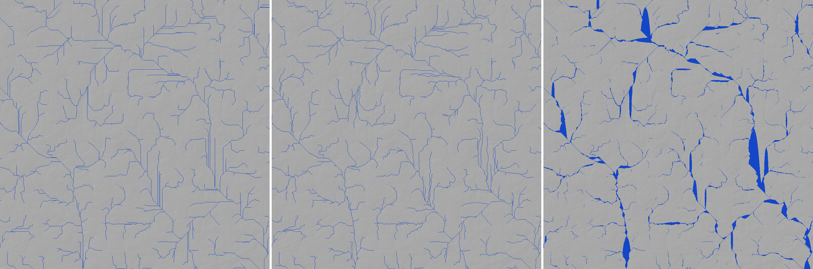

# SPIKE-62 R4 routing cost and flow direction

Opened: 2026-10-30
Question:
- (a) How much routing time does re-routing every k of 10 stream-power steps save, and how far does the carve move from re-routing every step?
- (b) Which faster depression flood keeps the result?
- (c) Do jittered D8 or MFD remove D8's straight runs on plains?
Why it matters: SPIKE-61 found routing to be 60 % of the 100 m bake; its time decides whether R4 fits the M9 draft's criterion 7 (10 h).
Time box: 3 h of machine time at BelowNormal, 4 tiles at once (opus-planner, 2026-10-30); used 12 min (21:45 to 21:53, after a 4.5 min trial).
Success criteria: per method, time per tile and the carve or channel difference in numbers; a still per flow direction.
Fallback if it fails: report the dominating step.
Code location: branch `spike/m9-route-cadence` (pushed, no PR; commit d9954f8c; spike code, never merged): ignored test `route_cadence_report` in `crates/app/src/globalperf.rs`, on top of SPIKE-61's `bake_prerun_report`.
Closed: 2026-10-30

## Method
- **Grid and tiles as SPIKE-61:** 101.8 m, windows of 3,584^2 cells (3,072^2 core plus a 256-cell halo), the store's field, the coupled network's inflow at the window edge, implicit stream power capped by local relief, 10 steps.
- **Tiles:** 12 land tiles, chosen from SPIKE-61's rows across its range of maximum cut.
  - Face 0: (31,4), (28,19), (10,10), (31,28), (10,22), (25,13), (7,22), (10,19).
  - Face 3: (10,14), (18,26), (14,18), (6,18).
  - 5 km relief p50 from 20 to 169 m; 10 tiles are plains under 100 m.
- **(a) Cadence:** route (flood, receivers, order, area) only on steps where `step % k == 0`, for k in 1, 3, 5, 10; carve every step with the last route. The difference to k = 1 is taken in the core, over the cells k = 1 cut by more than 1 cm (4-9 M cells a tile).
- **(b) Floods on the sampled ground:**
  - the binary-heap priority flood of SPIKE-61;
  - Barnes et al. (2014) improved: cells raised to the spill level go to a plain FIFO before the heap;
  - a bucket queue at 5 cm.

  The order for area and carve comes from the receivers (a donor-list stack, Braun and Willett) for every flood, so it no longer depends on the flood's pop order.
- **(c) Flow direction on the filled ground:**
  - D8 (steepest descent);
  - jittered D8: the slope times `1 + 0.5 u`, with `u` a hash in [-1, 1] of the cell and direction, as in SPIKE-35;
  - MFD after Quinn: area shared to all lower neighbours by slope^1.1 times contour length, cells in decreasing filled height.

  Channels are cells with area of at least 1e7 m2.
  - Straight share: channel cells whose only channel neighbours are the two opposite cells along one axis.
  - Long share: straight cells in axis runs of at least 20 cells (2 km).
- **Load:** BelowNormal, 4 tiles at once.
  - Explorer's `cargo xtask prepush` (`test gpu`, `editor --smoke`, `generate`) ran beside (`raw/beside-start.txt`).
  - Processor performance p10 75 %, p50 85 %, p90 123 %; utility p50 67 % (`raw/cpuperf.txt`).
  - Times are under load: comparisons within a tile hold, absolute values are upper bounds.

## Results
### (a) Cadence (medians over 12 tiles; seconds per tile for the 10-step bake)
| k | Route time | vs k = 1 | Carve difference to k = 1, p50 / p95 / max (m) | p95 on the two steepest tiles (m) |
|---|---|---|---|---|
| 1 | 27.0 | 1 | - | - |
| 3 | 10.1 | 2.7x less | 0.000 / 0.139 / 32.8 | 0.37, 0.64 |
| 5 | 4.9 | 5.5x less | 0.000 / 0.233 / 32.9 | 0.64, 1.11 |
| 10 | 2.3 | 11.5x less | 0.001 / 0.378 / 34.2 | 1.10, 1.98 |
- The maximum (about 33 m) is a channel that moved by a cell; the p95 grows with relief and with k.
- Carve (all k): 2.6 s per tile (median).

### (b) Floods (seconds per tile on the sampled ground, median of 12)
| Flood | Time | Filled-height difference to the heap flood, median / max (m) |
|---|---|---|
| Binary heap (SPIKE-61) | 2.91 | - |
| Barnes improved (heap plus plain FIFO) | 2.24 (1.3x faster) | 0.126 (the order of epsilon steps on flats; the same depressions are filled) |
| Bucket queue, 5 cm | 1.15 (2.5x faster) | 0.75 (max 1.9): cells raised by out-of-order neighbours; not exact |
- **One route at k = 1:** flood 2.2 s, receivers 0.23, order from receivers 0.28, area 0.05.
- One tile, (0,31,4) with 20 m relief and many sea cells, took 12.4 s with the heap and 8.4 s with Barnes, with 130 s routing at k = 1 under load.

### (c) Flow direction (medians over the 10 plains tiles; the 2 hill tiles are alike)
| Method | Straight share | Long runs (at least 2 km) | Channel cells (D8 = 1) |
|---|---|---|---|
| D8 | 0.51 | 0.27 | 1 |
| Jittered D8 | 0.29 | 0.001 | 1.02 |
| MFD (Quinn) | 0.02 | 0.000 | 2.3 |
- MFD's low share flatters it: it spreads area over filled flats, and the area threshold paints those as wide blobs (the still).
- Receivers cost the same in D8 and jittered D8 (0.23 s per tile).

## Findings
1. **Re-route every 3rd to 5th step.** k = 5 cuts routing 5.5x and moves the carve by p50 0 and p95 0.23 m (up to 1.1 m on the steepest tile); k = 3 cuts 2.7x at p95 0.14 m. A moved channel is local (one cell), so the max is not a measure. Pick k by the scorecard's tolerance in R4's tuning.
2. **Barnes improved is the flood to use:** 1.3x faster, the same depressions filled. The 5 cm bucket queue is 2.5x faster but overfills by up to 2 m; it needs an exact variant to be usable.
3. **Take the order from the receivers, not from the flood.** It costs 0.28 s, makes any flood usable, and decouples routing from filling.
4. **Jittered D8 removes D8's long straight runs** (long share 0.27 to 0.001) at no cost. It still draws short parallel pairs in places (the still). MFD needs a channel rule other than an area threshold, so it is not a drop-in replacement.
5. **Effect on SPIKE-61's estimate:** routing was 54 s of an 81 s tile (p50, face 0). With Barnes, the receivers' order and k = 5 it is about 5-6 s, so a tile takes about 30-35 s. That is about 2.5x SPIKE-61's throughput, an estimated **4.5-6 h for the planet** at 10 steps, inside criterion 7's 10 h. This is an estimate from the medians under load, not a bake run.

## Visuals

Tile (0,16,16) of SPIKE-61 (a plain, 5 km relief p50 42 m), about 104 km square at 101.8 m, hillshade with channels of at least 10 km2 in blue. Left D8, middle jittered D8, right MFD. Generator data only (no GLO-30).
- D8 draws long axis-parallel and diagonal straight runs.
- Jittered D8 meanders like real drainage, with a few short parallel pairs.
- MFD spreads into wide patches over filled flats.

## Handover
- **Rerun:** run from the worktree root on branch `spike/m9-route-cadence`, at BelowNormal; one line per tile. `CADENCE_DUMP_DIR` writes the sampled ground and the channel masks per method.
  ```
  PLANET_ANET_STORE=C:/DEV/SeriousPlanetData/global16384 PLANET_ANET_RES=16384 CADENCE_TILES=0:31:4,...,3:6:18 CADENCE_PAR=4 CADENCE_OUT=<abs path> cmd //c start "" //b //wait //belownormal cargo test -p planet --release --lib route_cadence_report -- --ignored --nocapture
  ```
- **Dumps:** tile (0,16,16) in `C:/DEV/SeriousPlanetData/spike-r3/cadence/` (about 90 MB, not in git).
