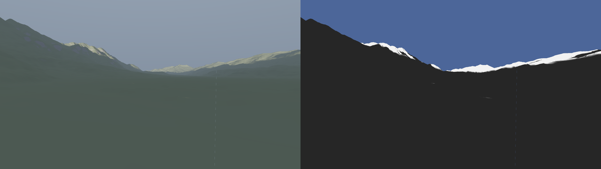
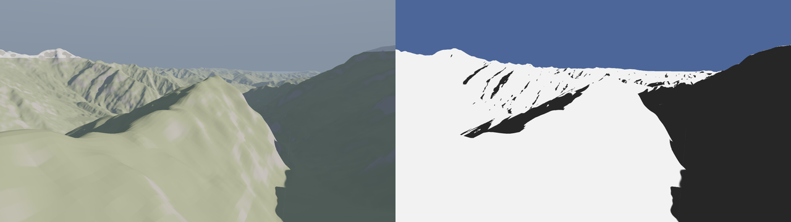
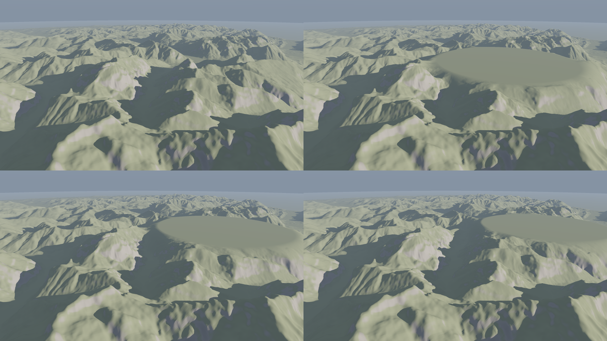
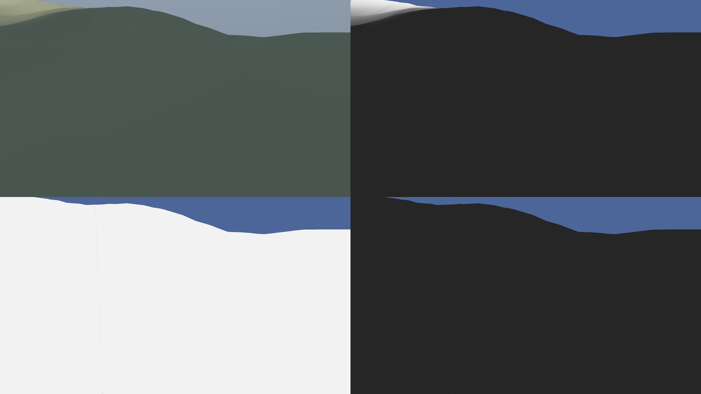

# SPIKE-56 Shadow architecture

Opened: 2026-10-29
Question: what computes shadows in this engine: terrain as occluder for any receiver (layer 1), and later objects as occluders (layer 2)?
Why it matters: the horizon-map shadows (GEN-044/045, REND-038, STRM-048/060/064) will be redone (owner, 2026-10-29); M9 needs the replacement's architecture before an OpenSpec change.
Time box: phase 1 (desk) about 2 h; phase 2 (GPU prototype, two sites) about 3 h, only on opus-planner's go.
Success criteria: phase 1: a data layout that works under wgpu 30 core features and both CI software adapters, a per-frame cost estimate at 1440p on Rasierklinge with its derivation, an ADR 0083 GPU share, edit latency, CON-11 and CON-14 positions, a proposed ADR draft. Phase 2: measured GPU ms of the march at the two sites within the proposed share, stills.
Fallback if it fails: if the march exceeds the share at half resolution with temporal reuse, keep the clipmap and replace the per-pixel march by a per-texel shadow map baked in the clipmap (one march per clipmap texel, sampled by receivers).
Code location: spikes/m9-shadow-architecture/ (throwaway; not part of the main crates)

Status: phase 1 (desk) and phase 2 (GPU prototype, 2026-10-29) done. Phase 2 corrects findings 3, 4, 5 and 7 below; where the two disagree, the phase 2 section holds.

## Inputs read
| Source | Fact used |
|---|---|
| GEN-019, GEN-025 | compact tile: 33x33 texels at cells 32, height `hr_min + f32(q) * hr_step` (tile-local), biquadratic base surface from 9 tile-local control points; slot 9,488 B |
| REND-016, STRM-006 | tiles live in storage-buffer blocks of up to 128 MiB (14,146 slots), 15 (mid) or 23 (high) blocks; read by slot index, no textures |
| STRM-015 | R is a function of camera position, LOD parameters and the horizon cut; view direction is not an input; holds leaves in all directions and their ancestors to the floor (level 3) |
| STRM-006 pins | R with ancestors is at most 10 % of 212,190 slots: about 21k tiles |
| `crates/render/src/graph.rs` | forward lit pass: `terrain` writes `hdr-scene` and `depth`; `sky-composite` applies aerial perspective afterwards; water draws between them |
| ADR 0083 | 16.6 ms frame at 1440p; measured GPU 4.3 ms (terrain 3.4); shares per subsystem not yet in a spec |
| REND-044 | horizon shadows plus material map: at most 1.5 ms of terrain-pass GPU |
| CON-11 v1.4, CON-14 v1.3 | lighting is presentation data: no CPU twin; presentation shading may use planet-scale constants under a declared, tested bound |
| wgpu-types 30.0.1 | `EXPERIMENTAL_RAY_QUERY`, `EXPERIMENTAL_RAY_TRACING_PIPELINES`, `TEXTURE_BINDING_ARRAY` are native-only features; ray query exists in the DX12 and Vulkan hal backends |
| world fixtures | body radius 6,371 km; face edge about 10,000 km; level L tile edge about 10,000 km / 2^L (level 16: 153 m, 4.8 m texels at cells 32) |

## Finding 1: ray length is bounded by curvature
A ray from a receiver toward a sun at elevation `e >= 0` above the receiver's horizon rises above the sphere by `d tan e + d^2 / (2R)`. An occluder at distance `d` must stand that high above the receiver.

| Relief between occluder and receiver | Longest possible occluder distance (e = 0) |
|---|---|
| 1 km | 113 km |
| 3 km | 196 km |
| 5 km | 252 km |
| 9 km | 339 km |

- `d_max = sqrt(2 R dh)`. A sun below the receiver's geometric horizon is the planet's own shadow: analytic, no march.
- So a march needs heights out to about 350 km around each shaded point at most, and to under 50 km for any sun above 5 degrees (`dh / tan e`, 3 km relief).
- Horizon maps buy nothing that a march over 350 km of heights cannot do; they are not needed as a far-field cache (see finding 4 for the one exception, the orbit view).

## Finding 2: data layout: a camera-centred height clipmap, filled from R
The compact tiles cannot be marched directly at an acceptable cost:

| Option | Per step | Problems | Verdict |
|---|---|---|---|
| March the storage-buffer slots through a page table | page lookup, slot header, 4 texel reads, a biquadratic base-surface evaluation, manual bilinear | about 10x a texture fetch; 6 face frames; tile edges | source only |
| Bindless per-tile textures (`TEXTURE_BINDING_ARRAY`) | 1 filtered fetch plus an indirection | native-only feature, non-uniform indexing on WARP and lavapipe unverified; duplicates the pool as textures; still 6 face frames | rejected |
| Tile atlas (33x33 per tile in a large 2D texture) | 1 fetch plus indirection | about 90 MB for 21k tiles of R; still a page table and face frames | rejected |
| **Clipmap**: N nested square levels around the camera's ground point, each a 2D-array layer, texel size doubling per level | 1 fetch (`textureLoad`) | one resample from tiles; one frame for all faces | **chosen** |

Clipmap layout (proposal; phase 2 confirms sizes):

| Item | Value |
|---|---|
| Levels | 10 to 12; level k texel `s0 * 2^k`, `s0` = 1 m near the ground (follows the finest resident tile under the camera), 1024 x 1024 texels a level |
| Coverage | level 0: 1 km; level 9: 512 km square (256 km radius); level 10: 1,024 km |
| Value | height above the sphere, `R32Float`, metres (no planet-scale value) |
| Max mips | per level, a max-height pyramid (`R32Float`, mips 1..10) for empty-space skipping |
| Memory | 1024^2 x 4 B x 1.33 = 5.6 MB a level; 12 levels 67 MB; coarse layer (finding 4) 8 MB; compare today's 56 MB coarse horizon plus chunk maps |
| Frame | a tangent plane at the camera's ground point (camera-relative f32); level centres snap to their own texel grid (toroidal addressing) |
| Projection | azimuthal around the anchor: crosses cube faces and edges without a seam, because tiles are resampled into it |
| wgpu | 2D array texture, `R32Float` storage write and `textureLoad`: core WebGPU, no native feature, works on WARP and lavapipe; no filtering needed (`FLOAT32_FILTERABLE` avoided) |

Filling it (gather, compute pass):
- The CPU (frame crate, GPU-free, CON-03) lists for each level the resident tiles of R that cover it, the finest available per region, and for each a texel rectangle and a small mapping from clipmap-local texel coordinates to the tile's `(u, v)`, built in f64 and handed over as tile-local f32 (CON-11).
- The compute pass reads the slot's texels from the existing storage-buffer blocks (no copy of the pool), bilinear in `(u, v)`, and writes the height. Then it rebuilds the max mips of the touched region.
- Work per frame: only regions whose tile changed (landing, eviction to an ancestor, edit refresh) and the strips a level scrolls. At the upload cap of 110 tiles a frame that is about 110 x 33^2 = 120k texels: under 0.05 ms. A teleport rebuilds all levels: 12 x 1M texels, about 0.3 ms once.
- R's horizon cut can drop an occluder that sits just below the camera's horizon yet shades a visible point (only for a sun within about 0.3 degrees of the receiver's horizon, at 50 to 100 km). The coarse layer covers it (finding 4).

## Finding 3: per-frame cost at 1440p on the RTX 3080 Ti Laptop (desk estimate; measured in phase 2 P1: about 2x higher)
Hardware assumed: 58 SMs, 232 TMUs at about 1.4 GHz (about 325 Gtexel/s peak), 512 GB/s. Estimates; phase 2 measures.

| Variant | Rays | Steps a ray (mean, max-mip skipping) | Fetches | Peak time | Expected (20-30 % of peak, dependent divergent loop) |
|---|---|---|---|---|---|
| Full resolution | 3.69 M | 48 | 177 M | 0.54 ms | 1.8 - 2.7 ms |
| **Half resolution** | 0.92 M | 48 | 44 M | 0.14 ms | **0.45 - 0.7 ms** |
| Half resolution, 2-frame temporal stagger | 0.46 M | 48 | 22 M | 0.07 ms | 0.25 - 0.35 ms |

- Steps: a min-max (here max-only) quadtree march takes about 2-4 steps per clipmap level it crosses plus a refinement at the hit; a low sun crosses 8-10 levels (24-48 steps), a midday sun leaves the level's max height within a few steps. 48 is the planning worst-case mean.
- Soft edge for free: track the smallest `(ray height - terrain height) / distance` along the march and map it to the sun's 0.53 degree disc (a penumbra, no extra fetches).
- Upsample (depth-aware, 4 taps) and temporal accumulation (reprojection with a clamp to the neighbourhood): about 0.1 ms each at 1440p.
- Clipmap upkeep: under 0.05 ms a frame, 0.3 ms on a teleport.
- CPU main thread: the per-level tile lists change only when R or a tile changes: under 0.1 ms a frame, on the plan worker where possible.

Integration with the forward pass (`terrain` writes the lit colour before `sky-composite`):
1. **Inline**: march in the terrain fragment shader at full resolution. No new pass, but no half resolution and no temporal reuse; 1.8-2.7 ms. Usable as the phase 2 baseline only.
2. **Split sun term (recommended)**: `terrain` writes the unshadowed direct-sun radiance into a second target (`rg11b10` or `rgba16float`, 15-30 MB at 1440p, about 0.1 ms of bandwidth); a compute pass marches at half resolution from `depth`; `sky-composite` (which already reads `hdr-scene` and `depth`) adds `shadow x sun` before the aerial perspective. Water surfaces and seabed read the same shadow mask.

## Finding 4: the coarse layer and the orbit view (phase 2 P3: the coarse layer must hold max heights)
- From orbit the visible disc is thousands of km wide and a pixel covers kilometres; shadows matter only near the terminator.
- The coarse layer is a global height cube from the floor tiles (levels 3-4 are always present, LOD-011): 6 x 512^2 `R32Float` with max mips, about 8 MB, roughly 20 km texels.
- Rays that leave the outermost clipmap level continue in the coarse layer (same march, other texture). Beyond 350 km a ray can only hit relief above 9 km (finding 1), so the coarse layer mostly serves the orbit view and R's horizon-cut gap.
- Replaces GEN-045's coarse horizon (56 MB) and REND-043's distance fade.

## Finding 5: ADR 0083 share (desk proposal; phase 2 revises it)
| Share (1440p, Rasierklinge) | GPU | Main-thread CPU | VRAM |
|---|---|---|---|
| Layer 1, terrain occluders (clipmap upkeep, march, upsample, temporal) | 1.0 ms | 0.1 ms | 80 MB |
| Layer 2, object occluders (reserved, M10+) | 1.0 ms | 0.3 ms | 67 MB (4 cascades of 2048^2 depth32) |

- The 1.0 ms of layer 1 fits the expected 0.45-0.7 ms with margin; REND-044's 1.5 ms for horizon shadows plus material map then reads 1.0 ms for shadows outside the terrain pass and the material map's own share.

## Finding 6: edit latency
- Path: edit, tile refresh (STRM, 0.15-1.5 s per SPIKE-29), tile lands, the clipmap gathers its rectangle in the same frame, the next march sees it. Shadows follow the drawn terrain in the frame the tile lands; today's horizon maps re-bake per chunk in seconds after the neighbourhood settles.
- Temporal history must not hold the old shadow: the clipmap upkeep marks touched regions, and history is rejected where a ray's footprint crosses one (or, simpler, the history weight is capped so a change settles in 2-3 frames).
- Preview stamps drawn before the refresh: the shadow lags until the tile refresh lands. Evaluating the preview stamp in the gather removes the lag (later, if wanted).

## Finding 7: CON-11 and CON-14 (phase 2 P2: the drop baked by the gather is picked)
- CON-11: the clipmap stores heights above the sphere (metres, up to about 10 km, f32 step 1 mm); positions are camera-relative f32 in the anchor's tangent frame; the tile mapping is built in f64 and handed over tile-local. The ray's curvature term `|p_h|^2 / (2R)` uses the constant `1/(2R)` (7.8e-8 per m), not a planet-scale value; shadows are presentation shading, so CON-11 v1.4 allows it under a declared bound tested at the worst case (1 m altitude, far from the origin, under camera motion). f32 error at 350 km camera-relative: about 2 cm.
- CON-14: shadows are lighting, presentation data with no CPU twin. The march has no atomics and no order-dependent reduction, so a given adapter draws the same pixels every run; goldens per adapter (ADR 0061) suffice. **The owner's exception (cross-machine identity) is not needed for layer 1.** It may be needed for hardware ray tracing (BVH builds differ by driver version).

## Finding 8: layer 2 (objects, M10+)
- **Receivers**: any pixel with a depth (terrain, a tower, a tree) marches layer 1 the same way; objects need nothing extra to receive terrain shadow.
- **Large static objects as layer-1 occluders**: buildings and forest canopy can splat a max height into the clipmap gather (an occluder height layer), so a tower or a forest edge casts long shadows at any distance at no march cost. Overhangs (bridges, arches) cannot be a heightfield: their far shadows are a stated limit.
- **Near objects**: cascaded shadow maps of objects only (terrain is not drawn into them, so no terrain acne and no terrain draw cost), 3-4 cascades out to about 2 km, combined as `min(layer 1, layer 2)`. Matrices camera-relative (CON-11).
- **Hardware ray tracing**: wgpu 30 has `EXPERIMENTAL_RAY_QUERY` (DX12 and Vulkan hal). Lavapipe exposes no ray query and WARP's support is unverified, and the feature is marked experimental. So it can only be an optional quality path beside the CSM, verified on the real GPU (`test gpu --real`), with CI goldens on the CSM path. Re-evaluate at M10.

## Phase 2: GPU prototype (2026-10-29)
Method:
- Standalone wgpu 30.0.1 prototype (core features only; not committed). Terrain: GLO-30 tiles N47 E011 (Alps) and N27 E086 (Himalaya), resampled to 4096^2 metric grids of 18 and 24 m and treated as a local tangent-plane raster (no cube faces).
- R stand-in: per clipmap level a 34 x 34 table of 32-cell tiles at the level's spacing, compact-style (24-bit height steps over the tile's range), in one storage buffer of 101 MB; tile corners offset 0.37 texel from clipmap texels.
- Clipmap: 10 levels of 1024^2 `R32Float`, 1 m to 512 m texels (1 km to 524 km), 3x3-dilated max pyramid of 11 mips, gathered on the GPU. Coarse stand-in: 64^2 texels of 19 km.
- Receivers: a primary heightfield ray cast from the camera stands in for the depth buffer (not part of the design; its 6-8 ms is not counted).
- March as in finding 3: max-mip skipping, two bilinear tests per texel, penumbra from the closest approach (sun radius 0.267 degrees). No temporal accumulation, no toroidal update, no incremental gather.
- Timing: GPU timestamps around each pass, 1440p (2560 x 1440), 20 warm-up runs, median of 41, three rounds; the table gives the median of the three medians and their spread.
- **The CPU was not quiet**: explorer ran builds and software-adapter tests in parallel; no perf window. Two sessions gave half-resolution times up to 1.5x apart at the same pose (laptop GPU clock states), and single rounds up to 5x slower. The ranges below cover both sessions; the plateau pose was measured in the second session only.

### P1: cost (RTX 3080 Ti Laptop, Vulkan, 1440p)
| Site (sun) | Terrain px | Marched px | Steps mean / p95 | Full res | Half res | Half, penumbra to 2 km | Upsample |
|---|---|---|---|---|---|---|---|
| Ridge: Inn valley at Innsbruck, camera 30 m up (2 degrees, sunset) | 69 % | 43 % | 87 / 246 | 4.5-6.1 ms | 1.7-2.2 ms | 1.6-1.8 ms | 0.18-0.19 ms |
| Gorge: Himalaya valley, camera 600 m up (25 degrees) | 72 % | 56 % | 34 / 65 | 1.8-2.9 ms | 0.78-1.18 ms | 0.79-1.0 ms | 0.16-0.20 ms |
| Plateau (owner's case, P5), camera 2.5 km up (15 degrees) | 100 % | 74 % | 28 / 72 | 2.3-3.4 ms (one set 4.7) | 0.80-1.18 ms | 1.17 ms | 0.2 ms (one set 4.4) |

| Clipmap upkeep | Time |
|---|---|
| Full rebuild: gather of 10 x 1024^2 texels from the tile slots, dilation, 10 mip reductions | 1.24-1.31 ms (single slow rounds 7 ms) |
| Drag frame of the plateau stamp (full rebuild, stamp evaluated in the gather) | 1.24-1.31 ms |

- Half resolution costs a third to a half of full resolution, not a quarter: neighbouring rays diverge more.
- The desk estimate (0.45-0.7 ms at 48 steps) was about 2x low: a step costs more than one fetch (the level choice, two dependent loads, divisions).
- Low sun is the expensive case: rays run tens of km at a grazing angle near the terrain. Capping the penumbra at 2 km saves up to 20 % at the ridge and nothing measurable at a higher sun (0.5 % of pixels change by more than 0.25).
- Half resolution plus upsample against full resolution: 0.04-1.0 % of terrain pixels differ by more than 0.25 (shadow edges).
- The share of 1.0 ms (finding 5) holds at a sun of 15-25 degrees only. **Revised share: 1.5 ms** of GPU for layer 1, with the half-resolution rays spread over two frames below about 5 degrees of sun. That spread halves the ridge's 1.6-2.2 ms to an estimated 0.8-1.1 ms; temporal accumulation and incremental upkeep add an estimated 0.3 ms. Not measured: the implementation's perf window confirms it.

### P2: CON-11, curvature in the shader or baked by the gather (planner addition a)
- Mode 0: heights above the sphere, the march adds `|x|^2 / (2R)` with the constant 1/(2R).
- Mode 1: the gather subtracts the sphere's drop from per-tile coefficients `c0 + c1 x + c2 y + c3 (x^2 + y^2)` built in f64 on the CPU, tile-local. The march has no R.
- Test: 65,536 world-fixed receivers on a 4 x 4 km grid, 0.5 m above the ground; camera at 1 m above ground moved 1 m in 100 steps of 1 cm, the clipmap fixed. Each mode at both sites, with the camera at the anchor and 30 km from it.

| Case | Shadowed | Max change of visibility over the pan | Receiver-steps changed by > 1/255 |
|---|---|---|---|
| Ridge, at the anchor (modes 0 and 1) | 100 % | 0.0010 | 0 of 6,553,600 |
| Ridge, 30 km from the anchor | 96 % | 0.0001 | 0 |
| Gorge, at the anchor | 64 % | 0.0012 | 0 |
| Gorge, 30 km from the anchor | 22 % | 0.0022 | 0 |

- Modes 0 and 1 agree to a mean |d| under 1e-5 in every case, and cost the same within the noise.
- No edge shift or flicker at 1 m: a camera-relative f32 receiver plus an anchor-frame camera of up to 30 km keeps visibility within 0.0022.
- **The ADR picks mode 1** (drop baked by the gather): same result and cost, and it keeps the planet radius out of the march, so no declared-bound exception under CON-11 is needed.

### P3: an occluder beyond R (planner addition c)
- A real horizon cut drops nothing these sites need. The cameras sit 500 to 3,000 m above the sphere: dip 0.7 to 1.8 degrees, horizon 80 to 195 km, beyond each 100 km DEM. The gap needs a camera near sea level.
- Stress instead: R cut at 30 km from the camera (tiles beyond replaced by the coarse layer). The camera is found by search: Himalaya valley at 2,937 m. The sun is at azimuth 20 degrees and 5.3 degrees elevation, 0.3 degrees below a massif's skyline 35-90 km away.

| Fill beyond the cut | Terrain shadowed | Agrees with full R |
|---|---|---|
| Full R (reference) | 98.7 % | 100 % |
| Coarse layer, mean height, 19 km texels | 0.0 % | 1.3 % |
| Coarse layer, mean height, 2.4 km texels | 0.0 % | 1.3 % |
| Coarse layer, max height, 19 km texels | 100 % | 98.7 % |
| No fill | 0.0 % | 1.3 % |

- A mean-height coarse layer does not fill the gap at a grazing sun: averaging lowers the peaks by more than the 0.3 degrees (about 200 m at 40 km).
- A max-height coarse layer fills it and over-shadows slightly (1.3 % of pixels here). **Finding 4 changes: the coarse cube holds max heights.**

### P4: software adapter (planner addition b)
- WARP (Microsoft Basic Render Driver, DX12) runs the gather, the mips and the march unchanged with core wgpu: R32Float storage writes on a 2D array, `textureLoad` of a mipped 2D array, timestamps available.
- Gorge, 1440p, mode 1: steps mean 34.0 / p95 65 and mean visibility 0.667, as on the RTX (34.0 / 65 / 0.666). The masks differ by more than 12 levels in 0.17 % of pixels (max 107, at edges).
- Cost on WARP at 1440p: gather and mips 4.3 s, half-resolution march 0.34 s, full 2.1 s; the full chain (gather, primary, half march, upsample, shade) 11.8 s wall. A golden at 640 x 360 is about 1/16 of the march, under a second plus one gather.
- Lavapipe was not run (Windows machine).

### P5: the owner's case: a dragged plateau stamp (owner's report, 2026-10-29, Plateau 6)
- Owner's reference: `C:/DEV/SeriousPlanetData/owner-refs/2026-10-29-plateau6-drag.webp` and `-rest.webp`: square, chunk-aligned shadow patches, a patchwork of old and re-baked maps after an edit, and shadows that do not follow the preview shape while dragging (REND-033).
- Prototype: Alps tile, a plateau (GEN-026 profile, reach 5 km, target local height + 600 m, M 1,200 m) evaluated in the gather like a preview stamp. Sun 15 degrees from the south-east, camera 2.5 km up. Three drag frames move the stamp 0, 1.5 and 3 km east.
- Each frame re-gathers the clipmap with the stamp where it is now (1.24-1.31 ms, full rebuild) and marches: the plateau's shadow follows the stamp in the same frame, with no chunk-aligned edges, because nothing is baked per chunk. An incremental gather of the stamp's footprint would cost less (not measured).
- In the engine the drawn geometry takes the preview stamp in the vertex stage (REND-033); the gather must apply the same preview stamp, so drawn ground and shadow agree while dragging.

### Prototype limits and artefacts
- Flat local raster instead of cube faces: the per-tile mapping is affine here; on the cube it is the f64 mapping of finding 2 (not built).
- No march beyond the clipmap (the DEMs end at about 50 km), no analytic planet shadow, no temporal accumulation, no toroidal or incremental gather.
- A faint dotted line remains where camera rays run parallel to a clipmap axis through a texel edge (`ridge.png`, `cut.png`): a traversal edge case of the prototype, fixed by a proper DDA.
- Raw output: `raw/site-ridge.txt`, `raw/site-gorge.txt`, `raw/site-plateau.txt`, `raw/pan.txt`, `raw/cut.txt`, `raw/soft-gorge.txt`.

## Recommendation
1. Layer 1 as in the ADR draft: a per-pixel march at half resolution over a camera-centred height clipmap gathered from R, max-mip skipping, penumbra, depth-aware upsample, temporal accumulation; the two-frame spread below about 5 degrees of sun.
2. The gather bakes the sphere's drop from per-tile f64 coefficients (P2); the march carries no planet-scale value.
3. The coarse cube holds max heights (P3).
4. GPU share for layer 1: 1.5 ms at 1440p on Rasierklinge (P1), confirmed in the implementation's perf window with temporal reuse.
5. The gather applies the preview stamp, so a dragged stamp shadows in the same frame (P5, the owner's case).
6. Retire the horizon maps (GEN-044/045, REND-038/041/043, STRM-048/060/064) once layer 1 lands.
7. Split the sun term out of the terrain pass and apply the shadow in `sky-composite`.
8. Layer 2: object-only CSM near the camera; static large objects splat into the clipmap; hardware ray tracing optional, re-evaluated at M10.

ADR draft: `adr-draft.md` (proposed; the architect files it under `docs/adr/`).

## Visuals

Ridge site, Inn valley at Innsbruck, sun 2 degrees from the west-south-west, RTX (Vulkan), 1440p shown at 640 px wide: the lit view (left) and the shadow mask (right); only the crests are lit.

Gorge site, Himalaya valley, sun 25 degrees from the west-south-west, RTX: lit view (left) and shadow mask (right).

The owner's case on the Alps tile, sun 15 degrees, RTX: without the stamp (top left), then the plateau at +0, +1.5 and +3 km east; each frame re-gathers and its shadow follows the stamp in the same frame.

Cut case, Himalaya, sun 0.3 degrees below a far skyline, RTX: lit view with full R (top left), the mask with full R (top right), the mask with R cut at 30 km and a mean-height coarse fill (bottom left, the shadow is lost), and with a max-height coarse fill (bottom right, recovered).
