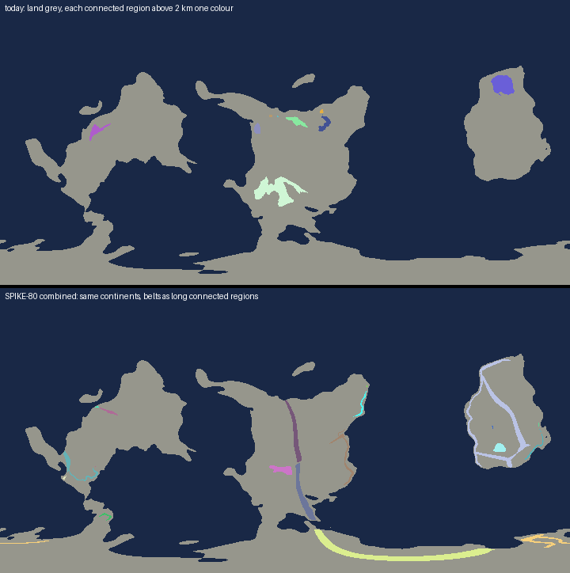

Opened: 2026-11-01
Question: Why did SPIKE-77 to 80 match Earth's statistics while their world map looks "generally wrong" (owner, 2026-11-01), and which shape metrics would have caught it?
Why it matters: explorer builds the engine preview (explorer inbox #37); these metrics become the scorecard's shape checks for the preview iterations.
Time box: 2 h (Sonnet, analysis only)
Success criteria: the blind spot of the old metrics named; 5 to 8 shape metrics with Earth references and a computation rule; measured on today's map and SPIKE-80's combined map; the knobs that move each; the continent generator and candidate approaches.
Fallback if it fails: the metric definitions alone.
Code location: Python scripts in `proto/` on SPIKE-69's 0.5-degree map of the generator's inputs (`target/s69/map13.f32`), resampled to 0.25 degree, and SPIKE-80's `combined.py` rerun unchanged (`s80-fields.f32`); no Rust, no cargo (a perf window ran beside it; scripts at idle priority).
Closed: 2026-11-01

## Headline
- **The old metrics are histograms, so they are blind to shape.** Class shares and hypsometry count land cells by class or height. Any rearrangement of the same cells scores the same: a 9,000 km line one cell wide and a compact massif of equal area at the same heights are equal to them. SPIKE-80 also tuned its belt amplitude and back-arc uplift on hypsometry itself, so that match was fitted, not predicted.
- **The continents never entered any metric, and no relief rule touches them.** The combined map has exactly today's continents (land 29.7 %, the same two masses of 119 and 31 Mkm²). The largest holds 79 % of the land; Afro-Eurasia holds about 57 % of Earth's. The coastline is smooth: box dimension 1.11 at 28-900 km.
- **The combined belts are one-cell-thin lines that run and close.** The largest connected region above 2 km is 18,100 km long; the next four are 8,300, 6,600, 5,400 and 4,200 km. Their widths at p10 are 64 km. The belts enclose 10.9 Mkm² of land they do not cover: a ring traced round the eastern continent by the coastal-arc term. Today's map has 7,200 km at most and encloses nothing.

## 1. Why the statistics matched
| Old metric | What it measures | Blind to |
|---|---|---|
| Class shares (61/20/19 %) | the share of land per relief class | where the classes are, their shape, their connectivity |
| Hypsometry (land above 0.5-5 km) | the height distribution of land cells | the same; and it was the tuning target of SPIKE-80's amplitude and back-arc uplift (`raw/combined-grid.log` in SPIKE-80) |
| Site scorecard (SPIKE-74 to 81) | 30 m to 5 km statistics at chosen sites | everything above 5 km; sites were re-matched to where the model put the classes |
| Aspect ratio of land above 2 km (SPIKE-79) | elongation per region | thinness, length, gaps and rings (a long thin ring is "aspect over 4") |

Off in the map, against Earth:
- belts: one-cell-thin and uniform in width; continuous over 5,000-18,000 km; a closed ring; no segmentation into ranges;
- continents: unchanged by the M9 work; two masses plus a polar band, too few and too large; coastlines smooth at 100-1,000 km scale.

## 2. Shape metrics
Computed on a global equirectangular grid (0.25 degree here; on the cube map the same on each face's lattice with the seams joined), cell areas on the sphere, 8-connectivity, regions joined across the 180-degree seam. Land is elevation above 0; high ground is elevation of at least 2,000 m.
| # | Metric | Computation | Earth reference |
|---|---|---|---|
| S1 | Land masses of at least 1 Mkm² | connected land regions by area | 5: Afro-Eurasia about 85, the Americas about 42, Antarctica 14.2, Australia 7.7, Greenland 2.2 Mkm² (standard geography) |
| S2 | Largest land mass's share of land | its area over all land | about 57 % (Afro-Eurasia over 149 Mkm²; 63 % without Antarctica) |
| S3 | Coastline dimension | box counting of the coast cells at 2-32 cells (about 28-900 km), slope of log count over log size | about 1.1-1.3 by coast: west Britain 1.25, Australia 1.13 (Richardson's data in Mandelbrot 1967, *Science* 156:636); measure Earth's global value at the same band before using it as a gate |
| S4 | High-ground width | per region above 2 km: 2 x the mean distance to its edge along its skeleton (km); area-weighted median and p10 | orogens about 100-500 km across (the Alps 150-250 km, the Himalaya 250-400 km, the Andes 200-700 km; standard geology) |
| S5 | High-ground segment length | per region: skeleton length (km); the five longest | the longest connected highland above 2 km is the Tibet-Himalaya-Pamir system, of order 3,000-4,000 km; the Andes, 7,000 km long, break below 2 km into shorter segments (approximate; to be measured on a global DEM with this code) |
| S6 | Enclosed area | land the high-ground regions surround but do not cover (filled minus covered), summed over holes of at least 0.5 Mkm² | about 0-1 Mkm² (the Tarim and Qaidam basins, partly ringed) |
| S7 | High ground share of land | land at least 2 km over all land | about 7 % without Antarctica (SPIKE-78) |
| S8 | Belt sinuosity | longest skeleton path over the distance between its ends | about 1.1-1.3 for the Andes' axis and the Himalayan arc (approximate); here measured as skeleton length over the region's largest span, which counts branches: not comparable yet, a cleaner path measure is needed |
- S5, S6 and S8 need an Earth measurement with the same code to become gates: ETOPO 2022 (NOAA, public, 1 arc-minute) at 0.25 degree would do; downloading it needs the planner's OK (paper and data rule).

## 3. Measured
`raw/shape.json`, `raw/holes.json`; today's map is the generator's elevation channel, the combined map SPIKE-80's chosen setting.
| Metric | Today | SPIKE-80 combined | Earth |
|---|---|---|---|
| Land fraction | 29.8 % | 29.7 % | 29.2 % |
| S1 land masses of at least 1 Mkm² | 2 (119.4, 31.1) | 2 (119.1, 31.1) | 5 |
| S2 largest share of land | 79 % | 79 % | 57 % |
| S3 coastline dimension | 1.11 | 1.11 | 1.1-1.3 (to be measured) |
| S4 width, area-weighted median (p10-p90) | 376 km (75-422) | 199 km (64-303) | 100-500 km |
| S5 longest five segments | 7,219 / 2,667 / 2,051 / 1,623 / 1,510 km | 18,127 / 8,334 / 6,603 / 5,384 / 4,225 km | of order 3,000-4,000 km longest |
| S6 enclosed area | 0 | 10.9 Mkm² | about 0-1 Mkm² |
| S7 high ground share of land | 3.9 % | 6.9 % | about 7 % |
| S8 sinuosity (with branches) | 1.91 | 1.72 | not comparable yet |
| Regions above 2 km | 10 | 18 | - |
- S7 is the only shape-free metric here, and the combined map passes it; S1, S2, S5 and S6 fail clearly and would have flagged SPIKE-80.
- Today's high ground is blob-like (wide, few, short); the combined map is the opposite extreme (thin, long, ringed).

## 4. Knobs that move each metric
| Metric | Knob (where) |
|---|---|
| S1, S2, S3, land fraction | the continent field only: `fbm(seed, LAYER_CONTINENT, warped, 1.1, 5) x 1.7` over a direction warped by 0.45 (`crates/generators/src/global.rs:174-182`), cut at 0.1 (`SEA_LEVEL_C`); base frequency (1.1: one or two masses), octaves and gain (coast detail), warp amplitude (0.45: shape variety). ADR 0089's class source and the plate belts do not touch it |
| S4 width | belt half-width `HW` (90 km) and its along-strike variety `WV` (0.6-1.5x), the Gaussian profile `exp(-(d/hw)^2)`, the flank factor (3 hw) (`combined.py` `model`) |
| S5 segment length | the convergence gate `smooth(conv, 0.05, 0.35)` and the coastal gate `seg_coast` (threshold 0.40-0.52): nothing breaks a belt along strike; plate count `NP` 14 and warp 0.35 set margin length. A gap noise along strike (or segmenting by margin curvature) is the missing knob |
| S6 enclosed area | the coastal-arc term `seg_coast x exp(-(d_coast/0.8 hw)^2)` traces a whole coastline, and Voronoi margins close around small plates inside continents: allow coastal arcs only on convergent margins facing an ocean plate, and gate interior margins |
| S7 | belt amplitude `A`, back-arc uplift `U`, plateau rule (SPIKE-78, 80) |
| S8 | warp of the plate cells and margin curvature |

## 5. Continents today and candidate approaches
- Today: domain-warped fBm continentalness (5 octaves from base frequency 1.1, warp 0.45), thresholded at 0.1 for about three tenths land (`global.rs`); unchanged by ADR 0088 and 0089 and by every M9 spike.
| Approach | What it gives | Effort | Risk |
|---|---|---|---|
| A. Tune the fBm | a higher base frequency (about 1.6-2.2) and more warp give more, smaller masses and rougher coasts; S1-S3 tunable within days with the preview | 1 PR plus preview iterations | low; continents stay unrelated to the plates and belts |
| B. Multi-scale noise with shape constraints | cratons seeded at a log-normal size distribution, grown on noise, the threshold chosen per quantile to hold land at 29 % and S1/S2 at targets | 2-3 PRs | medium: constraint solving on the sphere, seams at cube faces |
| C. Plate-driven continents | the same plate model places continental crust (plate interiors, accreted terranes at convergent margins), so belts sit at continent edges by construction (S5, S6 follow) | 3-5 PRs plus a spike | medium-high: couples two systems; the plate model becomes a format question for the owner |
| D. Tectonic simulation | plates moving over time (e.g. Cortial et al. 2019, "Procedural Tectonic Planets", Computer Graphics Forum) | weeks | high: a new subsystem; determinism and bake time (CON-14) |
- A first, gated by S1-S3 in the preview; C if the owner wants belts and coasts to agree by construction.

## Limits
- 0.25-degree resampling of a 0.5-degree input: widths under about 60 km and coast detail under 100 km are not resolved.
- Earth references for S5, S6 and S8 are approximate from standard geography; they need the same code on a global DEM before they gate.
- Skeleton lengths count branches (S5, S8 overstate long, branched regions); the order of magnitude is not in doubt (18,100 km against a few thousand).
- The polar land of the generator is in S1, S2 and the largest mass (the southern band connects to the central continent).
