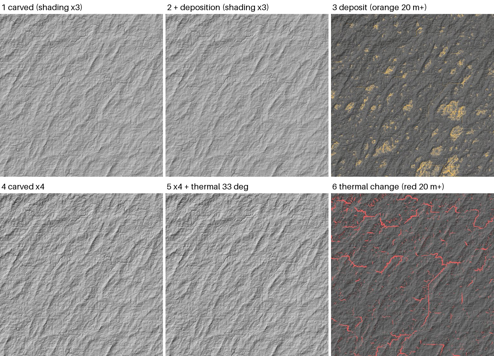

# SPIKE-64 R3b: CPU thermal and deposition kernels on a region

Opened: 2026-10-31
Question: What do CPU thermal and deposition passes (SPIKE-57 recommendation 2, after Schott et al. 2024) do on the 100 m bake's ground, measured against the scorecard's slope and relief at the same spacing, and what do they cost per tile?
Why it matters:
- R4's bake plans thermal and deposition passes after the carve (M9 draft, R3/R4).
- Criterion 1 needs hill slope and relief at least 0.6 of real.
- Criterion 7 needs the bake within 10 h.
Time box: 2-3 h at BelowNormal (opus-planner, 2026-10-31); used about 1 h, with 6 min of machine time.
Success criteria: per kernel, the change of slope (p50/p90/p99), 1 and 5 km relief and the flat share against real tiles at about 100 m, and the time per tile.
Fallback if it fails: report what blocks the kernels.
Code location: a standalone program, not in the workspace (`proto/s64.rs.txt`, `proto/Cargo.toml.txt`; no dependencies). Scoring and the still are in `proto/score.py.txt` and `proto/shade.py.txt`.
Closed: 2026-10-31

## Method
**Ground:** SPIKE-61's dumped tiles at 101.8 m, read only from `C:/DEV/SeriousPlanetData/spike-r3/`:
- tile 1, a rough upland;
- tile 2, a smooth lowland;
- tile 4, a plain.

Each is a window of 3,584^2 cells (3,072^2 core plus a 256-cell halo), as sampled (`orig`) and after the capped carve of 10 stream-power steps (`carved`), with the drainage area.

**Thermal** (Schott et al. 2024's thermal pass as a CPU Jacobi gather):
- In each pass a land cell gives each lower neighbour 1/16 of the height difference above the critical one, and takes the same from each higher land neighbour. The critical difference is `tan(theta) (1 + 0.25 u)` times the distance, with `u` a hash of the unordered cell pair, so both cells see one critical slope.
- Values are read from the previous pass, so mass is kept and the result does not depend on the thread count.
- 100 passes on 4 threads, at theta 33 degrees (the angle of repose) and 20 degrees.

**Deposition** (transport-limited, one sweep from upstream to downstream):
- Order and receivers come from a Barnes flood with jittered D8 on the carved ground (SPIKE-62).
- A cell's load is its donors' load plus its own eroded column (`orig - carved`).
- The load first fills the cell's depression up to the filled level.
- Then half of the load above the capacity `kc A^0.5 S` settles, raising the cell at most half the drop to its receiver.
- The rest moves on; what reaches the sea or the window edge leaves.
- kc 1e4, 1e5 and 1e6, and kc 1e5 followed by thermal at 33 degrees.

**Realistic relief:** tile 1's land heights scaled x4 (SPIKE-55's gap of 4-9x), then thermal at 33 degrees.

**Scorecard measures** at about 100 m, land only, over the 3,072^2 core:
- slope in degrees from central differences;
- relief as the median of the max minus min over 1 km and 5 km blocks;
- the flat share (slope under 1 degree);
- the shares over 20 and 33 degrees.

The real tiles are SPIKE-55's GLO-30 samples, block-averaged to 90-113 m.

**Machine:** heavy lock, BelowNormal.
| Run | Start | CPU before |
|---|---|---|
| tile 2 | 08:46 (after a 20 min lock wait) | 43 % |
| tiles 1 and 4 | 08:47 | 12 % |
| scaled | 08:50 | not logged |

## Results
### Slope and relief at about 100 m
| Ground | Slope p50/p90/p99 (deg) | Relief 1 km p50 (m) | Relief 5 km p50 (m) | Flat | Over 20 deg | Over 33 deg |
|---|---|---|---|---|---|---|
| real Alps | 16.9/35.9/49.0 | 345 | 1,029 | 8.9 % | 43.8 % | 14.8 % |
| real Highlands | 6.6/16.9/31.1 | 129 | 431 | 6.4 % | 6.3 % | 0.68 % |
| real Valley and Ridge | 5.7/16.6/25.6 | 99 | 335 | 6.3 % | 5.5 % | 0.02 % |
| real Black Forest | 5.4/20.1/28.4 | 95 | 256 | 9.4 % | 10.2 % | 0.09 % |
| real Loess | 2.8/5.5/9.8 | 35 | 67 | 19.0 % | 0 | 0 |
| real Badlands | 1.9/4.9/9.8 | 30 | 88 | 26.1 % | 0.01 % | 0 |
| real Brandenburg | 0.8/3.9/7.1 | 20 | 43 | 54.9 % | 0 | 0 |
| tile 1 orig | 2.7/5.6/11.1 | 44 | 140 | 10.0 % | 0.05 % | 0 |
| tile 1 carved | 3.0/6.7/15.5 | 49 | 145 | 8.6 % | 0.37 % | 0.002 % |
| tile 1 + thermal 33 | 3.0/6.7/15.4 | 49 | 145 | 8.6 % | 0.33 % | 0 |
| tile 1 + thermal 20 | 3.0/6.7/14.4 | 49 | 145 | 8.6 % | 0.06 % | 0 |
| tile 1 + deposition kc 1e5 | 2.9/6.7/15.9 | 48 | 143 | 10.3 % | 0.44 % | 0.025 % |
| tile 1 + deposition + thermal 33 | 2.9/6.7/15.7 | 48 | 143 | 10.3 % | 0.37 % | 0.001 % |
| tile 1 carved x4 | 11.7/25.2/47.9 | 197 | 581 | 0.6 % | 18.6 % | 4.43 % |
| tile 1 x4 + thermal 33 | 11.8/24.8/36.1 | 193 | 569 | 0.6 % | 18.7 % | 2.32 % |
| tile 2 carved | 0.8/1.6/3.9 | 14 | 45 | 67.5 % | 0 | 0 |
| tile 2 + thermal 33 or 20 | unchanged | | | | | |
| tile 2 + deposition kc 1e5 | 0.8/1.6/3.7 | 13 | 44 | 68.2 % | 0 | 0 |
| tile 4 carved | 0.8/1.6/3.8 | 14 | 45 | 66.5 % | 0 | 0 |
| tile 4 + deposition kc 1e5 | 0.8/1.6/3.7 | 13 | 44 | 67.3 % | 0 | 0 |
- The full rows for every variant are in `raw/gen*.json` and `raw/real.json`.

### Deposition: share of the eroded volume that stays in the window
| Tile | kc 1e4 | kc 1e5 | kc 1e6 |
|---|---|---|---|
| 1 | 33.4 % | 22.7 % | 21.5 % |
| 2 | 26.5 % | 16.5 % | 15.2 % |
| 4 | 26.8 % | 17.6 % | 16.4 % |
- About 15-21 % is the filling of depressions, whatever the capacity. The capacity adds the rest, and a 100x change of kc moves it by about 12 points.
- The deposits lie as patches in closed basins of the carved ground (`images/`, panel 3).

### Cost per tile (3,584^2 window, 12.8 M cells, BelowNormal)
| Kernel | Time |
|---|---|
| Thermal, one pass, 4 threads | 157-171 ms (tiles 2, 4); 225 ms (tile 1, 33 deg); 414 ms (tile 1, 20 deg) |
| Thermal, 100 passes | 16-41 s |
| Deposition (flood 1.5-2.9 s, route 0.6 s, sweep about 0.3 s) | 2.3-3.7 s |

- Thermal mass error: 5e3 m3 of 2.9e8 m3 moved (f32 rounding), and 5e1 m3 on tile 2.
- Cells still moving in the 100th pass:
  - 0 (tiles 2 and 4 at 33 degrees);
  - 18,490 (tile 1, 33 degrees);
  - 109,488 (tile 1, 20 degrees);
  - 798,478 (tile 1 scaled x4), 0.1-6 % of the window.

## Findings
1. **On today's carved ground the two kernels cannot close criterion 1's gap.**
   - The generator's slopes at 100 m are far under the critical angle: tile 1's p99 is 15.5 degrees against 26-31 for real hills, and tiles 2 and 4 reach 3.9 degrees.
   - Thermal at 33 degrees changes nothing measurable.
   - Thermal at 20 degrees trims the steep tail (p99 15.5 to 14.4), away from real.
   - Deposition flattens a little: flat share +1-3 points, 1 km relief -2 to -4 %.
   - Relief must come first, from R4's uplift and carve.
2. **Once relief is realistic, thermal does its job.** On tile 1 scaled x4:
   - 33 degrees cuts the slope p99 from 47.9 to 36.1 degrees and the share over 33 degrees from 4.4 % to 2.3 %, towards the Highlands (31.1 degrees, 0.7 %).
   - It acts on the walls of the carved channels (panel 6), widening incised valleys into slopes at the critical angle, and leaves p50 and relief as they were.
3. **Deposition fills closed basins first.** In this kernel 15-21 % of the eroded volume stays whatever the capacity. A bake that floods its depressions anyway (R4's Barnes flood) gets lake-floor flats from it: the deposits are flat patches in hollows (panel 3), not floodplains along rivers. Valley-floor deposits need the capacity to drop along the river, which needs real slopes first (finding 1).
4. **Cost.**
   - Deposition costs a sweep of about 0.3 s per tile if it reuses R4's last route, or about 3 s with its own flood: under 30 min for the planet's 2,140 land tiles at 4 tiles at a time, or a few minutes with the route reused.
   - Thermal at 100 full passes costs 16-41 s per tile (2.4-6 h for the planet at 4 tiles at a time). Too much for criterion 7's 10 h beside routing (SPIKE-62: 4.5-6 h).
   - After the first passes only 0.1-6 % of cells still move, so a kernel over active cells (the movers and their neighbours) should cut thermal to a few seconds per tile. Not built here.
5. **For R4:**
   - deposition as one sweep on R4's last route, after the carve;
   - thermal at the angle of repose, perturbed, on an active-cell set, after relief has been raised;
   - both scored against the scorecard at the hill sites, not on today's relief.

## Open points
- Scaling relief x4 is a stand-in for R4's uplift and carve, not a generator. Thermal's effect on real-shaped relief waits for the R4 store.
- The deposition kernel is a sketch (one sweep, `zeta` 0.5, cap at half the drop). Schott et al.'s deposition is iterated with drainage per step; a floodplain needs it iterated with the carve, not after it.
- The active-cell thermal kernel is not built; its time is an estimate from the counts of moving cells.
- Thread-count independence holds by construction (Jacobi reads of the previous pass); not tested by a run on 1 and 8 threads.
- The real tiles are DSMs (SPIKE-55): forest and buildings raise their slopes, most on the plains.

## Visuals


Tile 1 (a rough upland), a 1,024-cell crop (104 km) at 101.8 m, hillshade from the north-west.
1. Carved ground (SPIKE-61), shading exaggerated x3.
2. After deposition at kc 1e5, also x3.
3. Deposit thickness, orange to 20 m and more: patches in closed basins.
4. Carved ground scaled x4.
5. Scaled ground after 100 thermal passes at 33 degrees.
6. Thermal's change, red to 20 m and more: along the walls of the carved channels.

Generator data only (no GLO-30).

## Handover
- **Build:** copy `proto/s64.rs.txt` to `src/main.rs` and `proto/Cargo.toml.txt` to `Cargo.toml` in an empty folder, then `cargo build --release`.
- **Run** at BelowNormal; `S64_SCALE=4` adds the scaled variant; `S64_PASSES` and `S64_THREADS` default to 100 and 4:
  ```
  cmd //c start "" //b //wait //belownormal s64.exe C:/DEV/SeriousPlanetData/spike-r3 <out dir> 1,2,4
  ```
- **Score:** `python -I score.py <out dir> 1,2,4 carved,thermal33,...`, and `python -I score.py real` for the GLO-30 rows (needs `glo30.py` from `spikes/m9-glo30-targets/results/proto/`).
- The variant rasters (3,072^2 f32) are in the spikes worktree's `target/s64/out`, not in git.
