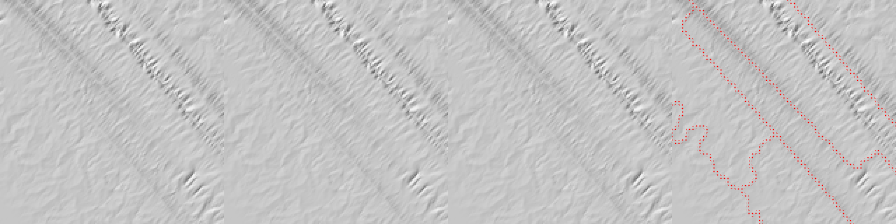
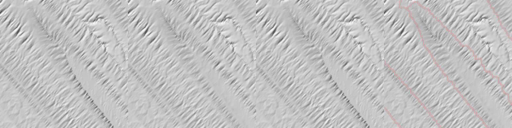
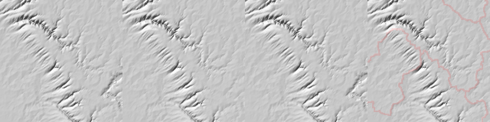

# SPIKE-107 follow-up: synthetic lands and divide crops

Run 2026-11-12 (the architect's verdict on SPIKE-107, relayed by the bulldozer): cheap runs only, no K7, thermal, deposition or per-round convergence. Same probe, variants, definitions and measures as `results.md` (the variant table of its section 1 is the definition of U, C, CaUb, UaCb, F2aUb and F2). Numbers and images; no verdict. Run by the spikes lane.

Probe: `mfd_compare.rs` on the local branch `spike/spike-107-probe` (never merged), with two additions: `PLANET_SYNTH=smooth|terraced PLANET_SALT=1..4` (the GEN-141 lands of `round_probe.rs`) and `PLANET_DIVIDES=1` (crops). Release build, BelowNormal, 8 threads, CPU load 7 % and 54 % at the two starts. Wall time: the eight synthetic runs 18 s together; R3a with crops 152 s.

## 1. Synthetic lands (a: flats and terraces, C, CaUb, F2aUb)

Four lands per kind (salt 1 to 4; `terrain(96, salt, terraced)` of `round_probe.rs`): 96 x 96 cells of 800 m, uniform metric (`cell_metric` off), 83 % land, 4 rounds of 5 steps, jitter stream = salt. The measure area is the land of the interior (12 cells in from the edge: 4,572 land cells of the first terraced land). Catchments of more than one cell: 617 to 647 (smooth), 498 to 533 (terraced); 65 to 71 % of the land lies on a catchment border (the catchments are small). The probe's U and C areas equal the library's (0 cells differ) and its round loop for C equals `solve_rounds` (0 cells differ) on all eight lands. Raw: `raw-followup/synth-<kind>-<salt>.txt`.

Values listed as salt 1 / 2 / 3 / 4.

### 1.1 Displacement against U after the 4 rounds (m)

| Comparison | Smooth: |dz| p95; mean dz | Terraced: |dz| p95; mean dz |
|---|---|---|
| noise floor U seed A - seed B | 41.5 / 41.1 / 40.6 / 40.9; ~0 | 41.1 / 41.0 / 43.6 / 42.3; ~0 |
| C - U | 36.3 / 39.7 / 35.2 / 35.8; +1.24 / +1.59 / +1.18 / +1.49 | 34.4 / 33.5 / 32.3 / 30.4; +1.25 / +1.42 / +1.24 / +1.10 |
| CaUb - U (area of C only) | identical to C - U in every land (all digits) | same p95 and maximum as C - U (the mean differs by at most 0.02 m) |
| UaCb - U (breach of C only) | 0.00 / 0.00 / 0.00 / 0.00 (0 cells differ) | 0.00 / 0.00 / 0.02 / 0.01; maximum 1.5 / 0.7 / 12.1 / 3.7 |
| F2aUb - U | 4.5 / 4.6 / 4.3 / 4.4; maximum 28 / 40 / 52 / 29; mean +1.03 / +1.02 / +0.94 / +0.96 | 3.1 / 3.1 / 2.9 / 2.5; maximum 25 / 30 / 24 / 18; mean +0.61 / +0.61 / +0.51 / +0.55 |

U itself changes the land by a mean of about -127 m (smooth) and -122 m (terraced) over the 4 rounds.

### 1.2 Surface statistics after the rounds (the interior land)

Ridge cells / valley cells, % of land (a cell higher / lower than 6 or more of its neighbours); 3x3 relief p50 / p95 (m):

| Land | U | U seed B (floor) | C | F2aUb |
|---|---|---|---|---|
| smooth 1 | 11.1 / 7.5; 218.4 / 383.5 | 11.8 / 7.5; 222.5 / 397.4 | 14.3 / 9.6; 222.3 / 392.7 | 11.2 / 7.6; 217.7 / 382.8 |
| smooth 2 | 11.1 / 6.6; 221.3 / 373.3 | 11.5 / 6.8; 224.8 / 385.4 | 13.9 / 9.4; 228.5 / 383.9 | 11.1 / 6.6; 221.9 / 373.0 |
| smooth 3 | 11.7 / 7.6; 218.1 / 370.4 | 11.2 / 7.5; 215.7 / 369.3 | 14.6 / 10.0; 218.5 / 370.4 | 11.7 / 7.5; 218.0 / 367.9 |
| smooth 4 | 11.5 / 6.8; 221.0 / 379.4 | 11.6 / 6.6; 222.8 / 382.7 | 14.0 / 9.0; 223.0 / 375.8 | 11.5 / 6.8; 220.7 / 376.9 |
| terraced 1 | 14.2 / 10.2; 217.4 / 387.1 | 14.5 / 10.2; 221.1 / 390.4 | 16.3 / 11.7; 221.8 / 400.7 | 14.2 / 10.1; 217.7 / 388.5 |
| terraced 2 | 14.4 / 9.8; 219.9 / 384.3 | 13.8 / 9.2; 217.0 / 384.7 | 16.2 / 11.8; 224.1 / 388.3 | 14.4 / 9.8; 221.0 / 383.5 |
| terraced 3 | 14.3 / 10.3; 215.4 / 378.8 | 14.0 / 10.1; 215.4 / 369.8 | 16.3 / 12.4; 215.8 / 381.8 | 14.3 / 10.3; 215.4 / 378.1 |
| terraced 4 | 14.4 / 9.9; 221.1 / 378.9 | 14.2 / 9.6; 218.2 / 385.9 | 16.6 / 12.1; 221.2 / 381.6 | 14.4 / 9.9; 220.7 / 377.5 |

- C (and CaUb, which is identical) raises the ridge and valley cell shares on all eight lands, by 1.5 to 3.2 percentage points (ridges: +2.5 to +3.2 smooth, +1.8 to +2.2 terraced); U's two seeds differ by 0 to 0.7 points. F2aUb stays within the seed difference.
- Relief p50 / p95 of C against U: +0.1 to +7.2 m and -3.6 to +13.6 m; the U seed difference is 0 to 4.1 m (p50) and 0.4 to 13.9 m (p95). C lies outside that range at smooth 2 (p50 +7.2 against 3.5) and terraced 1 (p95 +13.6 against 3.3).

### 1.3 Channel initiation (A_d at least 75 km^2 = 117 cells of 0.64 km^2; U has 38 to 55 channel cells)

Membership difference against U on the final surfaces (cells in the interior; % of U's channel cells):

| Variant | Smooth 1 / 2 / 3 / 4 | Terraced 1 / 2 / 3 / 4 |
|---|---|---|
| U seed B (floor) | 26.3 / 71.1 / 41.8 / 51.1 | 46.5 / 58.3 / 61.8 / 59.1 |
| C | 26.3 / 23.7 / 20.0 / 8.5 | 16.3 / 16.7 / 1.8 / 20.5 |
| UaCb | 0 / 0 / 0 / 0 | 0 / 0 / 0 / 6.8 |
| F2aUb | 0 / 2.6 / 1.8 / 0 | 0 / 0 / 0 / 0 |

On the start surface (terraced 1): C 13.5 %, F1 7.7 %, F2 1.9 %, F3 0 %.

### 1.4 Area at the borders and outlet closure (start surface)

- A_d of C against U at distance 0 from a catchment border (65 to 71 % of the land): 73.6 % of the cells outside 0.9-1.1 (smooth 1; p5 0.30, p50 0.91, p95 1.60, maximum 5.6), 65.8 % (terraced 1); F1 29.9 % and F2 5.6 % (terraced 1); F3 0.2 %; F4 0.0 %. Distance 1: C 30.9 % (terraced 1).
- Border cells whose C area is under half their U area: 12.5 to 13.0 % (smooth), 8.7 to 9.5 % (terraced).
- Lower neighbours per land cell, 1 / 2 / 3 or more (terraced 1): U 6.4 / 7.8 / 85.8 %, C 21.2 / 22.7 / 56.2 %.
- Outlet closure: C and ToRecv area-weighted gap 1.1e-16 to 1.4e-16 (terraced 1); U 0.43, F1 0.44, F2 0.41, F3 0.42, F4 0.42.

### 1.5 Mean slope across catchment borders against interior pairs (across / interior ratio of the means)

| Land | U | U seed B | C | F2aUb |
|---|---|---|---|---|
| smooth 1 / 2 / 3 / 4 | 0.748 / 0.726 / 0.774 / 0.740 | 0.738 / 0.727 / 0.762 / 0.723 | 0.740 / 0.708 / 0.768 / 0.722 | 0.747 / 0.724 / 0.774 / 0.740 |
| terraced 1 / 2 / 3 / 4 | 0.728 / 0.709 / 0.752 / 0.728 | 0.723 / 0.714 / 0.749 / 0.714 | 0.716 / 0.694 / 0.755 / 0.717 | 0.728 / 0.709 / 0.752 / 0.728 |

C's mean slope across the borders is 0.2 to 2.6 % above U's (smooth: 0.05632 / 0.05492 / 0.05720 / 0.05491 against 0.05545 / 0.05468 / 0.05619 / 0.05481); U's seed B differs from U by 0.3 to 1.5 %.

## 2. Hillshade crops across three divides of R3a (b)

R3a (face 4, 12,288 cells, seed 15, i 168-1187, j 4520-5539; 814 m cells; the run of `results.md`, 4 rounds). The crops are 160 x 160 cells at 3 pixels a cell (480 x 480 per panel). Selection: the three non-overlapping windows with the most border cells between D8 catchments of at least 5,000 cells each (the catchments of U's routing of the start surface; 90 % land at least), counted on every second cell. Panels from left to right: U, C, F2aUb, and C with the catchment border cells marked by a red dot per cell (so that the position of any line can be compared with the border). Light from the north-west, vertical exaggeration 8.

| Crop | Window cells (i, j) | Border cells sampled | Image | Mean slope across the border / interior, ratio: U, C, F2aUb |
|---|---|---|---|---|
| 1 | i 624-783, j 752-911 | 517 | `images-followup/R3a-divide-1-i624-j752.png` | 0.00774 / 0.01343, 0.576; 0.00739 / 0.01313, 0.563; 0.00773 / 0.01342, 0.576 |
| 2 | i 832-991, j 576-735 | 425 | `images-followup/R3a-divide-2-i832-j576.png` | 0.00700 / 0.02031, 0.345; 0.00674 / 0.01931, 0.349; 0.00700 / 0.02030, 0.345 |
| 3 | i 784-943, j 80-239 | 422 | `images-followup/R3a-divide-3-i784-j80.png` | 0.00701 / 0.01662, 0.422; 0.00666 / 0.01607, 0.415; 0.00711 / 0.01663, 0.427 |

What the images show (looked at all three): along the marked borders no line, step or seam is visible in the U, C or F2aUb panels; the three panels of a crop look the same at this scale. Inside the crops C's mean slope across the border is 3.7 to 5 % lower than U's (the whole window of results.md section 3.6 has C 19 % higher than U in R3a); F2aUb is within 1.4 % of U.


Crop 1: U, C, F2aUb, C with the catchment borders in red.


Crop 2, the same panels.


Crop 3, the same panels.

## 3. Caveats

- The synthetic lands are the GEN-141 lands (small catchments; most land is within 4 cells of a border), so the border-driven measures dominate; four lands per kind, one seed each, 4 rounds, a 12-cell interior. The channel counts are small (36 to 55 cells), so a few cells change the membership percentages.
- The breach rule's effect that dominates R3a and R3b (`results.md` section 3.3) is inert on these lands (UaCb equals U or within 12 m at one cell).
- The three crops are chosen by border length between large catchments, not by the size of the difference; the divide crops of the 19-22 % border-slope shift were not located separately.

## 4. Reproduce

```
PLANET_SYNTH=smooth PLANET_SALT=1 mfd_compare 8          # then terraced, salts 2 to 4
PLANET_MARGIN=0 PLANET_WIN=4,12288,168,1187,4520,5539,15 PLANET_DIVIDES=1 mfd_compare 8
```

Raw output: `raw-followup/`.
