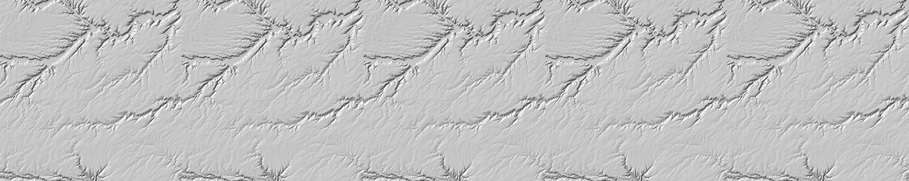
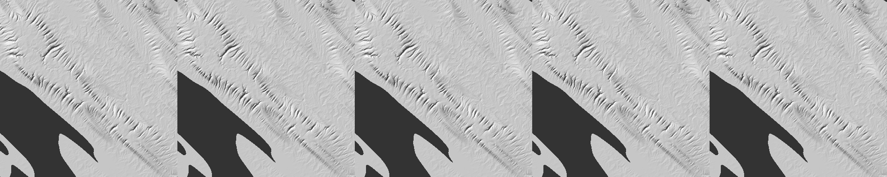

# SPIKE-107 re-run after the window-cut fix (GEN-172)

Run 2026-11-11 (the architect's order, relayed by the bulldozer): re-run the UaCb and C rows on R3a and R3b with margin 200 and the inner box, on main c1bb17df (GEN-172: a window-cut outlet gives the breach no floor). Numbers and images; no verdict. Run by the spikes lane.

Probe: `mfd_compare.rs` as in `results.md` (the variant table of its section 1 defines U, C, UaCb, CaUb, F1, F2, F2aUb), on the local branch `spike/spike-107-rerun-probe` (never pushed): one line added, `CarveParams::window_cut = true` for a window run, plus `PLANET_WINCUT=0` (the control: the old breach rule) and `PLANET_CROP` (the hillshade crop). Release build, BelowNormal, 8 threads, CPU load 3 to 31 % at the starts (see the caveats for two stalls).

Windows: R3a = face 4, 12,288 cells, seed 15, box i 168-1187, j 4520-5539; R3b = face 2, seed 15, box i 9768-10787, j 8104-9123. Margin 200 cells on every side (a window of 1,388 x 1,420 and 1,420 x 1,420 cells); every measure counts the box only. 4 rounds of 5 steps, `cell_metric`. The probe's U and C areas equal the library's (0 cells differ) and its round loop for C equals `solve_rounds` (0 cells differ) on both windows. Raw: `raw-rerun/`.

## 1. Displacement, relief and channel membership against U (box, after 4 rounds, same seed)

| Measure | R3a before (margin 0, old rule) | R3a now | R3b before (margin 0, old rule) | R3b control (margin 200, old rule) | R3b now |
|---|---|---|---|---|---|
| C - U, \|dz\| p95 (m) | 5.78 | 0.99 | 8.89 | 2.05 | 0.42 |
| C - U, mean dz (m) | +1.08 | +0.017 | +3.78 | +4.01 | +0.013 |
| UaCb - U, mean dz (m) | +1.02 | 0.000 (0 cells differ) | +3.76 | +4.00 | 0.000 (0 cells differ) |
| CaUb - U, mean dz (m) | +0.06 | +0.017 | +0.02 | +0.013 | +0.013 |
| F2aUb - U, \|dz\| p95 (m) | 0.16 | 0.06 | 0.04 | 0.03 | 0.03 |
| U two-seed floor, \|dz\| p95 (m) | 13 | 15.25 | 28 | 40.15 | 40.15 |
| 3x3 relief p95 (m): U / C / U seed B | not listed here | 116.5 / 117.1 / 116.9 | 123.3 / 109.6 / 123.1 | 176.4 / 158.9 / 175.8 | 176.4 / 176.5 / 175.8 |
| Channel membership against U: C (U seed B, the floor) | 15.2 % (58 %) | 3.30 % (62.2 %) | 22.3 % (57 %) | 15.27 % (62.0 %) | 2.14 % (62.0 %) |
| Channel membership against U: UaCb | 10.9 % | 0.00 % | 20.1 % | 13.13 % | 0.00 % |
| Channel membership against U: CaUb | 4.9 % | 3.30 % | 3.0 % | 2.14 % | 2.14 % |
| Channel membership against U: F1 / F2 (final surface, box) | not listed | 1.74 % / 0.98 % | not listed | not listed | 0.97 % / 0.45 % |

- "Before" is `results.md` (margin 0, the old breach rule). "Control" is this run with `window_cut` off (the old rule) at margin 200: the margin alone leaves the difference (mean +4.0 m, relief p95 158.9 against 176.4 m, 15 % of the channel cells).
- "Now" has the window-cut rule: UaCb equals U in every cell of both windows (C's breach adds nothing inside the box: no outlet of the windows is a basin rim); the whole difference of C against U is the area clip (CaUb equals C).
- The two-seed floors differ from the earlier rows because the windows differ (the box has a margin).
- R3a C - U displacement of 0.99 m (p95) against the floor of 15.25 m; R3b 0.42 m against 40.15 m. Maximum |C - U|: 410 m (R3a), 140.5 m (R3b), each at a few cells (the floor's own maximum is 358 m and 390 m).
- On the start surface (static measures, whole window): channel membership of C against U 4.41 % (R3a) and 3.49 % (R3b), F1 2.43 % and 1.52 %, F2 1.56 % and 0.77 %. Heads of C more than 2 cells from a U head: R3a 210 of 3,056 (U has 2,926); R3b 187 of 5,372 (U 5,320).
- Ridge / valley cell shares (% of land): R3a U 17.32 / 17.00, C 17.52 / 17.15, U seed B 17.38 / 17.08; R3b U 18.68 / 18.72, C 18.77 / 18.78, U seed B 18.70 / 18.74.
- Mean slope across catchment borders (the roots are those of U's routing of the start surface): R3a U 0.00304, C 0.00365 (+20 %), U seed B 0.00301; R3b U 0.00281, C 0.00303 (+7.8 %), U seed B 0.00279. UaCb and F2aUb are within 1 % of U (R3a F2aUb 0.00307).
- Outlet closure (R3b, start surface): C area-weighted gap 8.1e-15; U 1.04; F1 0.76; F2 0.77. Border area ratios (R3b, start surface, distance 0): C outside 0.9-1.1 on 57.7 % of the border cells, F1 30.7 %, F2 20.2 %.

## 2. Hillshade at the cells of the trenches (R3b)

The panels show the same cells as `images/R3b-hillshade.png` of `results.md` (box cells i 120-499, j 0-379), now with margin 200 and the window-cut rule; left to right U, C, UaCb, CaUb, F2aUb.



Looked at both images: in `results.md` panel U has a straight diagonal trench from the top left and an incised valley that panels C and UaCb lose; here the five panels look the same, the valley is in all of them and the straight diagonal trench is in none. (The trench started at the window's top edge, a window cut; with margin 200 that edge is outside the box.)


R3a, the crop where |C - U| is largest (box cells i 188-567, j 200-579 of the window): the five panels look the same.


C - U over the box and 20 cells around it (blue below, red above, saturating at 20 m).

## 3. Caveats

- One seed and one window per region; the control isolates the breach rule from the margin for R3b only.
- The probe stalled at 0 CPU for minutes twice (the first R3a run, killed and run again from the start; the R3b control, which resumed and finished); the cause was not investigated. The numbers above are from complete runs.
- The old figures are those of `results.md` at margin 0; the windows differ, so the floors and the relief numbers are not comparable cell for cell.

## 4. Reproduce

```
cargo build --release -p planet-generators --example mfd_compare     # from spike/spike-107-rerun-probe
PLANET_MARGIN=200 PLANET_WIN=4,12288,168,1187,4520,5539,15 mfd_compare 8     # R3a
PLANET_MARGIN=200 PLANET_WIN=2,12288,9768,10787,8104,9123,15 mfd_compare 8   # R3b (PLANET_CROP=120,0 for the cells of the trenches; PLANET_WINCUT=0 for the control)
```

## 5. Addendum: hypsometry of the box land (architect's G-MFD row)

Added 2026-11-12 on the bulldozer's order: p5 to p95 of height on the land of the inner box (margin 200) for U, C and U under the second jitter seed, R3a and R3b. The probe's earlier output held p10, p50 and p90 only and no surfaces were kept, so the three round loops were run again (U, C and U seed B only, the same window, parameters and seeds as sections 1 to 4: U p10 / p50 / p90 below equal the `raw-rerun` values, R3a 0 / 34 / 631 m and R3b 18 / 313 / 451 m). Land = start height above the sea level and not an outlet; R3a 727,199 cells, R3b 883,645. Heights in metres after 4 rounds. Probe: `shapes_check hyps` on the local branch `spike/spike-108-rerun` (never pushed). Raw: `raw-rerun/hyps-R3a.txt`, `raw-rerun/hyps-R3b.txt`.

| Fixture | Row | p5 | p10 | p25 | p50 | p75 | p90 | p95 |
|---|---|---|---|---|---|---|---|---|
| R3a | start surface z0 | 1.04 | 3.63 | 16.83 | 35.09 | 275.77 | 650.00 | 684.44 |
| R3a | U | 0.01 | 0.46 | 7.90 | 33.89 | 220.55 | 630.98 | 690.89 |
| R3a | C | 0.02 | 0.48 | 7.91 | 33.89 | 220.64 | 630.88 | 690.88 |
| R3a | U seed B | 0.01 | 0.46 | 7.91 | 33.87 | 220.44 | 630.40 | 690.86 |
| R3a | C - U | +0.00 | +0.02 | +0.01 | +0.01 | +0.09 | -0.10 | -0.01 |
| R3a | U seed B - U | +0.00 | +0.00 | +0.01 | -0.02 | -0.11 | -0.58 | -0.03 |
| R3b | start surface z0 | 13.79 | 30.48 | 209.96 | 344.67 | 403.47 | 446.11 | 468.40 |
| R3b | U | 5.00 | 17.75 | 152.87 | 312.58 | 402.39 | 451.28 | 475.16 |
| R3b | C | 5.00 | 17.76 | 152.92 | 312.59 | 402.40 | 451.29 | 475.16 |
| R3b | U seed B | 5.00 | 17.77 | 153.14 | 312.94 | 402.63 | 451.48 | 475.20 |
| R3b | C - U | +0.00 | +0.01 | +0.05 | +0.02 | +0.01 | +0.01 | +0.00 |
| R3b | U seed B - U | +0.00 | +0.02 | +0.27 | +0.37 | +0.23 | +0.20 | +0.04 |

- The largest absolute C - U over the seven quantiles is 0.10 m (R3a) and 0.05 m (R3b); the largest absolute U seed B - U is 0.58 m and 0.37 m.
- Quantile by quantile |C - U| is at or below |U seed B - U| except at R3a p5 and p10 (0.00 and 0.02 m against 0.00 m after rounding; U, C and seed B are 0.01, 0.02 and 0.01 m at p5 and 0.46, 0.48 and 0.46 m at p10).
