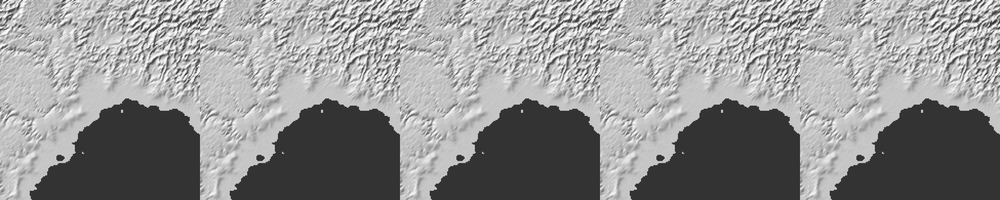
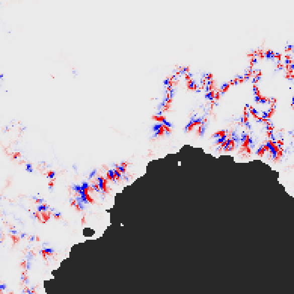
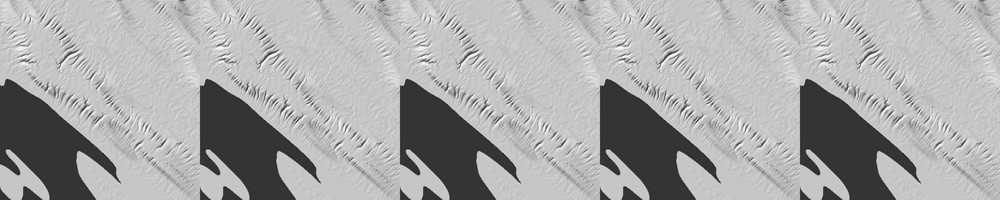
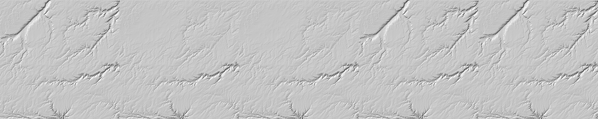
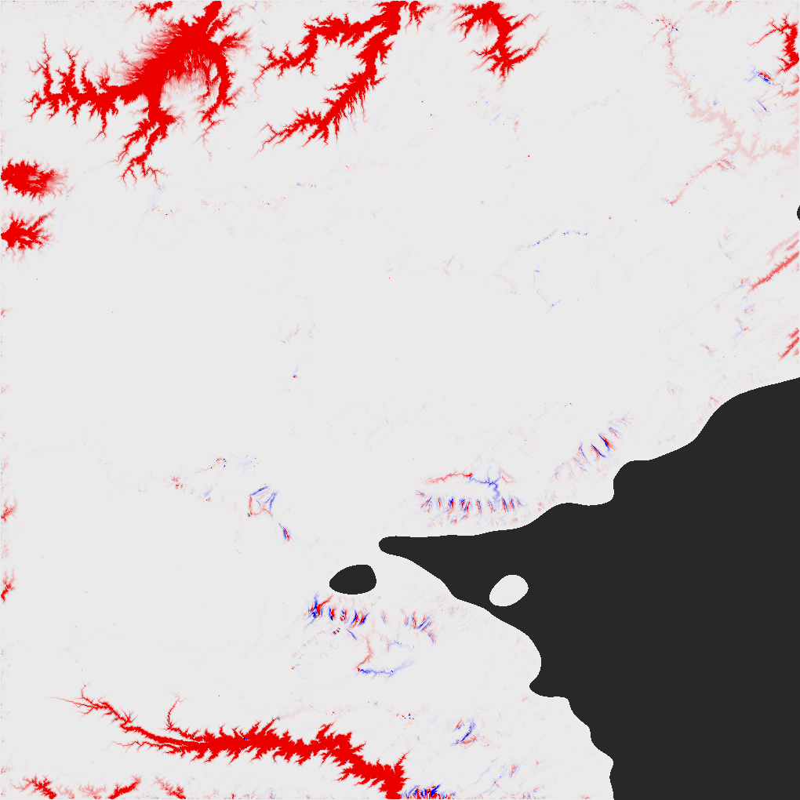
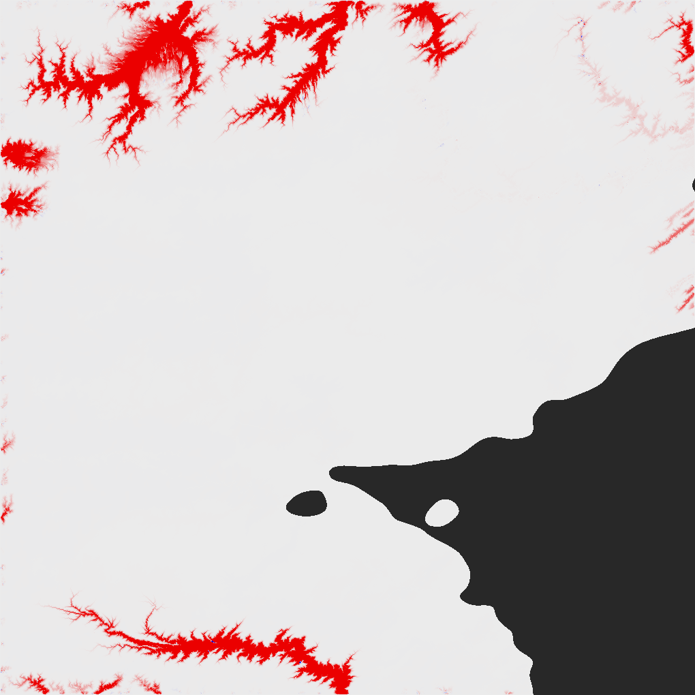
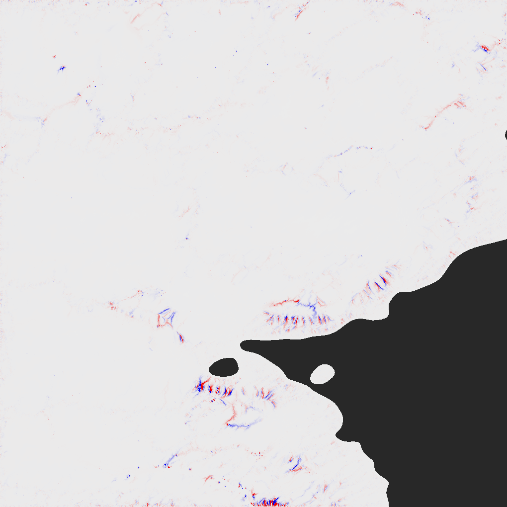

# SPIKE-107: MFD comparison (unclipped, clipped, boundary flux)

Opened: 2026-11-11
Question: does the catchment-clipped multiple-flow-direction (MFD) area of GEN-141 (`MfdClip::Local`) change the terrain's geomorphology against unclipped region-wide MFD (`MfdClip::Off`) and against a boundary-flux exchange between catchments?
Why it matters: A3 §12.4 (MFD, P0) and ADR 0112 condition 1: the clip stays provisional until compared; G-LOCAL shows computational consistency, not plausibility. A3 §13 open item 1 ("whether clipped MFD changes the look").
Time box: plan and runs 2026-11-11, about 1 h of machine time (single runs, BelowNormal).
Success criteria: per fixture and variant, the measures of §3 against the unclipped reference, with numbers and renders; which measures differ is reported, the verdict is the architect's.
Fallback if it fails: the two library variants only.
Code location: probe `crates/generators/examples/mfd_compare.rs` on the local spike branch `spike/spike-107-probe` (never merged, not pushed); no change to production code.

Status: runs complete 2026-11-11 on R1, R3a and R3b. Numbers only; no verdict. Run by the spikes lane, which built none of the code under test.

The architect's answers (2026-11-11): boundary flux is the lagged form with 1 and 2 passes, judged against unclipped MFD; the clip passes if it stays within unclipped MFD's two-seed noise floor on displacement, relief and channel membership, keeps outlets exact, and shows no visible line along catchment borders.

## 1. Variants (exact definitions)

| Variant | Area | Breach of a catchment |
|---|---|---|
| U | `MfdClip::Off`, canonical flood: every cell shares its held area among all its lower neighbours, in proportion to `slope^1.1` (Freeman); the area is region-wide | the library's, without the exit base |
| C | `MfdClip::Local` (`RoundRules::ROUND`): a lower neighbour in another D8 catchment is dropped from the weights and their sum | the library's, with the exit base (`exit_base`, `round.rs`) |
| ToRecv | `MfdClip::ToReceiver`: the foreign share goes to the cell's own receiver | without the exit base |
| F1, F2 (F_n) | boundary flux, below | with the exit base (as C) |
| UaCb | U's area | C's breach (exit base) |
| CaUb | C's area | U's breach (no exit base) |
| F2aUb | F2's area | U's breach |

Boundary flux F_n (lagged Jacobi exchange; built in the probe, the library has no such form). On the filled surface of the round's start, cells in height order, ties by cell index, outlets pass nothing on:
1. Pass 0: the weights are U's (all lower neighbours). The share a cell gives to a lower neighbour in the same D8 catchment is added to that neighbour's area as in U. The share to a neighbour in another catchment is not added; it is stored as a flux at that neighbour. The cell's own area starts as its cell area.
2. Pass k (k = 1..n): the same, with the fluxes of pass k-1 added to the receiving cells' own areas at the start; the fluxes of pass k are stored again.
3. F_n is the area of pass n. The areas are monotone in n and converge to U (U is the fixed point); F_n is not closed in a catchment (the inflow raises the outlet's area above the sum of the members' cell areas, as in U).
Within the rounds the probe's loop is `solve_rounds_with` with the area of the region routing replaced by F_n (each round, from that round's surface); the cut, gather and `catchment_round` calls are the library's. The probe's U and C areas equal the library's bit for bit (0 of 302,475 / 1,040,400 cells differ), and its round loop for C equals `solve_rounds` (0 cells differ, all three fixtures).

## 2. Fixtures

| Fixture | Window | Land |
|---|---|---|
| R1 | prototype region 1: face 1, 3,072 cells a face edge (3.26 km), i 2014-2168, j 190-344, margin 200: 555 x 545 cells; measures over the 155 x 155 box (16,730 land cells) | 61 % |
| R3a | face 4, 12,288 cells a face edge (814 m), seed 15, i 168-1187, j 4520-5539 (1,020 x 1,020; the window of SPIKE-106 item 13); measures over the whole window | 70 % |
| R3b | face 2, 12,288, seed 15, i 9768-10787, j 8104-9123 | 85 % |

Every fixture: 4 rounds of 5 steps, true cell metric, `CarveParams` default otherwise. The noise floor is the same variant under a second jitter seed (`stream ^ 0x5EED_1234_ABCD_EF01`); every "against U" row is the same seed. Not run: the synthetic lands of GEN-141, a K7-level pass, named low-relief and coastal-mountain fixtures (A3 §12.1's suite is not listed in the region search file), threshold sweeps.

## 3. Results

### 3.1 Area at divides (start surface, ratio V / U of `A_d`)

Cells by distance in cells from a catchment border (a land cell with a land neighbour in another catchment; 14.1 % / 14.2 % / 8.1 % of land in R1 / R3a / R3b). Share of cells with the ratio outside 0.9-1.1:

| Variant | Distance 0 | 1 | 2 | 3-4 | 5-8 | over 8 (control) |
|---|---|---|---|---|---|---|
| C, R1 | 50.7 % | 23.5 % | 7.4 % | 2.8 % | 0.6 % | 0.0 % |
| C, R3a | 64.8 % | 30.8 % | 10.8 % | 4.3 % | 1.1 % | 0.1 % |
| C, R3b | 57.9 % | 29.4 % | 11.4 % | 5.0 % | 2.1 % | 0.3 % |
| F1, R1 | 20.5 % | 3.4 % | 1.1 % | 0.5 % | 0.1 % | 0.0 % |
| F1, R3a | 41.0 % | 11.1 % | 5.1 % | 2.2 % | 0.5 % | 0.1 % |
| F1, R3b | 31.2 % | 9.3 % | 4.6 % | 2.1 % | 0.6 % | 0.0 % |
| F2, R1 | 9.4 % | 1.0 % | 0.4 % | 0.1 % | 0.0 % | 0.0 % |
| F2, R3a | 26.2 % | 5.6 % | 2.5 % | 1.0 % | 0.2 % | 0.1 % |
| F2, R3b | 20.4 % | 4.3 % | 1.9 % | 0.8 % | 0.2 % | 0.0 % |

- C at distance 0: p5 0.30 / 0.11 / 0.10, p50 0.95 / 0.92 / 0.93, p95 1.32 / 1.67 / 1.44, maximum 21 / 27 / 23 (R1 / R3a / R3b). Full band tables, ToRecv and F3, F4 in `raw/`.
- F_n never exceeds U (maximum ratio 1.000) and approaches it with n: whole land, share outside 0.9-1.1: R1 3.3 % (F1), 1.4 % (F2), 0.6 % (F3), 0.3 % (F4); R3a 7.2, 4.4, 2.5, 1.3 %; R3b 3.5, 2.1, 1.2, 0.6 %.
- Border cells whose C area is under half their U area: 8.9 % / 17.4 % / 14.3 % of border cells.
- Lower neighbours per land cell (1 / 2 / 3 or more), U weights against C weights: R1 16.2 / 14.2 / 69.6 % against 18.1 / 16.3 / 65.6 %; R3a 5.5 / 8.1 / 86.3 against 8.0 / 10.9 / 81.1; R3b 6.5 / 10.4 / 83.1 against 7.4 / 11.7 / 80.9.

### 3.2 Outlet closure (start surface)

Relative gap `|A_d(outlet) - sum of the members' cell areas| / sum`, catchments of 2 or more cells (R1 / R3a / R3b):

| Variant | p95 | maximum | area-weighted |
|---|---|---|---|
| C | 3.7e-16 / 3.6e-16 / 4.4e-16 | 4.9e-15 / 2.3e-14 / 1.6e-14 | 1.6e-15 / 6.8e-15 / 4.6e-15 |
| ToRecv | 3.9e-16 / 4.0e-16 / 4.4e-16 | 4.7e-15 / 2.2e-14 / 1.5e-14 | 1.7e-15 / 6.6e-15 / 4.2e-15 |
| U | 17.1 / 17.0 / 69.8 | 5.8e3 / 1.3e4 / 1.2e4 | 1.05 / 0.76 / 1.12 |
| F1 | 4.1 / 2.4 / 4.7 | 2.6e3 / 1.0e4 / 9.0e3 | 0.86 / 0.68 / 0.83 |
| F2 | 8.2 / 5.6 / 15.5 | 4.7e3 / 1.1e4 / 1.1e4 | 0.90 / 0.65 / 0.85 |

### 3.3 Displacement after the 4 rounds (land cells of the measure area; metres)

| Comparison | R1 |dz| p50 / p95 / max; mean dz | R3a | R3b |
|---|---|---|---|
| **Noise floor** U seed A - seed B | 6.95 / 88.1 / 370; +0.26 | 0.92 / 13.1 / 340; +0.007 | 1.07 / 27.9 / 343; -0.14 |
| C seed A - seed B | 7.81 / 89.2 / 370; +0.26 | 0.94 / 13.7 / 372; +0.011 | 1.02 / 23.8 / 343; -0.20 |
| C - U | 0.03 / 9.75 / 107; +0.24 | 0.02 / 5.78 / 410; **+1.08** | 0.01 / 8.89 / 402; **+3.78** |
| ToRecv - U | 0.03 / 9.86 / 110; +0.32 | 0.01 / 1.68 / 413; +0.06 | 0.01 / 0.55 / 151; +0.02 |
| F1 - U | 0.01 / 2.16 / 41; +0.41 | 0.00 / 4.47 / 225; +1.23 | 0.00 / 8.35 / 402; +3.81 |
| F2 - U | 0.00 / 0.54 / 19; +0.11 | 0.00 / 3.58 / 218; +1.11 | 0.00 / 8.05 / 402; +3.78 |
| **UaCb - U** (breach of C only) | 0.00 / 0.00 / 0; 0.000 | 0.00 / 2.15 / 218; **+1.02** | 0.00 / 7.93 / 402; **+3.76** |
| **CaUb - U** (area of C only) | 0.03 / 9.75 / 107; +0.24 | 0.01 / 1.61 / 410; +0.06 | 0.01 / 0.53 / 151; +0.02 |
| F2aUb - U | 0.00 / 0.54 / 19; +0.11 | 0.00 / 0.16 / 148; +0.09 | 0.00 / 0.04 / 146; +0.02 |

- U changes the land by a mean of -190 m (R1), -15.5 m (R3a), -10.7 m (R3b) over the 4 rounds, so the displacements above are against a change of that size.
- The displacement of C against U in R3a and R3b is made by C's breach rule (UaCb - U carries the mean and the p95; CaUb - U does not). In R1 the breach rule changes nothing (UaCb equals U in every cell). The renders show it: `images/R3b-dz-UaCb-minus-U.png` carries C's red areas (C higher than U by 20 m and more in the valley beds, in belts at the top and bottom of the window), `images/R3b-dz-CaUb-minus-U.png` only short red and blue pairs along ridges.
- The area clip alone (CaUb) moves cells along ridges and divides: `images/R1-dz-C-minus-U.png`, `images/R3b-dz-CaUb-minus-U.png`; the largest differences are 107 m (R1), 410 m (R3a), 151 m (R3b).
- F2aUb is closest to U everywhere: |dz| p95 0.54 / 0.16 / 0.04 m, maximum 19 / 148 / 146 m.

### 3.4 Surface statistics on the same land (after the rounds)

3x3-block relief p50 / p95 (m); ridge cells (share of land cells higher than 6 or more neighbours) and valley cells; max-descent slope p95:

| Variant | R1 relief | R1 ridge / valley % | R3a relief | R3a ridge / valley | R3a slope p95 | R3b relief | R3b ridge / valley | R3b slope p95 |
|---|---|---|---|---|---|---|---|---|
| start surface | 135.3 / 927.6 | 22.2 / 21.6 | 8.2 / 86.6 | 12.1 / 10.4 | 0.0408 | 6.5 / 15.9 | 15.3 / 14.2 | 0.0094 |
| U | 239.1 / 735.5 | 23.05 / 23.09 | 17.0 / 109.9 | 17.04 / 16.64 | 0.0595 | 16.3 / 123.3 | 18.61 / 18.51 | 0.0764 |
| **U seed B (floor)** | 238.7 / 730.0 | 22.76 / 23.27 | 17.1 / 110.4 | 17.05 / 16.68 | 0.0596 | 16.3 / 123.1 | 18.63 / 18.51 | 0.0759 |
| C | 240.9 / 735.1 | 23.45 / 23.33 | 16.4 / 109.0 | 17.36 / 16.86 | 0.0590 | 15.5 / **109.6** | 18.90 / 18.70 | **0.0683** |
| ToRecv | 240.8 / 736.5 | 23.45 / 23.37 | 17.1 / 110.9 | 17.39 / 16.91 | 0.0603 | 16.3 / 123.3 | 18.75 / 18.63 | 0.0765 |
| F2 | 239.1 / 735.5 | 23.01 / 23.08 | 16.3 / 107.8 | 17.06 / 16.63 | 0.0582 | 15.5 / 109.6 | 18.77 / 18.60 | 0.0682 |
| UaCb | 239.1 / 735.5 | 23.05 / 23.09 | 16.3 / 108.0 | 17.06 / 16.64 | 0.0582 | 15.5 / 109.6 | 18.77 / 18.60 | 0.0683 |
| CaUb | 240.9 / 735.1 | 23.45 / 23.33 | 17.1 / 111.0 | 17.34 / 16.86 | 0.0603 | 16.3 / 123.3 | 18.74 / 18.61 | 0.0765 |
| F2aUb | 239.1 / 735.5 | 23.01 / 23.08 | 17.0 / 109.8 | 17.04 / 16.63 | 0.0595 | 16.3 / 123.3 | 18.61 / 18.51 | 0.0764 |

- The aggregate statistics have a small seed floor (relief p95 differs by 0.5 m, 0.2 m between U's two seeds in R3a, R3b; 5.5 m in R1), against the pointwise floor of §3.3 (|dz| p95 13 to 88 m). C's relief p95 is 0.9 m (R3a) and 13.7 m (R3b: 123.3 to 109.6, -11 %) under U's; the shift follows the breach rule (UaCb 109.6, CaUb 123.3).
- Hypsometry (height p10 / p50 / p90): R3b U 22 / 326 / 454 m, C 23 / 333 / 455 m, UaCb 23 / 333 / 455, CaUb 22 / 326 / 454. R1 and R3a: identical to within 6 m.

### 3.5 Channel initiation

Channel cell: `A_d` at least 75 km^2 (`HydroParams::initiation_m2`), a land cell. On the start surface (U has 60,606 / 47,128 / 108,402 channel cells and 3,306 / 1,688 / 2,824 heads), share of U's channel cells in the symmetric difference, and heads more than 2 cells from a U head:

| Variant | R1 | R3a | R3b |
|---|---|---|---|
| C | 3.48 %; 134 heads | 5.40 %; 156 | 3.03 %; 108 |
| ToRecv | 3.49 %; 136 | 5.35 %; 153 | 3.01 %; 110 |
| F1 | 1.56 %; 35 | 2.86 %; 40 | 1.64 %; 40 |
| F2 | 0.60 %; 7 | 1.84 %; 27 | 0.88 %; 15 |
| F3 | 0.26 %; 3 | 1.12 %; 12 | 0.49 %; 5 |
| F4 | 0.12 %; 2 | 0.63 %; 8 | 0.28 %; 4 |

On the final surfaces, each variant's channels from its own area (the box, 3,188 / 39,410 / 60,544 channel cells in U):

| Variant | R1 | R3a | R3b |
|---|---|---|---|
| **U seed B (floor)** | 35.13 % | 58.14 % | 56.60 % |
| C | 8.81 % | 15.20 % | 22.25 % |
| ToRecv | 8.88 % | 4.86 % | 3.06 % |
| F1 | 2.54 % | 13.24 % | 21.02 % |
| F2 | 1.16 % | 12.23 % | 20.46 % |
| UaCb | 0.00 % | 10.90 % | 20.07 % |
| CaUb | 8.81 % | 4.87 % | 3.02 % |
| F2aUb | 1.16 % | 1.50 % | 0.68 % |

- Under a second jitter seed 35 to 58 % of U's channel cells differ after the rounds; the differences of every variant against U are below that.
- The membership difference of C in R3a and R3b has the same origin as the displacement: C's breach (UaCb 10.9 % / 20.1 %), not its area (CaUb 4.9 % / 3.0 %).

### 3.6 A line along the catchment borders

Slope between neighbouring cells (|dz| / distance), over pairs both in the measure area, by whether the pair crosses a catchment border (roots of U's routing of the start surface; R1 4,723 across and 61,220 interior pairs; R3a 156,196 and 2,732,518; R3b 98,605 and 3,415,705). Mean slope across the borders, and across / interior ratio of the means:

| Variant | R1 across; ratio | R3a across; ratio | R3b across; ratio |
|---|---|---|---|
| start surface | 0.01306; 0.496 | 0.00232; 0.331 | 0.00158; 0.596 |
| U | 0.01368; 0.473 | 0.00427; 0.368 | 0.00324; 0.268 |
| **U seed B (floor)** | 0.01347; 0.465 | 0.00423; 0.364 | 0.00319; 0.265 |
| C | 0.01372; 0.473 | 0.00510; **0.450** | 0.00332; 0.301 |
| ToRecv | 0.01365; 0.471 | 0.00519; 0.445 | 0.00353; 0.292 |
| F1 | 0.01364; 0.472 | 0.00409; 0.362 | 0.00300; 0.272 |
| F2 | 0.01369; 0.473 | 0.00418; 0.371 | 0.00305; 0.277 |
| UaCb | 0.01368; 0.473 | 0.00419; 0.371 | 0.00304; 0.276 |
| CaUb | 0.01372; 0.473 | 0.00517; 0.444 | 0.00352; 0.291 |
| F2aUb | 0.01369; 0.473 | 0.00425; 0.366 | 0.00325; 0.269 |

- In R3a, C and ToRecv (the two area rules that route the foreign share inside the catchment) raise the mean slope across borders by 19-22 % against U (0.00510, 0.00519 against 0.00427; floor 0.00423); the breach rule does not (UaCb 0.00419). F does not. In R3b the same direction with +2.5 % (C) and +9 % (ToRecv). R1: none.
- C's and F's interior slopes fall in R3a (0.01135, 0.01128 against 0.01160) and R3b (0.01104, 0.01103 against 0.01209); that follows the breach rule (UaCb, CaUb).
- Renders: `images/R1-hillshade.png`, `images/R3a-hillshade.png`, `images/R3b-hillshade.png` (panels left to right: U, C, UaCb, CaUb, F2aUb; light from the north-west, vertical exaggeration 8). R3a: no difference visible at this scale. R3b: the panels of C and UaCb lose the incised valley at the top left that U, CaUb and F2aUb have. A line along the borders was not looked for beyond these panels and the slope statistic.

## 4. Cost

Release build, Windows, 8 threads, BelowNormal. A carve of R1 about 1.3 s, of R3a 4.9 s, of R3b 6 s; F's rounds twice that (the exchange passes). Whole probe: R1 40 s, R3a 130 s, R3b 150 s (one run 520 s under other load). The static F passes: 2.4 s (R1), 9.5 s (R3a), 11 s (R3b).

## 5. Caveats

- Three windows, two seeds (14, 15), one rounds setting (4 x 5). The probe's channel threshold is the H1 default on grids of 3.26 km and 814 m.
- The noise floor is one second jitter seed: a pointwise floor (large) and an aggregate floor (small) give different bars; both are in the tables.
- F is the lagged form with 1 and 2 passes as the architect chose; F is not closed in a catchment (§3.2), so a carve under F reads areas that exceed the catchment's own sum at the outlet, as U does.
- F's rounds run through the probe's copy of the round loop; they have no key hash, no memo and no partition test.
- Channels are cells above the threshold by the variant's own area, not the H1 graph; heads are channel cells with no higher channel neighbour (a proxy).
- Not measured: K7 or any finer pass, convergence per round, flats and terraces (the GEN-141 lands), thermal and deposition (the carve only).

## 6. Reproduce

```
cargo build --release -j 4 -p planet-generators --example mfd_compare            # from spike/spike-107-probe
PLANET_STATIC_ONLY=1 mfd_compare 8                                              # R1, static measures
mfd_compare 8                                                                    # R1, rounds
PLANET_MARGIN=0 PLANET_WIN=4,12288,168,1187,4520,5539,15 mfd_compare 8           # R3a
PLANET_MARGIN=0 PLANET_WIN=2,12288,9768,10787,8104,9123,15 mfd_compare 8         # R3b
```

Raw output: `raw/R1.txt`, `raw/R3a.txt`, `raw/R3b.txt`.

## Visuals


R1 box and margin, after 4 rounds; panels left to right: U, C, UaCb, CaUb, F2aUb.


R1, height of C minus U (red higher, blue lower, saturating at 20 m); the pairs lie along divides.


R3a crop of 380 cells, the same five panels.


R3b crop of 380 x 380 cells, the same five panels; C and UaCb lose the valley at the top left.


R3b, C minus U, whole window.


R3b, U's area with C's breach minus U: the valley belts of C's difference.


R3b, C's area with U's breach minus U: ridge pairs only.


R3b, F2's area with U's breach minus U: nearly white.
