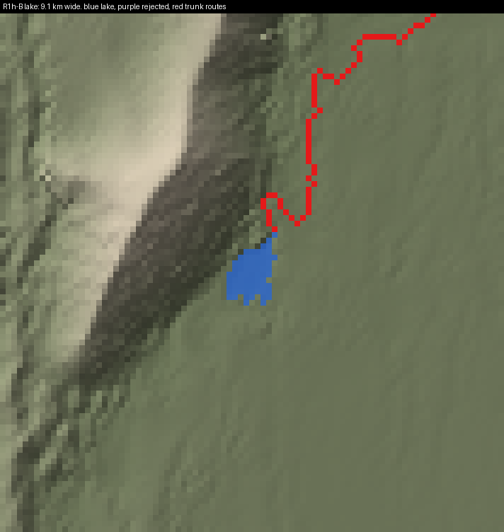
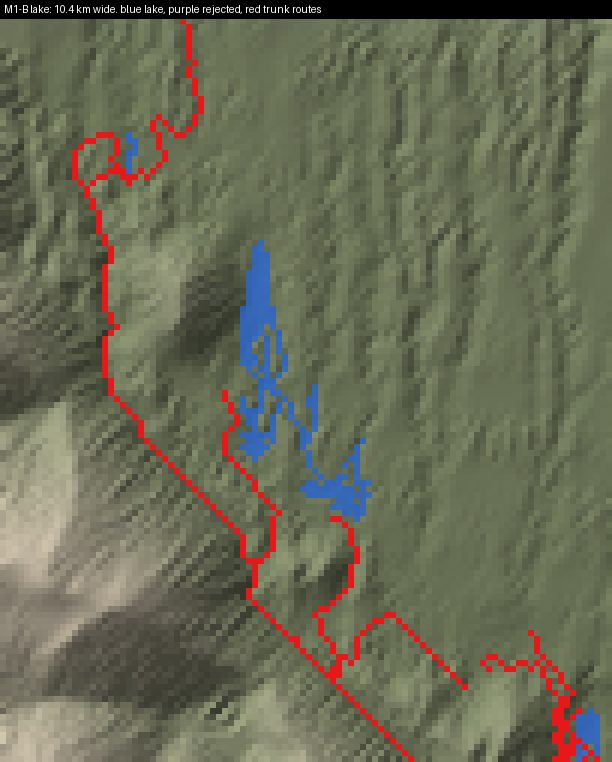
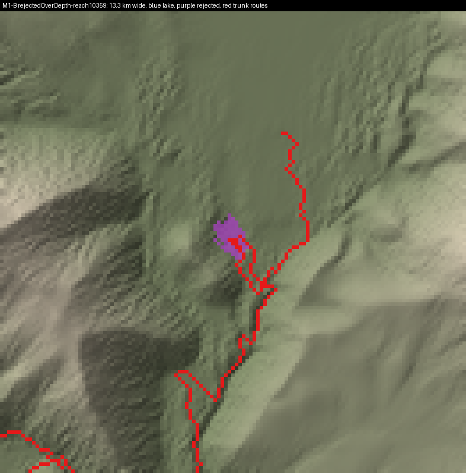
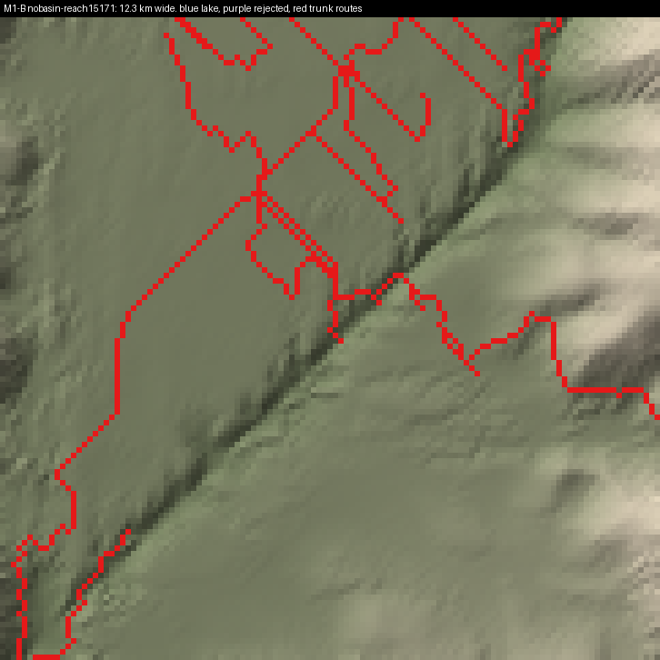

# SPIKE-126: the ponding rule (P3 D-1, lead #152)

Opened: 2026-11-16 (lead #152; owner, 2026-11-16)
Question: do rises over the corridor bar on H1 trunks become lakes or seasonal or dry flats that spill over their sill, instead of cuts, and how much of the D-1 fault does that remove?
Why it matters: the last D-1 experiment before the pick (P3, D-1 closure); the owner's fault is a river that floats uphill or cuts through a ridge.
Time box: 1 day of agent work (used: about 0.5 day, most of it waiting for the heavy lock).
Success criteria: the corridor share at k_c 2 snapped rises; the ponds' share of river length moves towards Earth's 15-50 % (SPIKE-119); G-DRAIN passes with ponds as lakes; three stills.
Fallback if it fails: name what the over-bar rises are instead, as a D-2 input.
Code location: branch `spike/ponding` (local, never merged): `crates/cache/examples/ponding.rs` (the river gate's setup plus the rule), `lakes_d4_fsm.rs.inc` (SPIKE-123's hierarchy), `river_suite::trunk_route` (one reach's corridor route, a copy of `trunk_corridor`'s routing).

## 1. Rule
Per H1 trunk reach (q >= `edge_q_m3s`), on the water surface S (the stored ground, raised to each pond's level), at k_c 2 snapped, cells inside the store only:
1. Route the reach as the corridor measure does (the route within the bar, else the minimax route).
2. If it fails, take the first cell c1 over the bar and the bed cell b (the running minimum before c1); the level needed is S(c1) - bar.
3. Small (within the bar): a cut, as today; nothing is ponded.
4. Medium: climb the SPIKE-123 hierarchy (built once on the stored ground) from b's node to the lowest node whose spill reaches the needed level; pond it to its spill when:
   - its area at the spill is at most the cap A_cap = (4 k_c dx_H1)^2 (k_c 2, dx_H1 814 m: 42.4 km2);
   - its depth (spill - floor) is at most D_lim = 2 x bar (R1h 54.9 m, M1 100 m, F1 20 m);
   - its spill cell lies in the reach's corridor.
   Re-route and repeat.
5. Large (D-2 input), one of:
   - NoBasin: b is in no depression; its water drains elsewhere;
   - SpillsLower: the tree's highest spill is below the needed level (the water leaves over a lower sill elsewhere);
   - OverCap or OverDepth;
   - SpillOutside: the spill is outside the corridor.
6. The kept ponds are those without a ponded ancestor.

The rule runs on the post-K7 stored ground (KR stage); the bake is not changed, so SPIKE-124's protection is not needed here (it matters only for a pond decided before K7).

## 2. Class rule
- Wet share f = q_in / E(A_sill), where:
  - q_in = max(the subtree's own runoff, the trunk's H1 discharge at the reach, its smallest q);
  - E(A_sill) = the open-water term summed over the cells under the sill (area-weighted, review F1).
- At steady state the wetted area is f x A_sill (evaporation per area uniform), so:

  | f | Class | Stored as |
  |---|---|---|
  | >= 1 | permanent lake | basin, class Lake, level = spill |
  | 0.1 to 1 | seasonal flat (wetland) | basin, class seasonal, level = spill (flood level); ground drawn as a flat material |
  | < 0.1 | dry flat (playa) | basin, class dry, level = spill |

- On a trunk (q >= 1 m3/s) a flat needs A_sill > q / e_open: 31.6 km2 per m3/s at e_open 1 m/yr; only near the cap and only in an arid climate.
- Caveat: the climate's open-water term is SPIKE-123's (PET minus land ET, about 35 mm/yr on R1h). Even at a full PET of 1 m/yr the smallest wet share seen (M1, 468) stays above 15: the classes do not change.

## 3. Results on B (SPIKE-121's stores, explorer's `b-r1h-s0.25`, `b-m1`, `b-f1`)
| Measure | R1h | M1 | F1 |
|---|---|---|---|
| Bar, m | 27.46 | 50.00 | 10.00 |
| Corridor k_c 2 snapped, reaches passing, before (D-1 table) | 4,949 / 5,106 (96.93 %) | 9,584 / 10,128 (94.63 %) | 9,728 / 9,893 (98.33 %) |
| After ponding | 4,963 / 5,106 (97.20 %) | 9,654 / 10,130 (95.30 %) | 9,728 / 9,893 (98.33 %) |
| Reaches over the bar, before | 157 | 544 | 165 |
| Reaches ending ponded (passing after: +14, +70, +0) | 14 | 58 | 0 |
| Large: NoBasin | 116 | 251 | 142 |
| Large: SpillsLower | 25 | 204 | 23 |
| Large: OverDepth / OverCap | 0 / 0 | 4 / 0 | 0 / 0 |
| Large: SpillOutside | 1 | 17 | 0 |
| Cut-throughs (runs over the bar along the routes, inside), before -> after | 925 -> 848 | 2,547 -> 2,271 | 647 -> 646 |
| Candidates met: area p50 / p90 / max, km2 | 0.16 / 0.73 / 1.74 | 0.25 / 1.59 / 7.99 | 0.01 / 0.09 / 0.38 |
| Candidates met: depth p50 / p90 / max, m | 4.3 / 26.2 / 45.3 | 3.7 / 44.3 / 122.7 | 0.0 / 0.2 / 0.2 |
| Lakes (count, km2) | 19, 4.83 | 97, 38.27 | 1, 0.02 |
| Seasonal flats / dry flats | 0 / 0 | 0 / 0 | 0 / 0 |
| River length in ponds (gate river cells) | 0.39 % | 1.00 % | 0.01 % |
| Earth lowland, in pits (SPIKE-119) | 15-50 % | 15-50 % | 15-50 % |
| G-DRAIN basins, before -> ponds as lakes (bar 10 %) | 0.47 -> 0.30 % | 3.32 -> 2.91 % | 0.00 -> 0.00 % |
| Run: wall s / peak GB | 467 / 8.1 | 549 / 8.1 | 632 / 8.1 |

- Saddles: the D-1 table's saddle count is a pre-K7 ridge measure of the bake; this rule leaves the bake unchanged, so that count is unchanged. The cut-through row above is the rule's own measure: over-bar runs that KR would have to cut.

Where a NoBasin bed's water goes (steepest descent on the stored ground):

| Where the water goes | R1h | M1 | F1 |
|---|---|---|---|
| A cell outside the store (store-edge artefact: the bed lies on the store's border) | 25 | 30 | 15 |
| The sea or the window's border, inside the corridor | 53 | 0 | 69 |
| The sea or the window's border, leaving the corridor | 0 | 0 | 4 |
| Past a small pit, inside the corridor | 32 | 183 | 47 |
| Past a small pit, leaving the corridor | 6 | 38 | 7 |

## 4. Findings
1. The rule rescues few reaches: R1h 14 of 157, M1 70 of 544 (58 ended ponded, 12 passed through an earlier pond), F1 none of 165. The corridor share moves by 0.27, 0.67 and 0.00 points.
2. Most over-bar rises are not basins. The stored ground drains the trunk's bed away from the rise, mostly along the corridor in the other direction: NoBasin with the water reaching an outlet without crossing the rise. Water would not pond there; it would follow L's own route. This is a disagreement between H1's trunk and the L ground: a D-2 input (H1 or KR moves the trunk), not a ponding case.
3. SpillsLower candidates are mostly flat valley floors (median depth 0.2 to 4 m) that spill over a lower sill elsewhere. Water leaves there, so this is also D-2.
4. Ponds stay small. After K7 the store keeps few deep depressions on the trunks (candidate area p90 0.7 to 1.6 km2). The proposed cap never binds and the depth limit binds 4 times on M1. Ponds hold 0.01-1.0 % of river length against Earth's 15-50 %. A lake share near Earth's needs ponds decided before K7, at the source stage (SPIKE-124's protection on H1's lakes), not on the post-K7 ground.
5. Every pond is a permanent lake. On these windows a trunk's discharge exceeds the open-water loss over any candidate area by 2 orders or more.
6. The proposed formulas (A_cap = (4 k_c dx_H1)^2, D_lim = 2 x bar) are safe but untested at their limits: only M1's 4 over-depth candidates reach either.
7. Store-edge artefact: 70 of the 509 NoBasin rises (25 R1h, 30 M1, 15 F1) have their bed on a cell outside the store. The corridor measure counts a reach once any point is inside, so these rises sit on the store's border. The D-1 table's corridor numbers carry this; it touches at most 25 + 30 + 15 reaches.

## 5. Recommendation
- D-1: ponding does not change the pick. B's corridor shares move by at most 0.7 points.
- D-2: take the NoBasin and SpillsLower reaches (R1h 141, M1 455, F1 165) as the D-2 list: the trunk should follow where L's water goes.
- D-4: keep the class rule (wet share q_in / E(A_sill), thresholds 1 and 0.1) for lakes decided upstream; on trunks it gives lakes except in arid basins near the cap.
- The ponding rule as a KR stage is not worth building on its own: about 1 % of river length and at most 0.7 points of corridor share.

## Visuals
Analysis renders: hillshade of the stored ground at 101.8 m (sun from the north-west), lakes blue, the rejected candidate purple, the trunk routes red, cells outside the store pale. CPU (numpy), no GPU path.

No seasonal or dry flat and no pond near the cap exist on the three windows. The third and fourth stills therefore show the cases the rule rejects.

R1h, pond 12: a lake of 0.73 km2, 35.9 m deep, at the foot of an escarpment; the trunk route ends in it (9.1 km wide).

M1, pond 92: the largest pond, 2.29 km2. It fills a branching valley system behind the rise, like a reservoir (10.4 km wide).

M1, reach 10359 (OverDepth): the candidate (purple, 0.78 km2) is 122.7 m deep against a limit of 100 m. The trunk climbs 57.1 m beside it (13.3 km wide).

M1, reach 15171 (NoBasin, more than 400 cells from the store's edge): the trunk crosses a straight escarpment and rises 124.4 m. The bed's water runs into a pit 13 cells away and leaves the corridor after 6. The ridge is not a dam, so ponding cannot help: a D-2 case (12.3 km wide).
