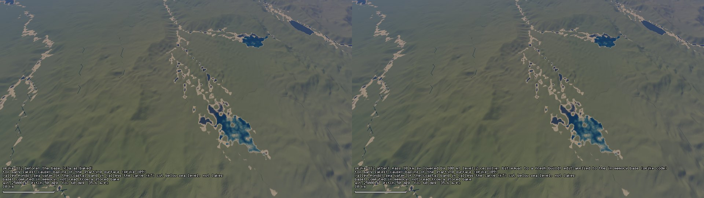
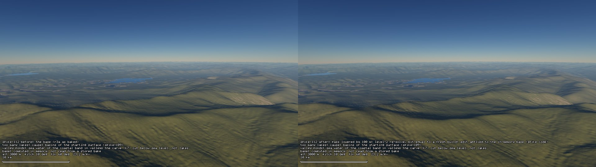
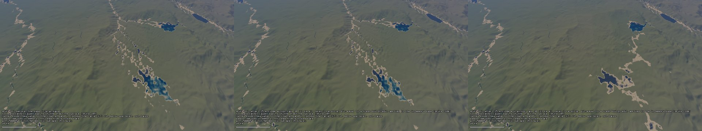
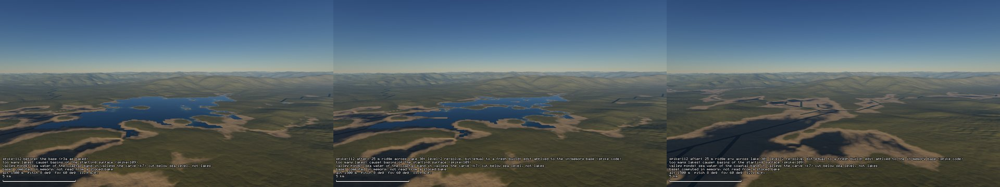
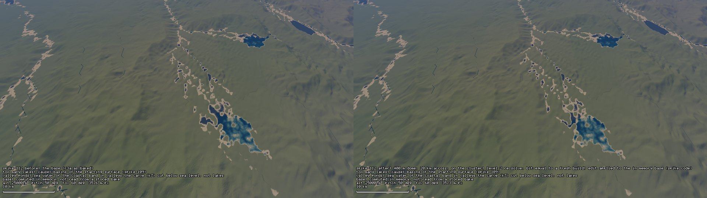
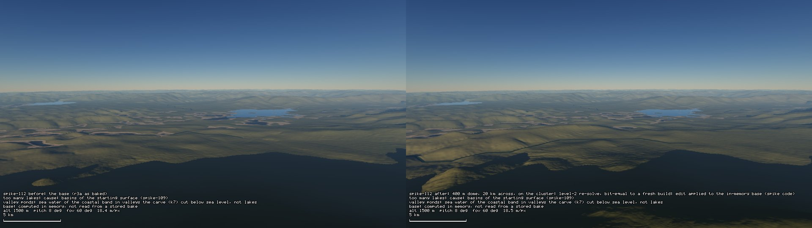
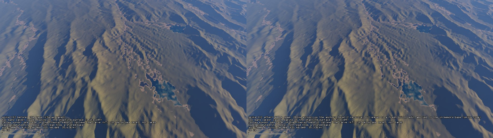
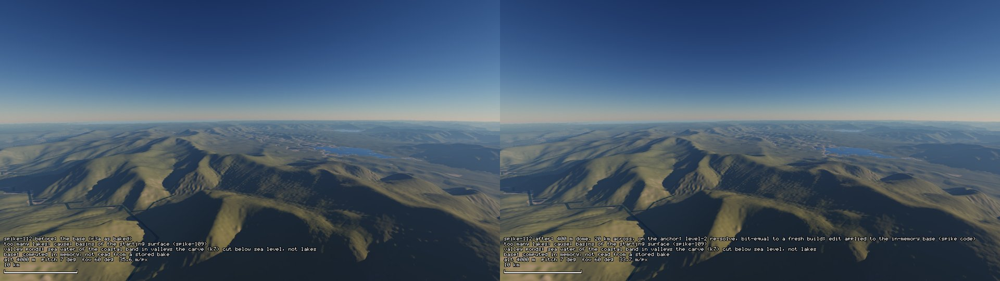
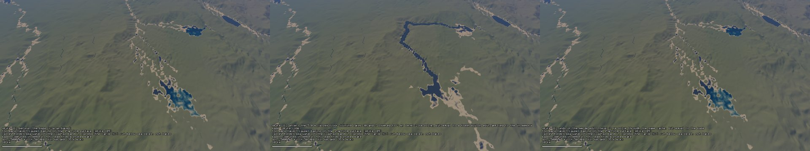

# SPIKE-112: an edit on the stored region R3a

Opened: 2026-11-13 (spikes lane; lead inbox #105; owner, 2026-11-13: "Use an exploration")
Question: does the level-2 re-solve of a region edit (A3 §6.5 and §11.1: memoised rounds, then H1, then K7 on the dirty tiles) fit "minutes, background", and does the incremental path beat a fresh rebuild at region size? If not, which part dominates.
Why it matters: approach A's riskiest assumption, measured before CP2; on the small window the incremental path was slower than a rebuild (GEN-143: 1.58 s against 0.71 s).
Time box: 2 days of agent work (report by 2026-11-15).
Success criteria: per edit (a lowered pass, a basin split, a 20 km height stamp, over the lake cluster at 36.75 S 162.28 W): dirty tiles and catchments per round; re-solve wall time against a fresh rebuild (same threads); peak commit; the incremental share against the parts recomputed whole; G-EQ against a fresh build of the edited definition; a before/after still pair and a low-sun oblique.
Fallback if it fails: report the dominating part with its numbers; level 2 then needs that part made incremental (or the edit kind moves to level 3).
Code location: spike branch `spike/region-edit` (`crates/cache/examples/region_edit.rs` and timers in the round and partition code; never merged).

## Answer
Yes at region scale: the level-2 re-solve of an edit on R3a takes 29 to 42 s on 8 threads against 178 to 184 s for a fresh rebuild (4.4 to 6.2 times faster), bit-equal to the fresh build in 4 of 4 edits. The whole gain is K7 on 6 to 10 of the 52 tiles, and K7 of the dirty tiles is 61 to 75 % of the level-2 time. The memoised rounds are slower than a fresh resident solve (8.9 to 9.8 s against 4.4 to 4.6 s): the partitioned route's whole-region parts dominate them, the area sweep alone 7.0 to 7.8 s on one thread.

## Method
- Region: the `bake_region` default (seed 14, face 1, regional cells 8056-8675 x 760-1379, margin 200: 1,020 x 1,020 = 1,040,400 regional cells at 814 m; 52 land L tiles of 768 local cells with a halo of 64), main 232973cc. My own bake under `target/spike112` (commit 62fe365293cf8acd, as crusader's `r3a-e1`); crusader's copy was not touched.
- The edit transforms the base at the lattice nodes before they are stored as f32 (`spike_t::edit_with`), so the regional solve, H1 and K7 all read the edited base.
- **Fresh rebuild**: the edited definition from nothing, as `bake_region`: resident rounds (`solve_rounds`), H1 (route, flood, hydrology, lakes, channel graph), K7 of all 52 tiles and the writer.
- **Level 2** (A3 §6.5, §11.1): the process first builds the base as the editor would hold it: memoised rounds (`solve_rounds_memo`, partitioned route with tiles of 256 regional cells, one `RoundCache`), H1 and all 52 tiles. Then the edit:
  1. memoised rounds on the same cache;
  2. H1 recomputed whole;
  3. a tile is dirty when what its K7 and water mask read changed: the lattice nodes under its window (4 nodes of margin), the regional change under it (3 cells of margin), the channels handed to it, the lake status and level of its H1 cells (1 cell of margin);
  4. K7 of the dirty tiles, the clean tiles' records reused, the writer writes the commit.
- **G-EQ**: the memoised edited surface against the resident solve of the edited definition (bits, every regional cell); the level-2 store against the fresh store of the edited definition, file for file and L tile record for record; the memoised base store against the fresh base store the same way.
- Wall times by the probe (`Instant`), 8 threads, BelowNormal, release build. The level-2 time starts once the base state is held and leaves out the lattice sampling (8 to 9 s; the editor holds the base). Peak commit: the process's `PeakPagefileUsage`.
- Machine (no perf window, none needed): the owner's viewer was open on crusader's `r3a-e1` from 05:59 and a crusader debug smoke process was alive; 15.9 GB RAM free, 34 % load before the runs. The first run (fresh base, 06:53 to 07:00) was 2 to 9 times slower in every stage (lattice 62.6 s against 8 to 9 s later); its times are not used. The later runs agree within 10 %.

## Edits (all in view of the E1 cluster stills, anchor 36.7498 S 162.2827 W)
| Edit | Definition (`edit_with`) | Base cells changed (regional) |
|---|---|---|
| pass | the lowest saddle near the cluster (952 m, cell 8554, 933; 10 km SW of the anchor) between catchments of 26,967 and 10,914 cells, lowered by 100 m within 2.5 km, falling to 0 over 1.5 km (E2-type) | 129 |
| split | a ridge at 25.1 m (lake 30's spill 5.1 m + 20 m; E3c-type), 16 km long, 1.2 km wide, blended over 0.6 km, through lake 30's centroid running N-S (38 km2, 13 km E of the anchor; the large lake of the E1 25 km still); it runs along the lake's long axis, a placement error kept as a measurement | 44 |
| split2 | the same ridge re-placed E-W across lake 30, 4 regional cells south of its floor cell, 16 km long | 31 |
| stamp | a dome of 400 m, 20 km across (smoothstep), centred on the anchor | 675 |

## Result
| | pass | split | split2 | stamp |
|---|---|---|---|---|
| Fresh rebuild: rounds / H1 / K7 + write (52 tiles) | 4.6 / 1.6 / 177.4 s | 4.4 / 1.6 / 174.3 s | 4.6 / 1.6 / 175.8 s | 4.4 / 1.6 / 172.5 s |
| **Fresh rebuild total** | **183.7 s** | **180.3 s** | **182.1 s** | **178.5 s** |
| Level 2: memoised rounds / H1 / dirty test / K7 of the dirty tiles + write | 8.9 / 1.5 / 0.05 / 31.4 s | 9.8 / 1.6 / 0.06 / 17.7 s | 9.3 / 1.6 / 0.05 / 22.5 s | 9.8 / 1.5 / 0.05 / 27.8 s |
| **Level 2 total** | **41.9 s** | **29.2 s** | **33.5 s** | **39.1 s** |
| Rebuild / level 2 | 4.4 | 6.2 | 5.4 | 4.6 |
| Dirty L tiles (records that really changed) | 10 (6) of 52 | 6 (2) of 52 | 7 (6) of 52 | 9 (5) of 52 |
| Catchments carved a round (of 2,550 to 2,729), cells carved | 2, 5, 5, 5; 39,140 to 42,024 | 1, 1, 1, 1; 10,247 to 12,255 | 2, 6, 6, 7; 12,255 to 78,988 | 2, 4, 4, 5; 39,140 to 42,021 |
| Tile floods a round (of 16 route tiles; memo hits) | 3, 3, 6, 6 (41 to 51) | 3, 3, 3, 3 (41 to 54) | 3, 3, 9, 9 (41 to 48) | 3, 3, 3, 6 (41 to 54) |
| Route tiles changed a round: filled / receivers / `A_d` | 1-2 / 1 / 2 | 0-1 / 0-1 / 0-1 | 1-3 / 1 / 2-3 | 1-2 / 1 / 2 |
| Solved surface: regional cells changed | 8,986 | 1,639 | 10,962 | 8,352 |
| H1: lakes, channel cells, segments (base 69, 47,951, 13,578) | 69, 47,950, 13,580 | 69, 47,953, 13,580 | 68, 47,895, 13,597 | 69, 47,957, 13,574 |
| G-EQ rounds: memoised against resident | 0 of 1,040,400 differ | 0 | 0 | 0 |
| G-EQ store: level 2 against fresh (commit, pack, index) | bit-equal; 52 of 52 records | bit-equal; 52 of 52 | bit-equal; 52 of 52 | bit-equal; 52 of 52 |
| G-EQ store: memoised base against fresh base | bit-equal | bit-equal | bit-equal | bit-equal |
| Peak commit of the fresh rebuild process | 214 MiB | 216 MiB | 214 MiB | 213 MiB |
| Commit with the base state held (peak) / after the edit (peak) | 373 (425) / 478 (529) MiB | 375 (427) / 473 (524) MiB | 376 (427) / 481 (533) MiB | 378 (428) / 476 (527) MiB |
| Round cache after the base / after the edit | 203 / 213 MiB | 203 / 209 MiB | 203 / 216 MiB | 203 / 211 MiB |

**Where the memoised rounds spend their time** (the edit's 4 rounds, seconds):
| Part | pass | split | split2 | stamp | Incremental? |
|---|---|---|---|---|---|
| tile floods (offers, sweeps, memo) | 0.26 | 0.23 | 0.36 | 0.26 | yes (memoised tiles) |
| catchment rounds (gather, key, carve or memo) | 0.06 | 0.08 | 0.07 | 0.07 | yes (memoised catchments) |
| tile hashes, cut, assemble | 0.13 | 0.14 | 0.14 | 0.13 | whole, small |
| flats regrade (GEN-173) | 0.21 | 0.22 | 0.21 | 0.23 | whole |
| receivers | 0.86 | 0.95 | 0.88 | 0.94 | whole |
| order and roots | 0.07 | 0.07 | 0.07 | 0.07 | whole |
| **area sweep** | **7.02** | **7.81** | **7.32** | **7.76** | whole, one thread |
| Incremental share of the rounds | 3.6 % | 3.2 % | 4.7 % | 3.4 % | |

The fresh resident rounds spend 3.9 to 4.2 s routing and 0.2 s carving for the same 4 rounds. The base through the memo: 11.4 to 12.5 s (tile floods 2.5 to 2.7 s, area sweep 7.2 to 8.0 s).

## Findings
1. **G-EQ holds at region scale for all four edits**: the memoised rounds equal the resident ones bit for bit, and the level-2 store (52 L tiles, basin tables, channel graph) equals the fresh store of the edited definition file for file. The same holds for the base built through the memo.
2. **The incremental path beats the rebuild only through K7.** K7 is 96 to 97 % of a fresh rebuild (172 to 177 s of 178 to 184 s); level 2 re-runs 6 to 10 of 52 tiles. The rounds and H1 are about 6 s of a rebuild.
3. **The memoised rounds are about twice as slow as the resident rounds** (8.9 to 9.8 s against 4.4 to 4.6 s), as GEN-143 measured on the small window (1.58 s against 0.71 s). The memo cuts the work it covers to 3 to 6 tile floods and 1 to 5 carved catchments a round, but those parts are 3.2 to 3.6 % of the rounds; the area sweep of the partitioned route, recomputed whole every round on one thread, is 79 to 80 %.
4. **The dirty-tile test over-approximates and missed nothing here**: 10 / 6 / 7 / 9 tiles were re-baked, 6 / 2 / 6 / 5 records really changed, and every reused record equals the fresh one. The test was written from what `l_tile` reads; it is not a proof.
5. **Memory is small at this size**: the fresh rebuild peaks at 213 to 216 MiB; the editor state with the round cache at 425 to 428 MiB, 524 to 529 MiB with an edit; the round cache holds about 205 bytes a regional cell (203 MiB for 1.04e6 cells).
6. **Neither ridge split lake 30 into two lakes.**
   - split (N-S, along the lake): the ridge shows as a chain of islands; H1 keeps one lake with 49 water cells instead of 58 and a new id (its floor cell now lies under the ridge; E3c's rule keeps the id only for the part that holds the old floor).
   - split2 (E-W, across the lake): lake 30 is no longer a kept basin (69 lakes become 68); lake 7, 30 km NE, stays in place but changes id (44 to 51 water cells, its spill moves). The rounds re-carve catchments of up to 79,000 cells in rounds 2 to 4 and the solved surface changes in 10,962 cells; in the 25 km still most valley ponds north of the lake are gone. Why the dammed valley lost its lake is not traced.
   - Both are bit-equal to the fresh build of their definition: the level-2 path reproduces what the solver does with the edit; whether that is the expected response to a ridge is a question for the solver, not for the incremental path.
7. **The pass and the stamp show as edited**: ground at the pass anchor 932 to 820 m (100 m lowered; the carve takes back about 12 m); the dome raises the anchor from 89 to 321 m (400 m added; the rounds and K7 cut the rest) and removes most valley ponds within its 10 km radius.

**At landmass scope** (measured in the follow-up below, replacing the extrapolation first written here): today's area sweep alone is 159 s a round on 1.42e8 land cells, about 11 minutes a 4-round solve at 1.49e8 land cells; there the routing recomputed whole dominates level 2, not K7. A job bounded by a region of this size (A3 §11.3) stays at seconds.

## Not done
- One region, four edits, each from the base (no chains of edits, no undo, no eviction budget).
- The lattice sampling of the edited definition (8 to 9 s) is outside both totals.
- The dirty-tile test is the probe's; a production rule would be content keys of the tiles (today's L tile keys do not depend on the content).

## Follow-up (lead, 2026-11-13): a real split and merge, the area sweep at landmass size, the dome
### A split and a merge by a height edit
- **Basin table** (`raw/basins.txt`): 7 lakes have their water centroid inside the region, all shallow and near the sea: floors 0.0 to 1.9 m, levels 1.8 to 5.1 m, 7 to 107 water cells.
- **No ridge can split a lake in this solver**: every round lowers each receiver on a cell's drain chain to what the cell allows (GEN-162: not below the chain's exit; GEN-174: at most `breach_max_m` = 500 m a cell a round), "so that a ridge across a valley does not hold a lake the flood would fill" (`carve.rs`). Measured on split2 (`raw/ridgecheck-split2.txt`): the ridge's 18 raised cells (to 19 to 29 m) end at 0.1 to 7.6 m after the rounds, the cell in the lake at 0.3 m. A ridge at the waist "level + 10 m" is cut the same way. Lakes survive only where the lowering stops at the sea level, which is why all 7 are 1 to 5 m deep.
- **The merge edit drained both lakes instead of joining them.** Lakes 30 and 7 are joined by a valley floor at 5.0 m (the minimax path, 69 cells, highest cell 5.0 m: `raw/pair30-7.txt`), 0.1 m under their level of 5.1 m, which drains to the sea. Lowering that floor to 2 m (17 trench parts, 0.5 km half-width) lowers the exit of both: both lakes lose their kept basins (69 to 67 lakes); in the stills the lowered floor fills with sea water (K7 cuts it below the sea level) and links the two lake sites.
- **Undo of that edit** (`--undo`: the base again through the same cache; K7 records reused by tile and content fingerprint from the base and the edit): both lakes come back with their old ids, bit-equal to the base store, in 10.8 s.

| | merge | undo of the merge |
|---|---|---|
| Fresh rebuild (rounds / H1 / K7 + write) | 176.6 s (4.4 / 1.5 / 170.7) | the base: same as fresh-none |
| Level 2 (rounds / H1 / dirty test / K7 + write) | 33.7 s (9.7 / 1.6 / 0.05 / 22.3, 7 tiles) | 10.8 s (9.1 / 1.5 / 0.06 / 0.2, 0 tiles) |
| Catchments carved a round | 51, 57, 56, 56 of 2,600 to 2,779 (12,252 to 78,985 cells) | 0 (all 2,550 to 2,729 from the memo) |
| Tile floods a round | 3, 6, 9, 9 | 0 (44 to 57 memo hits) |
| Dirty L tiles (records changed) | 7 (6) of 52 | 0: every tile's fingerprint is the base's |
| Solved surface changed | 11,112 cells | 0 against the base |
| Lakes (inside the region) | 7 to 5: `8002756936f5f001` (lake 30) and `13b4d1c6bd1d599a` (lake 7) gone | 5 to 7: both back with the same ids, water cells, floor and level |
| G-EQ | memoised = resident (0 of 1,040,400); store bit-equal to fresh-merge, 52 of 52 records | store bit-equal to fresh-none, 52 of 52 records |
| Commit after the step (peak) | 481 MiB (534) | 616 MiB (617), both states' records held |

- The first fresh merge rebuild (188.6 s) overlapped a 20 s build of mine; the table holds the clean re-run (`raw/fresh-merge-b.txt`).
- **What this tests and what not**: the undo/replay of a basin-topology change (two lakes removed, then restored with their ids) is bit-exact through the memo, and costs the rounds' whole parts plus H1 only. A split or merge of two kept basins could not be made by a height edit here: it needs basins the breach keeps (an intentional basin, A3 §5.3, or a profile without the breach), which is a question for the solver, not for the incremental path.

### The area sweep at landmass size
- Grid: R3a's filled surface (resident solve, canonical flood) upsampled 14 times bilinearly (14,280 x 14,280 = 2.04e8 cells, 1.42e8 of them land; 6.2e7 sea and border outlets), then the canonical flood on that grid (75.3 s, one thread), receivers from it (8 threads) and the topological order and catchment roots (one thread): 18.2 s. No world bake. `raw/sweep-f14.txt`.
- **Today's sweep is serial**: `partitioned_route_weighted`'s area part (extracted unchanged as `area_sweep` on the spike branch) runs on one thread whatever the thread count.
- **Probe**: with the local clip a cell shares only with neighbours of its own catchment, so catchments are independent; `area_sweep_par` sweeps them on 8 threads, largest first, each cell adding its donors in the same order (level descending, id): the same bits by construction.

| Sweep (one round, 2.04e8 cells) | Wall time | Cells differing from today's |
|---|---|---|
| today's (serial, tiles of 256) | 158.7 s | - |
| per catchment, 1 thread | 161.1 s | 0 of 203,918,400 |
| per catchment, 8 threads | 69.4 s | 0 |

- The speed-up stops at 2.3 because the largest catchment holds 23.3 % of the land cells (3.3e7) and is swept by one thread (Amdahl bound about 4.3); a wavefront inside a catchment would be the next step, not tried.
- **Per level-2 solve** (4 rounds; scaled to F8's 1.49e8 land cells): the sweep alone is about 11 minutes today, about 5 minutes at 8 threads. The receivers (parallel) and the flats regrade, order and roots add to it; the tile floods are memoised.
- Same check at 4.2e6 cells (`raw/sweep-f2.txt`): 3.7 s, 3.7 s, 1.4 s; 0 cells differ.
- The probe's peak commit is 13.9 GB (it holds both areas for the comparison); not a budget measurement.

### Why the dome barely shows
Mostly washed out, not the pose: the rounds take back 188 m of the 400 m at the median raised cell (`raw/ridgecheck-stamp.txt`; 311 of 566 raised cells keep at least half the edit; the anchor keeps 232 m), and the rest is a smooth hump of about 2 % slope in a valley between ridges of about 1 km; the low-sun stills at 25 km and from 30 km back (below) do not show it better.

### Why split2 removed the valley ponds (cheap trace)
In the valley north of lake 30 (regional cells 8555-8580 x 940-975, 936 cells) the solved floor ends 146 m higher with the ridge (median; p95 406 m; 824 cells higher, 106 lower; `raw/box-split2.txt`): the rounds no longer incise that valley toward the sea level, so K7 has no near-sea-level floor to cut into ponds. That is the carve's re-route of the valley, as the lead expected; why the breach of the ridge does not restore the valley's incision inside the rounds is not traced.

## Visuals
Capture-stills `--commit` on the RTX 3080 Ti Laptop (Vulkan), 1920 x 1080, scaled to 960 x 540 (pairs) or 640 x 360 (triples) in the sheets. Poses as the E1 stills (cluster 25 km: altitude 25 km, 20 km back, heading 0, pitch 50, sun 13 h; low-sun obliques: sun 17 h). The commit is the level-2 result; the edit is applied to the stills' in-memory base by the same transform as the bake (spike code, `PLANET_SPIKE_EDIT`). Every still carries the E1 notes (too many lakes, valley ponds, base in memory) and a BEFORE or AFTER line. Not a measurement.


Pass lowered by 100 m, the cluster pose: before (left), after (right); the pass is 10 km SW of the anchor, left of the frame centre.


Pass lowered by 100 m, low sun from 3,000 m looking east at the pass: the saddle of the near ridge is wider and deeper after (right).


Ridge across lake 30 (lower right of the frame), the cluster pose: before, split (N-S ridge), split2 (E-W ridge); in split2 the lake and most valley ponds north of it are gone.


Lake 30 at low sun from 1,500 m looking east: before; split (a chain of islands along the lake); split2 (the lake gone, the valley a beach-shaded floor with burnt channels).


The 400 m dome, 20 km across, on the anchor (the frame centre): most valley ponds within its radius are gone after (right).


The dome at low sun from 1,500 m looking east over the anchor: raised ground in the foreground after (right), with its shadow and a river burnt across it.


The cluster pose with the sun at 7 h: the dome on the anchor (frame centre) is still hard to see after (right).


From 30 km south at 4,000 m, sun at 7 h: the 1 km ridges in front dominate; the dome in the valley beyond is not visible.


The merge edit: before; after (the lowered 5.0 m floor between lakes 30 and 7, filled with sea water by K7; both lakes no longer kept); the undo, identical to before (bit-equal store).

## Reproduce
```
cargo build --release -p planet-cache --example region_edit      # branch spike/region-edit
region_edit locate                                                 # the lakes and passes near the cluster
region_edit fresh --name none                                      # then --name pass|split|stamp --edit <spec>
region_edit incr --name pass --edit <spec>                         # needs fresh-none and fresh-pass under target/spike112
```
Edit specs: `raw/chain.ps1.txt`. Raw output: `raw/`.
