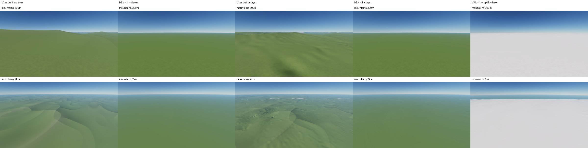
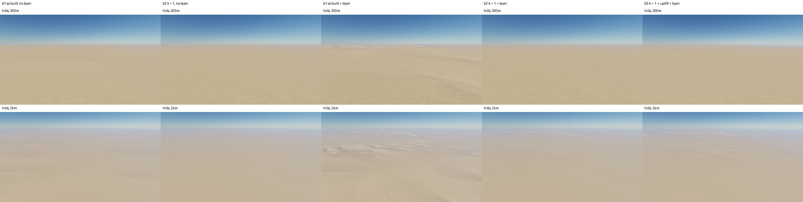
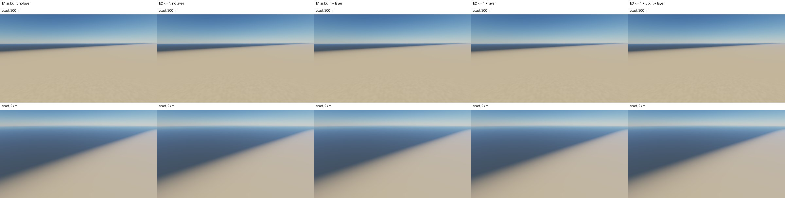

# SPIKE-99 The relief driver k: drop it, with or without an uplift map

Opened: 2026-11-03
Question: what does dropping the relief driver k (GEN-097, GEN-099, ADR 0088 point 2) do to relief realism, and does relief from an uplift map plus the erosion bake close the gap?
Why it matters: the owner expects to drop k but fears a relief gap that hurts the realism statistics (owner, 2026-11-03; planner inbox #80); the M9 bake design depends on it.
Time box: about 1 day of agent work.
Success criteria: per relief class and scale band (local relief in 1/3/10 km windows, std per band 0.2-1/1-3/3-10/10-30 km, slope median and p90, hypsometry), the gap between base 2 (k = 1) and the GLO-30 samples, and the share of that gap base 3 (k = 1, uplift map) closes, each with and without the erosion layer, on seed 14's three preview regions; a ranked recommendation (drop k with base 3, drop k with something else, keep k).
Fallback if it fails: keep k (base 1) and record the measured gap as the reason.
Code location: branch `spike/relief-driver-k` at e1bea86e (from `exp/stair-remedies`; throwaway, never merged into the main crates).

## 1. What k does in the bake today

- In the bake, k acts only through the hill band amplitude (GEN-098): `BakeInputs::base` passes the class-blended k to `ClassSource::elevation_m`, whose band amplitude is `30 + 145 smoothstep(1, 5, k) + 650 smoothstep(5, 7.5, k)` m (crates/generators/src/classes.rs:430).
- That amplitude is 30 m at k = 1, 175 m at k = 5 (hills), about 500 m at k = 6 (mountains) and 825 m at k = 7.5 (high mountains); `CLASS_K` = plain 1, rolling 1, hills 5, mountains 6, high mountains 7.5, plateau 1, badlands 2, sand sea 0.35.
- The expression `m + k (e - m)` (the ring mean m, ADR 0088 point 2) exists only in the runtime `ErosionField::height_via` behind `with_relief()`, which only tests call. The stored k and m channels (kinds 10 and 11) have no caller outside tests. It is off in every bake and every runtime path.
- Pass 1's uplift is one constant: `u_over_k x k_dt` = 1 m a step, 20 m over the run, everywhere. Pass 1 carves; it does not build relief.
- So "dropping k" means removing the per-class amplitude of the hill band: the only relief source between the belt term of the base (`e0`, wavelengths of tens of km) and the runtime detail.

## 2. Answer

| Class (region) | 3 km relief p50, GLO-30 | b1 as built | b2 k = 1 | b3 k = 1 + uplift | b3 closes of the b2 gap |
|---|---|---|---|---|---|
| mountains (mountains tile) | 380 m | 292 m (0.77) | 191 m (0.50) | 233 m (0.61) | 23 % |
| high mountains (mountains tile) | 804 m | 170 m (0.21) | 48 m (0.06) | 52 m (0.06) | 1 % |
| hills (coast tile) | 155 m | 67 m (0.43) | 32 m (0.20) | 37 m (0.24) | 4 % |
| mountains, low (hills tile) | 380 m | 65 m (0.17) | 33 m (0.09) | 39 m (0.10) | 2 % |

With the erosion layer; the ratio to GLO-30 in brackets. The full tables (every measure, with and without the layer) are in `tables.md`.

- Dropping k loses 35-75 % of the as-built relief in every relief class, at every scale from 0.2 to 30 km, with the layer or without it. Without the layer the k = 1 base is nearly flat: 2-13 % of GLO-30 relief, slopes under 1 degree.
- The erosion layer adds relief at 1-10 km, but it cannot replace the band. In the mountains class it lifts b2 from 0.13 to 0.50 of GLO-30 at 3 km, against b1's 0.77.
- Base 3 as prototyped closes 23 % of the gap at 3 km in the mountains class, 61 % at 10 km and 55 % in the 1-3 km band. It closes about nothing in the high mountains and the hills.
- Base 3 shifts the hypsometry: elev p50 rises by 340-1,370 m. The GLO-30 sites are already far lower than the generator's mountain classes (2,157 m for Everest's tile against 3,763 m as built for the high-mountain class).
- Pass 1 converts little uplift into relief: 1,000 m of uplift in the mountains class became about 40 m more 3 km relief. At 814 m cells and 20 implicit steps, ridges and valleys rise together; relief by uplift would need a carve that runs to near steady state (many more steps or a larger K dt), which changes the bake's cost.
- Even as built, the high-mountain class reaches only 0.21 of Everest's tile's relief. That gap exists regardless of k.

## 3. Recommendation (ranked)

1. **Keep k's function, drop the name.** In the bake, k is only a per-class amplitude of the hill band. State it as a per-class band amplitude in the class table (the same numbers: 30 / 175 / about 500 / 825 m) and retire the k channel, the ring mean m and `m + k (e - m)`, which no bake reads. This loses nothing measured here and removes the stored channels (kinds 10 and 11).
2. **Drop k with something else:** an uplift-driven carve only with a pass 1 that reaches near steady state. It is not measured here; its cost would be a separate spike (steps and K dt against relief and time).
3. **Drop k with base 3 as prototyped:** not recommended. It recovers 1-23 % of the 3 km gap outside the 10 km band and raises the median elevation by up to 1.4 km.
4. **Drop k with nothing (base 2):** not recommended. The relief falls to 6-50 % of GLO-30 with the layer.

Separately, the high-mountain relief gap (0.21 of GLO-30 as built) is a generator gap of its own, whichever option is taken.

## 4. Method

Bases, on seed 14's preview tiles (face/ti/tj on the 98,304-cell face grid, tiles of 3072 cells of 101.8 m): mountains 2/12/10, hills 0/8/24, coast 0/14/3.

| Base | Base field | Pass 1 |
|---|---|---|
| b1 as built | class-blended k in the hill band | as built |
| b2 | k = 1 everywhere (band 30 m) | as built |
| b3 | k = 1 | plus a per-cell uplift map |

- Base 3's uplift map, metres over pass 1's 20 steps, blended by the class weights: plain 0, rolling 40, hills 300, mountains 1,000, high mountains 1,600, plateau 150, badlands 100, sand sea 0. It comes on top of the constant 20 m. Its mean over the uplifted cells was 125 m (face 2) and 81 m (face 0), with a maximum of 1,519 m.
- Without the layer, b3 is b2 plus the uplift map added directly (no carve).
- The erosion layer: explorer's remedies.
  - Pass 1 at 12,288 cells a face (814 m), with MFD drainage area and the C1 (Catmull-Rom) read of the pass-1 change in pass 2 (`stair_exp --face-res 12288 --mfd-area --c1-face-read`).
  - Pass 2 as standard: the local carve, thermal at repose and one deposition sweep.
  - The change is faded to 0 within 3 m above sea level.
  - Faces 2 and 0 were carved; the other faces' change is 0 (the tiles are far from the face edges).
- Statistics (`relief_stats`, spike branch):
  - Grid: generator tiles at 101.8 m (3072² cores). GLO-30 tiles are resampled bilinear to 101.8 m on a local east/north grid over the central 90 % of each 1-degree tile.
  - Land is height over 1 m. A cell's class is the argmax of the lattice's class weights.
  - Local relief is p95 - p5 in blocks of 1, 3 and 10 km (blocks at least 90 % one class and 95 % land); the tables give the median over the blocks.
  - A band's std is the std of the difference of two box means (0.2-1, 1-3, 3-10, 10-30 km), over land cells whose large box is 95 % land.
  - Slope by central differences; hypsometry as elevation percentiles.
- The GLO-30 reference of a class is the mean over its sites:

| Class | Sites |
|---|---|
| plain | Brandenburg |
| rolling | Loess Hills |
| hills | Black Forest, Valley and Ridge |
| mountains | Alps, Highlands |
| high mountains | Everest |
| badlands | Badlands (the generator makes none) |
| sand sea | Erg Chebbi (the generator makes none) |

- Limits:
  - The generator side has no runtime ground detail below 101.8 m. GLO-30 at 101.8 m keeps its own fine relief, so the 0.2-1 km band and the 1 km relief favour GLO-30.
  - One seed, three tiles.
  - The class of a GLO-30 site is assigned by hand.
  - b3's uplift values are one prototype setting, not a tuned optimum.
- Runs (UTC, `runs.log`): A (statistics without the layer) 20:15-20:26; D base-only stills 20:26-20:57; B (pass 1 and pass 2, all bases) 20:58:18-23:29:58; C (statistics with the layer) 23:29-23:40; D layered stills after C. The machine is in the 2026-11-03 state (all-core limited): the wall times are progress notes, not timings.

## 5. Data

- `tables.md`: every measure, per region and class, GLO-30 against b1, b2 and b3, with and without the layer, and the share of the b2 gap that b3 closes.
- `dem.tsv`, `base.tsv`, `layer.tsv`: the raw statistics (`label class cells measure value`).
- `runs.log`: the start and end time of every run.
- The GLO-30 statistics (`dem.tsv` and the GLO-30 columns) were produced using Copernicus WorldDEM-30 © DLR e.V. 2010-2014 and © Airbus Defence and Space GmbH 2014-2018 provided under COPERNICUS by the European Union and ESA; all rights reserved. The organisations in charge of the Copernicus programme by law or by delegation do not incur any liability for any use of the Copernicus WorldDEM-30. Derived statistics only; no DEM data is committed (https://doi.org/10.5270/ESA-c5d3d65).

## Visuals

Lit stills, 1600x900 scaled to 480x270, RTX 3080 Ti (hardware adapter). Each sheet has two rows: 300 m (pitch 12 degrees) and 2 km (pitch 22 degrees) above each base's own ground. Each sheet has five columns: b1 and b2 without the layer, then b1, b2 and b3 with it (layer read C1, coast fade 3 m).
- Every base shares one camera position and heading per site, searched on the as-built base without the layer.
- The runtime ground detail is the default (`NATURAL_STRENGTH`).

Mountains, tile 2/12/10: b1 with the layer is the only image with ridges and valleys. b2 is flat to the horizon with and without the layer. b3's 1-1.6 km of uplift lifts the ground above the snow line, so the whole view is snow; the hypsometry shift of section 2, seen.

Hills, tile 0/8/24 (arid colouring): b1 with the layer shows low forms and channels; b2 and b3 are near flat.

Coast, tile 0/14/3: k is about 1 on the coastal plain, so the five images nearly match.
