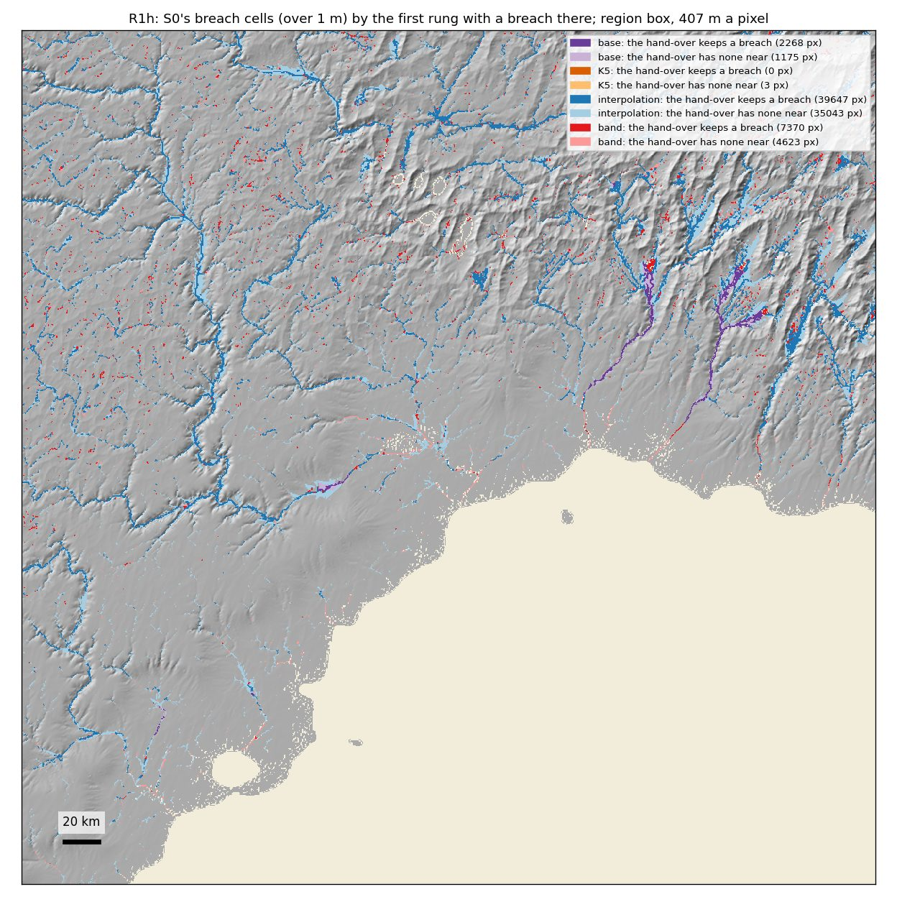
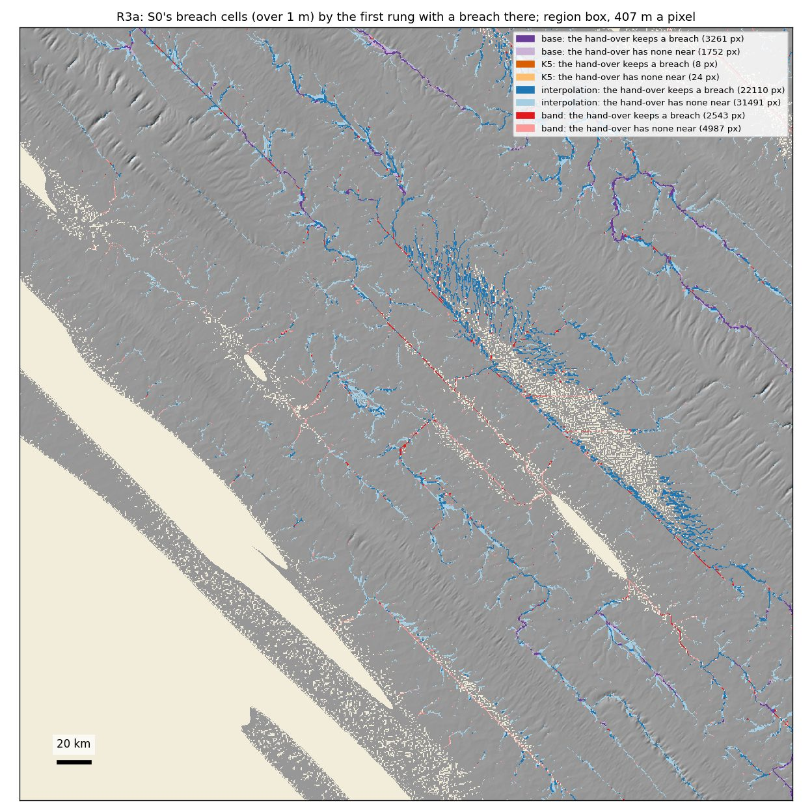
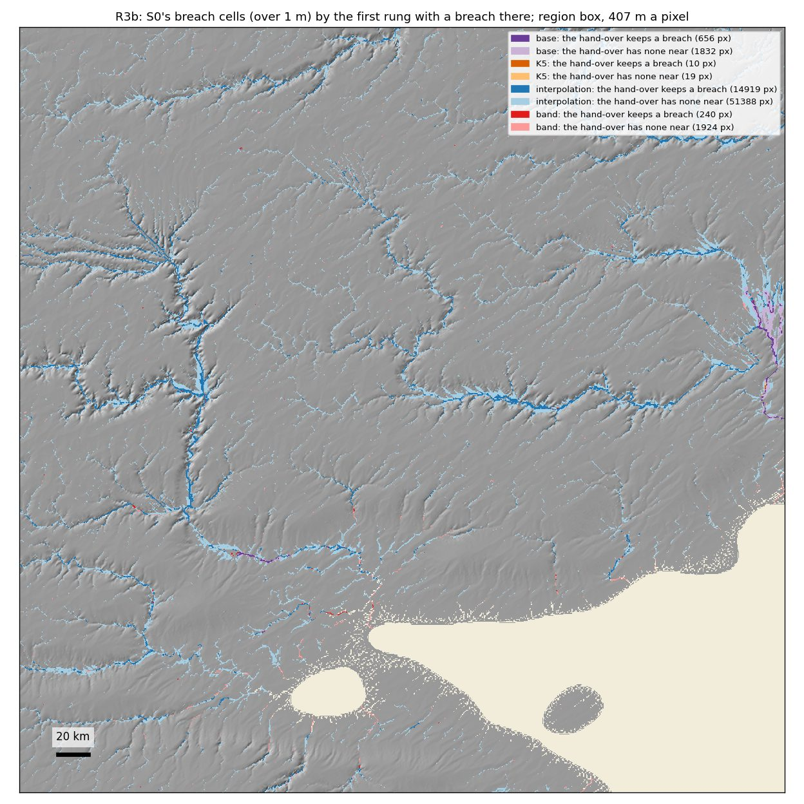
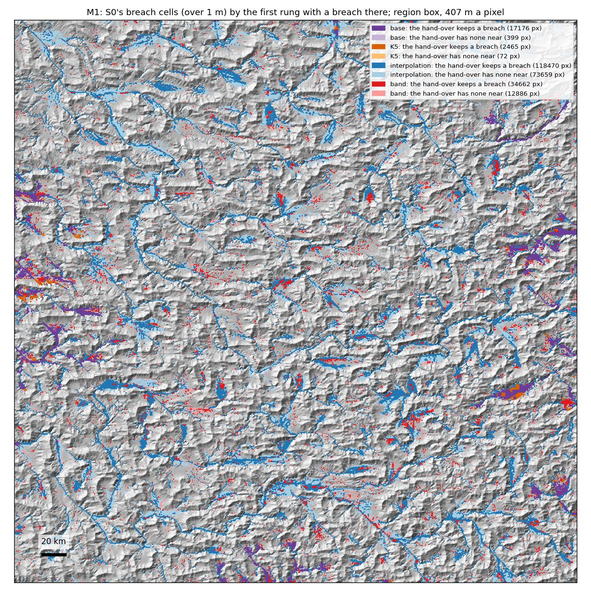
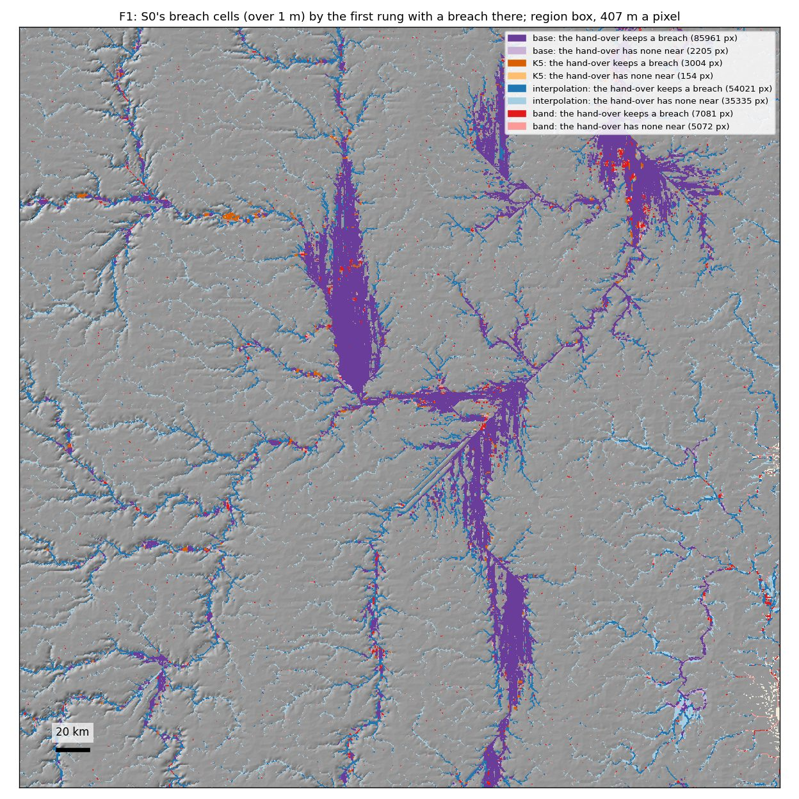

# SPIKE-135: the repair debt of S0, by origin

Opened: 2026-11-17 (lead #135; owner's question, 2026-11-17)
Question: does the pipeline build a coherent terrain from a coherent base, or make an incoherent base look coherent by KS, KV and KC? How large is the repair debt in `S0`, and which stage makes it: the base, K5, the scale transition from 814 m to L, the band `r`, drainage derivation (H1), or rasterisation?
Why it matters: the owner's decision 5 (fix the deep basins at the base or at K5) waits for it; the river-graph plan's KS, KV and KC are repair stages.
Time box: 1 day (used: about 3 h).
Success criteria: a ladder of surfaces on five windows, each routed at its own grid with one rule; per rung the river length on closed depressions, the depressions, the minimal drainage correction (breach and fill) and the ridges it crosses; D-2 against H1 for the L rungs; an attribution table; where KS lowers by defect class; one sheet per window.
Fallback if it fails: report the rungs measured and name the missing one.
Code location: branch `spike/repair-debt` @ 5dfa8e8a (never merged):
- `crates/cache/examples/repair_debt.rs`: the ladder; the helpers are kg_trunk's (spike/deep-basins).
- `crates/cache/examples/ks_dump.rs`: SPIKE-128's `ks_g1b` at e359dfae, with `--dump-only`, which writes RG-1's and RG-2's lowering at L.

## Answer
- **Both, at different stages.**
  - **The base is incoherent.** At 814 m, 60-96 % of `z_b`'s river length (75 km2 channels) lies on closed depressions. Draining it needs a breach on 12-28 % of the land, and on 0-22.5 % of the land the breach is over 50 m. M1's base would need cuts of up to 2,206 m.
  - **K5 repays the base's debt at 814 m on R1h, R3a and R3b.**
    - What remains on `z_s` is shallow: breach at most 5 m, no breach over 10 m.
    - On M1 K5 keeps deep basins: breach up to 1,106 m, 0.26 % of the land over 50 m.
    - On F1 K5 keeps broad lowland depressions: 52 % of the river length on closed depressions, 0.49 % of the land breached over 10 m.
  - **K5 is not a minimal repair.** It lowers `z_b` by 4.6 to 29 times the volume of the base's minimal breach (erosion rounds, not a breach).
- **The scale transition makes most of `S0`'s debt.** Read at L, `C1(z_s)` puts 67-85 % of the river length back on closed depressions, against 3.5-52 % on `z_s` at 814 m. On `S0`, the share of breach cells by origin:

| Origin | R1h, R3a, R3b, M1 | F1 |
|---|---|---|
| interpolation (first at `C1(z_s)` at L) | 77-93 % | 33 % |
| base (kept by K5) | 6-10 % | 61 % |
| band `r` | 1.4-13 % | 4 % |
| K5 (new at 814 m) | 0-1.1 % | 1.8 % |

- **A hand-over that is drained by construction removes most of it.**
  - SPIKE-116's hand-over, with the raw band added (L5 below), is compared with `S0`:

| Measure | `S0` | L5 |
|---|---|---|
| breach volume, four windows | baseline | 68-97 % less |
| breach volume, F1 | baseline | 4 % less |
| D-2 failures (H1 trunk reaches failing the corridor measure) | 78-1,890 | 2-866 (54-97 % fewer) |
| river length on closed depressions | 69-89 % | 29-68 % |

  - Its residue is the base's real basins and the band.
- **KS is only partly a repair.**
  - On R1h and M1, 36-63 % of KS's lowering volume lies on cells `S0` does not need breached.
  - On R3a, R3b and F1 that share is 67-92 %.
  - Of the lowering, 17-57 % is what `S0`'s breach also asks for there.
  - KV and KC exist only on the synthetic G0 fixture (SPIKE-132), so their share by defect class is not measured.

## Method
- Windows: SPIKE-129's five (face, region, seed): R1h `1,8056,8675,760,1379,14`, R3a `4,368,987,4720,5339,15`, R3b `2,9968,10587,8304,8923,15`, M1 `4,6600,7219,10200,10819,15`, F1 `4,4800,5419,3300,3919,15`. Margin 200 regional cells; numbers over the region box (620 x 620 cells at 814 m, 4,960 x 4,960 at L).
- K5 is today's regional solve (`region_front`, 4 rounds). `C1` is the C1 read of a regional field at an L cell centre (`RegionField`).
- The ladder:

| Rung | Surface | Grid |
|---|---|---|
| L0b | `z_b` on B's own lattice | 611 m |
| L0 | `z_b` | 814 m |
| L1 | `z_s` (K5's output) | 814 m |
| L2b, L2s | `C1(z_b)`, `C1(z_s)` | L (101.8 m) |
| L3 | `z_s` breached over 4 neighbours (step 1 cm, land floored at 5 mm), read bilinearly between the regional cell centres (SPIKE-116; no band) | L |
| L4 | `S0` = `C1(z_s)` + `r`, `r` = B - `C1(z_b)` | L |
| L5 | L3 + `r` (the source-fixed hand-over, raw band) | L |

- One routing rule on every rung:
  - Outlets: the grid's edge and the sea (reading 12): cells at or below 0 m connected through such cells to the edge or to a K5 sea outlet; inland cells at or below 0 m are land.
  - The canonical priority flood (GEN-141) with a 1e-3 m grade; D8 steepest descent on it, ties by the lower cell id; D8 drainage area; channels at 75 km2 and 1 km2.
- Per rung, over the land of the box:

| Measure | Definition |
|---|---|
| River length on closed depressions | Channel length (cell to receiver) on cells where a 1e-7 m flood stands more than 1 mm above the surface; "over 5 m": the depression's largest fill is over 5 m |
| Depressions | 8-connected components of such cells touching the box |
| Breach | The complete breach along the routing: each cell lowered to the lowest height upstream of it, the least lowering that makes every flow path non-increasing on this routing (the river gate's "every basin breached"); counted from 1 cm |
| Fill | The 1e-7 m flood's depth (the fill alternative) |
| Ridge cells crossed | G0 contracts §9 ridge cells (at least 2 m above both cells 2 out along one of 4 lines) the breach lowers over 1 m and over 10 m |
| D-2 | today's H1 (K6) trunk reaches (q at least 1 m3/s) failing BUILD-057's corridor measure (k_c 2, snapped, land-only snap) on the rung; bar from `S0`'s relief (the window's) |

- Attribution of `S0`'s breach cells (lowered over 1 m), by the first rung with a breach over 1 m nearby:
  - **base:** within one 814 m cell on both `z_b` and `z_s`;
  - **K5:** on `z_s` only;
  - **interpolation:** on `C1(z_s)` within 4 L cells, but not on `z_s`;
  - **band:** on `S0` only.
- "Hand-over fixes": L5 has no breach over 1 m within 4 L cells.
- KS: RG-1 (KS0, H from today's H1), RG-2 (KS1, flow-path H on a routing of KS0 at L) and RG-1 with K6''s H. The lowering is `S0 - KS`, from SPIKE-128's code (explorer's K6' dump for the third). Its volume is split by the class of the cell (none: no `S0` breach over 1 m).
- Runs, under the heavy lock (wall time with setup, peak working set; `raw/peaks.txt`): five windows, 283-496 s each, peak 4.6 GB; KS dumps 125-190 s each, peak 4.0 GB.

## Results
### The rungs
River length (75 km2 channels) on closed depressions, all / over 5 m deep, %:

| Rung | R1h | R3a | R3b | M1 | F1 |
|---|---|---|---|---|---|
| L0b `z_b`, B's lattice (611 m) | 70.8 / 64.7 | 70.4 / 52.1 | 60.2 / 45.1 | 96.3 / 96.3 | 82.6 / 71.9 |
| L0 `z_b` (814 m) | 67.2 / 61.7 | 70.2 / 52.3 | 59.5 / 44.3 | 96.1 / 96.1 | 80.6 / 70.1 |
| L1 `z_s` (814 m) | 3.6 / 0.1 | 43.2 / 0.0 | 3.5 / 0.0 | 11.0 / 11.0 | 52.3 / 47.2 |
| L2b `C1(z_b)` at L | 69.2 / 62.3 | 66.5 / 47.3 | 57.0 / 39.3 | 96.8 / 96.8 | 80.5 / 68.3 |
| L2s `C1(z_s)` at L | 72.0 / 61.4 | 71.9 / 30.2 | 67.2 / 50.9 | 85.3 / 84.7 | 78.9 / 68.7 |
| L3 `z_s` 4-neighbour breached, bilinear | 33.0 / 14.4 | 34.5 / 0.0 | 25.4 / 5.9 | 46.2 / 41.0 | 46.1 / 35.8 |
| L5 L3 + `r` | 49.2 / 28.2 | 49.6 / 0.0 | 28.8 / 6.0 | 68.1 / 65.1 | 54.2 / 36.5 |
| L4 `S0` | 76.5 / 65.0 | 74.9 / 37.2 | 68.8 / 52.4 | 89.1 / 88.5 | 80.4 / 71.1 |

The same at 1 km2 channels, %:

| Rung | R1h | R3a | R3b | M1 | F1 |
|---|---|---|---|---|---|
| L0b | 58.2 / 55.4 | 39.0 / 30.1 | 37.5 / 28.5 | 83.4 / 83.4 | 76.1 / 67.1 |
| L0 | 46.2 / 43.9 | 35.9 / 27.9 | 32.2 / 24.5 | 76.7 / 76.6 | 67.0 / 58.7 |
| L1 | 0.9 / 0.0 | 11.1 / 0.0 | 0.6 / 0.0 | 5.0 / 5.0 | 22.7 / 21.6 |
| L2b | 74.2 / 71.0 | 65.9 / 55.7 | 65.8 / 56.6 | 96.9 / 96.9 | 90.5 / 82.7 |
| L2s | 44.3 / 35.5 | 52.9 / 10.8 | 36.0 / 26.4 | 67.4 / 67.1 | 69.7 / 63.4 |
| L3 | 12.9 / 5.6 | 32.4 / 0.0 | 8.5 / 2.2 | 30.0 / 28.9 | 60.5 / 58.3 |
| L5 | 21.4 / 11.6 | 41.0 / 0.0 | 10.1 / 2.2 | 40.5 / 39.3 | 62.1 / 56.3 |
| L4 `S0` | 47.2 / 37.6 | 54.8 / 14.8 | 37.0 / 27.0 | 69.4 / 69.1 | 70.7 / 64.1 |

Breach: land cells lowered / over 10 m / over 50 m, % of the land:

| Rung | R1h | R3a | R3b | M1 | F1 |
|---|---|---|---|---|---|
| L0b | 20.0 / 14.1 / 8.03 | 14.5 / 0.67 / 0.010 | 12.1 / 2.53 / 0.257 | 28.3 / 26.7 / 22.35 | 24.9 / 3.56 / 0 |
| L0 | 16.4 / 11.3 / 6.02 | 14.0 / 0.74 / 0.009 | 11.8 / 2.72 / 0.327 | 27.5 / 26.3 / 22.51 | 23.8 / 3.58 / 0 |
| L1 | 0.37 / 0 / 0 | 2.47 / 0 / 0 | 0.22 / 0 / 0 | 0.52 / 0.41 / 0.264 | 4.64 / 0.49 / 0 |
| L2b | 16.8 / 9.8 / 4.77 | 14.3 / 0.44 / 0.015 | 12.2 / 2.29 / 0.216 | 28.4 / 25.2 / 20.25 | 25.0 / 3.00 / 0 |
| L2s | 4.17 / 1.53 / 0.361 | 6.67 / 0.02 / 0 | 3.29 / 0.66 / 0.035 | 7.14 / 4.77 / 2.397 | 8.44 / 1.22 / 0 |
| L3 | 0.85 / 0.03 / 0 | 4.02 / 0 / 0 | 0.55 / 0 / 0 | 1.63 / 0.82 / 0.366 | 7.37 / 1.42 / 0 |
| L5 | 1.93 / 0.23 / 0.011 | 6.08 / 0 / 0 | 0.73 / 0 / 0 | 4.55 / 2.51 / 0.814 | 8.71 / 1.45 / 0 |
| L4 `S0` | 5.86 / 2.07 / 0.500 | 10.6 / 0.04 / 0 | 4.08 / 0.72 / 0.040 | 11.0 / 7.64 / 3.747 | 10.6 / 1.37 / 0.002 |

Breach depth on lowered cells p50 / p95 / max, m:

| Rung | R1h | R3a | R3b | M1 | F1 |
|---|---|---|---|---|---|
| L0 | 26.6 / 374 / 922 | 1.8 / 10.2 / 62 | 3.0 / 34.0 / 130 | 231 / 1,373 / 2,206 | 3.7 / 15.3 / 37 |
| L1 | 0.25 / 5.0 / 5 | 0.13 / 1.2 / 3 | 0.33 / 4.2 / 4 | 52 / 371 / 1,106 | 1.7 / 18.0 / 36 |
| L2s | 4.9 / 66 / 229 | 0.31 / 3.8 / 79 | 2.4 / 29.2 / 105 | 23.8 / 224 / 1,266 | 2.0 / 20.7 / 64 |
| L5 | 1.2 / 18.4 / 94 | 0.19 / 1.7 / 6 | 0.32 / 3.7 / 13 | 12.5 / 128 / 1,286 | 3.0 / 21.2 / 47 |
| L4 `S0` | 4.4 / 67 / 291 | 0.20 / 3.4 / 80 | 1.7 / 26.8 / 107 | 25.8 / 237 / 1,324 | 2.3 / 19.4 / 65 |

Volume, breach / fill alternative, km3:

| Rung | R1h | R3a | R3b | M1 | F1 |
|---|---|---|---|---|---|
| L0b | 3,043 / 10,433 | 89 / 317 | 203 / 530 | 26,672 / 112,956 | 315 / 651 |
| L0 | 1,878 / 5,159 | 72 / 237 | 188 / 444 | 23,879 / 93,621 | 298 / 584 |
| L1 | 0.85 / 0.5 | 1.3 / 3.9 | 0.46 / 0.5 | 107 / 2,494 | 44 / 716 |
| L2b | 1,717 / 6,778 | 72 / 317 | 178 / 538 | 21,474 / 113,838 | 265 / 642 |
| L2s | 112 / 712 | 12.9 / 79 | 49 / 293 | 1,012 / 11,214 | 102 / 828 |
| L3 | 2.7 / 11.2 | 3.1 / 3.5 | 1.2 / 3.8 | 182 / 2,985 | 114 / 727 |
| L5 | 14.3 / 37.7 | 5.4 / 12.0 | 1.4 / 4.2 | 382 / 3,709 | 122 / 724 |
| L4 `S0` | 155 / 807 | 17.2 / 85 | 54 / 298 | 1,645 / 12,938 | 127 / 837 |

On 75 km2 rivers, breach p95 / max (m); cells over 10 m / over 50 m:

| Rung | R1h | R3a | R3b | M1 | F1 |
|---|---|---|---|---|---|
| L0 | 556 / 922; 8,739 / 6,010 | 13.9 / 62; 1,664 / 27 | 43 / 130; 4,319 / 556 | 1,795 / 2,206; 18,147 / 17,645 | 20.2 / 37; 6,270 / 0 |
| L1 | 5.0 / 5; 0 / 0 | 1.4 / 3; 0 / 0 | 4.2 / 4; 0 / 0 | 454 / 1,106; 680 / 510 | 21.6 / 36; 814 / 0 |
| L2s | 104 / 229; 41,156 / 15,269 | 7.6 / 79; 2,207 / 7 | 46.5 / 105; 34,152 / 4,098 | 374 / 1,266; 100,152 / 73,298 | 32.7 / 64; 46,487 / 90 |
| L5 | 31.6 / 91; 18,944 / 1,630 | 2.7 / 6; 0 / 0 | 4.8 / 13; 50 / 0 | 187 / 1,286; 100,634 / 49,283 | 33.9 / 47; 43,995 / 0 |
| L4 `S0` | 117 / 291; 55,845 / 21,695 | 8.6 / 80; 3,876 / 8 | 46.4 / 107; 37,254 / 4,588 | 476 / 1,324; 133,434 / 104,784 | 35.0 / 65; 55,427 / 337 |

Ridge cells (G0 §9) the breach lowers over 10 m, of the rung's ridge cells:

| Rung | R1h | R3a | R3b | M1 | F1 |
|---|---|---|---|---|---|
| L0 | 10,141 of 87,700 | 605 of 51,264 | 1,720 of 54,450 | 31,521 of 146,888 | 6,866 of 127,612 |
| L1 | 0 of 107,411 | 0 of 92,970 | 0 of 118,887 | 682 of 155,179 | 1,144 of 153,286 |
| L2s | 43,948 of 1.10 M | 496 of 72,225 | 17,944 of 399,788 | 233,882 of 3.48 M | 42,116 of 354,291 |
| L5 | 5,366 of 1.28 M | 0 of 77,075 | 9 of 351,853 | 144,928 of 4.12 M | 36,272 of 338,687 |
| L4 `S0` | 62,800 of 1.36 M | 570 of 74,581 | 18,498 of 402,501 | 462,624 of 4.36 M | 43,996 of 372,288 |

D-2: H1 trunk reaches failing the corridor measure / measured:

| Rung | R1h | R3a | R3b | M1 | F1 |
|---|---|---|---|---|---|
| L2s `C1(z_s)` | 313 / 3,291 | 57 / 9,631 | 534 / 5,950 | 851 / 6,581 | 496 / 8,913 |
| L3 | 19 / 3,323 | 2 / 9,568 | 28 / 6,122 | 155 / 6,478 | 71 / 8,686 |
| L5 | 50 / 3,271 | 2 / 9,390 | 29 / 6,090 | 866 / 6,243 | 60 / 8,590 |
| L4 `S0` | 352 / 3,094 | 78 / 9,070 | 568 / 5,779 | 1,890 / 6,002 | 525 / 8,277 |

- Inland land at or below 0 m (reading 12): none on the 814 m rungs. On `S0`: 0 (M1) to 524,775 cells (R3a, 2.6 % of the land), mostly coastal strips where the band dips under 0 m. The rule counts them as land, so they add depressions on `S0` and L5.
- Full table, depression counts and fill shares: `raw/tables.md`. Per-rung CSVs: `raw/ladder-<w>.csv`. Logs: `raw/run-<w>.txt`.

### K5 at 814 m
| Window | Breached over 1 m: in both / only `z_b` (repaired) / only `z_s` (made) | K5 lowers / raises `z_b`, km3 | `z_b`'s minimal breach / fill, km3 |
|---|---|---|---|
| R1h | 338 / 40,677 / 21 | 14,241 / 133 | 1,878 / 5,159 |
| R3a | 534 / 28,560 / 56 | 2,078 / 190 | 72 / 237 |
| R3b | 234 / 29,877 / 15 | 4,099 / 1,190 | 188 / 444 |
| M1 | 1,247 / 103,838 / 691 | 109,802 / 10 | 23,879 / 93,621 |
| F1 | 9,231 / 66,293 / 2,515 | 3,274 / 1,468 | 298 / 584 |

### Attribution of `S0`'s breach cells
Cells (share) / volume share / share of the class the hand-over has no breach near:

| Class | R1h | R3a | R3b | M1 | F1 |
|---|---|---|---|---|---|
| base | 40,144 (5.7 %) / 5.4 % / 29 % | 44,205 (9.7 %) / 13.1 % / 31 % | 29,874 (5.7 %) / 3.7 % / 72 % | 205,147 (8.1 %) / 11.1 % / 2 % | 1,109,859 (61.0 %) / 61.0 % / 2 % |
| K5 | 6 (0.0 %) / 0.0 % / 100 % | 233 (0.1 %) / 0.1 % / 75 % | 374 (0.1 %) / 0.0 % / 55 % | 28,619 (1.1 %) / 1.3 % / 2 % | 32,060 (1.8 %) / 2.3 % / 4 % |
| interpolation | 608,550 (86.7 %) / 92.2 % / 43 % | 384,976 (84.7 %) / 83.7 % / 53 % | 487,255 (92.9 %) / 95.9 % / 72 % | 1,968,039 (77.5 %) / 82.8 % / 36 % | 605,523 (33.3 %) / 35.5 % / 30 % |
| band | 53,595 (7.6 %) / 2.4 % / 34 % | 25,163 (5.5 %) / 3.1 % / 59 % | 7,144 (1.4 %) / 0.4 % / 85 % | 336,994 (13.3 %) / 4.9 % / 24 % | 70,911 (3.9 %) / 1.2 % / 29 % |
| over 10 m: base / K5 / interp. / band, % | 6 / 0 / 91 / 3 | 25 / 0 / 74 / 1 | 4 / 0 / 96 / 0 | 9 / 1 / 82 / 9 | 59 / 3 / 38 / 0 |
| on 75 km2 rivers: base / K5 / interp. / band, % | 3 / 0 / 88 / 9 | 9 / 0 / 75 / 17 | 3 / 0 / 94 / 3 | 6 / 1 / 84 / 10 | 33 / 2 / 61 / 4 |

### The differences between rungs (lead #135 step 3)
| Defect class | Rungs | Reading |
|---|---|---|
| Base (intrinsic) | L0, L0b | 60-96 % of the river length on closed depressions. Breach on 12-28 % of the land, 0-22.5 % over 50 m. B's own 611 m lattice is the same or worse (L0b): the 814 m sampling adds no defect. |
| K5 | L1 - L0 | Repairs 28,560-103,838 breached cells, keeps 234-9,231, makes 15-2,515. Kept and made are concentrated on M1 (deep, to 1,106 m) and F1 (broad lowland, to 36 m). M1's kept and made cells lie where SPIKE-134 found the K5 basins (not traced basin by basin). |
| Interpolation, 814 m to L | L2s - L1 | River length on closed depressions rises from 3.5-52 % to 67-85 %. Breach rises from 0.2-4.6 % to 3.3-8.4 % of the land, with 2.4 % of M1's land over 50 m. The base's own read (L2b - L0) adds little: `z_b` is already broken. |
| Band `r` | L4 - L2s | +1.5 to +4.5 points of river length on closed depressions. Breach volume +8.5 to +62 % (R3b +8.5 %, F1 +24 %, R3a +34 %, R1h +39 %, M1 +62 %). D-2 +6 to +122 % (M1 851 to 1,890). |
| Hand-over fix potential | L4 - L5 | L5 removes 68-97 % of `S0`'s breach volume on four windows (F1 4 %) and 54-97 % of the D-2 failures. Ridge cells breached over 10 m fall from 570-462,624 to 0-144,928. |
| Drainage derivation (H1) | D-2 on `S0` | 78-1,890 of 3,094-9,070 H1 trunk reaches fail the corridor measure on `S0` (0.9-31.5 %); on L3, 2-155. SPIKE-131: K6' (sills, SPIKE-127) alone makes no real change to the trunks on four windows, R3a at noise level. |
| Rasterisation | G-SURF-I; SPIKE-129 | G-SURF-I (`docs/gates/ledger.md`, 0900c015) compares the runtime's `B + R(L)` with the bake's `C1(z)` on three tiles: 0.30-23.6 % of vertices over 0.25 m, p99 0.15-1.31 m, max 7.19 m. SPIKE-129's graph/raster agreement against routed `S0`: 10.5-40.5 % of river cells within 1 cell of the graph, 30-71 % of graph cells near a routed river (K6' and today's K6). The read error (at most 7.19 m) is small next to the breach depths above. The low agreement measures the centreline method (SPIKE-129 finding 6), not a defect of the surface. |

### Where KS lowers `S0`
KS is SPIKE-128's code; volume in km3. The split is the share of the volume by the cell's class (none: no `S0` breach over 1 m), in %.

| Window | Stage | Volume | none / base / K5 / interp. / band | Within 4 cells of a breach, % | The part `S0`'s breach also asks for, % |
|---|---|---|---|---|---|
| R1h | RG-1 (today's H) | 4.68 | 50 / 2.7 / 0 / 41 / 5.6 | 89 | 45 |
| R1h | RG-2 | 18.24 | 63 / 0.5 / 0 / 33 / 3.7 | 71 | 34 |
| R1h | RG-1 (K6' H) | 11.81 | 50 / 2.4 / 0 / 45 / 3.1 | 89 | 47 |
| R3a | RG-1 | 0.43 | 92 / 0.9 / 0 / 5 / 2.5 | 40 | 33 |
| R3a | RG-2 | 1.83 | 91 / 1.3 / 0 / 7 / 0.8 | 26 | 17 |
| R3a | RG-1 (K6' H) | 1.09 | 75 / 3.3 / 0 / 20 / 2.1 | 59 | 44 |
| R3b | RG-1 | 0.27 | 90 / 0.4 / 0 / 8 / 1.3 | 52 | 23 |
| R3b | RG-2 | 1.55 | 80 / 0.5 / 0 / 19 / 0.5 | 46 | 26 |
| R3b | RG-1 (K6' H) | 0.79 | 67 / 2.2 / 0.1 / 30 / 0.6 | 71 | 41 |
| M1 | RG-1 | 46.15 | 36 / 0.6 / 0 / 51 / 12.4 | 97 | 57 |
| M1 | RG-2 | 208.74 | 47 / 0.7 / 0.1 / 46 / 7.0 | 82 | 48 |
| M1 | RG-1 (K6' H) | 112.50 | 39 / 0.7 / 0.1 / 54 / 6.8 | 95 | 56 |
| F1 | RG-1 | 0.33 | 78 / 4.2 / 0.1 / 14 / 4.3 | 74 | 36 |
| F1 | RG-2 | 3.10 | 81 / 0.3 / 0 / 16 / 2.5 | 54 | 25 |
| F1 | RG-1 (K6' H) | 1.03 | 68 / 3.6 / 0.1 / 26 / 2.2 | 82 | 39 |

- On R1h and M1 KS acts mostly near the interpolation defects: 71-97 % of its lowering is within 4 cells of an `S0` breach cell.
- On R3a, R3b and F1, 67-92 % of its lowering is on cells `S0` does not need breached. KS's rule lowers `r` where it exceeds H, so this is likely band on hillslopes; the data do not separate those cells by class (the band class holds 0.5-12 % of KS's volume).
- KV and KC: measured only on SPIKE-132's synthetic fixture (budget 10 m everywhere). Not measured by defect class; this needs G1f's integrated run on a window.

## Findings
1. **The base is incoherent at every scale it has.** `z_b` drains no better on B's 611 m lattice than at 814 m (L0b against L0).
   - On M1 the base's minimal breach is 23,879 km3 (cuts to 2,206 m), and a fill would need 93,621 km3.
   - The base stage makes valleys that do not connect: M1's p50 breach on lowered cells is 231 m.
2. **K5 is the repair of the base.** It removes 88-99 % of the base's breached cells (F1 88 %).
   - It is erosion, not a minimal repair: it lowers 4.6-29 times the base's breach volume.
   - On R1h, R3a and R3b, what remains on `z_s` at 814 m is shallow: breach at most 5 m (R3a still has 43 % of its river length on depressions of at most 3 m).
   - On M1 and F1 it does not finish: deep basins (M1) and broad lowland depressions (F1, 61 % of `S0`'s breach cells) stay. That is SPIKE-134's origin finding, here as a share of the debt.
3. **The scale transition makes most of `S0`'s debt.** On four windows 77-93 % of `S0`'s breach cells (83-96 % of the volume) first appear when `z_s` is read at L.
   - This is SPIKE-116's diagonal-saddle result, now on five windows and as a share. Any C1 or bilinear read of a D8-drained grid closes basins at diagonal steps.
   - The sheets show these cells along the valley network (blue).
4. **The band adds a smaller part:** 1.4-13 % of the cells and 0.4-4.9 % of the volume. In the D-2 count it adds more: M1's failures rise from 851 to 1,890.
5. **A drained hand-over (L5) removes most of the interpolation debt.**
   - It removes 68-97 % of the breach volume and 54-97 % of the D-2 failures on four windows, but only 4 % of the volume on F1, whose debt is the base's.
   - What it leaves:
     - shallow basins from L sampling (SPIKE-116);
     - the base's basins K5 keeps;
     - the band's own dips (L5 against L3: +3 to +22 points of river length on closed depressions).
6. **KS repairs the interpolation debt where relief is high; elsewhere it acts away from the breach need.** On R3a, R3b and F1, 67-92 % of KS's volume lies on cells `S0` does not need breached, so KS is not a targeted repair there. Its rule suggests band clipping on hillslopes; this note does not measure that.
7. **Coastal strips under 0 m:** with reading 12's sea, `S0` has 25,525-524,775 inland cells at or below 0 m (none on M1). Most are the band dipping under the sea level near the coast (SPIKE-129's early sea ends). On the L rungs they count as land with depressions.

## Recommendation
- **The owner's question:** the pipeline does both. K5 makes the incoherent base coherent at 814 m: a real repair, done as erosion. The hand-over to L then breaks it again, and KS repairs part of that. Most of `S0`'s debt is made between K5 and L, not inherited from the base.
- **Fix at the source stage (owner, 2026-11-12), in order:**
  1. **The hand-over.** A drainage-preserving read of `z_s` at L (SPIKE-116's 4-neighbour drainage at 814 m, or a monotone read along the D8 steps) is the largest lever. It removes 68-97 % of `S0`'s breach volume on four windows before any KS.
  2. **Decision 5 (base or K5).** The residual debt that survives K5 sits on M1 (deep basins) and F1 (lowland depressions):
     - a base that drains at 814 m removes it at the start;
     - K5 with more rounds does not (SPIKE-134);
     - on R1h, R3a and R3b the base's debt is already repaid by K5.
  3. **The band.** A small share. Floor it at the sea level near the coast (finding 7) and damp it toward the channels (SPIKE-116's residual damping) before KS.
- **KS, KV and KC** then act on a smaller debt. Measure their share by defect class again on the fixed hand-over (G1f's integrated run).
- **Not measured:**
  - KV and KC by class (fixture only);
  - a least-cost breach (the breach along the routing goes to the pit floor, so it is an upper bound on depth for a given routing);
  - bake stills: no world bake.

## Visuals
Analysis renders (CPU), not the production path: `S0` is not baked, and capture stills need a world bake.

Each sheet shows one window's region box, 4 L cells (407 m) a pixel:
- A low-sun hillshade of `S0` (block means).
- `S0`'s breach cells over 1 m, coloured by the first rung with a breach there: purple base, orange K5, blue interpolation, red band.
- Dark shade: the hand-over (L5) keeps a breach within 4 L cells. Light shade: it has none there.
- A pixel shows the class of the block's deepest breach cell.
- Sand: block mean at or below 0 m (sea, and inland cells under 0 m).
- 20 km scale bar.

R1h: interpolation cells along the whole valley network; band cells scattered on the hillslopes; base cells on a few reaches.

R3a, the flat coastal window: interpolation cells along the valleys, more than half of them gone under the hand-over (light blue); coastal strips under 0 m (sand speckle).

R3b: interpolation along the trunks; 72 % of them gone under the hand-over.

M1, the mountain window: wide interpolation patches in the valleys, band cells on the slopes, base and K5 cells in the deep basins (purple, orange).

F1: the base's broad lowland depressions (purple fans), which K5 keeps and the hand-over cannot remove; interpolation along the tributaries.

## Reproduce
- `cargo build --release -p planet-cache --example repair_debt --example ks_dump` on `spike/repair-debt`.
- KS dumps: `cargo xtask heavy target/release/examples/ks_dump.exe --window <w> --out <dir>/<tag> --dump-only`.
- Ladder: `cargo xtask heavy target/release/examples/repair_debt.exe --window <w> --out <dir> --tag <tag> --ks <dir>/<tag> --ks0-k6p <explorer's ks0-k6p-8160x8160.f64>`.
- Tables: `python tools/ladder_tables.py raw r1h r3a r3b m1 f1` (reads `raw/ladder-<w>.csv`). Sheets: `python tools/repair_sheet.py <dir> <tag> <title> <out.jpg>`.
