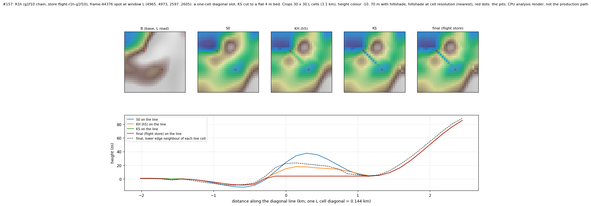
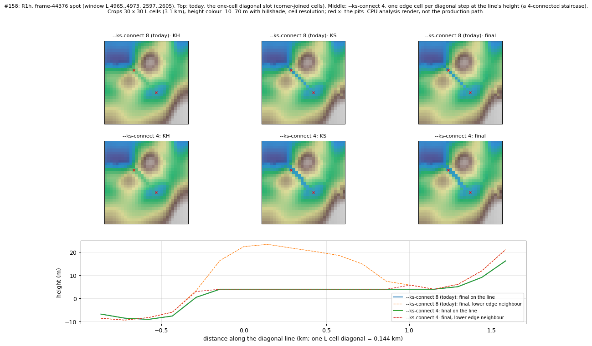
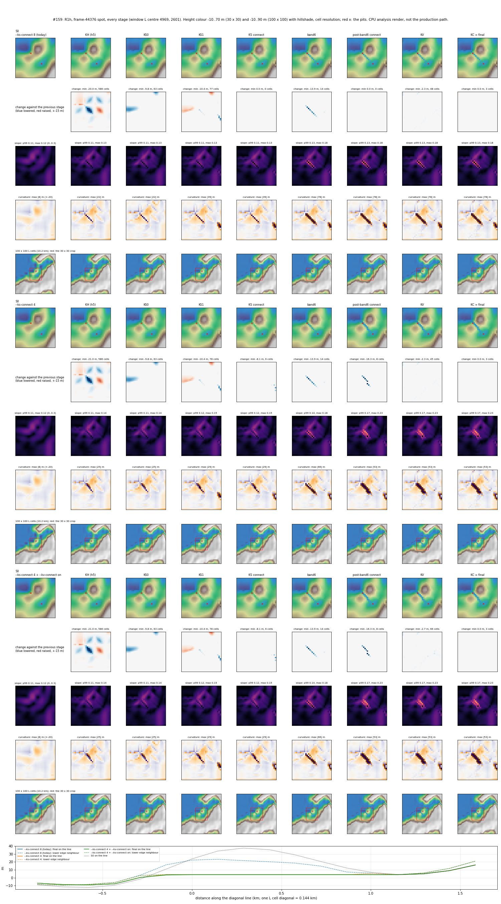
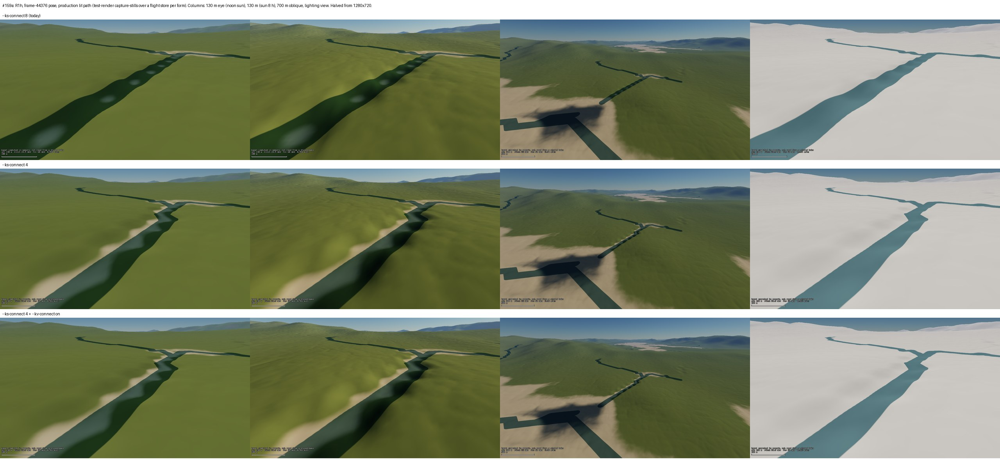
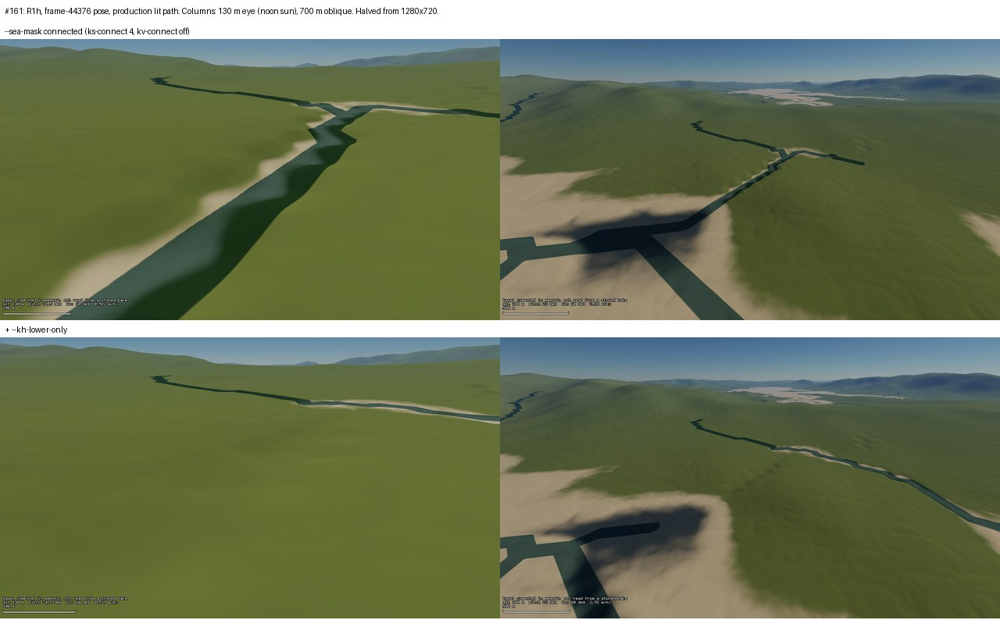

# SPIKE-141: RG carving artefacts at the owner's bead-chain spot

Opened: 2026-11-20 (lead #157; the owner's flight frame-44376 on the store flight-r1h-g1f10)
Question: What makes the regular chain of round pits along a diagonal river line, which stage, and what is the source fix?
Why it matters: the owner's G2 flight judges RG against B; the pits are RG-only.
Time box: lead orders #157 to #161c, 2026-11-20 to 2026-11-21.
Success criteria: the stage named with a cross-section; a switch per fix with R1h gate rows and the frame-44376 spot.
Fallback if it fails: the pits stay a known G2 item.
Code location: `spike/rg-prototype` (`rg_chain` switches); option (c) on `spike/hump-lake` 39d51927.
Status: closed 2026-11-21. Defaults pushed at e3eed5fb: `--ks-connect 4` (reading 38), `--sea-mask connected` (reading 39), `--kh-lower-only on` (reading 40); the hump-trench class is a G3 item (lead #161c).

## #157: the pits are a one-cell diagonal slot
- Location: the frame's camera ray-marched against g1f10's final surface puts the pits at R1h window L cells (4965..4973, 2597..2605), 0.25-1 km ahead of a camera 130 m over the ground.
- Spacing: one pit per diagonal L cell (144 m), not one per 814 m H1 cell.
- Shape: the line cells lie 12-19 m below both edge cells of each 2 x 2 block, so they meet only at corners; the mesh draws each as a separate pit (`raw/s157-line.txt`).
- RG-only. Corner-only 2 x 2 blocks inside R1h's box (`raw/s157-corner-g1f10.txt`):

| Over | B | S0 | KH | KS | final |
|---|---|---|---|---|---|
| 5 m | 2 | 161 | 10,452 | 25,246 | 25,506 |
| 10 m | 0 | 1 | 6,083 | 13,568 | 13,380 |

- Explorer #178's coastal holes (frame-43411) are a different mechanism: below-sea pits already in S0.

## #158: 4-connected carving (`--ks-connect 4`, the default since reading 38)
- On each D8 diagonal step of a carved line, the lower of the two shared edge cells is lowered to the step's mean height, within the budget left. Claims come from the unchanged surface and are applied as a minimum.
- Applied in three places:
  - KH h5's channel zone;
  - KS1, on the L reaches and KG-trib's channel routing;
  - after band6, on corner links of two lowered cells. The frame-44376 slot is a band6 breach path, flat at its spill level, so the KS1 pass alone did not reach it.
- R1h, final surface, corner links at 5 m: 25,506 to 3,556 (`raw/s158-r1h-*-corner.txt`). Crusader's `--kv-connect` (reading 38) takes KV's part to 465.
- Gate bars unchanged: uphill 1.24 to 1.27, agreement 91.65 / 97.64 to 91.71 / 97.65.
- KV's cross pass (`--kv-cross 0.001`) changes nothing (47 cells, at most 0.14 m); the slot's sides were within s_wall 0.20.

## #159, #159a: every stage at the spot, and the production path
- Sheet `images/s159-stages.png`: S0, KH, KS0, KS1, KS connect, band6, post-band6 connect, KV, KC per form, with change, slope and curvature panels.
- The first hard edge is KH h5's one-cell diagonal groove (curvature 22-25 m). band6's breach then cuts it 13.9 m deeper (curvature 66-78 m).
- With connect 4 the slot becomes a two-cell staircase: curvature 78 to 53 m, bank slope max 0.18 to 0.23.
- Stills through the production lit path (`images/s159a-stills.jpg`):
  - today: the beads;
  - connect 4: no beads, but angular jogs in the water's outline and a sand band on the lowered bank.

## #160: one connected sea for every stage (`--sea-mask connected`, the default since reading 39)
- Only KG-trunk used reading 12's connected ocean. KS took every S0 <= 0 cell as sea, and KG-trib, the basin passes, band6, KV and KC took it as an outlet, so inland below-sea pockets were never drained.
- Inland below-sea L cells: R1h 154,902, F1 184,282, R3a 648,426.
- Level against connected (`raw/gate-rows.txt`):

| Window | bar_uphill | bar_agree_1km2 | bars passing | basin share |
|---|---|---|---|---|
| R1h | 1.27 to 0.45 | 91.71 to 92.18 | 8 to 9 of 9 | 11.18 to 3.46 % |
| F1 | 0.49 to 0.27 | 96.46 to 96.44 | 9 to 9 of 9 | 9.65 to 0.62 % |
| R3a | 1.28 to 0.02 | 83.85 to 87.53 | 7 to 8 of 9 | 1.80 to 0.00 % |

- F1's 9.3 % unintended ponds of the G2 table were these pockets.
- Frame-43411's hole stays a kept lake: S0's own pit, deeper than the fill budget.

## #161: the hump trench
- band6's least-cost breach cuts through convex humps of S0 or S_KH. R1h's box, cuts over 10 m through a S_KH hump over 10 m: 902 paths (11,340 cells, cut p50 21.6 m, max 79.1 m); F1: 52 paths (`raw/s161-*-humps.txt`).
- KH h5's raised side lobes: Clough-Tocher on the quad's two triangles split along the D8 step keeps the off-diagonal corners' heights and gradients, above C1's smooth read. KH raised 1.07 M cells over 0.5 m (up to 155 m, 52 km3).
- Three forms, R1h, all with connected sea and connect 4 (kv-connect off):

| Field | lo (`--kh-lower-only`) | h10 (`--band6-hump 10`) | lake10 (`--band6-hump-lake 10`) |
|---|---|---|---|
| hump trenches (10 m / 10 m) | 894 | 5 | 39 |
| band6 raised (window) | 14.9 km3 | 65.9 km3 | 12.0 km3 |
| corner links at 5 m | 4,456 | 8,134 | 10,237 |
| bar_uphill | 0.32 | 0.45 | 0.33 |
| bar_agree_1km2 / 75 km2 | 92.34 / 98.13 | 92.06 / 98.15 | 90.19 / 95.05 |
| bars passing | 9 of 9 | 9 of 9 | 9 of 9 |
| frame-44376 spot | no trench (line on S0's hump) | filled to 13 m | no trench |

- lo: KH never raises C1. It removes the frame-44376 trench, whose depression KH's lobes closed, and improves the bars a little; window-wide the trenches stay.
- h10: no breach deeper than 10 m; the depression is filled. Removes the class at 4.4x the fill and KV links through the fill. F1: 52 to 6 trenches at +0.6 km3.
- lake10: the depression stays. Removes the class at a fifth of h10's fill, but 7,160 standing depressions lower agreement (1 km2 to 0.2 over the bar).
- Decision (lead #161c, reading 40): lo is the default for G2; the trenches are a known item; a "lake-worthy only" form of (c) goes on the G3 list.

## Visuals
All sheets are CPU analysis renders unless marked as the production path.

#157: R1h g1f10 at the frame-44376 spot; B, S0, KH, KS and final crops (3.1 km, height colour with hillshade) and the line's cross-section against S0.

#158: the spot with `--ks-connect 8` (top) and `4` (middle); the line against its lower edge neighbour (bottom).

#159: rows today, connect 4, connect 4 + kv-connect; per stage the heights, the change, slope, curvature and a 10 km view; the cross-section at the bottom.

#159a: production lit path (`test-render --scene capture-stills` over a flight store per form) at the frame's pose, noon and 8 h sun, a 700 m oblique and the lighting view; rows today, connect 4, connect 4 + kv-connect.

#161: production lit path, 130 m and 700 m oblique; connected sea alone (top) and with `--kh-lower-only` (bottom): the trench river at the spot is gone.
