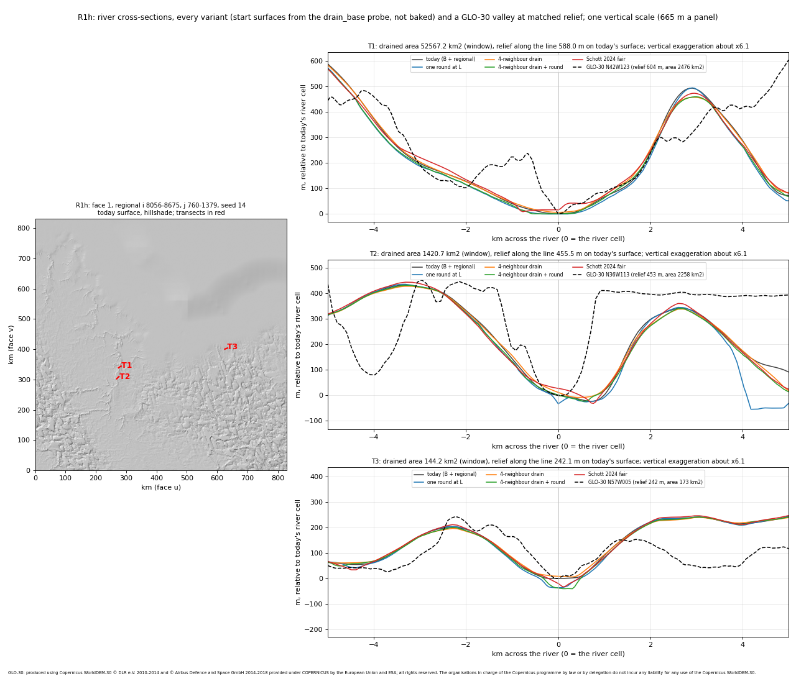
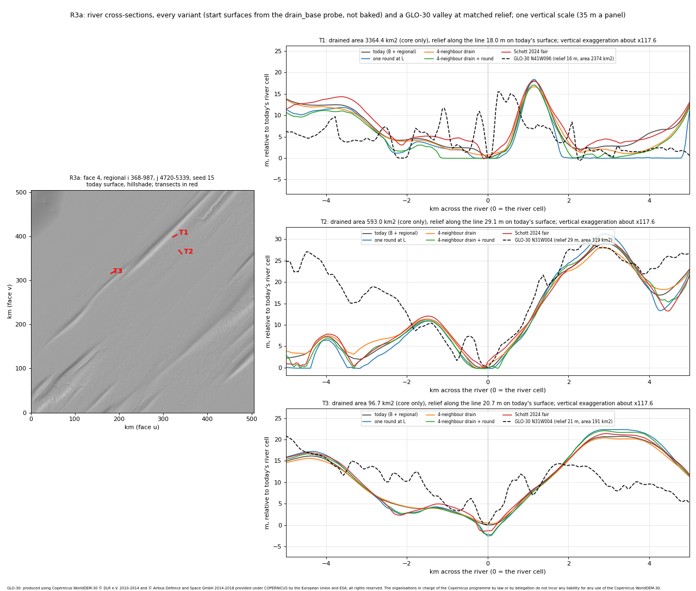
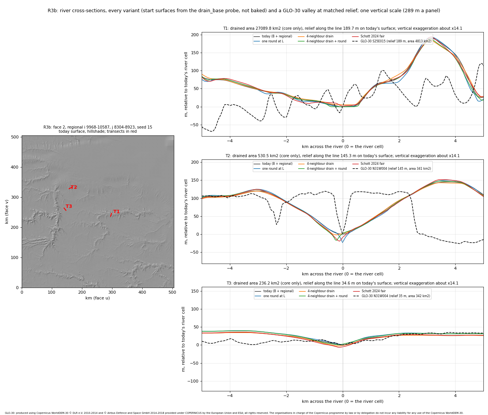
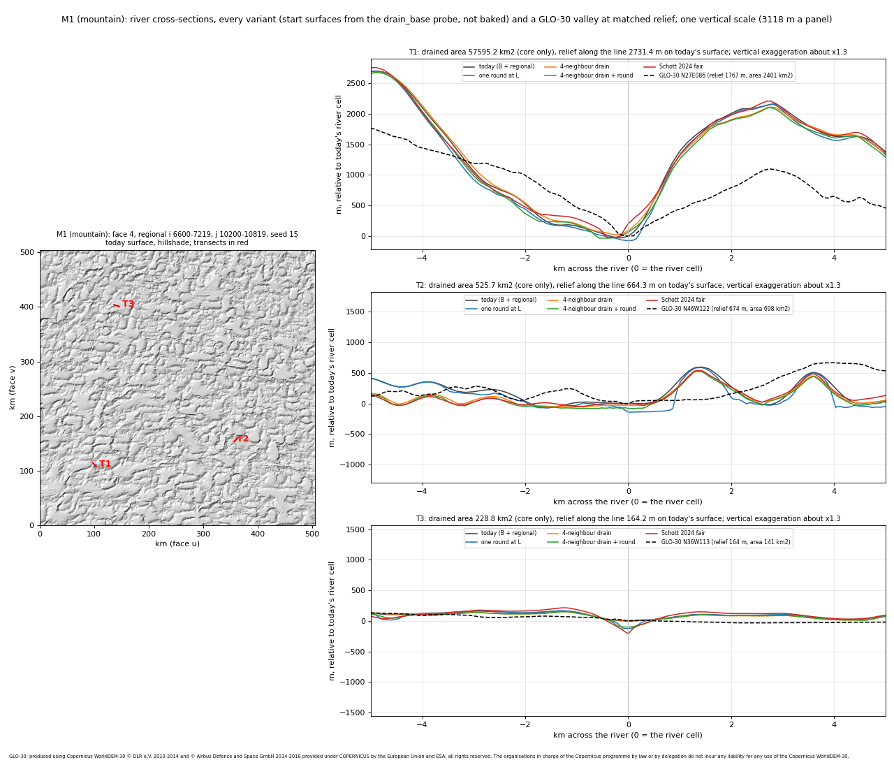
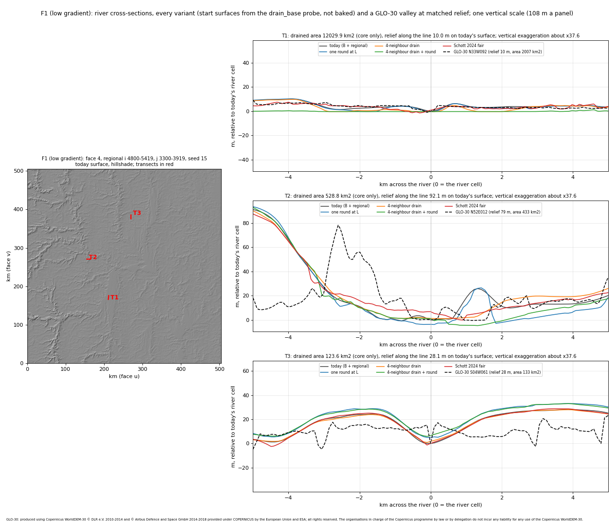

# SPIKE-119: the river measurement suite (windows, transects, the GLO-30 benchmark)

Opened: 2026-11-15
Question: which two windows (a mountain window, a low-gradient river landscape) and which fixed transects join R1h, R3a and R3b, and how is the GLO-30 benchmark prepared and widened, so that every river variant is measured on the same five windows against a documented Earth reference?
Why it matters: P3 exit item E1 (the measurement suite frozen); E3's controlled comparison (D-1) runs on these windows and this benchmark.
Time box: 1 day of agent work.
Success criteria: two windows with face, cells and seed, the mountain one with relief over 10 x 10 cells of at least 300 m, both as river-gate aliases; 3 transects a window in a csv with a figure tool that plots every variant and a GLO-30 valley at matched relief at one vertical scale; the benchmark's preparation written down with counts per tile, the DSM caveat measured, tiles added for a broad floodplain, an incised plateau, volcanic, glacial or fjord, arid-mountain terrain and a large river.
Fallback if it fails: windows named without a figure tool; the benchmark documented on the 15 old tiles only.
Code location: spike branch `spike/river-suite` (probes `window_scan`, `grid_gate`; never merged); Python tools under `tools/` (committed with the results).

Order: lead, spikes lane order #121 (2026-11-15). Windows added as river-gate aliases `m1` and `f1` by explorer (#1523, BUILD-055); the benchmark carries the suite lines of BUILD-057 (#1523).

## 1. The two new windows
Canonical form (lead, 2026-11-14): `face,i0,i1,j0,j1,seed` in regional cells (12,288 a face edge, 814 m), a 620-cell core, margin 200, L cells of 101.8 m.

| Name | Window | Seed | Relief p50 over 2 x 2 / 10 x 10 L cells (m) | River cells | Basins (cells) | Lakes at D 20 m (cells) | H1 edge crossings matched | B elevation p5 / p50 / p95 (m) | B slope p95 (611 m nodes) |
|---|---|---|---|---|---|---|---|---|---|
| M1 (mountain) | 4,6600,7219,10200,10819 | 15 | 42.1 / 378.7 | 178,827 | 87.96 % (157,303; 13,267 basins) | 87.08 % (155,718) | 61 of 82 | 3,165 / 5,075 / 6,713 | 0.69 |
| F1 (low gradient, a continental trunk) | 4,4800,5419,3300,3919 | 15 | 1.33 / 11.6 | 201,291 | 73.05 % (147,038; 30,046 basins) | 15.66 % (31,530) | 58 of 87 | 30 / 83 / 216 | 0.0109 |
| R1h (for comparison) | 1,8056,8675,760,1379 | 14 | 5.9 / 54.9 | 112,148 | 67.33 % (75,506; 15,469 basins) | 47.66 % (53,450) | 36 of 44 | 7 / 632 / 1,211 | 0.20 |

Start-surface numbers from main's `cargo xtask river-gate <window>` (today's surface: B plus the 814 m regional field, no bake), logs `raw/windows/gate-m1.txt`, `gate-f1.txt`, `gate-r1h.txt` (run before the suite lines landed).

How they were found (`window_scan`, raw `raw/windows/window-scan.txt`):
- A whole-face scan of B for each face of seed 15 at a 16-node stride (9.8 km): per 620-cell block the land share, mean height, the range over 3 x 3 coarse nodes, and the largest drained area of a D8 route on that coarse grid (priority flood from the sea and the face edge).
- B's relief at 1.2 km (2 x 2 lattice nodes) predicts the start surface's 10 x 10 L relief at a ratio of 1.7 to 3.8 (R1h 21.2 m to 54.9 m; R3a 2.8 to 9.3 m; R3b 2.8 to 10.7 m; face 3 candidate 136 to 229 m). So relief over 300 m needs B's 2 x 2 relief over about 180 m.
- Mountain candidates: face 3 i 5400 (229 m, refused), face 1 i 7200 (B 47.6 m, too low), face 2 i 4200 (B 144 m, about 245 m expected), face 4 i 6600 (B 228.5 m, gate 378.7 m: taken). The generator's mountain belts this high stand on 3-7 km of base height: M1 is the seed's most Alps-like 1 km relief, but on a Tibet-like height. Recorded, not fixed (generator realism is not P3).
- Low-gradient candidates: all land, mean height 20-400 m, p90 coarse range under 70 m, ranked by the largest river: F1 carries a trunk of about 6.2 million km2 on the coarse route (face 4, about 4,000 regional cells from R3a). R3a and R3b are low-gradient too (relief 9.3 and 10.7 m) but hold no river of that size.

## 2. Transects
Files: `transects.csv` (the 15 transects), `tools/transects.py` (`pick` writes a window's three, `plot` draws its figure), `raw/transect-matches.txt` (the GLO-30 valley matched to each).

### 2.1 The rule (deterministic, the same for every window)
- Surface: today's start surface (B + regional) from the drain_base probe's dump; R1h the whole 8,160-cell window, the others the 4,960-cell core (the variants were dumped as cores).
- River cells and drained area: main's routing (`route_rules` on the plain flood, epsilon 1 mm, seed 7) over the dump, by `grid_gate` (raw `raw/windows/transect-route-*.txt`). A core routes without its margin, so a river entering from outside carries only its area inside the core (`area_scope` in the csv).
- Candidates: river cells (at least 75 km2, land) in the central 60 % of the dump, one per 6 km block (the largest area in it).
- T1 trunk: the largest drained area. T2: area 0.5-2 x 1,000 km2. T3: area 0.5-2 x 150 km2. For T2 and T3, the candidate with the band's median valley depth (ring 2-4 p50 minus the cell): typical, not extreme.
- Line: through the river cell, normal to the stream's direction over 8 cells up and 8 down; 10 km long (5 km each side), sampled every 50.9 m, bilinear.
- Coordinates: face L cells (8 a regional cell, 98,304 a face edge), so a transect is fixed independently of any dump's origin.
- GLO-30 match: the same rule on the tiles of the window's pool (R1h and M1 high; R3a and R3b mid; F1 low), area band as above (T1: no tile drains a trunk, so area at least min(half the target, 2,000 km2)); the relief along the line closest to the window transect's on today's surface.
- Figure: heights relative to today's river cell; every variant and the GLO-30 valley on one vertical scale per figure (the panel span is the figure's largest profile range); the exaggeration is stated in each panel.

### 2.2 The 15 transects
| Window | Id | Drained area km2 (scope) | Relief along the line m | GLO-30 match (relief m, area km2) |
|---|---|---|---|---|
| R1h | T1 | 52,567 (window) | 588.0 | N42 W123 Crater Lake (603.8, 2,476) |
| R1h | T2 | 1,421 (window) | 455.5 | N36 W113 Grand Canyon (453.0, 2,258) |
| R1h | T3 | 144 (window) | 242.1 | N57 W005 Highlands (242.0, 173) |
| R3a | T1 | 3,364 (core) | 18.0 | N41 W096 Loess hills (16.0, 2,374) |
| R3a | T2 | 593 (core) | 29.1 | N31 W004 Erg Chebbi (29.3, 319) |
| R3a | T3 | 97 (core) | 20.7 | N31 W004 Erg Chebbi (20.9, 191) |
| R3b | T1 | 27,090 (core) | 189.7 | S25 E015 Namib (188.8, 4,813) |
| R3b | T2 | 531 (core) | 145.3 | N31 W004 Erg Chebbi (145.3, 341) |
| R3b | T3 | 236 (core) | 34.6 | N31 W004 Erg Chebbi (34.7, 342) |
| M1 | T1 | 57,595 (core) | 2,731.4 | N27 E086 Himalaya (1,767.3, 2,401): no tile reaches it |
| M1 | T2 | 526 (core) | 664.3 | N46 W122 Cascades (673.9, 698) |
| M1 | T3 | 229 (core) | 164.2 | N36 W113 Grand Canyon (164.0, 141) |
| F1 | T1 | 12,030 (core) | 10.0 | N33 W092 Mississippi (10.0, 2,007) |
| F1 | T2 | 529 (core) | 92.1 | N52 E012 Brandenburg (78.8, 433) |
| F1 | T3 | 124 (core) | 28.1 | S04 W061 Amazon (28.1, 133) |

## 3. The GLO-30 benchmark (provisional, not a gate)
### 3.1 Preparation (`tools/dem_prep.py`, then `grid_gate`, main's river gate unchanged)
| Step | Rule |
|---|---|
| Source | Copernicus DEM GLO-30 (a DSM), 1-degree COG tiles, AWS bucket `copernicus-dem-30m`; 15 tiles from 2026-10-28 and 2026-11-04, 6 added 2026-11-15 (owner's go) |
| Pixel | 1" north-south (30.92 m); east-west 1" below 50 degrees, 1.5" at 50-60, 2" at 60-70, 3" at 70-80 degrees (the GLO-30 product rule) |
| Square cells | L cells of 101.8 m: py = 1" x 111,320 m/degree, px = scale_lon x 111,320 x cos(lat_c), lat_c the tile's centre latitude; a cell is the box mean of the whole pixels whose row and column indices fall in [floor(k x 101.8 / p), floor((k+1) x 101.8 / p)), so a cell holds 3-4 pixels a side, alternating (3.28-4.97 x 3.29 here) |
| Latitude error | east-west scale exact at lat_c; across the tile's +-0.5 degrees off by up to tan(lat_c) x 0.87 % (0.9 % at 47 degrees, 2.4 % at 70 degrees) |
| Resampling | box mean (no interpolation); no-data pixels left out; a cell without data becomes -100 m (none occurred) |
| Sea | cells at or below the tile's sea level are outlets (GLO-30 sets the sea to 0 m); the grid's edge is an outlet (Grid::outlets); Death Valley (N36 W117) uses -200 m, since its valley lies below 0 m |
| Pits | not filled or breached before measuring: the gate's basins are the DEM's own pits (real lakes, karst and DSM artefacts alike); river cells come from the gate's own routing on its plain flood |
| River cells | drained area at least 75 km2 (HydroParams initiation), land; area by `route_rules` (epsilon 1 mm, seed 7, default round rules); counted inside a 10-cell border |
| Pools | SPIKE-108's frozen pools by slope p95 (high 0.2-0.7, mid 0.03-0.14, low under 0.03); new tiles placed by the slope p95 measured here (8 x 8 L-cell block means of 814 m, steepest neighbour), which reads 0.82-0.93 of the frozen values on the old tiles, so the placement threshold is 0.15 for high and 0.03 for low |
| Notice | produced using Copernicus WorldDEM-30 © DLR e.V. 2010-2014 and © Airbus Defence and Space GmbH 2014-2018 provided under COPERNICUS by the European Union and ESA; all rights reserved. The organisations in charge of the Copernicus programme by law or by delegation do not incur any liability for any use of the Copernicus WorldDEM-30. |

### 3.2 Counts per tile (all numbers in `benchmark.csv`; raw gate and preparation output in `raw/bench/`)
| Source | Tile | Landform | Pool | Slope p95 (frozen / here) | px a cell | Land cells | River cells (>= 1,000 km2) | Largest area km2 | Basins % (cells, basins) | Valley depth 1-2 / ring 2-4 % (cells) | Lakes % (cells) | Relief 2x2 / 10x10 m |
|---|---|---|---|---|---|---|---|---|---|---|---|---|
| 3DEP DTM | N33W092 | NEW Lower Mississippi: broad floodplain | low (placed) | - / 0.0085 | 3.95 x 3.29 | 956,043 | 10,450 (1,841) | 2,590 | 45.30 (4,734, 730) | 0.00 / 0.00 (0 / 0) | 0.00 (0) | 0.6 / 4.7 |
| 3DEP DTM | N36W113 | NEW Grand Canyon: incised plateau | high (placed) | - / 0.3816 | 4.09 x 3.29 | 921,707 | 6,782 (1,600) | 8,193 | 19.21 (1,303, 71) | 30.57 / 56.40 (2,073 / 3,825) | 11.40 (773) | 11.5 / 73.5 |
| 3DEP DTM | N40W078 | Appalachian Valley and Ridge | high | 0.217 / 0.1838 | 4.33 x 3.29 | 870,203 | 7,146 (1,112) | 4,184 | 22.14 (1,582, 151) | 0.03 / 2.90 (2 / 207) | 0.00 (0) | 13.7 / 91.8 |
| 3DEP DTM | N46W122 | NEW Cascades (St. Helens): volcanic, forest | high (placed) | - / 0.4044 | 4.78 x 3.29 | 785,436 | 4,776 (370) | 1,441 | 7.20 (344, 56) | 9.63 / 33.40 (460 / 1,595) | 0.38 (18) | 33.7 / 271.0 |
| GLO-30 | N27E086 | Himalaya (Everest) | high | 0.687 / 0.6123 | 3.71 x 3.29 | 1,018,277 | 7,017 (1,982) | 6,785 | 15.80 (1,109, 85) | 40.80 / 84.20 (2,863 / 5,908) | 9.75 (684) | 66.7 / 486.6 |
| GLO-30 | N31W004 | Erg Chebbi: dunes, desert | mid | 0.078 / 0.0497 | 3.86 x 3.29 | 978,576 | 8,199 (651) | 1,460 | 3.93 (322, 440) | 0.10 / 1.33 (8 / 109) | 0.00 (0) | 2.0 / 13.6 |
| GLO-30 | N33W092 | NEW Lower Mississippi: broad floodplain | low (placed) | - / 0.013 | 3.95 x 3.29 | 956,043 | 8,313 (1,402) | 3,103 | 61.09 (5,078, 2,329) | 0.00 / 0.00 (0 / 0) | 0.00 (0) | 1.9 / 15.2 |
| GLO-30 | N35W076 | Outer Banks: barrier coast | low | 0.0082 / 0.008 | 4.04 x 3.29 | 94,217 | 0 (0) | 41 | 0.00 (0, 136) | 0.00 / 0.00 (0 / 0) | 0.00 (0) | 1.7 / 10.8 |
| GLO-30 | N36W113 | NEW Grand Canyon: incised plateau | high (placed) | - / 0.3789 | 4.09 x 3.29 | 921,707 | 6,715 (1,566) | 8,190 | 24.87 (1,670, 70) | 26.00 / 51.32 (1,746 / 3,446) | 22.40 (1,504) | 11.4 / 73.6 |
| GLO-30 | N36W117 | NEW Death Valley: arid mountains | high (placed) | - / 0.2351 | 4.09 x 3.29 | 921,707 | 7,481 (1,024) | 5,512 | 21.29 (1,593, 12) | 0.00 / 0.00 (0 / 0) | 0.00 (0) | 7.9 / 75.5 |
| GLO-30 | N40W078 | Appalachian Valley and Ridge | high | 0.217 / 0.1838 | 4.33 x 3.29 | 870,203 | 6,743 (868) | 3,309 | 64.94 (4,379, 612) | 0.06 / 3.54 (4 / 239) | 0.99 (67) | 14.2 / 97.3 |
| GLO-30 | N41W096 | Loess hills (Iowa/Nebraska) | mid | 0.0368 / 0.0322 | 4.39 x 3.29 | 856,254 | 9,068 (1,259) | 3,369 | 24.58 (2,229, 380) | 0.00 / 0.00 (0 / 0) | 0.00 (0) | 7.1 / 34.4 |
| GLO-30 | N42W123 | Crater Lake, Cascades: volcanic | high | 0.275 / 0.2433 | 4.47 x 3.29 | 843,378 | 5,507 (552) | 4,941 | 14.67 (808, 163) | 5.32 / 22.34 (293 / 1,230) | 3.83 (211) | 21.8 / 167.3 |
| GLO-30 | N43W102 | Badlands, South Dakota | mid | 0.0452 / 0.0367 | 4.54 x 3.29 | 829,429 | 6,787 (1,624) | 4,669 | 8.78 (596, 251) | 0.00 / 0.00 (0 / 0) | 0.00 (0) | 4.8 / 29.4 |
| GLO-30 | N45E014 | Kras, Slovenia: karst | high | 0.295 / 0.2437 | 4.70 x 3.29 | 711,501 | 3,934 (103) | 1,163 | 60.32 (2,373, 636) | 2.87 / 14.13 (113 / 556) | 36.83 (1,449) | 22.2 / 151.9 |
| GLO-30 | N46W122 | NEW Cascades (St. Helens): volcanic, forest | high (placed) | - / 0.3992 | 4.78 x 3.29 | 785,436 | 4,763 (337) | 1,433 | 19.65 (936, 178) | 8.10 / 37.52 (386 / 1,787) | 8.00 (381) | 33.4 / 268.0 |
| GLO-30 | N47E011 | Alps (Tyrol) | high | 0.591 / 0.5309 | 4.87 x 3.29 | 770,414 | 5,548 (997) | 3,191 | 28.05 (1,556, 424) | 3.66 / 17.70 (203 / 982) | 4.25 (236) | 40.9 / 333.7 |
| GLO-30 | N48E008 | Black Forest | high | 0.2165 / 0.1827 | 4.97 x 3.29 | 755,392 | 5,885 (622) | 1,773 | 32.35 (1,904, 499) | 1.80 / 31.76 (106 / 1,869) | 4.86 (286) | 13.9 / 95.5 |
| GLO-30 | N52E012 | Brandenburg: glacial plain | low | 0.0268 / 0.0209 | 3.60 x 3.29 | 692,085 | 5,560 (681) | 3,494 | 69.32 (3,854, 1,361) | 0.00 / 0.00 (0 / 0) | 0.00 (0) | 2.3 / 19.9 |
| GLO-30 | N57W005 | Scottish Highlands: glaciated | high | 0.242 / 0.2172 | 4.08 x 3.29 | 585,140 | 3,430 (198) | 1,320 | 38.48 (1,320, 168) | 0.06 / 3.47 (2 / 119) | 5.89 (202) | 15.6 / 127.6 |
| GLO-30 | N61E006 | Sognefjord: fjord, glacial troughs | high | 0.679 / 0.6009 | 3.45 x 3.29 | 493,197 | 1,627 (0) | 640 | 56.91 (926, 165) | 0.18 / 7.19 (3 / 117) | 0.00 (0) | 45.1 / 370.6 |
| GLO-30 | N70W154 | Alaska North Slope: tundra, thaw lakes | low | 0.0131 / 0.0117 | 3.28 x 3.29 | 262,614 | 1,406 (0) | 498 | 39.97 (562, 494) | 0.00 / 0.00 (0 / 0) | 0.00 (0) | 0.8 / 9.6 |
| GLO-30 | S04W061 | NEW Amazon at Manaus: large river, rain forest | low (placed) | - / 0.0179 | 3.30 x 3.29 | 1,149,177 | 8,787 (2,103) | 5,299 | 44.18 (3,882, 1,752) | 0.00 / 0.00 (0 / 0) | 0.00 (0) | 3.8 / 18.6 |
| GLO-30 | S25E015 | Namib Sand Sea | mid | 0.1127 / 0.0897 | 3.62 x 3.29 | 1,046,175 | 9,798 (1,890) | 7,191 | 59.55 (5,835, 1,417) | 0.01 / 0.03 (1 / 3) | 51.75 (5,070) | 8.3 / 69.4 |
| GLO-30 | S44E170 | NEW Southern Alps (Mackenzie): glacial, braided | high (placed) | - / 0.571 | 4.54 x 3.29 | 767,860 | 5,483 (35) | 1,432 | 5.51 (302, 108) | 3.90 / 10.80 (214 / 592) | 3.01 (165) | 54.8 / 430.2 |

| Source | Tile | Uphill steps % | Width at 10 m p50 / p90 (m) | Width at half ring depth p50 (m) | Asymmetry p50 | Drainage density km/km2 | Narrowness p50 | Slope-area theta | Spectrum beta |
|---|---|---|---|---|---|---|---|---|---|
| 3DEP DTM | N33W092 | 14.65 | 13,030 / 13,030 | 171 | 0.17 | 0.129 | 0.91 | 0.15 | -2.62 |
| 3DEP DTM | N36W113 | 24.31 | 125 / 2,179 | 268 | 0.20 | 0.086 | 0.50 | 0.05 | -3.35 |
| 3DEP DTM | N40W078 | 19.76 | 498 / 1,282 | 294 | 0.42 | 0.096 | 0.41 | 0.41 | -3.51 |
| 3DEP DTM | N46W122 | 18.17 | 249 / 1,535 | 292 | 0.33 | 0.071 | 0.46 | 0.36 | -3.65 |
| GLO-30 | N27E086 | 25.02 | 94 / 283 | 295 | 0.21 | 0.080 | 0.43 | 0.32 | -3.73 |
| GLO-30 | N31W004 | 9.00 | 3,952 / 9,622 | 233 | 0.23 | 0.097 | 0.60 | 0.13 | -3.26 |
| GLO-30 | N33W092 | 15.54 | 7,046 / 13,030 | 281 | 0.70 | 0.104 | 0.56 | 0.13 | -2.27 |
| GLO-30 | N35W076 | 0.00 | 0 / 0 | 0 | 0.00 | 0.000 | 0.00 | 0.21 | -2.05 |
| GLO-30 | N36W113 | 25.58 | 143 / 2,130 | 273 | 0.21 | 0.085 | 0.49 | 0.02 | -3.44 |
| GLO-30 | N36W117 | 3.22 | 6,876 / 10,366 | 318 | 0.60 | 0.095 | 0.48 | 0.29 | -3.61 |
| GLO-30 | N40W078 | 35.83 | 494 / 1,358 | 286 | 0.43 | 0.093 | 0.46 | 0.24 | -3.49 |
| GLO-30 | N41W096 | 21.93 | 1,323 / 7,710 | 248 | 0.41 | 0.124 | 0.54 | 0.26 | -2.80 |
| GLO-30 | N42W123 | 24.02 | 279 / 5,358 | 272 | 0.28 | 0.077 | 0.50 | 0.28 | -3.65 |
| GLO-30 | N43W102 | 20.10 | 1,143 / 5,025 | 283 | 0.33 | 0.097 | 0.49 | 0.15 | -3.16 |
| GLO-30 | N45E014 | 34.54 | 458 / 3,432 | 298 | 0.49 | 0.066 | 0.48 | 0.23 | -3.56 |
| GLO-30 | N46W122 | 29.77 | 182 / 842 | 273 | 0.31 | 0.071 | 0.50 | 0.32 | -3.67 |
| GLO-30 | N47E011 | 22.95 | 731 / 3,858 | 300 | 0.44 | 0.085 | 0.46 | 0.43 | -3.46 |
| GLO-30 | N48E008 | 27.58 | 277 / 3,562 | 297 | 0.31 | 0.091 | 0.41 | 0.28 | -3.06 |
| GLO-30 | N52E012 | 16.92 | 5,111 / 10,153 | 266 | 0.63 | 0.097 | 0.51 | 0.15 | -2.44 |
| GLO-30 | N57W005 | 20.31 | 545 / 1,844 | 330 | 0.54 | 0.069 | 0.38 | 0.35 | -3.60 |
| GLO-30 | N61E006 | 14.94 | 742 / 2,107 | 365 | 0.79 | 0.038 | 0.33 | 0.40 | -4.13 |
| GLO-30 | N70W154 | 17.94 | 3,681 / 12,449 | 297 | 0.46 | 0.064 | 0.49 | 0.06 | -2.88 |
| GLO-30 | S04W061 | 14.92 | 2,087 / 6,719 | 272 | 0.72 | 0.092 | 0.49 | 0.13 | -2.36 |
| GLO-30 | S25E015 | 30.19 | 1,074 / 5,602 | 395 | 0.81 | 0.110 | 0.43 | 0.12 | -2.57 |
| GLO-30 | S44E170 | 5.91 | 2,331 / 6,721 | 347 | 0.67 | 0.083 | 0.45 | 0.51 | -3.70 |

- Basins: river cells in closed basins at least 0.5 m deep and 16 cells (fill epsilon 1e-7 m). Valley depth 1-2: river cells over 50 m below the p50 of the surface 1-2 cells out (the canyon a viewer sees). Ring 2-4: the river level over 50 m below the p50 2-4 cells out. Lakes: river cells in basins deeper than 20 m. Relief: p50 of the range over 2 x 2 and 10 x 10 cells.
- Suite columns: BUILD-057's definitions (#1523). A width of 13,030 m is the 64-cell cap on both sides. Uphill steps, width and narrowness are read on the raw DSM: the DEM is not drained first, so they describe its river cells as routed over its own pits.
- Pools: `(placed)` marks a new tile placed by the slope measured here.

### 3.3 The DSM caveat, measured
GLO-30 is a surface model (canopy, buildings, bridges). Four tiles have a free bare-earth DTM: USGS 3DEP 1 arc-second (public domain, NAVD88), prepared the same way on the same 1-degree box.

| Tile | DSM minus DTM, mean / p5 / p50 / p95 (m) | Cells over 5 m apart | Basins % DSM / DTM (cells) | Ring 2-4 % DSM / DTM (cells) | Lakes % DSM / DTM | Relief 10x10 m DSM / DTM | Uphill steps % DSM / DTM | Spectrum beta DSM / DTM | River cells DSM / DTM |
|---|---|---|---|---|---|---|---|---|---|
| N33W092 Lower Mississippi: broad floodplain | 3.59 / -0.85 / 0.81 / 15.23 | 32.2 % | 61.09 / 45.30 (5,078 / 4,734) | 0.00 / 0.00 (0 / 0) | 0.00 / 0.00 | 15.2 / 4.7 | 15.5 / 14.7 | -2.27 / -2.62 | 8,313 / 10,450 |
| N40W078 Appalachian Valley and Ridge | 6.26 / -1.36 / 4.58 / 18.67 | 48.5 % | 64.94 / 22.14 (4,379 / 1,582) | 3.54 / 2.90 (239 / 207) | 0.99 / 0.00 | 97.3 / 91.8 | 35.8 / 19.8 | -3.49 / -3.51 | 6,743 / 7,146 |
| N46W122 Cascades (St. Helens): volcanic, forest | 11.64 / -5.44 / 9.66 / 35.08 | 72.2 % | 19.65 / 7.20 (936 / 344) | 37.52 / 33.40 (1,787 / 1,595) | 8.00 / 0.38 | 268.0 / 271.0 | 29.8 / 18.2 | -3.67 / -3.65 | 4,763 / 4,776 |
| N36W113 Grand Canyon: incised plateau | 1.61 / -7.93 / -0.25 / 14.29 | 26.5 % | 24.87 / 19.21 (1,670 / 1,303) | 51.32 / 56.40 (3,446 / 3,825) | 22.40 / 11.40 | 73.6 / 73.5 | 25.6 / 24.3 | -3.44 / -3.35 | 6,715 / 6,782 |

- GLO-30 stands 0.8-9.7 m (p50) above the bare earth and 14-35 m at p95: the canopy, strongest in the Cascades' forest (72 % of cells over 5 m apart).
- **Basins:** the DSM raises the basin share 1.3-2.9 times (Appalachian forest 64.9 % against 22.1 %): canopy edges, roads and bridges dam the river cells. GLO-30 basin shares are an upper bound, not a target.
- **Uphill steps:** up to 1.8 times the DTM's (Appalachians 35.8 % against 19.8 %), for the same reason.
- **Relief on flat ground:** on the floodplain the DSM triples the 10 x 10 relief (15.2 m against 4.7 m): canopy patches are the relief. Low-gradient windows (F1, R3a, R3b) are judged against a DTM, not GLO-30.
- **On steep ground the DSM is close:** relief within 2 %, ring 2-4 depth within 4-5 points, spectrum beta within 0.1.
- Datum: NAVD88 against EGM2008 differs by under about 1 m over these tiles; not corrected (smaller than the canopy).
- Free DTMs for other tiles (not downloaded; for a later widening): Austria (Tyrol 10 m, N47 E011), Norway (Kartverket 10 m, N61 E006), Scotland (OS Terrain 50, N57 W005), German states (Brandenburg, Baden-Wuerttemberg DGM1). FABDEM (canopy-removed GLO-30, worldwide) is CC BY-NC-SA, non-commercial: not used.

### 3.4 Gaps in the benchmark
- **A large river cannot be read from one tile by drained area.** The routing sees only the tile, so the largest drained area on any tile is 640-8,193 km2. On the Amazon tile (S04 W061) the trunk carries millions of km2, but the area rule finds 5,299 km2 at most and the river cells follow tributaries. A large-river reference needs an external drained-area or water-body grid (HydroSHEDS, or the GLO-30 product's water body mask) or a mosaic of the catchment. F1's trunk has no Earth match today.
- **The same truncation holds for the windows' cores:** F1's core routes its trunk as 12,030 km2 (6.2 million km2 on the face-wide coarse route). The gate's H1 discharge at the crossings carries the real size.
- **The barrier coast (N35 W076) holds no river cell** (94,217 land cells, largest area 41 km2): it stays in the pool statistics but gives no transect.
- **No Earth valley matches M1's trunk:** 2,731 m of relief across 10 km against 1,767 m at the best Himalaya transect; M1's belt is higher and steeper than any tile in the set.

## 4. Findings
- Both windows exist on seed 15 and meet the order: M1 relief 378.7 m over 10 x 10 cells; F1 11.6 m, with a continental trunk. Both are river-gate aliases on main (#1523).
- The start surface fails the basin bar on both, as on the other three: M1 87.96 %, F1 73.05 % of river length in closed basins (R1h 67.33 %). E3's comparison starts from there.
- M1's relief comes from B's belt on 3-7 km of base height (B slope p95 0.69 at 611 m against 0.20 on R1h): the generator's most Alps-like 1 km relief stands on a Tibet-like height, and its trunk valley is deeper than any Earth transect in the set.
- In the cross-sections the variants differ little on steep ground at 10 km; on flat ground they differ in kind: on F1 T1 the 4-neighbour drain plus round is a level plain at the river level across 10 km, and one round at L cuts box-shaped steps of 50-130 m beside the river (R1h T2, M1 T2).
- The benchmark is a DSM: on flat or forested ground its basins (1.3-2.9x), uphill steps (up to 1.8x) and relief (up to 3x) are canopy, not terrain. GLO-30 is a provisional benchmark on steep, open ground; flat windows need a DTM reference.
- The six added tiles cover floodplain, incised plateau, volcanic, glacial and braided, arid-mountain and large-river terrain; the large-river case is not measurable by area on one tile (3.4).

## Visuals

R1h (face 1, seed 14): locator hillshade and the three transects; five start-surface variants (drain_base probe, spike/schott-fair f15b0e1d, not baked) and a GLO-30 valley at matched relief, one vertical scale (648 m a panel). CPU, no renderer.

R3a (face 4, seed 15): the same, 35 m a panel.

R3b (face 2, seed 15): the same.

M1 (face 4, seed 15, the mountain window): the same; the trunk T1 sets the scale (3,118 m a panel), so T2 and T3 read at about x1.3.

F1 (face 4, seed 15, the low-gradient window): the same, 108 m a panel.

Statistics and images derived from Copernicus DEM GLO-30: produced using Copernicus WorldDEM-30 © DLR e.V. 2010-2014 and © Airbus Defence and Space GmbH 2014-2018 provided under COPERNICUS by the European Union and ESA; all rights reserved. The organisations in charge of the Copernicus programme by law or by delegation do not incur any liability for any use of the Copernicus WorldDEM-30. 3DEP: U.S. Geological Survey, 3D Elevation Program 1 arc-second Digital Elevation Model (public domain).
