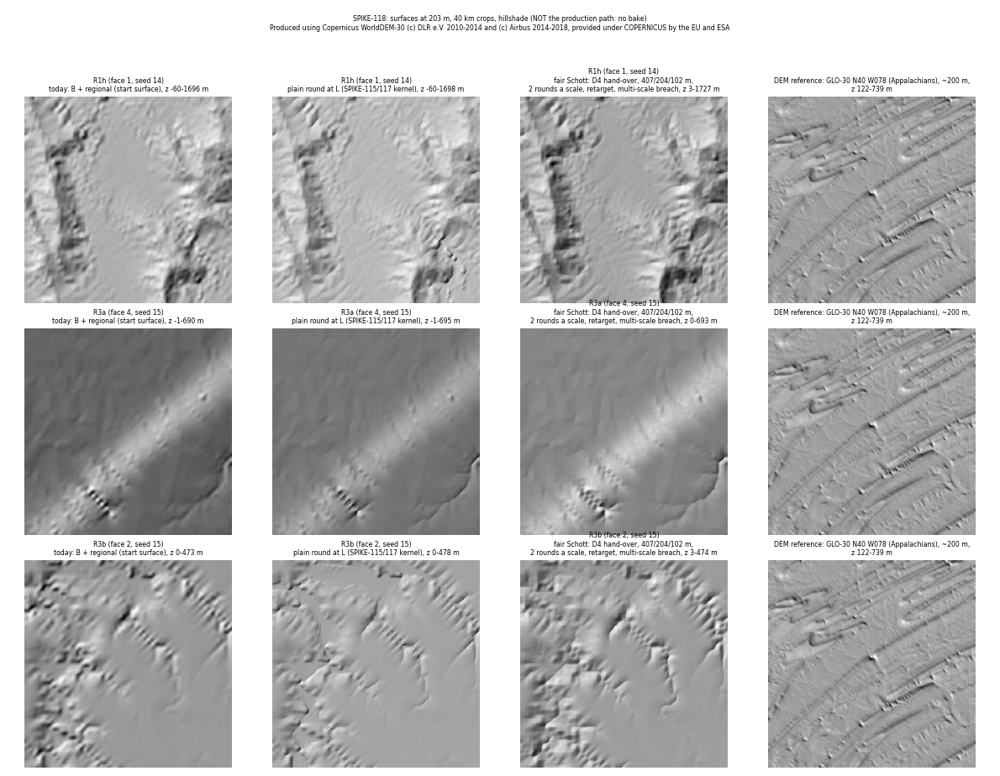
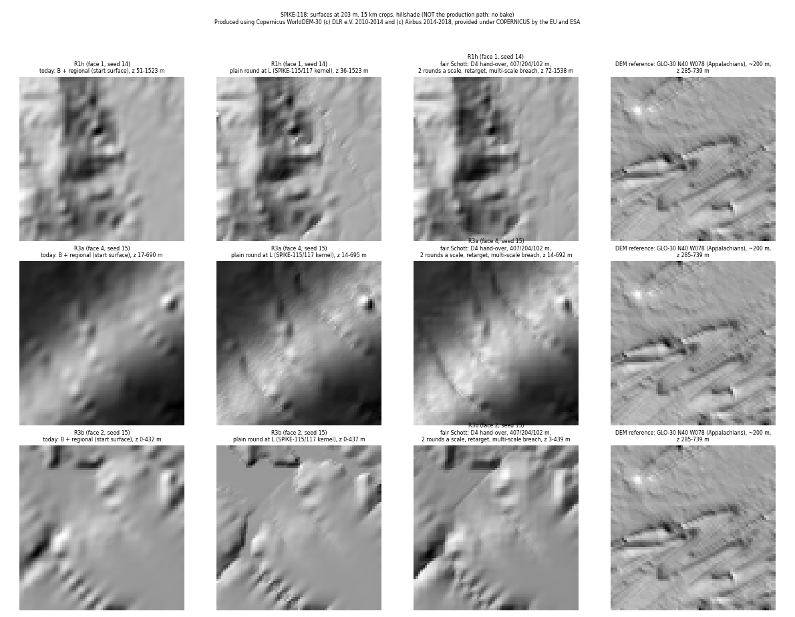

# SPIKE-118: Schott 2024, done fairly, against "4-neighbour drain plus one round at L"

Opened: 2026-11-14
Question: does Schott 2024's multi-scale pipeline, run as the paper runs it, beat "4-neighbour drain plus one round at L" on the river bars, and what of the paper transfers?
Why it matters: SPIKE-115 ran Schott 2024's multi-scale step with one parameter set for all scales and no retargeting; it over-eroded. ADR 0123 picks the L round; this run checks that the paper was not dismissed on an unfair test (P3 E1, lead 2026-11-14, order #116).
Time box: 1 day of agent work (about 5 h used).
Success criteria: on R1h, R3a and R3b, SPIKE-117's metric (agreed with crusader): basins, canyons over 50 m, lakes at D = 20 m, relief at 200 m-1 km, axis share, cost a region; a picture sheet beside SPIKE-117's result and a DEM.
Fallback if it fails: ADR 0123 as drafted (one round at L).
Code location: branch `spike/schott-fair` @ 71667d3a (from `spike/drain-base`; local, never merged). Example `crates/cache/examples/drain_base.rs`, switches `PLANET_SCHOTT=1`, `PLANET_ROUND_L=1`, `PLANET_TRANSFER=d4`.

## Answer
**No.** Schott 2024 done fairly drains completely (0.00 % basins on all three windows) but does not beat "4-neighbour drain plus one round at L": both meet every bar, and Schott costs 2-5 times the round (344-387 s against 68-199 s on this probe), adds more relief and carves valleys up to 255 m under its start surface; it is better only on the residual basins (0.00 % against 0.00-2.06 %) and on the axis share (46-57 % against 50-69 %), which one round at L alone already meets (43-47 %, basins 0.98-4.54 %).

## Method
- **Start:** SPIKE-116's 4-neighbour hand-over (`PLANET_TRANSFER=d4`): the solved 814 m surface breached over 4 neighbours, read bilinearly at L, B's residual damped near channels over 400 m, land floored at sea + 5 mm. This is also the start of "D4 + round".
- **Per-scale pipeline (the paper's structure):**
  1. Scales 407, 204 and 101.8 m (L). The coarsest scale starts from the hand-over averaged to 407 m.
  2. Each finer scale starts from the coarser result upsampled bilinearly, plus the hand-over's detail band between the two scales.
  3. Per-scale parameters: the regional kernel (`solve_rounds`, implicit stream power) with `k_dt` scaled by cell / 814 m (K x 0.5, 0.25, 0.125), no uplift.
  4. Toward steady state: up to N rounds a scale, stop when the mean |dz| < 0.1 m. N = 2 (main setting) and N = 4.
  5. Elevation retargeting after each round: t += boxblur² (input - t, radius 4), so the large forms stay the input's.
  6. Finish: a multi-scale breach (radii 8, 4, 2, 1 cells with box-blurred breach differences), then a plain breach.
- CPU, deterministic (the regional kernel and priority floods; 8 threads).
- **Metric (SPIKE-117, agreed with crusader):**
  - basins: river cells on a depression at least 0.5 m deep and 16 L cells, under a priority flood with epsilon 1e-7 m a cell;
  - canyon: the cut over 50 m with every pit breached (D = infinity), and lakes with pits over 20 m kept (D = 20 m), each on the final surface;
  - lowered: river cells under the hand-over by over 50 m (Schott only: how deep the pipeline carves);
  - axis: the share of channel steps along a grid axis;
  - relief: p50 of the height range in 2 x 2 (200 m) and 10 x 10 (1 km) windows on land, against today (`B + regional`).
- "Round only" was re-run on this probe with SPIKE-117's parameters (`PLANET_ROUND_L=1`); "D4 + round" is SPIKE-117's (crusader's probe, same windows and metric).

## Numbers (inside the region's 620-cell cores, margin 200)
| Window | variant | basins (bar 10 %) | canyon > 50 m (bar 1 %) | lakes D = 20 m | relief 200 m / 1 km | axis share | river cells lowered > 50 m | wall a region |
|---|---|---|---|---|---|---|---|---|
| R1h | today | 67.34 % | 8.18 % | 47.69 % | 100 / 100 % | 47.2 % | - | 152 s |
| R1h | round only | 0.98 % | 0 % | 0 % | 114 / 112 % | 47.4 % | - | 517 s (round 68 s) |
| R1h | D4 + round (SPIKE-117) | 2.06 % | 0 % | 0 % | 115 / 110 % | 66.5 % | - | D4 71-83 s + round 63-77 s |
| R1h | Schott, 2 rounds a scale | 0.00 % | 0 % | 0 % | 121 / 115 % | 56.7 % | 20.73 % (max 255 m) | 583 s (pipeline 344 s) |
| R1h | Schott, 4 rounds a scale | 0.00 % | 0 % | 0 % | band +39 %, 1 km 140 % | - | 34.17 % (max 330 m) | 798 s |
| R3a | today | 53.55 % | 0.01 % | 1.63 % | 100 / 100 % | 44.4 % | - | 175 s |
| R3a | round only | 1.78 % | 0 % | 0 % | 122 / 118 % | 42.6 % | - | 561 s (round 191 s) |
| R3a | D4 + round (SPIKE-117) | 0.00 % | 0 % | 0 % | 121 / 117 % | 50.2 % | - | as R1h |
| R3a | Schott, 2 rounds | 0.00 % | 0 % | 0 % | 119 / 109 % | 46.1 % | 1.41 % (max 162 m) | 607 s (pipeline 360 s) |
| R3a | Schott, 4 rounds | 0.00 % | 0 % | 0 % (1 mm count 54.8 %, flats) | band +130 %, 1 km 124 % | - | 3.22 % | 776 s |
| R3b | today | 62.35 % | 1.15 % | 25.34 % | 100 / 100 % | 45.9 % | - | 184 s |
| R3b | round only | 4.54 % | 0 % | 0 % | 113 / 113 % | 45.5 % | - | 544 s (round 199 s) |
| R3b | D4 + round (SPIKE-117) | 0.20 % | 0 % | 0 % | 110 / 110 % | 68.6 % | - | as R1h |
| R3b | Schott, 2 rounds | 0.00 % | 0 % | 0 % | 123 / 117 % | 53.5 % | 5.55 % (max 120 m) | 675 s (pipeline 387 s) |
| R3b | Schott, 4 rounds | 0.00 % | 0 % | 0 % | band +64 %, 1 km 147 % | - | 21.20 % | 884 s |

- Wall times on this probe include the regional front (about 40 s) and a sampling and routing pass for the metric (about 300-500 s), equal for all variants; compare the pipeline and round columns.
- Relief for the 4-round runs is the band std and the 1 km block p50 against today (the 2 x 2 / 10 x 10 line came later).
- Schott per scale (R1h, 2 rounds): 407 m 6 s (last mean |dz| 11.0 m), 204 m 29 s (3.8 m), 101.8 m 143 s (1.3 m), breach 166 s. R3a and R3b: last mean |dz| 2.4-2.5 m, 0.8-0.9 m, 0.3 m.
- No scale reached the 0.1 m steady-state tolerance in 2 or 4 rounds; on R1h the 407 m change stays at 11 m a round. More rounds deepen the valleys (river cells lowered over 50 m 20.7 % → 34.2 % on R1h).

## Reading
- **Drainage:** Schott's final multi-scale breach drains by construction (0.00 % on every window and every N). The L round leaves 1-5 % basins, under the 10 % bar.
- **Axis bias:** Schott's rounds at 407 and 204 m soften the 4-neighbour hand-over's axis bias (56.7 % and 53.5 % against D4 + round's 66.5 % and 68.6 %), but do not remove it: one round at L alone stays at B's 43-47 %.
- **Over-erosion:** without uplift the implicit stream-power kernel keeps cutting toward base level; on hilly ground (R1h) a fifth of the river cells end over 50 m under the start. Retargeting keeps the large forms but not the valley floors. The paper's steady state assumes uplift balanced against erosion; with the planet's uplift field unknown at L (the regional solve's uplift is spent at 814 m), the pipeline has no stop but the round count.
- **Relief:** Schott raises the 200 m band by 19-23 % at 2 rounds, more than the round (13-22 %) and D4 + round (10-21 %); DEM relief is not the target, but more is not closer.
- **Cost:** the pipeline costs 344-387 s a region on CPU against 68-199 s for one round at L on this probe (63-77 s on SPIKE-117's); an edit re-runs all three scales and both breaches over the dirty region (no local path), against SPIKE-117's 0.02-0.31 s round over the dirty catchments.

## What transfers
- **The final multi-scale breach** (radii 8 to 1 with blurred breach differences): it drains completely at moderate change. Candidate for the residual 1-5 % basins after the L round, if the bar tightens.
- **Elevation retargeting** (blurred difference to the input): keeps an eroded surface on the regional forms; useful wherever a round at L must not drift from H1 at the region edge.
- **Per-scale K scaling** by cell size: needed whenever one kernel runs at several resolutions.
- **Coarse-to-fine as a breach structure, not as erosion:** routing order coarse to fine is the same idea as SPIKE-116's hand-over.

## What blocks
- **No uplift at L:** the paper's steady state balances uplift and erosion; this pipeline's regional uplift is spent at 814 m, so at finer scales the kernel only cuts, and the result depends on the round count, not on a steady state.
- **Cost on CPU:** 2-5 times one round at L; CON-28 keeps the authoritative surface on the CPU, while the paper's interactive rates come from the GPU.
- **Edits:** the paper recomputes the whole pyramid; this application needs a local edit path (Barnes 2016 plus the round over the dirty catchments, SPIKE-115 and SPIKE-117), which a global multi-scale pass does not have.
- **Scale range:** the paper's scales span a single terrain tile; here the 814 m solve already covers the coarse scales, so only 407-101.8 m remain, where the kernel is weakest at its job (relief shaping) and strongest at its fault (valley cutting).

## Visuals

Hillshade at 203 m (every 2nd L cell), 40 km crops chosen for the largest relief: today, plain round at L, Schott (2 rounds a scale), and the GLO-30 DEM (N40 W078) at about 200 m. CPU probe, not the production path (no bake).

The same at 15 km crops.

- At 40 km the three surfaces differ little: both erosion variants sharpen the valley floors of today's start; Schott's valleys on R1h are deeper and wider.
- At 15 km on R3b the plain round leaves straight-edged flats (breached floors), and Schott leaves a straight diagonal step from its 407 m scale. Neither shows the DEM's ridge-and-valley texture; that texture is not in B at sub-km scales (SPIKE-116).
- Logs of every run (lock lines removed): `logs/run-<window>-<variant>.txt` (today, hand = hand-over alone, s2 = Schott 2 rounds, schott4 = 4 rounds, round = plain round).

Produced using Copernicus WorldDEM-30 © DLR e.V. 2010-2014 and © Airbus 2014-2018, provided under COPERNICUS by the European Union and ESA; all rights reserved.
