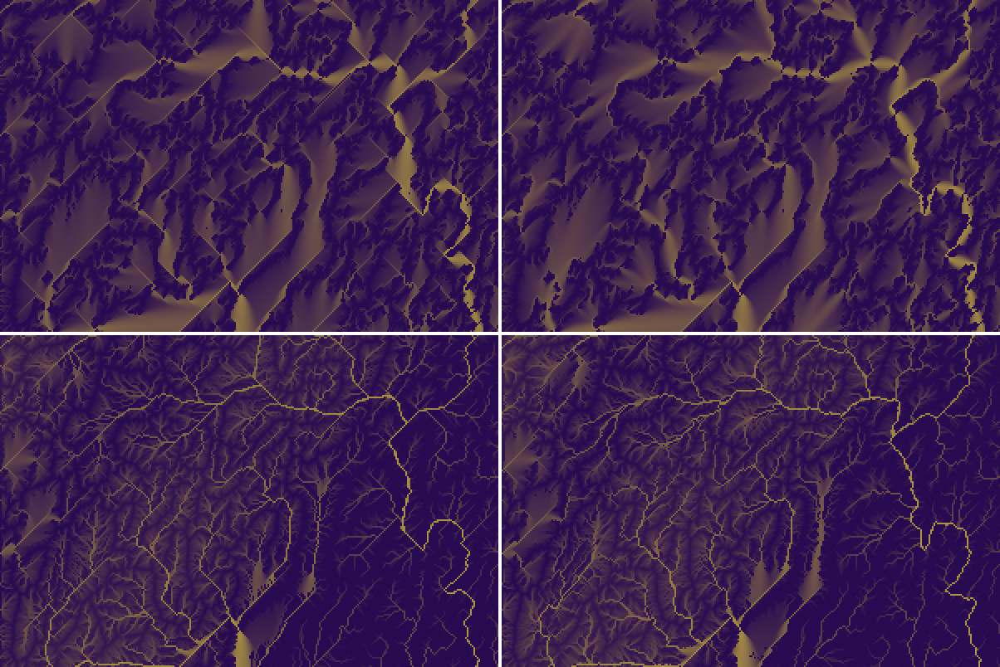

# SPIKE-108 follow-up (1): (b) and (c) re-run after GEN-173 (flats graded by distance to the pour points)

Run 2026-11-12 (architect's follow-up, relayed by the bulldozer): re-run the orientation chords (b) and the straight runs (c) on R1, R3a and R3b on main 1041d28c (GEN-172 and GEN-173 in). Pass bar (architect): within 1.5x of the DEM on the diagonals and within 2x on the runs. Numbers and images; the verdict is the architect's. Run by the spikes lane.

Probe: `shapes_check` as in `results.md` (same definitions, fixtures and DEM pools), on the local branch `spike/spike-108-rerun` (never pushed): `CarveParams::window_cut = true` added for the window runs. The DEM is routed again with the new flood (its flats are graded the same way), so the DEM figures differ from `results.md`; both columns are given. Release build, BelowNormal, 8 threads, CPU load 2 to 76 % at the starts (other sessions' builds). Statistics derived from Copernicus DEM GLO-30: produced using Copernicus WorldDEM-30 © DLR e.V. 2010-2014 and © Airbus Defence and Space GmbH 2014-2018 provided under COPERNICUS by the European Union and ESA; all rights reserved. The organisations in charge of the Copernicus programme by law or by delegation do not incur any liability for any use of the Copernicus WorldDEM-30. Raw: `raw-gen173/`.

## 1. Result in numbers (generator after 4 rounds under U, against the matched DEM pool)

"Before" is `results.md` (main b8c5bbb5, chessboard-graded flats). Pools: high-relief (8 tiles) for R1 (box 620 cells), mid-relief (4 tiles) for R3a and R3b.

| Measure | R1h before | R1h now | R3a before | R3a now | R3b before | R3b now |
|---|---|---|---|---|---|---|
| Chord 8, share within 2.5 deg of 45/135: generator | 0.0747 | 0.0560 | 0.1159 | 0.1074 | 0.0646 | 0.0518 |
| same, DEM pool before / now | 0.0582 / 0.0546 | | 0.0386 / 0.0394 | | 0.0386 / 0.0394 | |
| Ratio, chord 8 diagonal 2.5 deg | 1.28 | 1.03 | 3.00 | 2.73 | 1.67 | 1.31 |
| Ratio, chord 16 diagonal 2.5 deg | 1.12 | 0.63 | 4.71 | 4.04 | 1.79 | 1.32 |
| Ratio, chord 8 diagonal 5 deg | 1.09 | 0.90 | 2.73 | 2.56 | 1.70 | 1.42 |
| Ratio, chord 16 diagonal 5 deg | 1.11 | 0.87 | 3.03 | 3.17 | 1.65 | 1.56 |
| Ratio, chord 8 axis 2.5 deg | 1.09 | 1.14 | 0.82 | 0.78 | 0.98 | 0.98 |
| Channel length in runs > 10 cells: generator | 0.0725 | 0.0232 | 0.1133 | 0.0700 | 0.0510 | 0.0205 |
| same, DEM pool before / now | 0.0263 / 0.0070 | | 0.0113 / 0.0113 | | 0.0113 / 0.0113 | |
| Ratio, runs > 10 | 2.76 | 3.31 | 10.0 | 6.19 | 4.5 | 1.81 |
| Channel length in runs > 20 cells: generator | 0.0216 | 0.0045 | 0.0574 | 0.0390 | 0.0131 | 0.0045 |
| same, DEM pool before / now | 0.0095 / 0.0000 | | 0.0000 / 0.0000 | | 0.0000 / 0.0000 | |
| Ratio, runs > 20 | 2.27 | not defined (DEM 0) | not defined | not defined | not defined | not defined |

- The ratios of the "before" columns are those of `results.md` (R1h = its box column). All-15-tile DEM pool, now: diagonal chord 8 0.0489, chord 16 0.0444; runs > 10 0.0090, runs > 20 0.0000 (8,480 channel steps); against it the run ratios (runs > 10) are R1h 2.6, R3a 7.8, R3b 2.3.
- Against the bar of the order: diagonals within 1.5x on all four ratios of R1h (0.63 to 1.03); R3b 1.31 to 1.56 (the last, chord 16 at 5 degrees, is over 1.5x); R3a 2.56 to 4.04. Runs within 2x: R3b 1.81 (R3b over the all-tile pool 2.3); R1h 3.31 (2.6 over all tiles); R3a 6.19.
- C against U (routed C): the same within 0.0004 on the diagonal chord shares and 0.0002 on the run shares in all three (R3b C 0.0515 and 0.0207; R3a 0.1071 and 0.0699; R1h 0.0560 and 0.0231).
- The DEM's own straight runs fell in the high-relief pool (0.0263 to 0.0070) and stayed in the mid pool (0.0113); the lifted-flat share of its channel steps is 0.56 (0.52 before) and 0.33 (0.32): the run ratios of R1h move with that denominator. The DEM run shares are small (0.7 to 1.1 % of 3,400 to 4,200 channel steps).

## 2. The flats

Start surface z0 (lifted by the fill, % of land: unchanged by construction): R1h 36.28, R3a 25.45, R3b 26.71. After the 4 rounds (lifted >= 0.5 mm, % of land) now (before): R1h 1.74 (1.83), R3a 7.01 (6.61), R3b 2.92 (2.87).

| Measure | R1h | R3a | R3b |
|---|---|---|---|
| Lifted cells after the rounds still on the chessboard rule (level = lowest neighbour + epsilon) | 32.9 % | 61.7 % | 77.8 % |
| Largest lifted component after the rounds (cells) | 10,337 | 10,622 | 37,744 |
| Channel steps on lifted cells, after the rounds now (before) | 0.183 (0.182) | 0.551 (0.511) | 0.267 (0.260) |
| Channel length in runs > 10 on those steps, now (before) | 0.0127 (0.1068) | 0.1131 (0.1880) | 0.0415 (0.0636) |
| z0: channel length in runs > 10 now (before) | 0.0186 (0.0542) | 0.0510 (0.0914) | 0.0142 (0.0325) |
| z0: channel length in runs > 20 now (before) | 0.0060 (0.0197) | 0.0303 (0.0494) | 0.0025 (0.0089) |

- GEN-173 regrades a flat of at most 127 cells that does not touch the grid border; larger flats keep the chessboard grade. R3a and R3b keep large lifted components (up to 37,744 cells) and a larger share of their lifted cells on the chessboard rule; R3a has the largest remaining straight-run share on its flats (0.113 of the channel length on lifted cells in runs over 10 cells).
- R3a's lifted cells after the rounds are mostly flat at the sea level (`results-pits.md`: components of over 300 cells less than 1 m deep, 4.6 % of land).


Left part of the owner's region (sheet pixels x 0-299, y 560-759, doubled): top `round-00-area`, bottom `h1-area`; left main b8c5bbb5, right main 1041d28c. The diamonds of round 0 are fans now; the H1 sheet has far fewer straight lines, but a long straight diagonal remains (bottom, near x 280 to 300).

## 3. Caveats

- One seed per region; the DEM pools are 3,400 to 4,200 channel steps (8,480 over all 15 tiles) and the DEM's straight-run shares are 0.7 to 1.1 %, so the run ratios rest on about 30 to 40 km of DEM channel.
- R1h is the 620-cell box at margin 200 (the whole 1,420 window was not re-run).
- The probe measures the surface after the 4 rounds, before the sediment pass and the H1 pass; the sheet comparison is the H1 stage.

## 4. Reproduce

```
cargo build --release -p planet-generators --example shapes_check        # from spike/spike-108-rerun (adds window_cut: true)
PLANET_WIN=1,12288,8056,8675,760,1379,14 PLANET_MARGIN=200 shapes_check gen 8      # R1h; R3a: 4,12288,168,1187,4520,5539,15; R3b: 2,12288,9768,10787,8104,9123,15
shapes_check dem          # PLANET_SLOPE=0.2,0.7 (high) or 0.03,0.14 (mid)
region_scale mem 400 8    # the stage sheets
```

## 5. Addendum: counts per direction (architect, 2026-11-12)

Added on the bulldozer's order: the channel steps and the straight runs over 10 cells per D8 direction (four diagonals, two axes), after GEN-173, on the same surfaces as section 1 (U after 4 rounds, box counted; margin 200). Probe `shapes_check dirs` and `dirsdem` on the local branch `spike/spike-108-rerun`. Raw: `raw-gen173/dirs-*.txt`. Directions as (di, dj) with j growing downwards: W (-1, 0), E (1, 0), N (0, -1), S (0, 1), NW (-1, -1), NE (1, -1), SW (-1, 1), SE (1, 1). A run is counted once, at its head; "run length" is the length of channel in runs over 10 cells (diagonal steps weigh sqrt 2) over the channel length; "on lifted cells" is the share of that length on cells the fill raised.

| Set | Steps by direction, share (W / E / N / S / NW / NE / SW / SE) | Runs over 10 cells by direction (count) | Run length / channel length by direction | Mean step vector (i, j) |
|---|---|---|---|---|
| R1h | 0.071 / 0.148 / 0.030 / 0.263 / 0.026 / 0.086 / 0.214 / 0.162 | 5 / 6 / 0 / 3 / 1 / 2 / 6 / 2 (25) | 0.0030 / 0.0051 / 0 / 0.0017 / 0.0009 / 0.0017 / 0.0078 / 0.0029 | (+0.09, +0.50) |
| R3a | 0.157 / 0.054 / 0.150 / 0.130 / 0.213 / 0.079 / 0.133 / 0.083 | 3 / 3 / 13 / 19 / 53 / 1 / 4 / 19 (115) | 0.0006 / 0.0006 / 0.0028 / 0.0048 / 0.0498 / 0.0003 / 0.0017 / 0.0093 | (-0.29, -0.10) |
| R3b | 0.032 / 0.258 / 0.098 / 0.117 / 0.028 / 0.220 / 0.090 / 0.157 | 0 / 25 / 11 / 11 / 1 / 24 / 2 / 14 (88) | 0 / 0.0041 / 0.0016 / 0.0018 / 0.0003 / 0.0077 / 0.0007 / 0.0043 | (+0.49, +0.02) |
| DEM high pool (8 tiles) | 0.110 / 0.156 / 0.167 / 0.107 / 0.107 / 0.185 / 0.097 / 0.072 | 1 / 1 / 0 / 1 / 0 / 0 / 0 / 0 (3) | up to 0.0024 | (+0.10, -0.18) |
| DEM mid pool (4 tiles) | 0.115 / 0.090 / 0.104 / 0.269 / 0.077 / 0.050 / 0.201 / 0.095 | 0 / 1 / 2 / 0 / 0 / 0 / 0 / 0 (3) | up to 0.0079 | (-0.16, +0.33) |
| DEM all 15 tiles | 0.127 / 0.122 / 0.137 / 0.169 / 0.110 / 0.121 / 0.135 / 0.078 | 1 / 2 / 2 / 1 / 1 / 0 / 0 / 0 (7) | up to 0.0032 | (-0.05, +0.01) |

- Grouped (steps / runs): R1h horizontal 0.219 / 11, vertical 0.294 / 3, NW-SE diagonals 0.188 / 3, NE-SW diagonals 0.300 / 8; R3a horizontal 0.211 / 6, vertical 0.281 / 32, NW-SE 0.297 / 72, NE-SW 0.212 / 5; R3b horizontal 0.289 / 25, vertical 0.215 / 22, NW-SE 0.186 / 15, NE-SW 0.310 / 26.
- One diagonal dominates the long runs of R3a: NW has 53 of the 115 runs and 0.0498 of the channel length in runs (SE has 19 and 0.0093; the other two diagonals 5 runs together). R1h has no dominant diagonal (SW 6 runs, SE 2, NW 1, NE 2; the runs are spread over W, E, SW); R3b's runs are NE 24, E 25, SE 14.
- The dominant direction follows the mean flow of the box: R3a's mean step vector is (-0.29, -0.10) (towards the west-north-west, NW dominant), R3b's (+0.49, +0.02) (towards the east, E and NE dominant), R1h's (+0.09, +0.50) (towards the south, S, SW and SE). The dominant diagonal differs between the three regions, so it is not one fixed grid direction.
- R3a's NW runs lie on the flats: 95 % of their length is on cells the fill raised (all runs in W, NE: 100 %; the SE runs 83 %); 75.6 % of all NW steps are on lifted cells (R3a overall 55 %). R3a's lifted components reach 10,622 cells, beyond the 127-cell limit of the regrade (section 2), and 61.7 % of its lifted cells are still on the chessboard rule. In R3b the run length on lifted cells is 50 to 69 % for E and NE; in R1h it is 25 to 31 % for E and SE.
- The DEM pools hold 3 to 7 runs over 10 cells (4,217, 3,459 and 8,480 channel steps), so no direction can be compared there beyond the steps: the DEM's step shares are within 0.05 to 0.27 per direction with no direction above 0.27 (the mid pool's S 0.269) and the diagonal steps 0.17 to 0.28 per group.
- U and C give the same counts within 1 per direction (raw).
